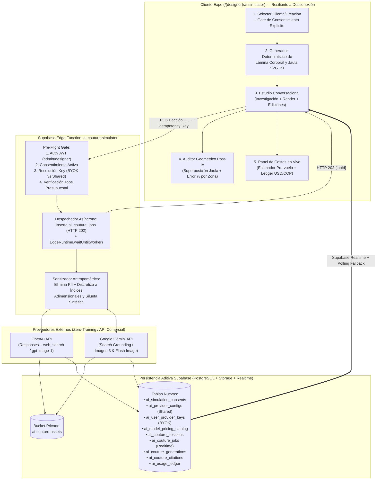

# Arquitectura Refinada y Especificación de MVP: **AI Haute Couture Simulator (v2.0)**

**Estado:** Auditoría y diseño en modo **100% lectura** sobre código/BD existentes (`0` archivos de código/BD modificados; M00–M07, Flujo B de M02, [`src/components/mannequin3d/`](file:///d:/Datos/Datos/DATOS%20JVINAS/Antigravity/2.ByKatherineCarroll/AtelierDigitalApp/src/components/mannequin3d/Mannequin3DViewer.tsx) y [`poc-simulador-3d/`](file:///d:/Datos/Datos/DATOS%20JVINAS/Antigravity/2.ByKatherineCarroll/AtelierDigitalApp/poc-simulador-3d/T5_2_CORRECTIVE_BENCHMARK.md) intactos).

---

## 1. Diferenciación Estricta: Capacidades Verificadas vs. Propuestas del Nuevo Módulo

| Componente / Capacidad | Estado Actual en Repositorio (Verificado) | Propuesta para `AI Haute Couture Simulator` (Pendiente de Implementación) |
|---|---|---|
| **Medidas y validación demográfica (M02)** | **Verificado:** [`masterCatalog.ts`](file:///d:/Datos/Datos/DATOS%20JVINAS/Antigravity/2.ByKatherineCarroll/AtelierDigitalApp/src/engine/pattern/catalog/masterCatalog.ts), [`measurementService.ts`](file:///d:/Datos/Datos/DATOS%20JVINAS/Antigravity/2.ByKatherineCarroll/AtelierDigitalApp/src/services/measurementService.ts) y [`demographicCadValidator.ts`](file:///d:/Datos/Datos/DATOS%20JVINAS/Antigravity/2.ByKatherineCarroll/AtelierDigitalApp/src/services/demographicCadValidator.ts) almacenan y validan cotas en `mm`. | Lectura no destructiva para generar la **Lámina Corporal Proporcional Calibrada** y la **Jaula de Verificación Geométrica Post-IA**. |
| **Diseño, Moodboard y Materiales (M03–M05)** | **Verificado:** [`designService.ts`](file:///d:/Datos/Datos/DATOS%20JVINAS/Antigravity/2.ByKatherineCarroll/AtelierDigitalApp/src/services/designService.ts) y [`commercialService.ts`](file:///d:/Datos/Datos/DATOS%20JVINAS/Antigravity/2.ByKatherineCarroll/AtelierDigitalApp/src/services/commercialService.ts) persisten silueta, escote, manga, paleta HEX, `weight_gsm`, `drape_profile` y TRM manual (`atelier_currency_rates`). | Compilador Sartorial que traduce estos metadatos estructurados en prompts técnicos y convierte costos USD de IA a COP usando la TRM manual de M05. |
| **Consentimientos y Transparencia IA (M00)** | **Verificado:** [`user_legal_consents`](file:///d:/Datos/Datos/DATOS%20JVINAS/Antigravity/2.ByKatherineCarroll/AtelierDigitalApp/supabase/migrations/20261028090000_user_legal_consents.sql) aplica a usuarios en `auth.users`, y [`app/ia-transparencia.tsx`](file:///d:/Datos/Datos/DATOS%20JVINAS/Antigravity/2.ByKatherineCarroll/AtelierDigitalApp/app/ia-transparencia.tsx#L36-L64) declara procesamiento 100% local sin envío de medidas a terceros. | Nueva tabla `public.ai_simulation_consents` por clienta/persona (`M01`) + actualización a versión `2.0` de [`legalDocuments.ts`](file:///d:/Datos/Datos/DATOS%20JVINAS/Antigravity/2.ByKatherineCarroll/AtelierDigitalApp/src/constants/legalDocuments.ts) + modo Sandbox con presets si no hay consentimiento. |
| **Copiloto IA ([`aiCopilotService.ts`](file:///d:/Datos/Datos/DATOS%20JVINAS/Antigravity/2.ByKatherineCarroll/AtelierDigitalApp/src/services/aiCopilotService.ts))** | **Verificado:** Heurística local determinística (`isConfigured: false`), sin llamadas externas ni claves. | Se mantiene intacto para M02. El nuevo simulador tendrá su propio servicio (`aiCoutureSimulatorService.ts`) y Edge Function (`ai-couture-simulator`). |

---

## 2. Arquitectura Revisada del Sistema (Incorporando los 5 Requisitos Obligatorios)

---

## 3. Alcance Concreto del MVP Funcional y Flujo Completo de Datos

El MVP se acota a un **flujo de 5 pasos de extremo a extremo** dentro de la nueva pantalla independiente `app/(designer)/ai-simulator.tsx`:

1. **Paso 1 — Selección de Sujeto y Compuerta de Consentimiento:**
   - La diseñadora selecciona: **(a)** una Clienta/Persona real (`M01`) y su Creación activa (`M03`), o **(b)** uno de los 4 Presets de Silueta del Atelier ([`FEMALE_SILHOUETTE_PRESETS`](file:///d:/Datos/Datos/DATOS%20JVINAS/Antigravity/2.ByKatherineCarroll/AtelierDigitalApp/src/components/mannequin3d/types.ts#L89-L114)).
   - Si selecciona una clienta real, el sistema verifica en `public.ai_simulation_consents` que exista un consentimiento vigente (`status = 'granted'`). Si no existe, abre el modal de registro de consentimiento explícito o permite continuar únicamente usando un Preset sintético.
2. **Paso 2 — Recuperación de Contexto (M02 + M04 + M05) y Silueta Proporcional:**
   - Lee en solo lectura la sesión de medidas verificada (`M02`), los códigos de silueta/escote/manga y paleta (`M04`) y el material principal con `weight_gsm`, `drape_profile` y `composition` (`M05`).
   - Construye localmente la **Lámina Corporal Proporcional Calibrada** (vista frontal y 3/4 con anillos métricos en busto, cintura, cadera, hombros y largo de talle) sin tocar `src/components/mannequin3d/`.
3. **Paso 3 — Investigación Contextual y de Materiales (Asíncrona con Citas):**
   - La diseñadora lanza una consulta (ej. *"Analizar comportamiento de caída y entretelas recomendadas para mikado de seda 280 gsm en silueta reloj de arena con escote corazón"*).
   - El worker consulta el contexto interno + búsqueda web con grounding (OpenAI o Gemini), devolviendo recomendaciones estructuradas con **citas clicables verificadas** (`url`, `title`, `domain`, `retrieved_at`).
4. **Paso 4 — Primera Generación Fotorrealista Guiada por Proporción:**
   - Muestra el costo estimado previo en USD/COP. Al confirmar, encola el trabajo asíncrono (`HTTP 202`) enviando la lámina proporcional + prompt sartorial compilado.
   - Al completarse, guarda la imagen en `ai-couture-assets` (`v1`) y ejecuta la **Validación Geométrica Post-IA** (Sección 4).
5. **Paso 5 — Modificaciones Conversacionales Iterativas (`v1 → v2 → vn`):**
   - La diseñadora pide ajustes en lenguaje natural (ej. *"Transforma el escote a barco sobre clavícula, agrega manga tres cuartos en organza traslúcida y cambia el tono principal a Azul Petróleo #1B4D5C"*) o marca una zona en el canvas.
   - Cada modificación toma como entrada la imagen de la versión padre (`parent_generation_id`) + la lámina proporcional, generando una nueva rama inmutable en el historial y permitiendo promover cualquier versión al Moodboard de `M04` con 1 clic (`createMoodboardItem`).

---

## 4. Requisito 1: Mecanismo de Fidelidad y Validación Geométrica Verificable

Dado que **ningún modelo generativo externo garantiza precisión milimétrica por sí solo**, el simulador implementa un protocolo de **Verdad Geométrica en 3 Capas**:

1. **Capa 1 — Construcción Determinística de la "Jaula Antropométrica" (`CanonicalBodyCage`):**
   - En un lienzo normalizado de `1024 × 1536 px` con escala métrica fija $\kappa = 0.75\text{ px/mm}$ (donde `1680 mm` equivalen exactamente a `1260 px` verticales), se calculan a partir de [`masterCatalog.ts`](file:///d:/Datos/Datos/DATOS%20JVINAS/Antigravity/2.ByKatherineCarroll/AtelierDigitalApp/src/engine/pattern/catalog/masterCatalog.ts) y del modelo elíptico de [`mannequinMeshBuilder.ts`](file:///d:/Datos/Datos/DATOS%20JVINAS/Antigravity/2.ByKatherineCarroll/AtelierDigitalApp/src/components/mannequin3d/mannequinMeshBuilder.ts) los anchos transversales exactos del cuerpo y de la prenda con holgura (`STANDARD_EASE_PROFILES`):
     - Semiancho biacromial: $R_{\text{hombro}} = \frac{\text{ancho\_espalda}}{2}$
     - Semiejes frontales en busto, cintura y cadera: $R_x(z) = \frac{C_z + E_z}{2\pi \cdot \phi_z}$ (donde $C_z$ es el contorno en `mm`, $E_z$ la holgura del perfil seleccionado y $\phi_z$ el factor de excentricidad anatómica delantero/espalda).
     - Alturas exactas: $Y_{\text{cuello}}, Y_{\text{busto}}, Y_{\text{cintura}} = Y_{\text{cuello}} - \text{largo\_talle\_delantero}, Y_{\text{cadera}}$.
2. **Capa 2 — Condicionamiento Visual de Entrada:**
   - La imagen PNG de esta silueta proporcional (maniquí de sastre a escala exacta dentro del lienzo `1024 × 1536`) se pasa como **imagen base de referencia** al endpoint de edición/generación multimodal junto con las razones adimensionales ($\text{WHR} = C_{\text{cintura}}/C_{\text{cadera}}$, $\text{WBR} = C_{\text{cintura}}/C_{\text{busto}}$).
3. **Capa 3 — Auditoría Cuantitativa Post-Generación y Superposición Visual (`GeometricFidelityAudit`):**
   - **Superposición Interactiva en UI:** El visor renderiza sobre la imagen fotorrealista una capa vectorial SVG conmutable (*"Ver Cintas y Jaula Antropométrica 1:1"*) que dibuja las cotas reales en `cm` de la clienta sobre hombros, busto, cintura y cadera.
   - **Medición Automática de Desviación ($\varepsilon_z$):** Un analizador de silueta sobre el buffer de la imagen generada mide el ancho horizontal de la prenda en las ordenadas $Y_{\text{hombro}}, Y_{\text{busto}}, Y_{\text{cintura}}, Y_{\text{cadera}}$ (para zonas entalladas según la silueta de `M04`) y calcula el error relativo respecto al ancho objetivo $W_{\text{obj}}(Y_z)$:
     $$\varepsilon_z = \frac{|W_{\text{render}}(Y_z) - W_{\text{obj}}(Y_z)|}{W_{\text{obj}}(Y_z)} \times 100\%$$
   - **Resultado Persistido en `ai_couture_generations.geometric_audit`:**
     - Si $\max(\varepsilon_{\text{busto}}, \varepsilon_{\text{cintura}}, \varepsilon_{\text{cadera}}) \le 6\%$ en zonas ceñidas: **`FIDELITY_PASS`**.
     - Si $> 6\%$: marca **`PROPORTION_DRIFT_WARNING`**, señala visualmente en qué cota la IA estilizó o ensanchó de más la figura y habilita un botón de *"Re-ajustar a Jaula Corporal"*.
   - **Aviso Permanente en UI y Exportación:** Toda imagen lleva metadato y sello visible: *"Simulación Visual de Referencia — No sustituye el patrón CAD 1:1 (M02) ni la prueba física de calce (M06)"*.

---

## 5. Requisito 2: Política de Privacidad, Minimización Antropométrica y Consentimiento Explícito

Las medidas corporales detalladas **no se tratan como datos automáticamente inocuos**: combinadas con el contexto de un atelier de autor pueden re-identificar a una persona o revelar rasgos físicos sensibles (Ley 1581 de 2012).

1. **Compuerta de Consentimiento Explícito (`public.ai_simulation_consents`):**
   - Como las clientas en `public.clients` y `public.persons` (`M01`) no tienen necesariamente usuario en `auth.users` (a diferencia de [`user_legal_consents`](file:///d:/Datos/Datos/DATOS%20JVINAS/Antigravity/2.ByKatherineCarroll/AtelierDigitalApp/supabase/migrations/20261028090000_user_legal_consents.sql)), se crea `public.ai_simulation_consents`:
     - Campos: `id`, `client_id`, `person_id`, `creation_id`, `consent_scope` (`'PROPORTIONS_ONLY'` | `'PROPORTIONS_AND_DESIGN_SKETCHES'`), `collection_channel` (`'in_person_signed'` | `'digital_acceptance'` | `'atelier_documented'`), `policy_version` (`'2.0'`), `status` (`'granted'` | `'revoked'`), `granted_at`, `revoked_at`, `recorded_by`.
   - **Bloqueo en Edge Function:** La Edge Function rechaza con `HTTP 403 CONSENT_REQUIRED` cualquier intento de usar una `measurement_session_id` real si no existe un registro `'granted'` vigente para esa clienta/persona.
   - **Revocación Instantánea:** Revocar el consentimiento bloquea futuras simulaciones con sus medidas y permite purgar los activos generados en `ai-couture-assets`.
2. **Protocolo de Minimización y Ofuscación Antropométrica Antes de Salir de Supabase:**
   - **Eliminación total de PII:** Jamás se envían a OpenAI/Gemini `client_id`, `person_id`, `full_name`, `email`, `phone`, `notes` personales ni fotografías reales de `client-photos` o `fitting_photo` (`M06`).
   - **Cuantización y Adimensionalización:** Al proveedor de texto/imagen no se le envían las medidas crudas exactas con decimales ni identificadores de sesión, sino **índices adimensionales** (`waist_to_bust_ratio`, `hip_to_waist_ratio`, `torso_to_height_ratio`), **intervalos redondeados a pasos de `1–2 cm`** y la **lámina geométrica sintética del maniquí sin metadatos EXIF**.
   - **Configuración de Proveedor:** Uso exclusivo de APIs comerciales (OpenAI Platform API / Google Cloud Vertex o Gemini API de pago) donde los payloads no se utilizan para entrenar modelos base, actualizando la sección correspondiente en [`app/ia-transparencia.tsx`](file:///d:/Datos/Datos/DATOS%20JVINAS/Antigravity/2.ByKatherineCarroll/AtelierDigitalApp/app/ia-transparencia.tsx) a versión `2.0`.

---

## 6. Requisito 3: Modalidades de API Keys (Propias BYOK vs. Compartidas del Atelier)

El sistema soporta ambas modalidades sin exponer jamás una clave en el frontend:

| Característica | Modalidad 1: Clave Compartida del Atelier (`SHARED`) | Modalidad 2: Clave Propia del Usuario (`BYOK`) |
|---|---|---|
| **¿Quién la configura?** | Solo el rol `admin` (vía `supabase secrets` o panel administrativo en `public.ai_provider_configs`). | Cualquier usuario autorizado (`admin` o `designer`) para su propio perfil en `public.ai_user_provider_keys`. |
| **Almacenamiento y Cifrado** | Variable de entorno `OPENAI_API_KEY` / `GEMINI_API_KEY` en Deno o columna cifrada con AES-256-GCM (`AI_MASTER_KEY_SECRET`). | Columna `encrypted_api_key` cifrada con AES-256-GCM en la Edge Function; `REVOKE SELECT (encrypted_api_key)` para `authenticated` y `anon`. |
| **¿Quién asume el costo?** | Cuenta institucional del Atelier. Sujeta a **topes estrictos diario y mensual en USD (`hard_limit_usd`)**. | Cuenta personal del proveedor del usuario que ingresó su clave. No descuenta del cupo compartido del Atelier (pero sí registra consumo en el ledger). |
| **Visibilidad en UI** | Muestra solo estado (`Activa / Verificada`), hint (`sk-...4F9a`) y saldo mensual disponible. | Permite a la diseñadora pegar su clave, probar conexión (`verify_key`), conmutar entre *"Usar mi clave propia"* o *"Usar clave del Atelier"* y borrarla en 1 clic. |

---

## 7. Requisito 4: Procesamiento Asíncrono y Resiliencia Operativa

Todas las operaciones de IA (`research`, `initial_render`, `conversational_edit`) se ejecutan mediante una **arquitectura asíncrona basada en trabajos (`public.ai_couture_jobs`)**:

1. **Idempotencia y Encolamiento Rápido (`< 300 ms`):**
   - El cliente envía `idempotency_key` (UUID generado por intención de usuario). Si ya existe un trabajo con esa llave, devuelve el trabajo existente sin duplicar cargos.
   - La Edge Function valida auth, consentimiento, clave y presupuesto, inserta el registro en `public.ai_couture_jobs` con `status = 'queued'` y responde de inmediato `HTTP 202 Accepted` con `{ jobId, status: 'queued', estimatedSeconds }`.
2. **Ejecución en Segundo Plano (`EdgeRuntime.waitUntil`):**
   - El worker actualiza `status` y `progress_step` en `ai_couture_jobs` en cada fase:
     `queued` $\rightarrow$ `compiling_context` $\rightarrow$ `calling_provider` $\rightarrow$ `uploading_asset` $\rightarrow$ `auditing_geometry` $\rightarrow$ `completed` (o `failed` con código estructurado: `PROVIDER_TIMEOUT`, `RATE_LIMIT`, `SAFETY_BLOCK`, `BUDGET_EXCEEDED`).
   - En caso de error transitorio de red (`HTTP 502/503/504` del proveedor), aplica **1 reintento automático con *exponential backoff*** (`2 s`) solo si la operación no mutó ni generó cargo previo.
3. **Sincronización en Cliente (Realtime + Polling Fallback + Rehidratación):**
   - La UI escucha cambios en tiempo real sobre `public.ai_couture_jobs` (`supabase.channel('ai-jobs')`) con fallback de consulta cada `3 s`.
   - Si la diseñadora cierra la pestaña o cambia de módulo mientras se genera una imagen, el worker en Supabase termina de subir el PNG a `ai-couture-assets` y actualiza `ai_couture_generations`. Al reabrir el simulador, la imagen y su auditoría geométrica aparecen listas.
   - Si un trabajo supera `90 s` sin actualizar `heartbeat_at`, un mecanismo de limpieza lo marca como `failed (TIMEOUT)` liberando la reserva presupuestal.

---

## 8. Requisito 5: Control Real de Costos por Proveedor y Supuestos Explícitos

### 8.1 Contabilidad Exacta y Compuerta Presupuestal (*Budget Gate*)
1. **Catálogo Editable de Tarifas (`public.ai_model_pricing_catalog`):**
   - Ningún precio queda quemado de forma rígida en el código: la tabla almacena el costo por `1M input tokens`, `1M output tokens`, costo por llamada de `web_search` y costo por imagen según `(provider, model_name, quality, resolution)`.
2. **Cálculo con Uso Real Devuelto por la API (`public.ai_usage_ledger`):**
   - En cada respuesta de OpenAI (`usage.input_tokens`, `usage.output_tokens`) y Gemini (`usageMetadata.promptTokenCount`, `candidatesTokenCount`), la Edge Function calcula el costo real incurrido y lo inserta atómicamente en `ai_usage_ledger` junto con la tasa de cambio vigente en `public.atelier_currency_rates` (**M05**) para reportar **USD y COP**.
3. **Reserva Pre-Vuelo y Bloqueo de Tope (`hard_limit_usd`):**
   - Antes de iniciar un job con clave `SHARED`, se verifica `SUM(calculated_cost_usd) + estimated_job_cost_usd <= monthly_hard_limit_usd` y `daily_hard_limit_usd`. Si excede el límite, la operación se rechaza antes de llamar a OpenAI/Gemini.

### 8.2 Estimación de Costos con Supuestos Explícitos (Referencia para el MVP)

> [!NOTE]
> **Supuestos explícitos del cálculo:** Tarifas públicas de referencia de API (sujetas a actualización en `ai_model_pricing_catalog`); promedio de `2,500 tokens` de entrada (contexto M02–M05 + prompt sartorial) y `1,200 tokens` de salida por investigación; imágenes en resolución vertical de alta costura `1024 × 1536 px` en calidad media/estándar; TRM referencial de ejemplo `1 USD = 4,200 COP` (en producción se toma de `atelier_currency_rates` M05).

| Acción en el MVP | Modelo de Referencia (Configurable) | Supuesto de Consumo por Acción | Costo Unitario Estimado (USD) | Equivalente Ref. (COP) |
|---|---|---|---:|---:|
| **1. Investigación contextual + web** | OpenAI `gpt-4o-mini` / `gpt-4.1-mini` + Web Search o Gemini Flash + Grounding | `1` búsqueda + `2.5k` in / `1.2k` out tokens | `$0.015 – $0.035 USD` | `~$65 – $150 COP` |
| **2. Primer render fotorrealista** | OpenAI `gpt-image-1` (`1024×1536`, calidad media) o Google `Imagen 3` | `1` imagen guía (silueta) + `1` imagen salida | `$0.040 – $0.080 USD` | `~$170 – $340 COP` |
| **3. Modificación conversacional** | OpenAI `gpt-image-1` (`edits`) o Gemini Flash Image Edit | `1` imagen previa + prompt delta (`1024×1536`) | `$0.040 – $0.080 USD` | `~$170 – $340 COP` |
| **Flujo MVP Completo (1 sesión)** | `1` Investigación + `1` Render inicial + `3` Modificaciones conversacionales | `5` jobs asíncronos auditados | **`$0.175 – $0.355 USD`** | **`~$735 – $1,490 COP`** |
| **Operación Mensual Estimada Atelier** | `40` sesiones completas de diseño al mes | `40` investigaciones + `160` imágenes generadas/editadas | **`$7.00 – $14.20 USD / mes`** | **`~$29,400 – $59,640 COP / mes`** |

*(Si la diseñadora selecciona calidad `high` / ultra-detalle en `gpt-image-1`, el costo por imagen sube a `~$0.17–$0.25 USD`, lo cual el estimador pre-vuelo mostrará explícitamente antes de confirmar).*

---

## 9. Criterios de Aceptación Verificables del MVP

1. **`CA-01` (Integridad de Restricciones):** `0` modificaciones a `src/components/mannequin3d/`, `poc-simulador-3d/` y Flujo B de M02; `npx tsc --noEmit` y `npx expo lint` con `0` errores.
2. **`CA-02` (Bloqueo por Consentimiento):** Intentar simular con las medidas reales de una clienta sin consentimiento `'granted'` en `ai_simulation_consents` debe ser bloqueado en UI y en la Edge Function (`HTTP 403`), permitiendo solo el uso de presets sintéticos.
3. **`CA-03` (Sanitización Verificada):** Inspección del payload enviado al proveedor externo comprobando `0` ocurrencias de nombres, correos, teléfonos, UUIDs de clienta o fotos de `client-photos` / `fitting_photo`.
4. **`CA-04` (Verificación Geométrica Superpuesta):** Toda imagen generada debe poder visualizarse con la **Jaula Antropométrica SVG 1:1** superpuesta y registrar su porcentaje de desviación $\varepsilon_z$ en `ai_couture_generations`.
5. **`CA-05` (Dualidad de API Keys):** Comprobar ejecución exitosa alternando entre clave `SHARED` (con descuento de presupuesto del Atelier) y clave `BYOK` (sin descontar del presupuesto compartido), sin exponer jamás la clave en respuestas HTTP.
6. **`CA-06` (Asincronía e Idempotencia):** Comprobar que toda solicitud devuelva `HTTP 202`, actualice progreso por etapas en `ai_couture_jobs`, sobreviva al cierre/reapertura de la pantalla y rechace cobros duplicados ante el mismo `idempotency_key`.
7. **`CA-07` (Control de Costos y Tope Duro):** Comprobar que `ai_usage_ledger` registre tokens/imágenes reales y que al alcanzar `hard_limit_usd` la Edge Function bloquee nuevas ejecuciones con `HTTP 429`.
8. **`CA-08` (Flujo Conversacional E2E):** Completar el ciclo: seleccionar clienta $\rightarrow$ cargar medidas/diseño $\rightarrow$ investigar material con citas $\rightarrow$ generar imagen `v1` $\rightarrow$ aplicar 2 modificaciones conversacionales (`v2`, `v3`) $\rightarrow$ promover `v3` al Moodboard `M04`.

---

## 10. Plan Incremental de Implementación por Etapas

- **Etapa 1 — Esquema SQL Aditivo, Bucket Privado y Gobernanza de Consentimiento/Costos:**
  - Migración aditiva con `ai_simulation_consents`, `ai_provider_configs`, `ai_user_provider_keys`, `ai_model_pricing_catalog`, `ai_couture_sessions`, `ai_couture_jobs`, `ai_couture_generations`, `ai_couture_citations`, `ai_usage_ledger` y bucket `ai-couture-assets`.
- **Etapa 2 — Edge Function Asíncrona, Bóveda de Claves (Shared + BYOK) y Ledger Presupuestal:**
  - Implementar `supabase/functions/ai-couture-simulator/index.ts` con cifrado AES-GCM de claves, pre-flight gate de consentimiento y presupuesto, encolamiento `HTTP 202` + `EdgeRuntime.waitUntil` y registro en `ai_usage_ledger`.
- **Etapa 3 — Generador de Lámina Corporal Proporcional y Auditor Geométrico Post-IA:**
  - Implementar `src/utils/bodyProportionReferenceBuilder.ts` (silueta + jaula SVG calibrada en `mm` a partir de `M02`) y el calculador de desviación $\varepsilon_z$ por zona anatómica.
- **Etapa 4 — Conectores de Investigación (Web Grounding) y Generación/Edición Conversacional (OpenAI + Gemini):**
  - Integrar en el worker asíncrono la búsqueda con citas verificables y el pipeline multimodal de `initial_render` y `conversational_edit` manteniendo el árbol de versiones (`parent_generation_id`).
- **Etapa 5 — Interfaz del MVP `app/(designer)/ai-simulator.tsx`, Visor de Jaula y Panel de Costos/Claves:**
  - Construir la pantalla del simulador (pasos 1 a 5), el conmutador de Jaula Antropométrica 1:1, el chat de modificación iterativa, el estimador/monitor de costos USD/COP y la configuración de claves `Shared` / `BYOK`.
- **Etapa 6 — Actualización de Transparencia IA (`v2.0`) y Suite de Aceptación `CA-01`..`CA-08`:**
  - Actualizar [`app/ia-transparencia.tsx`](file:///d:/Datos/Datos/DATOS%20JVINAS/Antigravity/2.ByKatherineCarroll/AtelierDigitalApp/app/ia-transparencia.tsx), ejecutar pruebas de aceptación y actualizar [`ANTIGRAVITY_CONTINUITY.md`](file:///d:/Datos/Datos/DATOS%20JVINAS/Antigravity/2.ByKatherineCarroll/AtelierDigitalApp/ANTIGRAVITY_CONTINUITY.md) y [`PROJECT_INDEX.md`](file:///d:/Datos/Datos/DATOS%20JVINAS/Antigravity/2.ByKatherineCarroll/AtelierDigitalApp/PROJECT_INDEX.md).

---

## 11. Decisiones que Requieren Aprobación del Propietario Antes de Escribir Código

Antes de iniciar la **Etapa 1**, se solicita confirmar las siguientes **5 decisiones de gobierno y producto**:

1. **D-01 (Tope Mensual Predeterminado para Clave Compartida):** ¿Se aprueba fijar por defecto un límite suave (`soft_limit`) de **`$15.00 USD/mes`** y un límite duro (`hard_limit`) de **`$20.00 USD/mes`** (modificables en cualquier momento por el `admin`) para la clave compartida del Atelier?
2. **D-02 (Proveedores en el MVP):** ¿Implementamos en el MVP los conectores para **ambos proveedores (OpenAI y Google Gemini)** desde el primer despliegue, o priorizamos uno primero dejando el segundo listo en la interfaz de configuración?
3. **D-03 (Modalidad de Consentimiento de Clientas en Taller):** ¿Se aprueba que la diseñadora pueda registrar en `ai_simulation_consents` la autorización presencial/documentada en el atelier (`in_person_signed` / `atelier_documented`), además de habilitar el modo Sandbox con Presets cuando aún no exista consentimiento de la clienta?
4. **D-04 (Edición en el MVP):** Para el paso 5 del MVP, ¿basta inicialmente con **modificación conversacional guiada por la imagen previa (`parent_generation_id` + instrucción en lenguaje natural)**, dejando el pincel manual de máscara (*inpainting brush*) para una sub-etapa posterior, o deseas incluir también el pincel de máscara dentro del MVP?
5. **D-05 (Actualización de Política Pública de Transparencia IA):** ¿Autorizas actualizar [`app/ia-transparencia.tsx`](file:///d:/Datos/Datos/DATOS%20JVINAS/Antigravity/2.ByKatherineCarroll/AtelierDigitalApp/app/ia-transparencia.tsx) y [`src/constants/legalDocuments.ts`](file:///d:/Datos/Datos/DATOS%20JVINAS/Antigravity/2.ByKatherineCarroll/AtelierDigitalApp/src/constants/legalDocuments.ts) a la versión `2.0` en la Etapa 6 para reflejar el nuevo simulador opt-in con medidas adimensionalizadas y consentimiento explícito?
