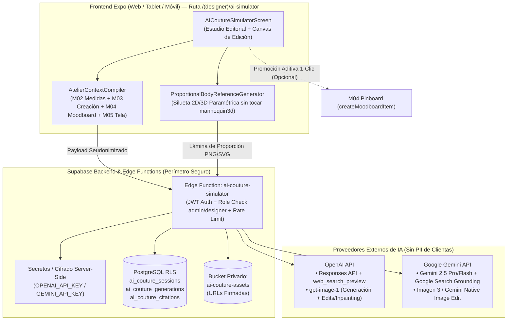

# Auditoría Técnica y Funcional: Diseño Arquitectónico del Módulo Independiente **AI Haute Couture Simulator**

**Fecha:** 2026-11-16  
**Estado de la auditoría:** COMPLETADA (100% solo lectura sobre código/BD existentes; M00–M07, Flujo B de M02, `src/components/mannequin3d/` y `poc-simulador-3d/` intactos).

---

## 1. Arquitectura Actual Verificada

### 1.1 Stack Tecnológico y Entorno ([package.json](file:///d:/Datos/Datos/DATOS%20JVINAS/Antigravity/2.ByKatherineCarroll/AtelierDigitalApp/package.json), [src/supabase.ts](file:///d:/Datos/Datos/DATOS%20JVINAS/Antigravity/2.ByKatherineCarroll/AtelierDigitalApp/src/supabase.ts))
- **Frontend Multiplataforma:** Expo SDK `~57.0.31`, React `19.2.3`, React Native `0.86.3`, React Native Web `^0.21.2`, navegación declarativa con `expo-router` (`~57.0.29`), TypeScript `~6.0.3`.
- **Gráficos y Utilitarios Locales:** `three` (`^0.170.0`), `expo-image-picker` (`~57.0.20`), `tesseract.js` (`^7.0.0`), `pdfjs-dist` (`^6.5.438`), `xlsx` (`^0.18.5`).
- **Backend y Persistencia (Supabase):** `@supabase/supabase-js` (`^2.117.3`), PostgreSQL con RLS estricto, funciones RPC `SECURITY DEFINER`, triggers de auditoría y concurrencia optimista (`row_version` / `PT409`).
- **Edge Functions:** Actualmente existe **una única** Edge Function en el repositorio: [`supabase/functions/admin-users/index.ts`](file:///d:/Datos/Datos/DATOS%20JVINAS/Antigravity/2.ByKatherineCarroll/AtelierDigitalApp/supabase/functions/admin-users/index.ts) (Deno `std@0.177.0`, validación criptográfica de JWT + verificación de rol en `public.profiles` con `SUPABASE_SERVICE_ROLE_KEY`).

### 1.2 Estado Real de los Módulos M00–M12 ([PROJECT_INDEX.md](file:///d:/Datos/Datos/DATOS%20JVINAS/Antigravity/2.ByKatherineCarroll/AtelierDigitalApp/PROJECT_INDEX.md), [M04_ALCANCE_FUNCIONAL.md](file:///d:/Datos/Datos/DATOS%20JVINAS/Antigravity/2.ByKatherineCarroll/AtelierDigitalApp/M04_ALCANCE_FUNCIONAL.md#L12-L26))

| Módulo | Estado Real en Código y BD | Tablas / Buckets / Rutas Verificadas |
|---|---|---|
| **M00 · Auth, Perfiles y Gobierno** | **Operativo / Aprobado** | `public.profiles` (`admin`, `designer`, `client`), `public.atelier_settings`, `public.user_legal_consents`, funciones `is_admin()`, `is_designer()`, `is_admin_or_designer()`, [`app/(admin)/index.tsx`](file:///d:/Datos/Datos/DATOS%20JVINAS/Antigravity/2.ByKatherineCarroll/AtelierDigitalApp/app/(admin)/index.tsx), [`app/(admin)/settings.tsx`](file:///d:/Datos/Datos/DATOS%20JVINAS/Antigravity/2.ByKatherineCarroll/AtelierDigitalApp/app/(admin)/settings.tsx), [`app/ia-transparencia.tsx`](file:///d:/Datos/Datos/DATOS%20JVINAS/Antigravity/2.ByKatherineCarroll/AtelierDigitalApp/app/ia-transparencia.tsx) |
| **M01 · Clientes, Personas y Campañas** | **Operativo / Aprobado** | `public.clients`, `public.persons`, `public.groups`, `public.group_members`, `public.measurement_campaigns`, `public.measurement_campaign_participants`, bucket privado `client-photos` |
| **M02 · Medidas, Tallas y Patronaje CAD** | **Operativo / Aprobado** | `public.measurement_catalog`, `public.measurement_sessions`, `public.measurement_values`, `public.ease_profiles`, `public.pattern_templates`, `public.pattern_executions`, `public.pattern_adjustments`, [`app/(designer)/patterns.tsx`](file:///d:/Datos/Datos/DATOS%20JVINAS/Antigravity/2.ByKatherineCarroll/AtelierDigitalApp/app/(designer)/patterns.tsx) |
| **M03 · Creaciones y Ciclo Comercial** | **Operativo / Aprobado** | `public.creations`, `public.creation_commercial_profiles`, `public.creation_proposals`, `public.creation_proposal_items`, `public.commercial_quotes`, `public.commercial_quote_items`, `public.atelier_projects`, `public.commercial_media_assets`, `public.commercial_events`, bucket privado `commercial-assets` (`10 MB`) |
| **M04 · Diseño, Moodboard y Biblioteca** | **Operativo / Aprobado** | `public.design_library_items`, `public.creation_moodboards`, `public.moodboard_items`, bucket privado `design-assets` (`15 MB`), [`app/(designer)/library.tsx`](file:///d:/Datos/Datos/DATOS%20JVINAS/Antigravity/2.ByKatherineCarroll/AtelierDigitalApp/app/(designer)/library.tsx) |
| **M05 · Materiales, Proveedores y TRM** | **Operativo / Aprobado** | `public.atelier_materials`, `public.atelier_suppliers`, `public.atelier_material_stock_logs`, `public.atelier_currency_rates`, [`app/(designer)/materials.tsx`](file:///d:/Datos/Datos/DATOS%20JVINAS/Antigravity/2.ByKatherineCarroll/AtelierDigitalApp/app/(designer)/materials.tsx) |
| **M06 · Pruebas, Ajustes y Entrega** | **Operativo / Aprobado** | `public.atelier_fitting_sessions`, `public.atelier_fitting_adjustments`, 8 RPCs transaccionales, [`app/(designer)/fittings.tsx`](file:///d:/Datos/Datos/DATOS%20JVINAS/Antigravity/2.ByKatherineCarroll/AtelierDigitalApp/app/(designer)/fittings.tsx) |
| **M07 · Costos, Pagos y Finanzas** | **Operativo / Aprobado** | `public.financial_movements`, 4 RPCs ACID, [`app/(designer)/finances.tsx`](file:///d:/Datos/Datos/DATOS%20JVINAS/Antigravity/2.ByKatherineCarroll/AtelierDigitalApp/app/(designer)/finances.tsx) |
| **Prototipos 3D Aislados** | **Aislados (No Producción)** | Maniquí paramétrico Three.js en [`src/components/mannequin3d/`](file:///d:/Datos/Datos/DATOS%20JVINAS/Antigravity/2.ByKatherineCarroll/AtelierDigitalApp/src/components/mannequin3d/Mannequin3DViewer.tsx) ([`app/mannequin-preview.tsx`](file:///d:/Datos/Datos/DATOS%20JVINAS/Antigravity/2.ByKatherineCarroll/AtelierDigitalApp/app/mannequin-preview.tsx)) y PoC física XPBD T0–T5.2 en [`poc-simulador-3d/`](file:///d:/Datos/Datos/DATOS%20JVINAS/Antigravity/2.ByKatherineCarroll/AtelierDigitalApp/poc-simulador-3d/T5_2_CORRECTIVE_BENCHMARK.md) |
| **M08–M12 (Agenda, Portal, IA M10, Dashboard, Archivos)** | **No implementados** | Solo planificados conceptualmente en [`M04_ALCANCE_FUNCIONAL.md`](file:///d:/Datos/Datos/DATOS%20JVINAS/Antigravity/2.ByKatherineCarroll/AtelierDigitalApp/M04_ALCANCE_FUNCIONAL.md#L21-L25). El nuevo **AI Haute Couture Simulator** materializa y amplía la visión del **Módulo 10** de forma independiente. |

---

## 2. Módulos, Archivos y Servicios Concretos Reutilizables (En Modo Lectura / Aditivo)

El proyecto ya fue diseñado en M02–M06 con metadatos estructurados pensando en una futura capa de IA (`RF-M04-04`). Los activos directamente reutilizables **sin modificar su lógica interna** son:

1. **Medidas Antropométricas y Catálogo Maestro (M02):**
   - [`src/engine/pattern/catalog/masterCatalog.ts`](file:///d:/Datos/Datos/DATOS%20JVINAS/Antigravity/2.ByKatherineCarroll/AtelierDigitalApp/src/engine/pattern/catalog/masterCatalog.ts) (`MASTER_MEASUREMENT_CATALOG`): códigos canónicos en milímetros (`estatura`, `contorno_busto`, `contorno_cintura`, `contorno_cadera`, `ancho_espalda`, `largo_talle_delantero`, `largo_talle_espalda`, `altura_busto`, `separacion_busto`, etc.) y límites biométricos `min_value_mm` / `max_value_mm`.
   - [`src/services/measurementService.ts`](file:///d:/Datos/Datos/DATOS%20JVINAS/Antigravity/2.ByKatherineCarroll/AtelierDigitalApp/src/services/measurementService.ts) (`fetchClientMeasurementSessions`, `fetchMeasurementCatalog`) y [`src/types/pattern/measurement.ts`](file:///d:/Datos/Datos/DATOS%20JVINAS/Antigravity/2.ByKatherineCarroll/AtelierDigitalApp/src/types/pattern/measurement.ts): lectura de sesiones verificadas (`MeasurementSession`) y valores en `mm` con nivel de confianza (`confirmed`, `designer_approved`).
   - [`src/services/patternService.ts`](file:///d:/Datos/Datos/DATOS%20JVINAS/Antigravity/2.ByKatherineCarroll/AtelierDigitalApp/src/services/patternService.ts) (`STANDARD_EASE_PROFILES`, `DEFAULT_PATTERN_TEMPLATES`): perfiles de holgura (`fitted`, `regular`, `relaxed`) y parámetros `GarmentDesignParameters` ([`src/types/pattern/ease.ts`](file:///d:/Datos/Datos/DATOS%20JVINAS/Antigravity/2.ByKatherineCarroll/AtelierDigitalApp/src/types/pattern/ease.ts)).
2. **Taxonomía Sartorial, Moodboards y Biblioteca de Autor (M04):**
   - [`src/types/design.ts`](file:///d:/Datos/Datos/DATOS%20JVINAS/Antigravity/2.ByKatherineCarroll/AtelierDigitalApp/src/types/design.ts) y [`src/services/designMockData.ts`](file:///d:/Datos/Datos/DATOS%20JVINAS/Antigravity/2.ByKatherineCarroll/AtelierDigitalApp/src/services/designMockData.ts): códigos estructurados de silueta (`silhouette_code`), escote (`neckline_code`), manga (`sleeve_code`), paletas cromáticas (`MoodboardColorSwatch` con `hex`, `finish`: `'matte' | 'satin' | 'silk_sheen' | 'metallic' | 'translucent' | 'velvet'`, y `role`: `'primary' | 'secondary' | 'accent' | 'lining' | 'embroidery'`).
   - [`src/services/designService.ts`](file:///d:/Datos/Datos/DATOS%20JVINAS/Antigravity/2.ByKatherineCarroll/AtelierDigitalApp/src/services/designService.ts) (`fetchMoodboardByCreation`, `fetchMoodboardItems`, `fetchDesignLibrary`, `createMoodboardItem`): permite leer el contexto estético de una Creación y **exportar de forma aditiva** una imagen generada por IA hacia el Pinboard de M04 como `MoodboardItem` (`item_type = 'sketch'` o `'silhouette_ref'`).
3. **Catálogo Físico de Materiales y Caída Textil (M05):**
   - [`src/types/commercial.ts`](file:///d:/Datos/Datos/DATOS%20JVINAS/Antigravity/2.ByKatherineCarroll/AtelierDigitalApp/src/types/commercial.ts#L68-L112) (`MaterialItem`, `MATERIAL_DRAPE_PROFILES`, `CANONICAL_MATERIAL_CATEGORIES`) y [`src/services/commercialService.ts`](file:///d:/Datos/Datos/DATOS%20JVINAS/Antigravity/2.ByKatherineCarroll/AtelierDigitalApp/src/services/commercialService.ts): proveen composición real (`composition`), gramaje (`weight_gsm`), perfil de caída (`drape_profile`: `'fluid' | 'structured' | 'crisp' | 'sheer' | 'heavy' | 'stretch' | 'delicate'`), ancho (`width_cm`), color (`color_code`, `color_name`) y muestra fotográfica (`storage_path` en `commercial-assets`).
4. **Contexto de Encargo y Ajustes de Calce (M03 y M06):**
   - [`src/services/creationService.ts`](file:///d:/Datos/Datos/DATOS%20JVINAS/Antigravity/2.ByKatherineCarroll/AtelierDigitalApp/src/services/creationService.ts) (`fetchCreations`, `fetchCreationById`): tipo de encargo (`bridal`, `gala`, `bespoke`, etc.), ocasión y tipo de prenda (`GarmentType`).
   - [`src/services/fittingService.ts`](file:///d:/Datos/Datos/DATOS%20JVINAS/Antigravity/2.ByKatherineCarroll/AtelierDigitalApp/src/services/fittingService.ts) y [`src/types/fitting.ts`](file:///d:/Datos/Datos/DATOS%20JVINAS/Antigravity/2.ByKatherineCarroll/AtelierDigitalApp/src/types/fitting.ts): historial de ajustes de calce por zona anatómica (`bust`, `waist`, `hip`, `shoulder`, `armhole`, `neckline`).
5. **Patrón de Invocación Segura de Edge Functions y Manejo de Errores:**
   - [`src/services/adminService.ts`](file:///d:/Datos/Datos/DATOS%20JVINAS/Antigravity/2.ByKatherineCarroll/AtelierDigitalApp/src/services/adminService.ts#L38-L86) (`extractFunctionErrorMessage` con clasificación de `FunctionsHttpError`, `FunctionsRelayError`, `FunctionsFetchError` y refresh de JWT) y [`supabase/functions/admin-users/index.ts`](file:///d:/Datos/Datos/DATOS%20JVINAS/Antigravity/2.ByKatherineCarroll/AtelierDigitalApp/supabase/functions/admin-users/index.ts): plantilla canónica para autenticar y autorizar llamadas server-side.

---

## 3. Brechas Técnicas y de Gobernanza Identificadas

1. **Ausencia de Conectividad IA Externa:** [`src/services/aiCopilotService.ts`](file:///d:/Datos/Datos/DATOS%20JVINAS/Antigravity/2.ByKatherineCarroll/AtelierDigitalApp/src/services/aiCopilotService.ts#L40-L48) es actualmente un motor local de reglas (`isConfigured: false`) con `if/else` de palabras clave; no existe integración con OpenAI ni Google Gemini.
2. **Ausencia de Bóveda / Gestión de API Keys:** [`public.atelier_settings`](file:///d:/Datos/Datos/DATOS%20JVINAS/Antigravity/2.ByKatherineCarroll/AtelierDigitalApp/src/types/settings.ts) solo almacena nombre comercial, contacto, idioma, moneda y formato de fecha. No existe tabla ni Edge Function para configurar, validar o rotar claves de OpenAI / Gemini sin exponerlas al cliente.
3. **Limitación del Maniquí 3D Actual para Exportación de Referencia ([`Mannequin3DViewer.tsx`](file:///d:/Datos/Datos/DATOS%20JVINAS/Antigravity/2.ByKatherineCarroll/AtelierDigitalApp/src/components/mannequin3d/Mannequin3DViewer.tsx#L141-L173)):**
   - Solo inicializa `THREE.WebGLRenderer` cuando `Platform.OS === 'web'` (en nativo muestra un contenedor de fallback).
   - Instancia `WebGLRenderer({ antialias: true, alpha: true })` **sin `preserveDrawingBuffer: true`**, por lo que `canvas.toDataURL()` fuera del ciclo inmediato de render devuelve un lienzo vacío, y además la restricción del proyecto prohíbe modificar destructivamente `src/components/mannequin3d/`.
4. **Brecha Legal/Ética en Política de Transparencia IA ([`app/ia-transparencia.tsx`](file:///d:/Datos/Datos/DATOS%20JVINAS/Antigravity/2.ByKatherineCarroll/AtelierDigitalApp/app/ia-transparencia.tsx#L36-L64)):**
   - El texto vigente declara que el copiloto *"opera de forma 100% local... NO envía los datos personales ni las medidas de las clientas a servidores externos de IA generativa"*.
   - **Implicación arquitectónica:** El nuevo módulo debe: (a) **anonimizar/seudonimizar estrictamente** cualquier contexto antes de enviarlo al proveedor externo (jamás transmitir nombre, correo, teléfono, documento ni fotos de rostro/fittings de clientas); (b) usar endpoints de API comerciales con *zero data retention / no-training*; y (c) requerir consentimiento explícito de la diseñadora al activar proveedores externos.

---

## 4. Arquitectura Propuesta: `AI Haute Couture Simulator` (Módulo Independiente)

### Ubicación Propuesta de Archivos (100% Aditiva y Aislada)
- **Ruta Expo Router:** `app/(designer)/ai-simulator.tsx` (y sección de claves en `app/(admin)/settings.tsx` o modal administrativo dedicado).
- **Componentes UI:** `src/components/aiSimulator/` (`AICoutureSimulatorScreen.tsx`, `SimulatorContextPanel.tsx`, `BodyProportionReferenceCard.tsx`, `WebResearchCitationsPanel.tsx`, `GarmentImageCanvasEditor.tsx`, `GenerationVersionTimeline.tsx`, `AIProviderKeyConfigModal.tsx`).
- **Servicios y Utilidades:** `src/services/aiCoutureSimulatorService.ts` y `src/utils/bodyProportionReferenceBuilder.ts` (generador independiente de láminas proporcionales basado en medidas).
- **Contratos TypeScript:** `src/types/aiSimulator.ts`.
- **Edge Function:** `supabase/functions/ai-couture-simulator/index.ts`.
- **Migración SQL Aditiva:** `supabase/migrations/YYYYMMDDHHMMSS_ai_haute_couture_simulator.sql`.

---

## 5. Integración Segura de API Keys (OpenAI y Gemini)

Para cumplir con las reglas de seguridad de [`aiCopilotService.ts`](file:///d:/Datos/Datos/DATOS%20JVINAS/Antigravity/2.ByKatherineCarroll/AtelierDigitalApp/src/services/aiCopilotService.ts#L12) y [`admin-users/index.ts`](file:///d:/Datos/Datos/DATOS%20JVINAS/Antigravity/2.ByKatherineCarroll/AtelierDigitalApp/supabase/functions/admin-users/index.ts):

1. **Prohibición Absoluta en Cliente:** Ninguna clave llevará prefijo `EXPO_PUBLIC_`, ni se guardará en `AsyncStorage`, `localStorage` ni en código fuente.
2. **Doble Mecanismo Server-Side en la Edge Function `ai-couture-simulator`:**
   - **Nivel 1 (Variables de Entorno de Supabase Functions):** Lectura primaria vía `Deno.env.get('OPENAI_API_KEY')` y `Deno.env.get('GEMINI_API_KEY')` configuradas con `supabase secrets set`.
   - **Nivel 2 (Configuración Administrativa Cifrada desde UI):** Tabla `public.ai_provider_configs` con RLS bloqueado para lectura directa de la columna secreta (`REVOKE SELECT (encrypted_api_key) FROM authenticated, anon`). Solo la Edge Function (usando `SUPABASE_SERVICE_ROLE_KEY` tras verificar `callerProfile.role === 'admin'`) puede guardar/actualizar la clave cifrada con AES-GCM (`AI_MASTER_ENCRYPTION_SECRET` en Deno env) o `pgsodium`, devolviendo al frontend únicamente metadatos enmascarados:
     - `provider`: `'openai' | 'gemini'`
     - `key_hint`: `'sk-proj-...9a4F'` / `'AIza...7xQ'`
     - `is_configured`: `boolean`
     - `last_verified_at`: `timestamptz`
     - `default_text_model`, `default_image_model`, `monthly_budget_usd_limit`
3. **Acción `verify_provider`:** Ping ligero desde la Edge Function para comprobar validez de la clave y permisos de modelo antes de habilitar el estudio.

---

## 6. Investigación Interna y Web con Referencias y Trazabilidad

El motor de investigación opera en dos fases dentro de la acción `research` de la Edge Function:

### 6.1 Fase A — Compilación de Contexto Interno de Atelier Digital (Seudonimizado)
Antes de consultar al LLM, el compilador reúne en solo lectura:
- **De M02 (`measurement_sessions` + `measurement_values`):** Vector de medidas en `mm` y proporciones adimensionales, **eliminando `client_id`, `full_name`, `email`, `phone` y notas personales**.
- **De M03 (`creations`):** `creation_type`, `occasion`, `garment_type`.
- **De M04 (`creation_moodboards` + `design_library_items`):** `silhouette_code`, `neckline_code`, `sleeve_code`, `color_palette` (HEX + `finish` + `role`) y `technical_notes` de la Biblioteca de Autor.
- **De M05 (`atelier_materials`):** `name`, `category`, `composition`, `weight_gsm`, `drape_profile`, `width_cm`, `color_name`, `color_code`.
- **De M06 (`atelier_fitting_adjustments`):** Alertas técnicas previas por zona anatómica (`shoulder`, `armhole`, `bust`, `waist`).

### 6.2 Fase B — Búsqueda Web Externa con Grounding y Citas Verificables
- **Con OpenAI:** Uso del endpoint `POST /v1/responses` con herramienta `tools: [{ type: "web_search_preview" }]`, extrayendo `annotations` de tipo `url_citation` (`url`, `title`, `start_index`, `end_index`).
- **Con Gemini:** Uso de `@google/genai` / REST `generateContent` con `tools: [{ googleSearch: {} }]`, extrayendo `candidates[0].groundingMetadata.groundingChunks` (`web.uri`, `web.title`) y `groundingSupports`.
- **Trazabilidad Persistida:** Cada fuente consultada (tendencias de alta costura, comportamiento de tejidos nobles, historia de siluetas, técnicas de bordado Lunéville, etc.) se guarda en `public.ai_couture_citations` vinculada al `session_id` y `generation_id`, distinguiendo claramente en la UI entre **[Fuente Interna Atelier M02–M06]** y **[Fuente Web Externa Verificada con URL]**.

---

## 7. Generación y Edición Fotorrealista de Imágenes de Prendas

### 7.1 Compilador Estructurado de Prompts Sartoriales (*Sartorial Prompt Compiler*)
En lugar de enviar texto libre ambiguo al generador de imágenes, la Edge Function construye un prompt técnico determinístico + esquema JSON que traduce los datos del Atelier:
- **Geometría y Proporción:** Proporciones corporales exactas derivadas de M02 + lámina visual de referencia corporal.
- **Arquitectura de Prenda (M04):** Silueta, estructura de corpiño/falda, tipo de escote, construcción de sisa y manga, costuras princesa/imperio.
- **Física Visual del Material (M05):** Traducción explícita de `weight_gsm` + `drape_profile` + `composition` + `ColorFinishType` a descriptores ópticos y mecánicos (ej. *Mikado de seda 280 gsm, caída estructurada escultórica, pliegues amplios de radio alto, brillo perlado `silk_sheen` en tono `#F7F2E7`*).
- **Estética de Firma:** Iluminación de estudio sobre maniquí Stockman o figurín de atelier en fondo marfil `#FAF7F2` sin rostros identificables de clientas.

### 7.2 Flujo Multimodal de Generación y Edición Iterativa
1. **Generación Inicial Guiada (`generate_garment_image`):**
   - **OpenAI:** `gpt-image-1` (`POST /v1/images/generations` o `/v1/images/edits` pasando como imagen guía la lámina proporcional del maniquí y opcionalmente el swatch textil de M05).
   - **Gemini:** `imagen-3.0-generate-002` (síntesis fotorrealista de alta resolución) o `gemini-2.5-flash-image` / edición multimodal guiada por imagen de referencia.
2. **Edición Iterativa y Regional (`edit_garment_image`):**
   - **Edición por Máscara (Inpainting):** El usuario pinta en el canvas de la app una máscara PNG transparente sobre una zona específica (escote, mangas, bajo, cintura, aplique de encaje/pedrería) y escribe la instrucción de cambio. Se envía a `/v1/images/edits` (`image` + `mask` + `prompt`) o al endpoint de edición de Gemini/Imagen.
   - **Edición Conversacional Multi-turno:** Ajuste de color/textura/caída conservando la composición previa (`parent_generation_id`), manteniendo un árbol de versiones inmutable para comparar *Antes vs. Después*.

---

## 8. Representación Corporal Basada en Medidas: Capacidades Reales de IA vs. Geometría Independiente

> [!IMPORTANT]
> **Distinción Técnica Crítica:** Los modelos de difusión y generación de imágenes (OpenAI `gpt-image-1`, Gemini/Imagen) **no resuelven geometría métrica exacta a partir de números en texto**. Escribir *"busto 104 cm, cintura 86 cm, cadera 114 cm, estatura 156 cm"* en un prompt de texto suele producir un maniquí estilizado genérico de pasarela porque el prior estadístico del modelo domina sobre las cifras.

Por ello, la arquitectura separa estrictamente responsabilidades:

| Capacidad | ¿Quién la resuelve? | Cómo se implementa en el Simulador |
|---|---|---|
| **Proporción antropométrica real (relación busto/cintura/cadera/espalda/talle/estatura)** | **Geometría Paramétrica Determinística (Local)** | Un generador puro y aislado (`src/utils/bodyProportionReferenceBuilder.ts`) reutiliza las ecuaciones de secciones elípticas y alturas de [`mannequinMeshBuilder.ts`](file:///d:/Datos/Datos/DATOS%20JVINAS/Antigravity/2.ByKatherineCarroll/AtelierDigitalApp/src/components/mannequin3d/mannequinMeshBuilder.ts) **sin modificar `src/components/mannequin3d/` ni el Flujo B de M02**, generando una **lámina de silueta proporcional 2D/SVG → PNG** (vistas frontal, 3/4, perfil y espalda con líneas de busto, cintura y cadera a escala real 1:10). |
| **Clasificación morfológica e índices adimensionales** | **Cálculo Matemático Determinístico** | Cálculo exacto de relaciones `cintura/busto`, `cadera/cintura`, `talle/estatura`, `espalda/cadera` y clasificación de silueta + holguras recomendadas según `STANDARD_EASE_PROFILES`. |
| **Fotorrealismo textil, textura, iluminación, bordados, encajes y variaciones de diseño** | **Modelos Externos de IA (OpenAI / Gemini)** | Reciben la **lámina visual proporcional renderizada** como imagen guía de entrada (*image-to-image / reference conditioning*) junto con el prompt sartorial compilado desde M04/M05. Así la IA viste la silueta proporcional real en lugar de inventar un cuerpo genérico. |
| **Simulación física elástica de tensión/colisión (XPBD)** | **PoC Aislada (`poc-simulador-3d/`)** | Permanece 100% separada e intacta (T0–T5.2); no se mezcla ni se reemplaza por otro solver físico. |

---

## 9. Almacenamiento, Modelo de Datos e Historial Auditable

### 9.1 Nuevo Bucket Privado en Supabase Storage
- **Bucket:** `ai-couture-assets` (`public = false`, límite `15 MB`, tipos `image/png`, `image/jpeg`, `image/webp`).
- **Estructura de rutas determinista:**
  - `sessions/{session_id}/body_ref_{angle}.png` (lámina de referencia corporal proporcional).
  - `sessions/{session_id}/gen_{generation_id}_v{version}.png` (imagen generada/editada).
  - `sessions/{session_id}/mask_{generation_id}.png` (máscara de edición inpainting).
- **Políticas RLS Storage:** Acceso exclusivo `public.is_admin_or_designer()` mediante URLs firmadas (`createSignedUrl`), idéntico al patrón probado en `design-assets` (M04) y `commercial-assets` (M03/M05).

### 9.2 Tablas Nuevas Propuestas (Migración 100% Aditiva, Cero Cambios a Tablas M00–M07)
1. **`public.ai_provider_configs`:** Configuración por proveedor (`openai`, `gemini`), clave cifrada, hint enmascarado, modelos activos, límites de gasto mensual y auditoría (`updated_by`).
2. **`public.ai_couture_sessions`:** Sesión de simulación vinculada opcionalmente (`ON DELETE SET NULL`) a `creation_id` (M03), `client_id` (M01), `person_id` (M01), `measurement_session_id` (M02), `moodboard_id` (M04) y `primary_material_id` (M05). Guarda el snapshot inmutable de medidas anonimizadas (`measurements_snapshot_mm JSONB`) y parámetros de diseño (`sartorial_spec JSONB`).
3. **`public.ai_couture_generations`:** Árbol de versiones (`id`, `session_id`, `parent_generation_id`, `version_number`, `operation_type`: `'research' | 'initial_render' | 'inpaint_edit' | 'style_variation'`, `provider`, `model_name`, `user_prompt`, `compiled_sartorial_prompt`, `body_ref_storage_path`, `mask_storage_path`, `output_storage_path`, `research_summary_md`, `token_usage JSONB`, `estimated_cost_usd NUMERIC(10,4)`, `promoted_moodboard_item_id UUID`, `created_by`, `created_at`).
4. **`public.ai_couture_citations`:** Fuentes trazables por generación (`id`, `generation_id`, `source_type`: `'internal_atelier' | 'external_web'`, `internal_module_code`, `title`, `url`, `domain`, `snippet`, `retrieved_at`).

---

## 10. Riesgos, Costos y Pruebas de Aceptación

### 10.1 Matriz de Riesgos y Mitigaciones
- **R-01 · Fuga de API Keys al bundle cliente:** Mitigado almacenando y usando las claves exclusivamente en la Edge Function `ai-couture-simulator` y bloqueando `SELECT` sobre la columna cifrada en PostgreSQL.
- **R-02 · Exposición de datos personales (PII) o fotos de clientas a terceros ([`app/ia-transparencia.tsx`](file:///d:/Datos/Datos/DATOS%20JVINAS/Antigravity/2.ByKatherineCarroll/AtelierDigitalApp/app/ia-transparencia.tsx)):** Mitigado mediante filtro sanitizador que elimina nombres, correos, teléfonos, cédulas y fotos de fittings antes de invocar OpenAI/Gemini; solo viajan medidas numéricas en `mm`, códigos técnicos de prenda/tela y la silueta geométrica del maniquí.
- **R-03 · Alucinación de proporciones corporales o viabilidad de costura:** Mitigado condicionando la generación con la lámina geométrica proporcional derivada de `masterCatalog.ts` y etiquetando toda imagen generada como *"Simulación Visual IA — Sujeta a validación de patronaje CAD M02 y prueba física M06"*.
- **R-04 · Latencia y timeouts en Edge Functions (15–45 s en generación de imágenes HD):** Mitigado con timeout explícito de 60 s en la Edge Function, registro inmediato de estado `'processing' -> 'completed' | 'failed'` en `ai_couture_generations` y subida directa del binario al bucket `ai-couture-assets` desde la propia Edge Function.

### 10.2 Estimación de Costos Operativos por Operación (APIs Oficiales)
| Operación | Proveedor / Modelo | Costo Estimado Unitario (USD) |
|---|---|---:|
| Investigación contextual + búsqueda web con citas | OpenAI `gpt-4.1-mini` / `gpt-4o` + `web_search` o Gemini `2.5 Flash` + Search Grounding | `~$0.01 – $0.04` / consulta |
| Generación fotorrealista 1024×1536 (Alta Costura) | OpenAI `gpt-image-1` (calidad media/alta) o Google `Imagen 3` | `~$0.04 – $0.17` / imagen |
| Edición localizada por máscara / variación iterativa | OpenAI `gpt-image-1` (`edits`) o Gemini Native Image Edit | `~$0.04 – $0.17` / edición |
| **Sesión completa promedio (1 investigación + 3 renders + 2 ediciones)** | Mixto OpenAI / Gemini | **`~$0.25 – $0.85` / sesión** |

### 10.3 Matriz de Pruebas de Aceptación Propuesta
- **`T-AI-01` (Seguridad de Claves):** Verificar que el bundle web/móvil y las respuestas de red nunca contengan `OPENAI_API_KEY` ni `GEMINI_API_KEY` en texto plano, y que un usuario `client` reciba `403 Forbidden`.
- **`T-AI-02` (Sanitización PII):** Auditar el payload saliente hacia OpenAI/Gemini comprobando ausencia total de `full_name`, `email`, `phone` y fotos de `client-photos` / `fitting_photo`.
- **`T-AI-03` (Trazabilidad de Investigación):** Verificar que toda consulta externa persista al menos 1 cita con `url`, `title`, `domain` y `retrieved_at` en `ai_couture_citations` y las referencias internas M02–M05 usadas.
- **`T-AI-04` (Fidelidad de Lámina Corporal Proporcional):** Comprobar que dos sesiones con medidas distintas (ej. *Petite 154 cm / 86-66-92* vs. *Curvy 165 cm / 102-74-108*) generen láminas de referencia con razones de aspecto geométricamente exactas antes de pasar al modelo de imagen.
- **`T-AI-05` (Linaje de Versiones y Edición por Máscara):** Verificar que una edición cree un nuevo registro con `parent_generation_id` apuntando a la versión previa sin sobrescribir el archivo original en `ai-couture-assets`.
- **`T-AI-06` (Puente No Destructivo a M04):** Confirmar que "Enviar al Moodboard" inserte un `MoodboardItem` válido en M04 sin alterar `creations`, `pattern_executions` ni `src/components/mannequin3d/`.
- **`T-AI-07` (Integridad de Regresión):** `npx tsc --noEmit` (0 errores), `npx expo lint` (0 errores) y suites M06/M07/T1 intactas.

---

## 11. Plan de Implementación Incremental por Etapas

1. **Etapa 1 — Base de Datos Aditiva, Bucket Privado y Gestión Segura de Claves (Backend):**
   - Crear migración SQL aditiva (`ai_provider_configs`, `ai_couture_sessions`, `ai_couture_generations`, `ai_couture_citations` + bucket `ai-couture-assets` con RLS `is_admin_or_designer()`).
   - Crear esqueleto de Edge Function `supabase/functions/ai-couture-simulator/index.ts` con acciones `get_provider_status`, `save_provider_key` (solo `admin`) y `verify_provider`.
2. **Etapa 2 — Compilador de Contexto Interno (M02–M06) e Investigación Web con Citas:**
   - Implementar `src/types/aiSimulator.ts` y `src/services/aiCoutureSimulatorService.ts`.
   - Añadir en la Edge Function la acción `run_research` conectada a OpenAI Responses (`web_search_preview`) y Gemini (`googleSearch`), guardando citas verificables en `ai_couture_citations`.
3. **Etapa 3 — Generador Independiente de Referencia Corporal Proporcional:**
   - Crear `src/utils/bodyProportionReferenceBuilder.ts` para transformar cualquier `MeasurementSession` (M02) o preset en una lámina multi-vista proporcional (frontal/lateral/espalda con cotas e índices adimensionales) exportable a PNG/SVG sin tocar `src/components/mannequin3d/` ni el Flujo B de M02.
4. **Etapa 4 — Motor de Generación y Edición Iterativa de Imágenes (OpenAI + Gemini):**
   - Implementar las acciones `generate_image` y `edit_image` en la Edge Function `ai-couture-simulator`, con compilación automática del prompt sartorial (M04 + M05 + proporción M02), subida directa al bucket `ai-couture-assets` y árbol de versiones en `ai_couture_generations`.
5. **Etapa 5 — Interfaz de Estudio `AI Haute Couture Simulator` y Puente a M04:**
   - Construir `src/components/aiSimulator/` y la ruta independiente `app/(designer)/ai-simulator.tsx` (accesible desde el Home de Diseñadora y desde el detalle de una Creación), incluyendo selector de proveedor/modelo, panel de investigación con citas clicables, visor de lámina proporcional, lienzo de máscara para edición por zonas, línea de tiempo de versiones y botón de promoción en 1 clic al Moodboard M04.
   - Añadir tarjeta de configuración de claves API (solo rol `admin`) en `app/(admin)/settings.tsx`.
6. **Etapa 6 — Gobernanza Legal, Validación E2E y Pruebas de Aceptación:**
   - Actualizar cláusula de uso opt-in asistido en `app/ia-transparencia.tsx` (si se autoriza), ejecutar suite de pruebas `T-AI-01` a `T-AI-07`, validar `tsc` + `expo lint` y actualizar `ANTIGRAVITY_CONTINUITY.md` y `PROJECT_INDEX.md`.
