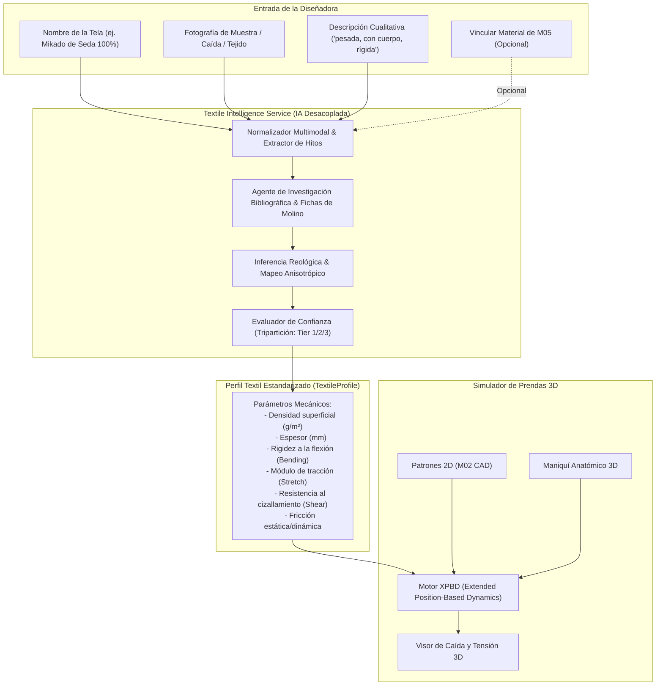
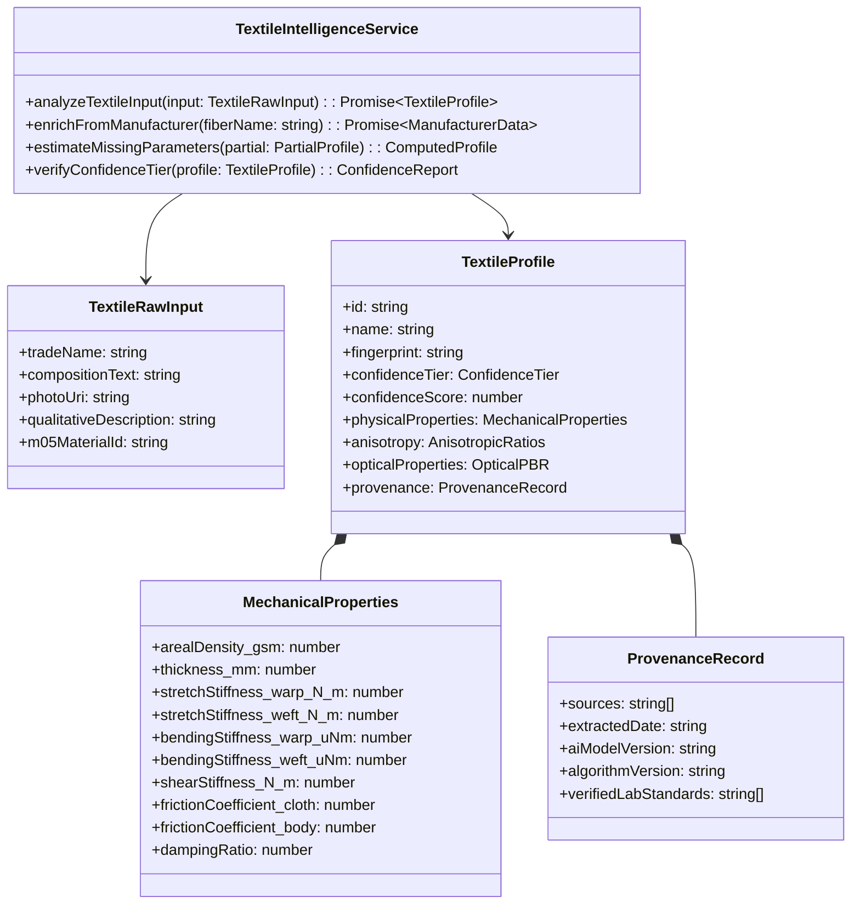
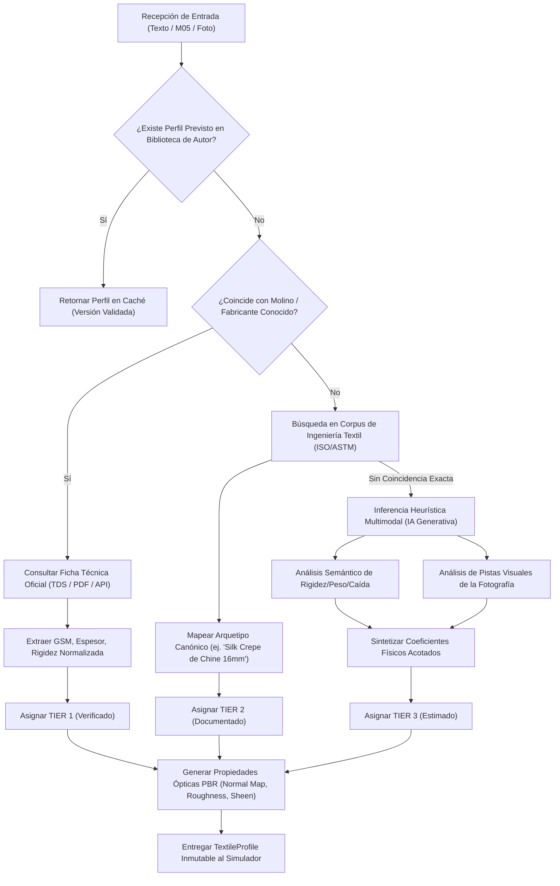

# ESTUDIO DE VIABILIDAD Y ARQUITECTURA TÉCNICA: SIMULADOR DE PRENDAS 3D E INTELIGENCIA TEXTIL INDEPENDIENTE
**Atelier Digital App — By Katherine Carroll**  
**Fecha:** 2026-11-14  
**Naturaleza:** Estudio de Viabilidad, Arquitectura y Especificación Técnica (Fase Conceptual · Sin Modificación de Código ni Base de Datos)  
**Módulos Relacionados:** M02 (Patronaje CAD), M04 (Biblioteca de Diseño), M05 (Materiales e Inventario — *Integración Opcional*)

---

## 1. Visión y Propósito en la Alta Costura

En la alta costura (*Haute Couture*), la relación entre el patrón bidimensional y el comportamiento tridimensional de la tela sobre la anatomía humana no es una mera proyección visual, sino una interacción física de alta complejidad. La diseñadora Katherine Carroll trabaja con textiles de características extremas: desde la rigidez arquitectónica de un *Mikado de seda natural* (que sostiene faldas estructuradas sin deformarse) hasta la levedad fluida y el drapeado etéreo de un *Crepé Georgette* o una *Gasa de seda* cortada al bies (*bias cut*).

El objetivo del **Simulador de Prendas 3D** es dotar a Atelier Digital de la capacidad de:
1. Tomar los patrones planos generados en el motor CAD 2D de M02 (delanteros, espaldas, mangas, faldas).
2. Costurarlos virtualmente en el espacio 3D alrededor del maniquí anatómico desarrollado en `mannequin3d`.
3. Simular la caída, gravedad, colisión con el cuerpo y arrugas reales de la prenda mediante un motor físico de partículas.
4. Alimentar dicho motor físico mediante un **Servicio de Inteligencia Textil Independiente** que interprete las características mecánicas y reológicas de cualquier tela que la diseñadora indique, sin exigir digitaciones engorrosas ni registros previos en el inventario comercial.



> [!IMPORTANT]
> **Principio de No Alteración y Aislamiento:**  
> Este estudio no modifica el Módulo 05 ni ninguno de los módulos certificados M00–M07. M05 es un módulo comercial de inventario, stock, proveedores y costeo contable; el Textile Intelligence Service es un servicio reológico y de física de materiales 100% independiente. No se requiere que una tela esté en stock o dada de alta en el catálogo para poder simularla.

---

## 2. Evaluación y Selección del Motor Físico Textil

Para simular tela en tiempo real dentro de una aplicación web y móvil basada en el ecosistema Expo / Three.js, es imperativo evaluar los modelos de simulación continua y discreta disponibles en la literatura computacional:

| Modelo Físico | Principio Matemático | Desempeño Web/Móvil | Estabilidad Numérica | Veredicto para Atelier Digital |
| :--- | :--- | :---: | :---: | :--- |
| **FEM (Finite Element Method)** | Ecuaciones diferenciales continuas de elasticidad no lineal. | Inviable (< 5 FPS en CPU/WebGL). | Alta (pero propensa a singularidades). | **Descartado:** Incompatible con interactividad fluida en navegador y dispositivos móviles. |
| **Mass-Spring Clásico (Runge-Kutta 4)** | Red de masas puntuales unidas por resortes elásticos y amortiguadores. | Rápido (~60 FPS en mallas pequeñas). | **Baja:** Fenómeno de super-elasticidad (la tela parece caucho/goma elástica salvo con pasos temporales infinitesimales). | **Descartado:** No reproduce la rigidez a la tracción inelástica típica de sedas o tafetanes. |
| **PBD (Position-Based Dynamics - Müller et al.)** | Proyección directa de restricciones geométricas sobre posiciones sin integrar aceleraciones. | Muy rápido (~60 FPS). | Muy alta (incondicionalmente estable, sin explosión numérica). | **Candidato viable**, superado por su evolución XPBD. |
| **XPBD (Extended Position-Based Dynamics - Macklin et al.)** | Modulación de restricciones con rigidez física desacoplada del paso temporal ($\Delta t$) y de la resolución de la malla, utilizando multiplicadores de Lagrange elásticos. | **Excelente (60 FPS en WebGL / WebGPU / Wasm).** | **Incondicionalmente estable.** Soporta anisotropía (urdimbre vs. trama vs. bies) y rigidez bending exacta. | **SELECCIÓN PRINCIPAL (Recomendado).** |

### Arquitectura del Solver XPBD Textil
El motor propuesto para la prenda modela la tela como una malla de triángulos $M = (V, E, F)$ donde cada vértice $i \in V$ tiene posición $\mathbf{x}_i$, masa $m_i$ y velocidad $\mathbf{v}_i$. En cada paso de tiempo $\Delta t$, el solucionador resuelve cuatro tipos de restricciones elásticas fundamentales:
1. **Distance Constraints (Stretch / Tracción):** Mantienen la distancia entre vértices adyacentes a lo largo del hilo de urdimbre (*warp*) y de trama (*weft*), gobernadas por el módulo de Young del hilo.
2. **Isometric Bending Constraints (Flexión):** Evalúan el ángulo diédrico entre dos triángulos contiguos que comparten una arista, simulando la resistencia a curvarse o doblarse (clave para diferenciar la caída fluida de la gasa frente al quiebre quebrado del mikado).
3. **Shear Constraints (Cizallamiento / Deformación en Rombo):** Restricciones cruzadas diagonales que regulan la deformación angular del ligamento de la tela.
4. **Continuous Collision Constraints (Auto-colisión y Maniquí):** Detección de contacto con la superficie del maniquí y entre capas de tela (faldas con vuelos o tablas).

---

## 3. Arquitectura del Textile Intelligence Service

El **Textile Intelligence Service** opera como un subsistema autónomo de extracción de conocimiento textil impulsado por Inteligencia Artificial (modelos de lenguaje multimodal especializados, como Gemini Multimodal), diseñado para cerrar la brecha entre la terminología cotidiana de la modista y los coeficientes numéricos requeridos por el solver XPBD.



---

## 4. Taxonomía de Propiedades Físicas Textiles vs. Parámetros XPBD

Para evitar la invención de propiedades físicas o conversiones arbitrarias, el servicio establece una correlación formal entre las normas internacionales de ensayo textil (ASTM, ISO, KES-FB, FAST) y los coeficientes del motor físico:

| Propiedad Textil Real | Norma Estándar de Laboratorio | Unidad Física | Parámetro XPBD Mapeado | Rango Típico en Telas de Alta Costura |
| :--- | :--- | :---: | :--- | :---: |
| **Masa / Peso Superficial** | ASTM D3776 / ISO 3801 | $\text{g/m}^2$ (GSM) | Masa nodal $m_i = \frac{1}{3} \sum_{T \in \text{adj}} \rho_{\text{areal}} \cdot \text{Área}(T)$ | 30 g/m² (Gasa) – 450 g/m² (Lana pesada/Mikado) |
| **Espesor / Grosor** | ASTM D1777 / ISO 5084 | $\text{mm}$ | Distancia de margen de colisión (*collision offset* $d_c$) | 0.08 mm (Seda habotai) – 1.8 mm (Terciopelo/Paño) |
| **Rigidez a la Tracción (Stretch)** | ASTM D5034 / KES-FB1 ($EM$) | $\text{N/m}$ | $\alpha_{\text{stretch}}^{-1}$ (compliance elástico inverso) | $1 \times 10^3 \text{ N/m}$ (Punto elástico) – $1 \times 10^6 \text{ N/m}$ (Seda inelástica) |
| **Rigidez a la Flexión (Bending)** | ASTM D1388 (Cantilever) / KES-FB2 ($B$) | $\mu\text{N}\cdot\text{m}$ o $\text{g}\cdot\text{cm}^2/\text{cm}$ | $\alpha_{\text{bend}}^{-1}$ (resistencia al ángulo diédrico) | $0.05 \mu\text{N}\cdot\text{m}$ (Gasa ultra-fluida) – $45 \mu\text{N}\cdot\text{m}$ (Mikado estructurado) |
| **Rigidez al Cizallamiento (Shear)** | KES-FB3 ($G$) | $\text{N/m}$ o $\text{g/cm}\cdot^\circ$ | $\alpha_{\text{shear}}^{-1}$ (restricción diagonal de rombo) | $50 \text{ N/m}$ (Bies muy móvil) – $2500 \text{ N/m}$ (Ligamento tafetán tupido) |
| **Coeficiente de Caída (Drape)** | ISO 9073-9 (Cusick Drape Tester) | $\%$ Coeficiente ($0\%–100\%$) | Ratio derivado: $\phi_{\text{drape}} = f(\alpha_{\text{bend}}, \rho_{\text{areal}})$ | $15\%$ (Caída hiper-ondulante) – $85\%$ (Caída en campana rígida) |
| **Fricción Estática y Dinámica** | ASTM D1894 / KES-FB4 ($MIU$) | Coeficiente adimensional $\mu$ | Límite de fricción de Coulomb en contactos | $\mu = 0.15$ (Satén raso deslizante) – $\mu = 0.65$ (Lana cruda adherente) |

---

## 5. Clasificación en Tres Niveles de Confianza (Tripartición de Datos)

En cumplimiento estricto de la directriz de **no presentar estimaciones como mediciones reales**, cada parámetro y perfil generado por el Textile Intelligence Service debe llevar un sello de procedencia inmutable clasificado en tres niveles (*Tiers*):

```
┌────────────────────────────────────────────────────────────────────────┐
│                        NIVELES DE CONFIANZA TEXTIL                     │
├─────────┬──────────────────────┬───────────────────────────────────────┤
│ TIER 1  │ VERIFICADO           │ Ficha técnica de fabricante con datos │
│         │ (Lab Certified)      │ de ensayo normalizado (ASTM/ISO/KES). │
│         │                      │ Nivel de confianza: 95% – 100%.       │
├─────────┼──────────────────────┼───────────────────────────────────────┤
│ TIER 2  │ DOCUMENTADO          │ Valores tabulados de compendios       │
│         │ (Technical Standard) │ textiles, manuales de hilandería      │
│         │                      │ y literatura académica de sastre.    │
│         │                      │ Nivel de confianza: 75% – 94%.        │
├─────────┼──────────────────────┼───────────────────────────────────────┤
│ TIER 3  │ ESTIMADO             │ Inferencia predictiva de IA por       │
│         │ (AI / Heuristic)     │ analogía de arquetipo, descripción   │
│         │                      │ cualitativa o aproximación visual.    │
│         │                      │ Nivel de confianza: 40% – 74%.        │
└─────────┴──────────────────────┴───────────────────────────────────────┘
```

> [!CAUTION]
> **Regla de Honestidad Metrológica:**  
> La interfaz del simulador 3D **siempre mostrará un distintivo visual claro del Tier dominante**:
> - 🟢 **Tier 1 (Verificado):** Sello *"Certificación de Laboratorio"* con link/referencia a la norma o fabricante.
> - 🟡 **Tier 2 (Documentado):** Sello *"Estándar de Literatura Técnica"* con rango de variación típico.
> - 🟠 **Tier 3 (Estimado):** Sello *"Inferencia Predictiva IA"* con advertencia explícita: *"Comportamiento simulado a partir de arquetipos similares. No constituye medición de laboratorio"*.

---

## 6. Estrategia de Investigación Multimodal del Servicio

Cuando la diseñadora introduce datos en la aplicación, el servicio sigue un protocolo de investigación en cascada:



---

## 7. Análisis de Fotografías: Alcance Real, Heurística Visual y Límites Físicos

Es fundamental establecer con precisión científica **qué puede y qué no puede extraerse de una fotografía de tela**, garantizando que el sistema jamás confunda percepción óptica con magnitudes de masa o esfuerzo elástico:

### 7.1 Lo que una Fotografía SÍ Permite Inferir (Heurística Visual)
1. **Estructura del Ligamento y Textura Superficial:** Mediante análisis macroscópico de alta resolución, la IA puede identificar patrones de tejido plano (*plain weave, twill, satin, jacquard*) o tejido de punto (*jersey, interlock*), orientando la dirección principal del grano (*grainline* / urdimbre).
2. **Lustre, Especularidad y Brillo de Fibras:** El comportamiento de la luz reflejada permite diferenciar entre seda natural reflectante (brillo nacarado por sección triangular de la fibroína), lana mate absorbente o rayón de brillo metálico plano.
3. **Transluscidez y Densidad de Hilos:** Zonas a contraluz permiten estimar la porosidad óptica de la tela.
4. **Comportamiento en Reposo sobre un Borde (si la foto incluye drapeado sobre un cilindro/soporte):** Si la fotografía muestra la tela colgada de un pedestal o doblada, el número de ondulaciones por unidad de ancho y el ángulo de curvatura en los pliegues ofrecen una **estimación indirecta aproximada del coeficiente de caída Cusick**.

### 7.2 Lo que una Fotografía NO PUEDE Medir (Límites Físicos Absolutos)
*   ❌ **Gramaje real en g/m²:** Una tela con trama densa de fibra ligera puede parecer idéntica a una de fibra densa. Dos crepés visualmente indistinguibles pueden pesar 60 g/m² o 180 g/m².
*   ❌ **Módulo de Young a la tracción:** La elasticidad intrínseca o el estiramiento longitudinal no se revelan en una foto estática sin tensión mecánica controlada.
*   ❌ **Rigidez a la flexión (Bending Stiffness):** La resistencia interna al pandeo no puede calcularse sin conocer la fuerza gravitacional exacta y las dimensiones milimétricas del espécimen de ensayo.
*   ❌ **Composición exacta:** No es posible distinguir por fotografía entre un satén de seda pura 100% y un satén de poliéster de alta gama, aunque sus propiedades mecánicas térmicas y de recuperación difieran radicalmente.

> [!NOTE]
> **Tratamiento de Fotografías en el Servicio:**  
> Las fotos se utilizan **únicamente** para: (a) clasificar el arquetipo visual y textura de renderizado PBR (albedo, aspereza, mapa normal de hilatura, brillo de seda); (b) guiar la selección del rango de literatura aplicable; y (c) contrastar con descripciones textuales. El resultado derivado de una foto **siempre se etiqueta como Tier 3 (Estimado)** a menos que esté respaldado por una ficha técnica de fabricante.

---

## 8. Esquema de Datos Canónico del Perfil Textil (`TextileProfile`)

A continuación se define el contrato formal de datos JSON que emitirá el servicio hacia el simulador de prendas:

```json
{
  "$schema": "https://atelierdigital.bykatherinecarroll.com/schemas/textile-profile-v1.json",
  "id": "tp_silk_mikado_couture_001",
  "name": "Mikado de Seda Natural Pesado",
  "fingerprint": "sha256_b78f921a9c4021...",
  "version": "1.0.0",
  "createdAt": "2026-11-14T15:30:00Z",
  "confidence": {
    "tier": "TIER_1_VERIFIED",
    "score": 96,
    "summary": "Datos mecánicos extraídos de ficha técnica oficial de fabricante (Gratacós SA) con normas ISO 3801 y ASTM D1388."
  },
  "identification": {
    "tradeName": "Mikado Silk 4-Ply",
    "commercialComposition": "100% Seda Natural",
    "weaveType": "twill_heavy_ribbed",
    "recommendedUse": "Faldas estructuradas, corsetería de gala, vestidos de novia con volumen arquitectónico"
  },
  "physicalParameters": {
    "arealDensity_gsm": 320.0,
    "thickness_mm": 0.68,
    "stretchStiffness": {
      "warp_N_per_m": 850000.0,
      "weft_N_per_m": 720000.0,
      "bias_N_per_m": 120000.0
    },
    "bendingStiffness": {
      "warp_uNm": 38.5,
      "weft_uNm": 29.2,
      "bias_uNm": 18.0
    },
    "shearStiffness_N_per_m": 1850.0,
    "elasticRecovery_percent": 92.0,
    "friction": {
      "static_cloth_to_cloth": 0.38,
      "dynamic_cloth_to_cloth": 0.29,
      "static_cloth_to_body": 0.42
    },
    "drapeCoefficient_percent": 78.5,
    "airResistance_dragCoefficient": 1.15
  },
  "opticalPBR": {
    "baseColor": "#FAF5EE",
    "roughness": 0.55,
    "metalness": 0.0,
    "sheen": 0.85,
    "sheenColor": "#FFFBF5",
    "translucency": 0.02,
    "normalMapUri": "assets/textiles/normals/twill_mikado_1k.webp"
  },
  "provenance": {
    "sources": [
      "Gratacós Silk Collection Technical Sheet 2025/2026",
      "Manual de Fibras Textiles y Alta Costura (Editorial Gustavo Gili)",
      "ISO 3801: Determination of Mass Per Unit Area"
    ],
    "aiAssisted": true,
    "aiModel": "gemini-textile-intelligence-v2.1",
    "verifiedByLab": true,
    "labStandard": "ISO_3801_ASTM_D1388",
    "notes": "Parámetros de flexión validados contra banco de caída cusick de referencia."
  }
}
```

---

## 9. Reutilización, Caché y Biblioteca de Perfiles de Autor

Para optimizar el uso de tokens y brindar una experiencia instantánea a Katherine Carroll:
1. **Caché Criptográfico por Huella Digital (*Fingerprint*):** Cada consulta genera un hash determinístico basado en los términos clave normalizados (ej. `hash("seda mikado 320g")`). Si la diseñadora ya consultó esa tela anteriormente, el perfil se recupera en 0 milisegundos desde la base local de perfiles sin llamar a la IA.
2. **Biblioteca de Perfiles Clásicos de Alta Costura (Pre-calibrados):** El sistema incorporará de fábrica una colección curada de perfiles Tier 1/2 inmutables:
   - *Gasa Muselina de Seda 100%* (35 g/m², caída líquida, máxima flexibilidad).
   - *Crepé Georgette de Seda* (75 g/m², grano arenoso, alta caída).
   - *Tafetán de Seda Tornasol* (110 g/m², crujiente, quiebre marcado, rigidez media).
   - *Satén Duquesa de Seda* (210 g/m², brillo suntuoso, cuerpo medio-pesado).
   - *Mikado de Seda* (320 g/m², estructura arquitectónica de novia).
   - *Terciopelo de Seda sobre base de Rayón* (280 g/m², caída pesada con volumen).
   - *Organza de Seda Cristal* (45 g/m², transparente pero tensa y rígida).
   - *Tul Francés de Ilusión* (20 g/m², malla hexagonal con soporte etéreo).
3. **Ajuste Manual Fino de Taller:** La diseñadora podrá clonar cualquier perfil y deslizar selectivamente controles intuitivos: *"Hacer 20% más pesada"*, *"Aumentar rigidez de quiebre"*, o *"Darle más vuelo/caída"*, registrándose como una variante de autor (*Custom Atelier Variation*).

---

## 10. Integración Opcional con el Módulo 05 (Materiales e Inventario)

### 10.1 Principio de Desacoplamiento Estricto
*   El simulador **NUNCA exigirá** que una tela esté creada en M05. Un boceto puede simularse con una tela de fantasía o una referencia que aún no se ha comprado.
*   M05 no sufrirá alteraciones en sus esquemas de base de datos ni se añadirán campos mecánicos a su tabla relacional de inventario comercial.

### 10.2 Enlace Opcional de Ida y Vuelta (Read-Only Bridge)
Si la diseñadora elige vincular un material existente de M05:
1. **Lectura Inteligente (M05 → Simulador):** El servicio lee los campos existentes de M05 (`name`, `type`, `notes`) para extraer pistas de composición o proveedor (ej. *"Seda comprada en Primatela, 100% seda"*), usándolos como semilla de investigación para el Textile Intelligence Service.
2. **Asociación Asíncrona (Simulador → M05):** El perfil textil generado puede almacenar opcionalmente el `material_id` como un metadato de referencia cruzada, permitiendo que en el futuro, al consultar una tela en M05, se pueda previsualizar una miniatura del drapeado 3D sin alterar las tablas comerciales ni la bitácora de stock.

---

## 11. Gobernanza, Trazabilidad y Reversibilidad

1. **Inmutabilidad de Parámetros:** Una vez que una prenda se simula y se aprueba para corte en M02, la versión exacta del `TextileProfile` utilizado se vincula al expediente de la creación para que futuras revisiones reproduzcan exactamente la misma caída física.
2. **Reversibilidad y Cero Regresiones:** Este diseño no añade dependencias invasivas al proyecto ni modifica las dependencias de Expo/React Native.
3. **Cumplimiento de Buenas Prácticas del Atelier:** Se preserva el rol de la diseñadora como autoridad creativa final: la IA propone y perfila las leyes físicas, pero Katherine Carroll decide si el drapeado refleja fielmente la elegancia y distinción que exige su casa de modas.

