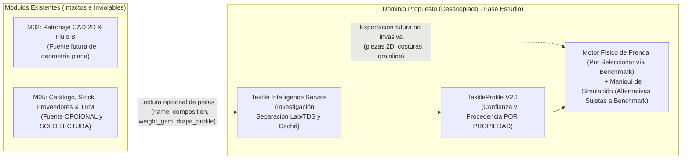
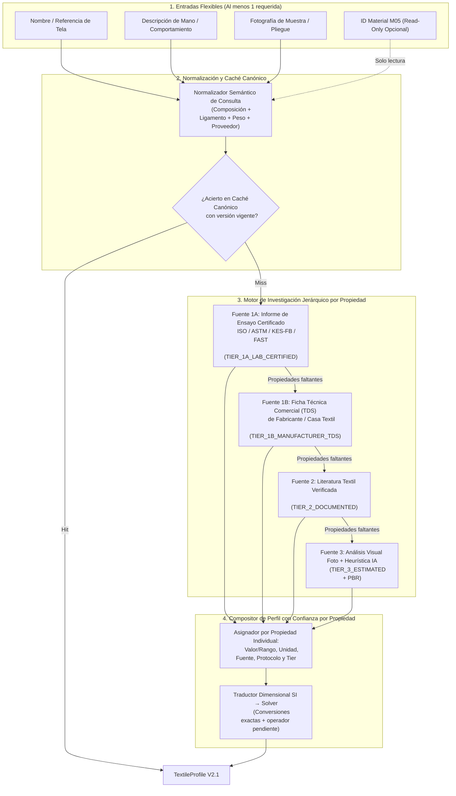
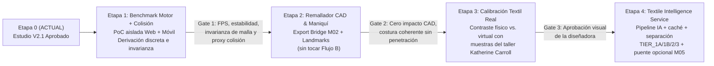

# ESTUDIO DE VIABILIDAD Y ARQUITECTURA TÉCNICA V2.1: SIMULADOR DE PRENDAS 3D E INTELIGENCIA TEXTIL INDEPENDIENTE
**Atelier Digital App — By Katherine Carroll**  
**Versión:** 2.1 (Corrección Puntual de Auditoría sobre V2)  
**Fecha:** 2026-11-14  
**Naturaleza:** Estudio de Arquitectura, Precisión Metrológica y Plan de Validación (Sin modificación de código, dependencias, configuraciones ni base de datos)  
**Documento base auditado:** [`ESTUDIO_VIABILIDAD_SIMULADOR_PRENDAS_3D_V2.md`](file:///d:/Datos/Datos/DATOS%20JVINAS/Antigravity/2.ByKatherineCarroll/AtelierDigitalApp/ESTUDIO_VIABILIDAD_SIMULADOR_PRENDAS_3D_V2.md)

> [!IMPORTANT]
> **Declaración de Integridad Técnica y Alcance V2.1:**  
> Esta revisión V2.1 mantiene intactos la visión funcional, el desacoplamiento total respecto a M05, la preservación de M02 y Flujo B, y el plan por etapas con puertas Go / No-Go aprobados en V2. **No modifica código fuente, dependencias, configuraciones, SQL, migraciones ni los módulos M00–M07.** No se introducen valores físicos, fichas, ensayos ni resultados inventados: todo rango numérico pendiente de fuente verificada se sustituye por marcadores explícitos, las ecuaciones discretas de XPBD se clasifican como pendientes de derivación matemática específica y la representación de colisión del maniquí queda abierta como alternativas sujetas a benchmark.

---

## 1. Matriz de Correcciones V2 → V2.1

La auditoría puntual sobre V2 identificó cinco aspectos específicos que debían ajustarse sin rehacer la arquitectura conceptual aprobada:

| # | Hallazgo de Auditoría sobre V2 | Ubicación en V2 | Corrección Aplicada en V2.1 |
| :---: | :--- | :--- | :--- |
| **1** | **Identificación imprecisa de módulos KES-FB1 / FB2 / FB3 / FB4:** El resumen de la Sección 1 atribuía erróneamente cizallamiento a `KES-FB3`, mientras la tabla §4.1 omitía `KES-FB3` en compresión/grosor. | §1 (tabla, fila 4), §4.1, §14 | Se corrige la correspondencia oficial de Kato Tech Co., Ltd.: **`KES-FB1`** (*Tensile and Shear Tester*: tracción de baja carga + cizallamiento), **`KES-FB2`** (*Pure Bending Tester*: flexión pura), **`KES-FB3`** (*Compression Tester*: espesor y compresibilidad/resiliencia) y **`KES-FB4`** (*Surface Tester*: fricción $MIU$, fluctuación $MMD$ y rugosidad $SMD$). Se incorpora referencia directa verificable al fabricante y se desambiguan igualmente **CSIRO FAST-1..4**. |
| **2** | **Fusión de ficha comercial de fabricante (TDS) y ensayo certificado de laboratorio:** Ambos figuraban mezclados bajo un único `TIER_1_VERIFIED`. | §5, §7.1, §7.2, §8.1, §9, §12.3 | Se separa estrictamente **`TIER_1A_LAB_CERTIFIED`** (ensayo instrumentado o informe trazable bajo norma `ISO`/`ASTM`/`KES-FB`/`FAST` con protocolo y tolerancias) de **`TIER_1B_MANUFACTURER_TDS`** (ficha técnica comercial de molino/fabricante con datos nominales sin protocolo completo ni incertidumbre de laboratorio). |
| **3** | **Rangos numéricos sin fuentes verificables:** El ejemplo JSON y varios pasajes contenían cifras concretas ilustrativas (`220/290/380`, `15/28/45`, `< 2–3%`, `90 días`, `< 10–50 ms`, `30×30 cm`, `2× a 3×`, `10–100 veces`) sin respaldo documental o empírico. | §3, §4.1, §6, §7.2, §8.1, §8.2, §12.2 | Se sustituyen todos los valores y rangos numéricos no respaldados por **marcadores explícitos** (`"<number: ..._pendiente_de_fuente>"` / `null` / `<umbral_pendiente_de_benchmark>` / `<TTL_configurable>`) y redacción cualitativa en explicaciones mecánicas, dejando únicamente conversiones dimensionales exactas y tamaños de muestra del protocolo de prueba marcados como metas operativas de validación. |
| **4** | **Ecuaciones discretas de conversión a XPBD tratadas como definitivas:** Se incluían expresiones específicas de escalado geométrico ($\alpha = 1/(K \cdot A_0)$, $A_{\text{dual}}/L_0^2$, $3e^2/(A_1 + A_2)$) sin estar ligadas a una formulación discreta cerrada y verificada. | §4.2 (apartado 4), §7.2 (`solverTranslationMetadata`) | Se conservan las conversiones algebraicas exactas de unidades físicas a SI (§4.2 apartados 1–3) y se reclasifica formalmente el apartado 4 como **especificación pendiente de derivación matemática vinculada al operador discreto elegido** (CST/StVK, *edge springs*, bisagra diédrica o flexión isométrica), exigiendo verificación de invarianza bajo remallado antes de programar el solver. |
| **5** | **Requisitos de malla, SDF y cápsulas del maniquí fijados sin benchmark:** Se exigía `≥ 6,000–12,000 triángulos` y proxy `SDF/cápsulas` como pre-requisito cerrado. | §10.2, §12.2, §13 | Se separan los **requisitos funcionales observables** del maniquí de las **alternativas arquitectónicas de malla y colisión (A: malla refinada + BVH/Spatial Hash, B: jerarquía analítica de primitivas/cápsulas, C: SDF o esquema híbrido)**, quedando su selección y densidad óptima sujetas al benchmark de Etapa 1 y Gate 2. |

*(Se conserva íntegramente la trazabilidad de correcciones previas V1 → V2: reclasificación de XPBD como candidato sujeto a benchmark, separación entre fuerza de rotura `ASTM D5034/D5035` y tracción de baja deformación, inclusión de elasticidad y recuperación elástica, corrección de unidades SI y diseño de caché normalizado).*

---

## 2. Visión Funcional y Separación de Dominios

La visión funcional para *By Katherine Carroll* permanece invariable: disponer de una herramienta visual de simulación tridimensional de prendas que permita evaluar caída, volumen, tensión y proporciones textiles antes del corte físico, alimentada por un servicio independiente de inteligencia textil asistido por IA que no exija registro previo de telas en inventario.



### Principios Inquebrantables de Frontera
1. **Independencia total de M05:** El simulador y el *Textile Intelligence Service* deben operar al 100% aun si el inventario de M05 está vacío o desconectado. M05 nunca será dependencia obligatoria ni sufrirá cambios en sus tablas, flujos comerciales, stock o TRM.
2. **Preservación de M02 y Flujo B:** El motor de patronaje CAD 2D de M02 y el Flujo B conservan la autoridad geométrica y milimétrica para el corte físico de la tela. No se rediseña M02.
3. **Separación entre torso visual y maniquí de simulación:** El prototipo aislado actual [`src/components/mannequin3d/`](file:///d:/Datos/Datos/DATOS%20JVINAS/Antigravity/2.ByKatherineCarroll/AtelierDigitalApp/src/components/mannequin3d/) es exclusivamente un busto visual exploratorio (no integrado en producción) y no cumple por sí solo los requisitos funcionales para simulación física de prendas.

---

## 3. Motores Físicos de Simulación Textil: Evaluación Comparativa y Pruebas Pendientes

> [!CAUTION]
> **Estado de Verificación:** Ninguno de los motores siguientes ha sido ejecutado ni medido dentro de Atelier Digital (Web o móvil Expo). Toda caracterización de desempeño en esta sección procede de literatura externa y constituye una hipótesis sujeta a medición empírica antes de seleccionar el motor definitivo.

| Candidato / Familia | Fundamento Teórico | Ventajas Reportadas en Literatura | Riesgos y Limitaciones en Web/Expo | Estado en Atelier Digital |
| :--- | :--- | :--- | :--- | :--- |
| **XPBD** (*Extended Position-Based Dynamics*, Macklin et al., 2016) | Proyección de restricciones con *compliance* elástico ($\alpha$) y multiplicadores de Lagrange regularizados respecto al paso temporal $\Delta t$ y al número de iteraciones. | Estabilidad numérica alta; soporte directo de restricciones de distancia, flexión isométrica/diédrica y anisotropía; menor acoplamiento entre rigidez aparente y número de iteraciones que PBD clásico. | La alta rigidez planar en tejidos sin elastano exige suficientes subpasos (*substeps*) o aceleración en WebAssembly / GPU Compute para evitar elongación artificial o caída de rendimiento en móvil. | **Candidato Principal a Evaluar (No seleccionado aún).** |
| **PBD Clásico** (Müller et al., 2007) | Proyección geométrica directa de restricciones de posición sin *compliance* físico en unidades SI. | Implementación ligera en JS puro; estabilidad alta. | La rigidez efectiva depende del número de iteraciones y de $\Delta t$; sus coeficientes ($k \in [0,1]$) **no tienen correspondencia dimensional directa** con magnitudes textiles ($\text{N/m}$, $\mu\text{N}\cdot\text{m}$). | **Candidato Secundario de Contraste** (línea base comparativa). |
| **Mass-Spring Implícito / Semi-Implícito** | Red de partículas con fuerzas elásticas integradas mediante esquemas implícitos o Verlet amortiguado. | Formulación directa de la ley de Hooke. | Inestabilidad numérica con rigideces altas salvo resolución de sistemas lineales dispersos en cada paso, costosa en cliente ligero. | **Descartado preliminarmente para JS directo**, opcional solo como contraste implícito en Wasm. |
| **FEM Continuo** (*Finite Element Method*) | Mecánica del medio continuo no lineal sobre elementos finitos. | Referencia de precisión ingenieril para análisis estructural de tensiones. | Coste computacional incompatible con interactividad en tiempo real en navegadores móviles convencionales. | **Fuera de alcance** para simulación interactiva en cliente. |
| **Entorno de Ejecución (JS vs. Wasm vs. WebGPU/WebGL Compute)** | Runtime del bucle físico y detección de colisiones. | JS evita compilación nativa; Rust/C++ → **WebAssembly (Wasm)** acelera cómputo numérico y colisiones; WebGPU/WebGL GPGPU ofrece paralelismo masivo. | Expo móvil (iOS/Android) condiciona WebGPU nativo y exige evaluar `WebView` vs. `expo-gl` vs. módulos nativos JSI/C++ (incompatibles con Expo Go puro). | **Asunto Técnico Abierto:** Debe medirse en PoC real en Etapa 1. |

### Batería Obligatoria de Pruebas Comparativas de Motores (Previa a Selección Definitiva)
Antes de declarar un motor definitivo, deberán ejecutarse pruebas reproducibles que midan:
1. **Escalamiento por densidad de malla de prenda:** Tiempo por paso (`ms/step`) y FPS sostenidos a través de una matriz escalonada de densidades crecientes (ej. niveles de prueba representativos desde corpiño simple hasta vestido largo con vuelo, `<densidades_N1_a_N4_definidas_en_protocolo_Etapa_1>`).
2. **Entornos objetivo reales:** Web Desktop (Chrome/Edge), Web Móvil (Safari iOS / Chrome Android) y el runtime móvil Expo evaluado (`WebView` vs. `expo-gl`).
3. **Prueba de no-estiramiento (*Locking / Super-elasticity Test*):** Simular un tejido plano no elástico colgado bajo gravedad $\mathbf{g} = -9.81\ \text{m/s}^2$ y verificar que su elongación longitudinal no supere un umbral máximo definido de ingeniería (`<umbral_elongacion_max_pendiente_de_criterio_Gate_1>`) a tasa interactiva.
4. **Prueba de flexión diferencial (*Virtual Cantilever / Drape Contrast*):** Verificar que el motor reproduce diferencias observables claras entre arquetipos rígido, intermedio y fluido, contrastados frente a muestras físicas del taller de Katherine Carroll.
5. **Auto-colisión multicapa y pliegues:** Verificar ausencia de penetraciones severas en faldas con pliegues y conjuntos de tela principal + forro.

---

## 4. Taxonomía Textil Corregida: Normas, Unidades y Conversión Física

### 4.1 Tabla Maestra de Propiedades Físicas, Instrumentación, Normas y Unidades

| Propiedad Requerida | Normas e Instrumentos Aplicables | Unidad de Laboratorio / SI | Qué Mide Realmente el Ensayo (y Alcance) | Rol en el Simulador de Prenda |
| :--- | :--- | :---: | :--- | :--- |
| **Composición** | **ISO 1833** (análisis químico cuantitativo) · **AATCC TM20 / TM20A** · Declaración de etiqueta (no certificada) | `%` en masa por fibra | Identidad y proporción de fibras constituyentes. | Condiciona densidad estimada, comportamiento elástico, recuperación e iluminación óptica PBR. |
| **Construcción / Ligamento** | **ISO 3572** (definiciones de ligamentos) · **ASTM D3775** (densidad de hilos en tejido plano) · Inspección macroscópica | Hilos/cm (urdimbre × trama) y clase estructural | Tipo de estructura (tafetán, sarga, raso, jacquard, punto) y densidad de hilos. | Determina la **anisotropía** entre urdimbre (*warp*), trama (*weft*) y bies (*bias*, 45°), además de la respuesta al cizallamiento. |
| **Peso / Masa Superficial** | **ISO 3801** · **ASTM D3776 / D3776M** | $\text{g/m}^2$ ($\text{GSM}$) o $\text{oz/yd}^2$ ($1\ \text{oz/yd}^2 \approx 33.906\ \text{g/m}^2$) | Masa por unidad de área de tela acondicionada. | Define la masa nodal $m_i$ asignada a cada vértice/triángulo bajo gravedad. |
| **Grosor / Compresión** | **ISO 5084** · **ASTM D1777** · **KES-FB3** (*Compression Tester*: $T_0, T_m, EMC, WC, RC$) · **CSIRO FAST-1** (*Compression Meter*: espesor a dos cargas) | $\text{mm}$ (espesor); `%` ($EMC$, $RC$); $\text{gf}\cdot\text{cm/cm}^2$ ($WC$) | Espesor bajo presión estándar definida y compresibilidad normal al plano. | Define el espesor de contacto (*collision thickness offset*) contra el cuerpo y entre capas, y la respuesta acolchada en textiles voluminosos. |
| **Flexión / Rigidez Flexural** | **ASTM D1388** (Cantilever / longitud de flexión) · **ISO 9073-7** (no tejidos, método cantilever) · **KES-FB2** (*Pure Bending Tester*: $B, 2HB$) · **CSIRO FAST-2** (*Bending Meter*) | Longitud $c$ ($\text{cm}$ o $\text{mm}$); $G_{\text{D1388}}$ ($\text{mg}\cdot\text{cm}$); $B_{\text{KES}}$ ($\text{gf}\cdot\text{cm}^2/\text{cm} = \text{gf}\cdot\text{cm}$); SI ($\mu\text{N}\cdot\text{m}$ o $\text{N}\cdot\text{m}$) | Resistencia pura del tejido a curvarse fuera de su plano por peso propio o momento flector aplicado. | Controla el radio de curvatura de pliegues, caída en campana y volumen estructural. |
| **Elasticidad (Tracción de baja carga y alta carga)** | **Baja carga (drapeado):** **KES-FB1** (*Tensile & Shear Tester* — módulo tracción: $EMT, WT, LT$) · **CSIRO FAST-3** (*Extension Meter*: $E_5, E_{20}, E_{100}$). **Tejidos elásticos:** **ASTM D3107** (tejido plano), **ASTM D2594 / D2594M** (punto), **ISO 20932-1**. **Rotura (límite máximo):** **ISO 13934-1/-2**, **ASTM D5034 / D5035**. | Extensión `%` bajo carga definida ($\text{gf/cm}$ o $\text{N}$); rigidez lineal equivalente ($\text{N/m}$) | ⚠️ `ASTM D5034/D5035` e `ISO 13934` miden **fuerza y elongación a la rotura** en `N`, órdenes de magnitud por encima del régimen de tensiones de caída en prenda. Para simulación se requieren ensayos de baja tensión o elasticidad cíclica. | Alimenta las restricciones de extensión en urdimbre, trama y bies. |
| **Recuperación Elástica** | **ASTM D3107** · **ASTM D2594 / D2594M** · **ISO 20932-1** · **KES-FB1** ($RT$ resiliencia a tracción %) | `%` de recuperación elástica y `%` de deformación residual (*growth*) | Capacidad de recuperar la longitud inicial tras retirar una carga de tracción. | Modela histéresis de ajuste y tendencia a ceder en prendas ceñidas. |
| **Cizallamiento (Shear)** | **KES-FB1** (*Tensile & Shear Tester* — módulo de cizallamiento $G$, histéresis $2HG$, $2HG5$) · **CSIRO FAST-3** (extensión al bies $EB_5$ para derivar rigidez de cizallamiento) | $\text{gf}/(\text{cm}\cdot^\circ)$ (KES-FB1) o $\text{N}/(\text{m}\cdot\text{rad})$ (SI); `%` al bies (FAST-3) | Resistencia angular de los hilos de urdimbre y trama a deformarse en paralelogramo bajo esfuerzo diagonal. | Crítico para modelar cómo la tela se adapta a superficies curvas (busto, cadera) y cortes al bies sin acartonarse. |
| **Caída (Drape)** | **ISO 9073-9** (determinación de drapeabilidad incluido coeficiente de caída) · **BS 5058** (Cusick Drapemeter) | Coeficiente de caída $DC$ (`%`) y morfología/número de ondas (*nodes*) | Área proyectada de sombra de un disco textil colgando por peso propio sobre pedestal circular. | **Métrica de calibración y validación visual, NO entrada física independiente:** emerge de masa superficial + flexión + cizallamiento. |
| **Fricción y Rugosidad Superficial** | **KES-FB4** (*Surface Tester*: coeficiente de fricción $MIU$, fluctuación $MMD$, rugosidad geométrica $SMD$) · **ASTM D1894** / **ISO 8295** (solo referencia adaptada para plásticos/laminados/recubiertos, no textiles estándar generales) | $MIU$ y $MMD$ adimensionales; $SMD$ en $\mu\text{m}$ | Resistencia al deslizamiento superficial bajo carga normal baja y perfil geométrico superficial. | Controla el deslizamiento entre tela principal, forro y superficie del maniquí. |

> [!NOTE]
> **Desambiguación de los Cuatro Módulos Kawabata (KES-FB, Kato Tech Co., Ltd.):**  
> - **KES-FB1:** *Tensile and Shear Tester* (tracción de baja carga + cizallamiento).  
> - **KES-FB2:** *Pure Bending Tester* (flexión pura).  
> - **KES-FB3:** *Compression Tester* (espesor y compresión normal).  
> - **KES-FB4:** *Surface Tester* (fricción superficial y rugosidad geométrica).  
> Por su parte, **CSIRO FAST** comprende **FAST-1** (compresión/espesor), **FAST-2** (flexión cantilever), **FAST-3** (extensión baja carga y derivada de cizallamiento al bies) y **FAST-4** (estabilidad dimensional húmedo-seco).

---

### 4.2 Conversiones Dimensionales a SI y Ecuaciones Discretas Pendientes de Derivación

La capa traductora distingue estrictamente entre **conversiones exactas de unidades físicas** (válidas universalmente en SI) y **ecuaciones de mapeo al solver discreto** (pendientes de derivación según el operador elegido).

#### A. Conversiones Dimensionales Exactas a Unidades SI (Verificadas Algebraicamente)

1. **Flexión (Bending Rigidity) a SI ($\text{N}\cdot\text{m}$ y $\mu\text{N}\cdot\text{m}$):**
   - Desde **KES-FB2** ($B$ en $\text{gf}\cdot\text{cm}^2/\text{cm} = \text{gf}\cdot\text{cm}$):
     $$B_{\text{SI}}\ [\text{N}\cdot\text{m}] = B_{\text{KES}} \times (9.80665 \times 10^{-3}\ \text{N/gf}) \times 10^{-2}\ \text{m/cm} = B_{\text{KES}} \times 9.80665 \times 10^{-5}$$
     $$B_{\mu\text{Nm}} = B_{\text{KES}} \times 98.0665\ \mu\text{N}\cdot\text{m}$$
   - Desde **ASTM D1388** (longitud de flexión $c$ en $\text{cm}$ y masa superficial $\rho_{\text{gsm}}$ en $\text{g/m}^2$, dado $1\ \text{g/m}^2 = 0.1\ \text{mg/cm}^2$):
     $$G_{\text{D1388}}\ [\text{mg}\cdot\text{cm}] = 0.1 \cdot \rho_{\text{gsm}} \cdot c_{\text{cm}}^3$$
     $$B_{\mu\text{Nm}} = G_{\text{D1388}} \times 0.0980665\ \mu\text{N}\cdot\text{m}$$

2. **Cizallamiento (KES-FB1 $G$) a SI ($\text{N}/(\text{m}\cdot\text{rad})$):**
   - Dado $1\ \text{gf/cm} = 0.980665\ \text{N/m}$ y $1^\circ = \frac{\pi}{180}\ \text{rad} \approx 0.01745329\ \text{rad}$:
     $$G_{\text{SI}}\ [\text{N}/(\text{m}\cdot\text{rad})] = G_{\text{KES}}\ [\text{gf}/(\text{cm}\cdot^\circ)] \times \frac{0.980665}{\pi / 180} \approx G_{\text{KES}} \times 56.1879$$

3. **Rigidez Lineal Equivalente de Tracción de Baja Carga ($\text{N/m}$):**
   - Si se dispone de extensión porcentual $E_{w}$ (%) bajo fuerza lineal por unidad de ancho $F_w$ en $\text{N/m}$ (ej. en **CSIRO FAST-3**, $100\ \text{gf/cm} = 98.0665\ \text{N/m}$):
     $$K_{\text{stretch}}\ [\text{N/m}] \approx \frac{F_w}{E_w / 100}$$
   - ⚠️ **Limitación física:** Las curvas fuerza-elongación textiles son no lineales (región inicial de *crimp removal* seguida de endurecimiento pronunciado). Un escalar lineal único constituye una aproximación por tramos que requerirá parametrización no lineal o calibración empírica según el motor elegido.

#### B. Mapeo a *Compliance* XPBD ($\alpha$) — **PENDIENTE DE DERIVACIÓN Y VERIFICACIÓN ESPECÍFICA**

> [!WARNING]
> **Reclasificación Correctiva (Hallazgo 4):**  
> En V2 se presentaron expresiones preliminares de ponderación geométrica ($1/(K \cdot A_0)$, $A_{\text{dual}}/L_0^2$, $3e^2/(A_1+A_2)$). En V2.1 dichas expresiones **se retiran como fórmulas operativas y se clasifican como pendientes de derivación matemática específica**, prohibiendo su implementación directa sin completar previamente el análisis formal del operador discreto elegido.

En **XPBD** (Macklin et al., 2016, DOI: [`10.1145/2994258.2994272`](https://dl.acm.org/doi/10.1145/2994258.2994272)), el término regularizado en la proyección iterativa es $\tilde{\alpha}_j = \alpha_j / \Delta t^2$, asociado a una energía potencial discreta $U_j(\mathbf{x}) = \frac{1}{2 \alpha_j} C_j(\mathbf{x})^2$. Por esta razón, la relación exacta entre una constante física continua ($K_{\text{stretch}}$, $G_{\text{shear}}$, $B_{\text{SI}}$) y el parámetro $\alpha_j$ **depende críticamente de la definición exacta de la función de restricción $C_j(\mathbf{x})$** que adopte el PoC del motor:
- **Membrana planar (tracción + cizallamiento):** Difiere si $C_j(\mathbf{x})$ formula un tensor continuo de deformación por triángulo (Green-Lagrange / Saint Venant-Kirchhoff integrado sobre área $A_0$) frente a restricciones de distancia por arista (*edge springs*) o restricciones de deformación ortotrópica en coordenadas UV del patrón.
- **Flexión fuera del plano:** Difiere si $C_j(\mathbf{x})$ mide el ángulo diédrico $\theta - \theta_0$ (tipo *Discrete Shells* / Grinspun-Bridson), el seno/tangente de mitad de ángulo o un operador laplaciano cuadrático isométrico; cada definición altera el factor geométrico en función de longitud de arista compartida $e$ y áreas adyacentes $A_1, A_2$.

**Criterio obligatorio antes de codificar el traductor en Etapa 1/2:**
1. Derivar $\alpha_j$ de forma explícita a partir de $U_j(\mathbf{x}) = \frac{1}{2\alpha_j} C_j(\mathbf{x})^2$ igualado a la densidad energética del medio continuo elegida, verificando consistencia dimensional exacta en unidades SI.
2. Ejecutar una **prueba de invarianza bajo remallado** comparando una malla gruesa y una malla refinada del mismo retazo para confirmar que la deflexión física no diverge al cambiar la resolución de triángulos.

---

## 5. Arquitectura del *Textile Intelligence Service* (Independiente de M05)

El servicio separa estrictamente las fuentes **de ensayo certificado**, las **fichas comerciales de fabricante**, la **literatura técnica** y las **inferencias heurísticas/visuales**.



### Reglas de Operación del Servicio
1. **Nunca exigir M05:** Si la diseñadora describe `"tafetán tornasol de seda con cuerpo estructurado"`, el servicio genera un `TextileProfile V2.1` completo sin depender ni consultar M05.
2. **Separación estricta entre TDS y ensayo certificado:** Una ficha comercial de fabricante (`TIER_1B_MANUFACTURER_TDS`) aporta típicamente peso nominal, ancho o composición, pero **no** debe etiquetarse como ensayo certificado de laboratorio (`TIER_1A_LAB_CERTIFIED`) a menos que incluya trazabilidad explícita al informe/norma ejecutada y sus condiciones de prueba.
3. **Granularidad por propiedad:** Si una ficha comercial aporta el gramaje (`TIER_1B_MANUFACTURER_TDS`) pero no publica flexión ni cizallamiento, las propiedades faltantes se completan con rangos documentados (`TIER_2_DOCUMENTED`) o estimados (`TIER_3_ESTIMATED`), conservando el nivel de confianza individual de cada campo.
4. **Prohibición de citas o cifras inventadas:** Si no existe documento real verificable accesible en la consulta, queda prohibido emitir nombres de proveedores, URLs, códigos de ficha o mediciones puntuales ficticias.

---

## 6. Análisis por Fotografía: Alcances Reales y Límites Físicos

El análisis visual multimodal cumple una función de **clasificación morfológica y texturizado óptico PBR**, nunca de metrología física:

| Capacidad | Viable por Fotografía | Nivel de Confianza Máximo | Justificación Física |
| :--- | :---: | :---: | :--- |
| **Acabado óptico superficial** (brillo satinado, mate lanoso, relieve brocado, transparencia) | ✅ Sí (Orientativo) | Óptico / PBR (`TIER_3_ESTIMATED` si sugiere física) | La respuesta especular y textura visual describen apariencia superficial. |
| **Apariencia de ligamento / grano macroscópico** (tafetán, sarga diagonal, raso, encaje) | ✅ Sí (en foto enfocada) | `TIER_3_ESTIMATED` | Patrones geométricos repetitivos orientan la familia constructiva probable, sin garantizar densidad de hilos ni fibra. |
| **Mapas PBR de renderizado** (albedo, rugosidad visual, normal map aproximado) | ✅ Sí | Visual únicamente | Mejora el realismo gráfico sin alterar parámetros del solver físico. |
| **Medición de masa superficial ($\text{g/m}^2$)** | ❌ **NO** | No aplicable | Dos telas de aspecto visual similar pueden diferir sustancialmente en gramaje por densidad de fibra, título y torsión de hilo. |
| **Medición de rigidez flexural ($B$), tracción ($K$) o cizallamiento ($G$)** | ❌ **NO** | No aplicable | Sin fuerzas conocidas ni escala metrológica calibrada (ej. longitud de caída libre Cantilever o dinamómetro), una imagen estática no determina constantes mecánicas. |
| **Identificación química de fibra** (ej. seda natural vs. poliéster satinado) | ❌ **NO** | No aplicable | Requiere ficha técnica, etiqueta declarada o análisis analítico (`ISO 1833` / `AATCC TM20`). |

> [!WARNING]
> **Regla Irrevocable:** Cuando la única entrada sea una fotografía sin ficha técnica ni composición confirmada, **todas las propiedades mecánicas serán `TIER_3_ESTIMATED`**, se expresarán con rangos o marcadores pendientes de calibración, y la UI mostrará una advertencia clara indicando que se parte de una estimación visual no medida.

---

## 7. Niveles de Confianza por Propiedad Individual y Esquema V2.1

### 7.1 Definición de Niveles de Confianza (`DataTier`)

Se separa explícitamente la evidencia de laboratorio certificada respecto de la ficha comercial de fabricante, eliminando porcentajes arbitrarios:

| Código de Nivel (`DataTier`) | Criterio Objetivo de Asignación | Trazabilidad y Representación Requerida |
| :--- | :--- | :--- |
| **`TIER_1A_LAB_CERTIFIED`** | Medición procedente de **certificado o informe de ensayo de laboratorio** trazable bajo norma identificable (`ISO`, `ASTM`, `KES-FB1..4`, `CSIRO FAST-1..4`). | Valor puntual medido + incertidumbre/tolerancia si consta, código exacto de norma, condiciones de ensayo y referencia/URL del informe o laboratorio. |
| **`TIER_1B_MANUFACTURER_TDS`** | Especificación nominal procedente de **ficha técnica comercial verificable (TDS)** emitida por fabricante, tejeduría o casa textil adjunta en la consulta. | Valor nominal declarado (y tolerancia comercial si la ficha la incluye), identificador/URL verificable del TDS y nota de ausencia de protocolo de laboratorio completo si no se detalla norma. |
| **`TIER_2_DOCUMENTED`** | Parámetro obtenido de **literatura científica o compendios técnicos textiles verificados** para una construcción equivalente (sin ensayo ni ficha específica del lote). | Rango documentado `{ min, typical, max }` procedente de la fuente citada + referencia bibliográfica verificable exacta. |
| **`TIER_3_ESTIMATED`** | Parámetro inferido por **heurística IA, descripción cualitativa de mano o análisis fotográfico**, o propiedad sin fuente cuantitativa directa. | Rango estimado `{ min, typical, max }` o marcador pendiente de calibración + explicación explícita del supuesto. Prohibido presentarlo como dato medido. |
| **`DESIGNER_OVERRIDE`** | Ajuste manual aplicado por Katherine Carroll tras comparar el comportamiento virtual frente a una muestra física real del taller. | Valor ajustado + identificador del campo base previo + marca temporal de edición y nota de retazo físico. |

### 7.2 Contrato JSON Estructural V2.1 (Libre de Valores Numéricos sin Fuente)

> [!NOTE]
> El siguiente bloque JSON ilustra exclusivamente la **estructura del contrato de datos V2.1**. Todos los valores cuantitativos no respaldados por una medición o cita bibliográfica real se sustituyen intencionalmente por marcadores de esquema (`"<number: ...>"` o `null`), prohibiendo simular datos físicos de laboratorio.

```json
{
  "schemaVersion": "2.1.0-draft",
  "profileId": "<uuid_perfil_textil>",
  "cacheKey": "<canonical_cache_key_sha256>",
  "createdAt": "<ISO-8601-UTC>",
  "identification": {
    "displayName": "<nombre_consulta_o_tela>",
    "composition": {
      "value": "<string_composicion_o_null>",
      "tier": "TIER_3_ESTIMATED",
      "source": "<origen_textual_tds_o_iso1833>"
    },
    "weaveType": {
      "value": "<string_ligamento_iso3572>",
      "tier": "TIER_3_ESTIMATED",
      "source": "<origen_clasificacion>"
    }
  },
  "overallConfidenceSummary": {
    "highestTierPresent": "<TIER_1A_LAB_CERTIFIED | TIER_1B_MANUFACTURER_TDS | TIER_2_DOCUMENTED | TIER_3_ESTIMATED>",
    "lowestTierPresent": "<DataTier>",
    "labCertifiedCount": "<number>",
    "manufacturerTdsCount": "<number>",
    "documentedCount": "<number>",
    "estimatedCount": "<number>",
    "designerOverrideCount": "<number>",
    "requiresPhysicalCalibration": true
  },
  "physicalProperties": {
    "arealDensity_gsm": {
      "unit": "g/m2",
      "tier": "<TIER_1A_LAB_CERTIFIED | TIER_1B_MANUFACTURER_TDS | TIER_2_DOCUMENTED | TIER_3_ESTIMATED>",
      "measuredValue": null,
      "range": {
        "min": "<number: min_pendiente_de_fuente_verificable>",
        "typical": "<number: typical_pendiente_de_fuente_verificable>",
        "max": "<number: max_pendiente_de_fuente_verificable>"
      },
      "standardRef": "ISO 3801 / ASTM D3776",
      "documentRef": "<url_o_codigo_certificado_o_tds_si_existe>",
      "assumptionNote": "<nota_de_alcance_o_lote>"
    },
    "thickness_mm": {
      "unit": "mm",
      "tier": "<DataTier>",
      "measuredValue": null,
      "range": {
        "min": "<number: min_pendiente_de_fuente_verificable>",
        "typical": "<number: typical_pendiente_de_fuente_verificable>",
        "max": "<number: max_pendiente_de_fuente_verificable>"
      },
      "standardRef": "ISO 5084 / ASTM D1777 / KES-FB3 / CSIRO FAST-1",
      "documentRef": "<url_o_codigo_si_existe>",
      "assumptionNote": "<nota_de_presion_normal_aplicada_o_estimacion>"
    },
    "bendingStiffness_uNm": {
      "unit": "uN*m",
      "tier": "<DataTier>",
      "measuredWarp_uNm": null,
      "measuredWeft_uNm": null,
      "warpRange": {
        "min": "<number: min_pendiente_de_fuente_verificable>",
        "typical": "<number: typical_pendiente_de_fuente_verificable>",
        "max": "<number: max_pendiente_de_fuente_verificable>"
      },
      "weftRange": {
        "min": "<number: min_pendiente_de_fuente_verificable>",
        "typical": "<number: typical_pendiente_de_fuente_verificable>",
        "max": "<number: max_pendiente_de_fuente_verificable>"
      },
      "standardRef": "ASTM D1388 / KES-FB2 / CSIRO FAST-2",
      "documentRef": "<url_o_codigo_si_existe>",
      "assumptionNote": "<nota_sobre_conversion_o_estimacion>"
    },
    "stretchStiffness_lowStrain_N_per_m": {
      "unit": "N/m",
      "tier": "<DataTier>",
      "warpRange": {
        "min": "<number: min_pendiente_de_fuente_verificable>",
        "typical": "<number: typical_pendiente_de_fuente_verificable>",
        "max": "<number: max_pendiente_de_fuente_verificable>"
      },
      "weftRange": {
        "min": "<number: min_pendiente_de_fuente_verificable>",
        "typical": "<number: typical_pendiente_de_fuente_verificable>",
        "max": "<number: max_pendiente_de_fuente_verificable>"
      },
      "standardRef": "KES-FB1 (traccion) / CSIRO FAST-3 / ASTM D3107 / ASTM D2594 / ISO 20932-1",
      "documentRef": "<url_o_codigo_si_existe>",
      "assumptionNote": "Baja carga de drapeado (no rotura ASTM D5034/D5035); pendiente lineal inicial aproximada."
    },
    "elasticRecovery_percent": {
      "unit": "%",
      "tier": "<DataTier>",
      "measuredValue": null,
      "range": {
        "min": "<number: min_pendiente_de_fuente_verificable>",
        "typical": "<number: typical_pendiente_de_fuente_verificable>",
        "max": "<number: max_pendiente_de_fuente_verificable>"
      },
      "standardRef": "ISO 20932-1 / ASTM D3107 / ASTM D2594 / KES-FB1 RT",
      "documentRef": "<url_o_codigo_si_existe>",
      "assumptionNote": "<nota_recuperacion_y_deformacion_permanente>"
    },
    "shearStiffness_N_per_m_rad": {
      "unit": "N/(m*rad)",
      "tier": "<DataTier>",
      "measuredValue": null,
      "range": {
        "min": "<number: min_pendiente_de_fuente_verificable>",
        "typical": "<number: typical_pendiente_de_fuente_verificable>",
        "max": "<number: max_pendiente_de_fuente_verificable>"
      },
      "standardRef": "KES-FB1 (cizallamiento G, 2HG, 2HG5) / CSIRO FAST-3 (EB5)",
      "documentRef": "<url_o_codigo_si_existe>",
      "assumptionNote": "<nota_sobre_anisotropia_al_bies>"
    },
    "frictionCoefficient": {
      "unit": "dimensionless",
      "tier": "<DataTier>",
      "clothToClothMIU": null,
      "clothToClothRange": {
        "min": "<number: min_pendiente_de_fuente_verificable>",
        "typical": "<number: typical_pendiente_de_fuente_verificable>",
        "max": "<number: max_pendiente_de_fuente_verificable>"
      },
      "surfaceRoughness_SMD_um": null,
      "standardRef": "KES-FB4 (MIU, MMD, SMD)",
      "documentRef": "<url_o_codigo_si_existe>",
      "assumptionNote": "<nota_fricción_tela_sobre_tela_o_forro>"
    }
  },
  "solverTranslationMetadata": {
    "targetSolverCandidate": "PENDING_BENCHMARK_SELECTION",
    "discreteFormulationStatus": "PENDING_OPERATOR_DERIVATION",
    "converterVersion": "0.1.0-spec",
    "notes": "Las conversiones unitarias a SI son exactas; el mapeo discreto a compliance depende del operador elegido en Etapa 1 y debe superar prueba de invarianza bajo remallado."
  },
  "optionalM05Link": {
    "linked": false,
    "materialId": null,
    "readOnlyFieldsUsed": []
  },
  "provenance": {
    "aiAssisted": true,
    "aiModelId": "<identificador_real_modelo_en_ejecucion>",
    "aiPromptVersion": "<hash_prompt_sistema>",
    "timestamp": "<ISO-8601-UTC>"
  }
}
```

---

## 8. Estrategia de Caché, Procedencia y Arquetipos Textiles

### 8.1 Caché Canónico Versionado
1. **Clave Canónica Normalizada (`CanonicalCacheKey`):**  
   Antes de generar el hash SHA-256, el normalizador tokeniza y ordena los atributos de entrada para evitar duplicidades triviales (p. ej., variaciones de orden o unidades equivalentes en la descripción), e incorpora un hash binario o perceptual de imagen cuando exista fotografía adjunta.
2. **Versionado Triple:**  
   Cada entrada cacheada almacena `(schemaVersion, converterVersion, aiModelId)` para marcar entradas como `stale` si cambia el algoritmo de traducción al solver elegido tras el benchmark, preservando intactos los datos documentales recopilados (`TIER_1A`, `TIER_1B`, `TIER_2`).
3. **Política de Expiración (TTL) Diferenciada:**
   - **`TIER_1A_LAB_CERTIFIED`:** Sin expiración temporal automática (vinculado de forma inmutable al informe o lote certificado).
   - **`TIER_1B_MANUFACTURER_TDS`:** Vigente mientras no cambie la revisión de la ficha técnica del fabricante.
   - **`TIER_2_DOCUMENTED` y `TIER_3_ESTIMATED`:** Sujetos a una política de expiración configurable (`<TTL_configurable_pendiente_de_politica_operativa>`) para permitir re-investigación cuando existan mejores fuentes.
   - **`DESIGNER_OVERRIDE`:** Nunca se sobrescribe automáticamente desde caché; se guarda como derivación explícita de autor en la biblioteca de trabajo de Katherine Carroll.
4. **Latencia Realista:** La recuperación local dependerá del medio de almacenamiento (SQLite / AsyncStorage / Supabase) y del tamaño de la entrada, debiendo medirse empíricamente durante la implementación (nunca asumir *"0 ms"*).

### 8.2 Biblioteca de Arquetipos Textiles (Puntos de Partida por Calibrar)
Mientras no existan ensayos físicos sobre muestras reales del taller de Katherine Carroll (laboratorio o kit de calibración física), los arquetipos textiles orientativos (gasa muselina, crepé georgette, tafetán, satén duquesa, mikado, terciopelo, organza, tul) operarán **estrictamente como puntos de partida `TIER_2_DOCUMENTED` o `TIER_3_ESTIMATED` sin constantes físicas certificadas**, sujetos a calibración visual y experimental mediante probetas de tamaño conforme al método elegido (`ASTM D1388` cantilever / prueba comparativa de caída tipo `ISO 9073-9`).

---

## 9. Integración Opcional y de Solo Lectura con M05 (`src/types/commercial.ts`)

De acuerdo con la verificación directa realizada sobre [`src/types/commercial.ts`](file:///d:/Datos/Datos/DATOS%20JVINAS/Antigravity/2.ByKatherineCarroll/AtelierDigitalApp/src/types/commercial.ts#L223-L254) (`MaterialItem`) y [`src/components/commercial/materialLabels.ts`](file:///d:/Datos/Datos/DATOS%20JVINAS/Antigravity/2.ByKatherineCarroll/AtelierDigitalApp/src/components/commercial/materialLabels.ts#L49-L67), M05 dispone de campos útiles que el *Textile Intelligence Service* puede leer de forma **opcional y estrictamente de solo lectura**:

| Campo Real en `MaterialItem` (M05) | Tipo Actual en M05 | Uso Opcional en Textile Intelligence Service | Tier Asignado al Extraerse de M05 |
| :--- | :--- | :--- | :--- |
| `name` | `string` | Semilla principal de búsqueda comercial. | Informativo |
| `category` | `MaterialCategory` | Distingue tela principal frente a forro (`'lining'`) o entretela (`'interfacing'`). | Informativo |
| `composition` | `string \| null` | Pista inicial de composición fibrosa declarada. | `TIER_3_ESTIMATED` o `TIER_1B_MANUFACTURER_TDS` solo si existe ficha adjunta |
| `weight_gsm` | `number \| null` | Masa superficial inicial declarada en ficha/etiqueta registrada en taller. | `TIER_1B_MANUFACTURER_TDS` si proviene de TDS verificado adjunto; de lo contrario `TIER_3_ESTIMATED` / declaración interna |
| `drape_profile` | `'fluid' \| 'structured' \| 'crisp' \| 'sheer' \| 'heavy' \| 'stretch' \| 'delicate'` | Acotación cualitativa inicial de búsqueda o heurística en caso de ausencia de datos instrumentales. | `TIER_3_ESTIMATED` (cualitativo de taller) |
| `supplier_name`, `supplier_ref`, `sku_code` | `string \| null` | Pistas para localizar una ficha técnica comercial real del proveedor (`TIER_1B`) o informe técnico asociado. | Pista de búsqueda |
| `width_cm`, `photo_url`, `tags`, `notes` | varios | Contexto auxiliar (ancho útil de tela, imagen de referencia visual/PBR y notas). | Visual / `TIER_3_ESTIMATED` |

**Garantía de desacoplamiento:** Si `optionalM05Link.linked === false`, el servicio no ejecuta ninguna lectura sobre las tablas de M05.

---

## 10. Maniquí de Simulación: Brechas del Prototipo Actual y Alternativas Sujetas a Benchmark

El prototipo aislado [`src/components/mannequin3d/`](file:///d:/Datos/Datos/DATOS%20JVINAS/Antigravity/2.ByKatherineCarroll/AtelierDigitalApp/src/components/mannequin3d/) demuestra renderizado básico en Three.js, pero **no es apto para simulación física de prendas ni debe integrarse como maniquí del simulador**.

### 10.1 Brechas Verificadas del Prototipo Actual (`mannequinMeshBuilder.ts`)
Según inspección directa de [`mannequinMeshBuilder.ts`](file:///d:/Datos/Datos/DATOS%20JVINAS/Antigravity/2.ByKatherineCarroll/AtelierDigitalApp/src/components/mannequin3d/mannequinMeshBuilder.ts#L80-L243):
1. **Baja discretización longitudinal:** Aunque el código declara `radialSegments = 36`, la malla del torso construye el bucle vertical directamente sobre las 11 capas de `profile` (10 bandas verticales), resultando en **720 triángulos totales** en el torso. Una discretización gruesa facetada produce transiciones abruptas de normal y artefactos de colisión (*jitter* o enganches) en zonas curvas como busto y cadera.
2. **Ausencia de extremidades:** Carece de brazos y separación anatómica de piernas/entrepierna, impidiendo simular mangas, sisas, pantalones, monos o tirantes apoyados sobre el trapecio/hombro exterior.
3. **Ausencia de *landmarks* 3D exportables:** No expone coordenadas mundiales paramétricas (centro de cuello, acromion, ápice de busto, sisa, cintura lateral, línea de cadera) necesarias para posicionar y alinear piezas 2D alrededor del cuerpo antes de coser.
4. **Sin estructura de colisión en tiempo real:** Solo construye una malla visual de renderizado sin aceleración espacial ni primitivas analíticas/volumétricas para colisión eficiente con miles de vértices textiles.
5. **Únicamente silueta femenina adulta:** No contempla variaciones morfológicas masculinas ni infantiles/juveniles.

### 10.2 Requisitos Funcionales y Alternativas Técnicas Sujetas a Benchmark

#### Requisitos Funcionales Mínimos (Agnósticos a la Representación)
1. Continuidad geométrica suave sin facetas angulares apreciables en zonas críticas de contacto textil (hombros, busto, cintura, cadera).
2. Presencia de extremidades superiores (al menos hombros y brazos articulables o desmontables según prenda) e inicio anatómico de muslos/piernas para pantalones y vestidos ajustados.
3. Diccionario de *landmarks* 3D acoplados a las medidas corporales para posicionamiento automático de paneles CAD.
4. Soporte de zonas de fricción diferenciadas (forro de sastre del busto frente a piel/superficie lisa).
5. Cero penetración persistente ni vibración numérica visible bajo el solver seleccionado.

#### Alternativas de Geometría y Detección de Colisión Sujetas a Benchmark (Etapa 1 / Gate 2)
En lugar de fijar de antemano una densidad exacta de triángulos o una técnica única de colisión, se evaluarán empíricamente tres alternativas (o una combinación híbrida) midiendo **tiempo de respuesta por paso (`ms/step`)**, **latencia al variar medidas del cliente** y **estabilidad visual sin penetración**:

| Alternativa Evaluada | Descripción Técnica | Ventajas Esperadas | Riesgos / Costes por Medir |
| :--- | :--- | :--- | :--- |
| **Alternativa A: Malla Paramétrica Refinada + Aceleración Espacial (BVH / Spatial Hash)** | Subdivisión geométrica suficiente en render y colisión (densidad exacta determinada por prueba de convergencia sin prefijar conteo arbitrario) indexada mediante BVH o tabla hash espacial. | Fidelidad exacta respecto a cualquier deformación morfológica de sastre; única geometría compartida para render y colisión. | Mayor coste por consulta vértice-triángulo y reconstrucción/refit de BVH al modificar medidas. |
| **Alternativa B: Jerarquía Analítica de Primitivas (Cápsulas / Elipsoides / Superelipsoides)** | Aproximación del cuerpo y extremidades mediante primitivas analíticas acopladas directamente a las medidas paramétricas, manteniendo una malla visual independiente de render. | Evaluación de distancia con signo $O(1)$ por primitiva sin mallas pesadas en el bucle físico; actualización instantánea al variar medidas. | Posible discrepancia geométrica entre la superficie visual y las cápsulas en zonas anatómicas cóncavas (bajo busto, clavícula, hueco esternal). |
| **Alternativa C: Campo de Distancia con Signo (SDF) en Grilla 3D o Esquema Híbrido** | Pre-cálculo de un SDF discreto (o híbrido: SDF en torso + cápsulas en brazos/piernas) para consultas $O(1)$ con interpolación trilineal y gradiente analítico. | Respuesta de colisión muy estable para mallas densas de tela; evita problemas de normales invertidas en aristas. | Consumo de memoria de la grilla 3D y latencia de recalculado del SDF cada vez que la diseñadora ajusta una medida en tiempo real. |

---

## 11. Conexión Futura con M02 CAD (Sin Alterar Flujo B)

La futura conexión con M02 operará mediante un **adaptador unidireccional de exportación (*Export Bridge*)** de solo lectura sobre los trazos ya generados por el módulo actual:
1. Contornos cerrados de piezas 2D en milímetros.
2. Etiquetado de **aristas de costura pareadas** (ej. hombro delantero $\leftrightarrow$ hombro espalda) para aplicar fuerzas iniciales de unión (*sewing constraints*) previas al drapeado libre.
3. Vector de **dirección de hilo (*grainline*)** de cada pieza para orientar correctamente la anisotropía textil (urdimbre, trama y corte al bies 45°).
4. **Asunto abierto por diseñar en Etapa 2:** Conversión de contornos Bézier/CAD en una malla triangular interior de buena relación de aspecto (*Delaunay remeshing* restringido o equivalente) con tamaño de arista controlado.

---

## 12. Decisiones Aprobadas, Asuntos Pendientes y Riesgos

### 12.1 Decisiones Arquitectónicas Aprobadas a Nivel de Estudio
1. El *Textile Intelligence Service* será un módulo independiente y 100% desacoplado de M05.
2. M05 funcionará únicamente como fuente opcional de pistas en modo estricto de solo lectura (*read-only*).
3. La confianza y procedencia se registrarán **por cada propiedad física individual**, separando estrictamente ensayo de laboratorio certificado (`TIER_1A_LAB_CERTIFIED`), ficha comercial de fabricante (`TIER_1B_MANUFACTURER_TDS`), literatura documentada (`TIER_2_DOCUMENTED`), heurística/visual (`TIER_3_ESTIMATED`) y ajuste manual (`DESIGNER_OVERRIDE`).
4. Una fotografía nunca se considerará medición de gramaje, rigidez flexural, tracción o cizallamiento.
5. No se modificará ni rediseñará M02 ni el Flujo B para acomodar el simulador 3D.

### 12.2 Asuntos Pendientes de Decisión y Validación
1. **Selección definitiva del motor físico y runtime:** Sujeta al benchmark comparativo de Etapa 1 (XPBD vs. PBD vs. Mass-Spring implícito; JS vs. Wasm vs. WebGPU/WebGL; comportamiento en Expo móvil real).
2. **Derivación matemática y validación numérica del mapeo discreto:** Formalizar las ecuaciones de *compliance* específicas para la formulación de restricciones finalmente elegida y superar la prueba de invarianza por remallado.
3. **Selección de representación y colisión del maniquí (Alternativa A, B o C):** Decidir con datos medidos en Etapa 1/2 y evaluar si se amplía un maniquí paramétrico propio con extremidades o si se adopta una base anatómica externa con licencia comercial compatible.
4. **Remallador CAD 2D → 3D:** Definir dónde y cómo triangular contornos CAD de M02 sin distorsionar costuras ni bloquear el hilo principal de la UI.
5. **Muestrario de calibración textil del taller:** Seleccionar un conjunto representativo de muestras físicas reales del taller de Katherine Carroll para calibrar visualmente el comportamiento del motor elegido antes del uso en prendas reales.

### 12.3 Matriz de Riesgos Técnicos y de Negocio

| Riesgo | Probabilidad | Impacto | Mitigación Propuesta |
| :--- | :---: | :---: | :--- |
| **Confundir ficha comercial de proveedor con ensayo de laboratorio real** | Alta | Alto | Separar explícitamente `TIER_1B_MANUFACTURER_TDS` de `TIER_1A_LAB_CERTIFIED` y mostrar distintivos visuales diferentes en la UI. |
| **Dependencia oculta de resolución de malla por fórmulas discretas no verificadas** | Media-Alta | Alto | Clasificar las ecuaciones de *compliance* XPBD como pendientes de derivación formal vinculada al operador elegido y exigir prueba de invarianza bajo remallado. |
| **Rendimiento insuficiente en dispositivos móviles Expo** | Media-Alta | Alto | Benchmark obligatorio previo en dispositivos reales antes de seleccionar arquitectura; contemplar Wasm o simulación progresiva/bajo demanda si el tiempo real continuo no es viable. |
| **Alucinación de la IA al citar normas, TDS o valores numéricos** | Alta sin control | Crítico | Exigir documento/URL real verificable para asignar `TIER_1A` o `TIER_1B` y cita bibliográfica verificable para `TIER_2`; degradar automáticamente a `TIER_3_ESTIMATED` toda inferencia sin respaldo documental. |

---

## 13. Plan de Validación por Etapas (Puertas Go / No-Go)

Se conserva íntegro el control secuencial por etapas: ninguna fase de implementación comienza sin superar los criterios objetivos de la puerta previa.



- **Gate 1 (Motor, Derivación Discreta y Alternativas de Colisión):** Medición documentada de `ms/step` y FPS en Web y móvil; estabilidad de telas rígidas sin elongación excesiva según criterio fijado en protocolo; derivación matemática formal del traductor al operador discreto seleccionado verificada bajo remallado; y comparación empírica de las Alternativas A/B/C de colisión del maniquí.
- **Gate 2 (Geometría CAD + Maniquí):** Validación del maniquí elegido (con extremidades necesarias y diccionario de *landmarks* 3D) y costura virtual estable de patrones base de prueba sin modificar M02 ni Flujo B.
- **Gate 3 (Fidelidad Textil):** Validación comparativa presencial junto a Katherine Carroll verificando contraste claro entre tejidos fluidos, estructurados y rígidos frente a muestras físicas reales.
- **Gate 4 (IA, Procedencia y Separación Lab/TDS):** Auditoría controlada de consultas reales comprobando cero citas fabricadas, correcta separación por propiedad entre `TIER_1A_LAB_CERTIFIED`, `TIER_1B_MANUFACTURER_TDS`, `TIER_2_DOCUMENTED` y `TIER_3_ESTIMATED`, e independencia absoluta respecto a M05.

---

## 14. Referencias Técnicas Verificables

### Normas Internacionales de Ensayo Textil
1. **ISO 1833 (serie):** *Textiles — Quantitative chemical analysis.* Catálogo oficial ISO: https://www.iso.org/
2. **ISO 3572:** *Textiles — Weaves — Definitions of general terms and basic weaves.* Catálogo ISO: https://www.iso.org/
3. **ASTM D3775:** *Standard Test Method for End (Warp) and Pick (Filling) Count of Woven Fabrics.* Catálogo oficial ASTM: https://www.astm.org/
4. **ISO 3801:** *Textiles — Woven fabrics — Determination of mass per unit length and mass per unit area.* Catálogo ISO: https://www.iso.org/
5. **ASTM D3776 / D3776M:** *Standard Test Methods for Mass Per Unit Area (Weight) of Fabric.* Catálogo ASTM: https://www.astm.org/
6. **ISO 5084:** *Textiles — Determination of thickness of textiles and textile products.* Catálogo ISO: https://www.iso.org/
7. **ASTM D1777:** *Standard Test Method for Thickness of Textile Materials.* Catálogo ASTM: https://www.astm.org/
8. **ASTM D1388:** *Standard Test Method for Stiffness of Fabrics* (Cantilever test). Catálogo ASTM: https://www.astm.org/
9. **ISO 9073-7:** *Textiles — Test methods for nonwovens — Part 7: Determination of bending length* (cálculo de rigidez flexural por cantilever; aplicable al ámbito de no tejidos según norma). Catálogo ISO: https://www.iso.org/
10. **ISO 9073-9:** *Textiles — Test methods for nonwovens — Part 9: Determination of drapability including drape coefficient.* Catálogo ISO: https://www.iso.org/
11. **BS 5058:** *Method for the assessment of drape of fabrics.* BSI Group: https://www.bsigroup.com/
12. **ISO 13934-1 / ISO 13934-2:** *Textiles — Tensile properties of fabrics* (Strip method / Grab method — fuerza máxima y elongación a la rotura). Catálogo ISO: https://www.iso.org/
13. **ASTM D5034 / ASTM D5035:** *Standard Test Methods for Breaking Strength and Elongation of Textile Fabrics (Grab / Strip).* Catálogo ASTM: https://www.astm.org/
14. **ASTM D3107:** *Standard Test Methods for Stretch Properties of Fabrics Woven from Stretch Yarns.* Catálogo ASTM: https://www.astm.org/
15. **ASTM D2594 / D2594M:** *Standard Test Method for Stretch Properties of Knitted Fabrics Having Low Power.* Catálogo ASTM: https://www.astm.org/
16. **ISO 20932-1:** *Textiles — Determination of the elasticity of fabrics — Part 1: Strip tests.* Catálogo ISO: https://www.iso.org/
17. **ASTM D1894** (*Standard Test Method for Static and Kinetic Coefficients of Friction of Plastic Film and Sheeting*) e **ISO 8295** (*Plastics — Film and sheeting — Determination of the coefficients of friction*): Referencias secundarias aplicables únicamente en adaptaciones para recubiertos o láminas poliméricas.

### Instrumentación Textil de Baja Tensión y Literatura de Simulación Física
18. **Kato Tech Co., Ltd. — Kawabata Evaluation System (`KES-FB1` Tensile & Shear, `KES-FB2` Pure Bending, `KES-FB3` Compression, `KES-FB4` Surface):** Sitio oficial del fabricante: https://www.keskato.co.jp/en/
19. **CSIRO FAST (*Fabric Assurance by Simple Testing* — FAST-1 Compression, FAST-2 Bending, FAST-3 Extension, FAST-4 Dimensional Stability):** Commonwealth Scientific and Industrial Research Organisation (CSIRO, Australia).
20. **Macklin, M., Müller, M., & Chentanez, N. (2016).** *XPBD: Position-Based Simulation of Compliant Constrained Dynamics.* Proceedings of the 9th International Conference on Motion in Games (MIG '16). ACM DOI: [`10.1145/2994258.2994272`](https://dl.acm.org/doi/10.1145/2994258.2994272)
21. **Müller, M., Heidelberger, B., Hennix, M., & Ratcliff, J. (2007).** *Position Based Dynamics.* Journal of Visual Communication and Image Representation, 18(2), 109–118. DOI: [`10.1016/j.jvcir.2007.01.005`](https://doi.org/10.1016/j.jvcir.2007.01.005)

### Referencias Internas del Proyecto Verificadas
22. **Contrato real M05 (`MaterialItem` y `MaterialDrapeProfile`):** [`src/types/commercial.ts`](file:///d:/Datos/Datos/DATOS%20JVINAS/Antigravity/2.ByKatherineCarroll/AtelierDigitalApp/src/types/commercial.ts#L101-L254)
23. **Etiquetas canónicas M05:** [`src/components/commercial/materialLabels.ts`](file:///d:/Datos/Datos/DATOS%20JVINAS/Antigravity/2.ByKatherineCarroll/AtelierDigitalApp/src/components/commercial/materialLabels.ts#L17-L68)
24. **Constructor de malla del prototipo visual 3D actual:** [`src/components/mannequin3d/mannequinMeshBuilder.ts`](file:///d:/Datos/Datos/DATOS%20JVINAS/Antigravity/2.ByKatherineCarroll/AtelierDigitalApp/src/components/mannequin3d/mannequinMeshBuilder.ts#L80-L243)
25. **Estudio previo auditado (V2):** [`ESTUDIO_VIABILIDAD_SIMULADOR_PRENDAS_3D_V2.md`](file:///d:/Datos/Datos/DATOS%20JVINAS/Antigravity/2.ByKatherineCarroll/AtelierDigitalApp/ESTUDIO_VIABILIDAD_SIMULADOR_PRENDAS_3D_V2.md)

---

## 15. Confirmación de No Alteración

Se confirma expresamente que durante la elaboración de esta revisión puntual **V2.1**:
- ✅ **NO** se modificó ningún archivo de código fuente (`src/`, `app/`).
- ✅ **NO** se modificó `package.json`, dependencias ni archivos de configuración.
- ✅ **NO** se modificó la base de datos, tablas, RPCs ni migraciones SQL.
- ✅ **NO** se alteraron los módulos M00–M07 (M02 y su Flujo B permanecen intactos; M05 se mantiene opcional y de solo lectura).
- ✅ **NO** se modificaron los documentos previos `ESTUDIO_VIABILIDAD_SIMULADOR_PRENDAS_3D.md` ni `ESTUDIO_VIABILIDAD_SIMULADOR_PRENDAS_3D_V2.md`.
- ✅ Se creó únicamente `ESTUDIO_VIABILIDAD_SIMULADOR_PRENDAS_3D_V2.1.md`.

