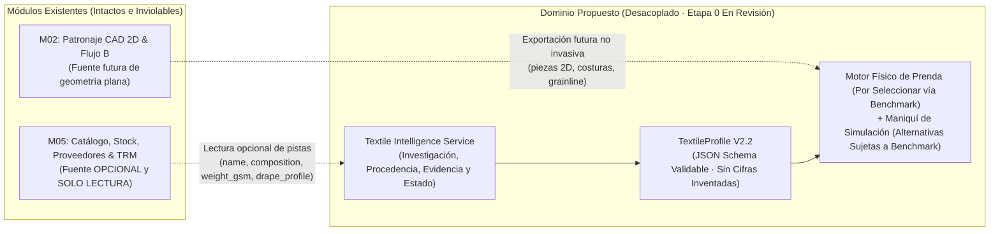
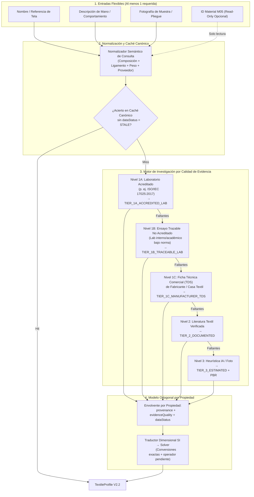
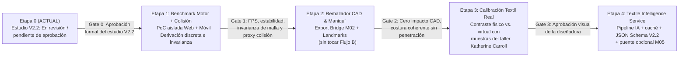

# ESTUDIO DE VIABILIDAD Y ARQUITECTURA TÉCNICA V2.2: SIMULADOR DE PRENDAS 3D E INTELIGENCIA TEXTIL INDEPENDIENTE
**Atelier Digital App — By Katherine Carroll**  
**Versión:** 2.2 (Corrección de Hallazgos Residuales de Auditoría sobre V2.1)  
**Estado del Documento:** **En revisión / pendiente de aprobación**  
**Fecha:** 2026-11-14  
**Naturaleza:** Estudio de Arquitectura, Modelo Metrológico de Procedencia/Evidencia/Estado, Contrato JSON Schema V2.2 y Plan de Validación (Sin modificación de código, dependencias, configuraciones ni base de datos)  
**Documento base revisado:** [`ESTUDIO_VIABILIDAD_SIMULADOR_PRENDAS_3D_V2.1.md`](file:///d:/Datos/Datos/DATOS%20JVINAS/Antigravity/2.ByKatherineCarroll/AtelierDigitalApp/ESTUDIO_VIABILIDAD_SIMULADOR_PRENDAS_3D_V2.1.md)

> [!IMPORTANT]
> **Declaración de Integridad Técnica y Alcance V2.2:**  
> Esta revisión V2.2 preserva íntegramente la arquitectura conceptual aprobada y las cinco correcciones aceptadas en V2.1, resolviendo los cuatro hallazgos residuales de auditoría. **No modifica código fuente, dependencias, configuraciones, SQL, migraciones ni los módulos M00–M07.** M05 continúa estrictamente opcional y de solo lectura; M02 y Flujo B permanecen intactos. No se inventan normas, acreditaciones, cifras físicas, fuentes ni resultados de benchmark.

---

## 1. Matriz de Correcciones V2.1 → V2.2

| # | Hallazgo Residual en V2.1 | Ubicación en V2.1 | Corrección Aplicada en V2.2 |
| :---: | :--- | :--- | :--- |
| **1** | **Equiparación parcial entre ensayo trazable de laboratorio y laboratorio acreditado:** `TIER_1A_LAB_CERTIFIED` mezclaba ensayos realizados en laboratorio acreditado formalmente (p. ej. `ISO/IEC 17025:2017`) con ensayos trazables realizados en laboratorios internos, académicos o no acreditados. | §5, §7.1, §8.1, §12.1, §13 | Se desdobla en dos niveles distintos: **`TIER_1A_ACCREDITED_LAB`** (informe bajo norma identificable emitido por laboratorio con acreditación verificable vigente, p. ej. `ISO/IEC 17025:2017`, con entidad acreditadora y declaración de incertidumbre) y **`TIER_1B_TRACEABLE_LAB`** (ensayo instrumental bajo norma identificable con protocolo y condiciones documentadas en laboratorio interno/académico o no acreditado), desplazando la ficha comercial de fabricante a **`TIER_1C_MANUFACTURER_TDS`**. |
| **2** | **Acoplamiento entre procedencia, calidad de evidencia y estado del dato:** `DataTier` incluía `DESIGNER_OVERRIDE` junto a niveles probatorios y mezclaba origen documental, fuerza de evidencia y ciclo de vida (`null` / `stale` / ajustado). | §5, §7.1, §7.2, §8.1, §9, §12.1 | Se establece un modelo ortogonal de **tres ejes independientes por propiedad**: (1) **`provenance`** (origen, actor/modelo, referencia documental, norma y acondicionamiento), (2) **`evidenceQuality`** (`TIER_1A_ACCREDITED_LAB` .. `TIER_3_ESTIMATED`), y (3) **`dataStatus`** (`PENDING_SOURCE`, `VERIFIED_RECORD`, `WORKSHOP_OVERRIDDEN`, `STALE_RECOMPUTE_REQUIRED`). |
| **3** | **Contrato §7.2 no validable automáticamente:** Usaba marcadores de tipo dentro de cadenas (`"<number: ...>"`) en un único pseudoejemplo JSON sin definición formal de esquema. | §7.2 | Se divide §7.2 en: **(a) JSON Schema Draft 2020-12 formal y validable**, con reglas condicionales (`if/then`) por nivel de evidencia y nulabilidad explícita, y **(b) Ejemplo JSON sintácticamente válido** conforme al Schema, con `dataStatus: "PENDING_SOURCE"` y valores numéricos físicos en `null` (**cero cifras físicas inventadas**). |
| **4** | **Etapa 0 declarada prematuramente como aprobada:** El flujo §13 mostraba `Estudio V2.1 Aprobado` cuando el documento seguía en revisión de auditoría. | Cabecera, §13 | Se actualiza el estado de **Etapa 0** a **`En revisión / pendiente de aprobación`** y se introduce el **Criterio de Paso Etapa 0 → Etapa 1** previo a iniciar cualquier PoC o benchmark. |

### Conservación Íntegra de las Cinco Correcciones Aceptadas en V2.1
1. Identificación exacta de los cuatro módulos Kato Tech **`KES-FB1`** (*Tensile & Shear*), **`KES-FB2`** (*Pure Bending*), **`KES-FB3`** (*Compression*) y **`KES-FB4`** (*Surface*), junto con **`CSIRO FAST-1..4`**.
2. Separación estricta entre **ficha técnica comercial del fabricante (TDS)** y **ensayos instrumentados de laboratorio**.
3. Eliminación de rangos numéricos físicos o umbrales sin fuente verificable.
4. Clasificación de las ecuaciones discretas de *compliance* XPBD como **pendientes de derivación matemática específica** vinculada al operador elegido y verificación de invarianza bajo remallado.
5. Conversión de requisitos de densidad de malla, SDF y cápsulas del maniquí en **alternativas técnicas abiertas sujetas a benchmark**.

---

## 2. Visión Funcional y Separación de Dominios

La visión funcional para *By Katherine Carroll* permanece invariable: habilitar una futura herramienta visual de simulación 3D de prendas que ayude a evaluar caída, volumen, tensión y proporciones textiles antes del corte físico, alimentada por un servicio independiente de inteligencia textil que no exija registro previo en inventario.



### Principios Inquebrantables de Frontera
1. **Independencia total de M05:** El simulador y el *Textile Intelligence Service* operan al 100% incluso con el inventario de M05 vacío o desvinculado. M05 nunca será dependencia obligatoria ni sufrirá cambios en sus tablas, flujos comerciales, stock o TRM.
2. **Preservación de M02 y Flujo B:** El motor de patronaje CAD 2D de M02 y el Flujo B conservan la autoridad geométrica y milimétrica para el corte físico de la tela. No se rediseña M02.
3. **Separación entre torso visual y maniquí de simulación:** El prototipo aislado [`src/components/mannequin3d/`](file:///d:/Datos/Datos/DATOS%20JVINAS/Antigravity/2.ByKatherineCarroll/AtelierDigitalApp/src/components/mannequin3d/) es exclusivamente un busto visual exploratorio (no integrado en producción) y no cumple por sí solo los requisitos funcionales para simulación física de prendas.

---

## 3. Motores Físicos de Simulación Textil: Evaluación Comparativa y Pruebas Pendientes

> [!CAUTION]
> **Estado de Verificación:** Ninguno de los motores siguientes ha sido ejecutado ni medido dentro de Atelier Digital (Web o móvil Expo). Toda caracterización de desempeño corresponde a literatura técnica externa y constituye una hipótesis sujeta a medición empírica antes de seleccionar un motor definitivo.

| Candidato / Familia | Fundamento Teórico | Ventajas Reportadas en Literatura | Riesgos y Limitaciones en Web/Expo | Estado en Atelier Digital |
| :--- | :--- | :--- | :--- | :--- |
| **XPBD** (*Extended Position-Based Dynamics*, Macklin et al., 2016) | Proyección de restricciones con *compliance* elástico ($\alpha$) y multiplicadores de Lagrange regularizados respecto a $\Delta t$ y número de iteraciones. | Estabilidad numérica alta; soporte directo de restricciones de distancia, flexión isométrica/diédrica y anisotropía; menor sensibilidad al paso de tiempo e iteraciones que PBD clásico. | La alta rigidez planar en tejidos sin elastano exige subpasos suficientes o aceleración en WebAssembly / GPU Compute para evitar elongación artificial o pérdida de fluidez en móvil. | **Candidato Principal a Evaluar (No seleccionado aún).** |
| **PBD Clásico** (Müller et al., 2007) | Proyección geométrica directa de restricciones sin *compliance* físico en unidades SI. | Implementación ligera en JS puro; estabilidad alta. | La rigidez efectiva depende del número de iteraciones y de $\Delta t$; sus coeficientes ($k \in [0,1]$) **no tienen correspondencia dimensional directa** con magnitudes textiles ($\text{N/m}$, $\mu\text{N}\cdot\text{m}$). | **Candidato Secundario de Contraste** (línea base comparativa). |
| **Mass-Spring Implícito / Semi-Implícito** | Red de partículas con fuerzas elásticas integradas mediante esquemas implícitos o Verlet amortiguado. | Formulación directa de la ley de Hooke. | Inestabilidad numérica con rigideces altas salvo resolución de sistemas lineales dispersos en cada paso, costosa en cliente ligero. | **Descartado preliminarmente para JS directo**, opcional solo como contraste implícito en Wasm. |
| **FEM Continuo** (*Finite Element Method*) | Mecánica del medio continuo no lineal sobre elementos finitos. | Referencia de precisión ingenieril para análisis estructural de tensiones. | Coste computacional incompatible con interactividad en tiempo real en navegadores móviles convencionales. | **Fuera de alcance** para simulación interactiva en cliente. |
| **Entorno de Ejecución (JS vs. Wasm vs. WebGPU/WebGL Compute)** | Runtime del bucle físico y detección de colisiones. | JS evita compilación nativa; Rust/C++ → **WebAssembly (Wasm)** acelera cómputo numérico y colisiones; WebGPU/WebGL GPGPU ofrece paralelismo masivo. | Expo móvil (iOS/Android) condiciona WebGPU nativo y exige evaluar `WebView` vs. `expo-gl` vs. módulos nativos JSI/C++ (incompatibles con Expo Go puro). | **Asunto Técnico Abierto:** Debe medirse en PoC real en Etapa 1. |

### Batería Obligatoria de Pruebas Comparativas de Motores (Previa a Selección Definitiva)
Antes de declarar un motor definitivo, deberán ejecutarse pruebas reproducibles que midan:
1. **Escalamiento por densidad de malla de prenda:** Tiempo por paso (`ms/step`) y FPS sostenidos a través de una matriz escalonada de densidades crecientes desde corpiño simple hasta vestido largo con vuelo (niveles exactos definidos en el protocolo de Etapa 1).
2. **Entornos objetivo reales:** Web Desktop, Web Móvil y el runtime móvil Expo evaluado (`WebView` vs. `expo-gl`).
3. **Prueba de no-estiramiento (*Locking / Super-elasticity Test*):** Simular un tejido plano no elástico bajo gravedad $\mathbf{g} = -9.81\ \text{m/s}^2$ y verificar que la elongación longitudinal no supere el criterio objetivo definido al aprobar el protocolo de Gate 1.
4. **Prueba de flexión diferencial (*Virtual Cantilever / Drape Contrast*):** Verificar diferencias observables claras entre arquetipos rígido, intermedio y fluido, contrastados frente a muestras físicas reales del taller de Katherine Carroll.
5. **Auto-colisión multicapa y pliegues:** Verificar ausencia de penetraciones severas en faldas con pliegues y conjuntos de tela principal + forro.

---

## 4. Taxonomía Textil Corregida: Normas, Unidades y Conversión Física

### 4.1 Tabla Maestra de Propiedades Físicas, Instrumentación, Normas y Unidades

| Propiedad Requerida | Normas e Instrumentos Aplicables | Unidad de Laboratorio / SI | Qué Mide Realmente el Ensayo (y Alcance) | Rol en el Simulador de Prenda |
| :--- | :--- | :---: | :--- | :--- |
| **Composición** | **ISO 1833** (análisis químico cuantitativo) · **AATCC TM20 / TM20A** · Declaración comercial de etiqueta | `%` en masa por fibra | Identidad y proporción de fibras constituyentes. | Condiciona densidad estimada, comportamiento elástico, recuperación e iluminación óptica PBR. |
| **Construcción / Ligamento** | **ISO 3572** (definiciones de ligamentos) · **ASTM D3775** (densidad de hilos en tejido plano) · Inspección macroscópica | Hilos/cm (urdimbre × trama) y clase estructural | Tipo de estructura (tafetán, sarga, raso, jacquard, punto) y densidad de hilos. | Determina la **anisotropía** entre urdimbre (*warp*), trama (*weft*) y bies (*bias*, 45°), además de la respuesta al cizallamiento. |
| **Peso / Masa Superficial** | **ISO 3801** · **ASTM D3776 / D3776M** (acondicionamiento estándar bajo **ISO 139**) | $\text{g/m}^2$ ($\text{GSM}$) o $\text{oz/yd}^2$ ($1\ \text{oz/yd}^2 \approx 33.906\ \text{g/m}^2$) | Masa por unidad de área de tela acondicionada. | Define la masa nodal $m_i$ asignada a cada vértice/triángulo bajo gravedad. |
| **Grosor / Compresión** | **ISO 5084** · **ASTM D1777** · **KES-FB3** (*Compression Tester*: $T_0, T_m, EMC, WC, RC$) · **CSIRO FAST-1** (*Compression Meter*) | $\text{mm}$ (espesor); `%` ($EMC$, $RC$); $\text{gf}\cdot\text{cm/cm}^2$ ($WC$) | Espesor bajo presión estándar definida y compresibilidad normal al plano. | Define el margen de separación de colisión (*collision thickness offset*) contra el cuerpo y entre capas. |
| **Flexión / Rigidez Flexural** | **ASTM D1388** (Cantilever / longitud de flexión) · **ISO 9073-7** (no tejidos, método cantilever) · **KES-FB2** (*Pure Bending Tester*: $B, 2HB$) · **CSIRO FAST-2** (*Bending Meter*) | Longitud $c$ ($\text{cm}$ o $\text{mm}$); $G_{\text{D1388}}$ ($\text{mg}\cdot\text{cm}$); $B_{\text{KES}}$ ($\text{gf}\cdot\text{cm}^2/\text{cm} = \text{gf}\cdot\text{cm}$); SI ($\mu\text{N}\cdot\text{m}$ o $\text{N}\cdot\text{m}$) | Resistencia pura del tejido a curvarse fuera de su plano por peso propio o momento flector aplicado. | Controla el radio de curvatura de pliegues, caída en campana y volumen estructural. |
| **Elasticidad (Tracción de baja carga y alta carga)** | **Baja carga (drapeado):** **KES-FB1** (*Tensile & Shear Tester* — módulo tracción: $EMT, WT, LT$) · **CSIRO FAST-3** (*Extension Meter*: $E_5, E_{20}, E_{100}$). **Tejidos elásticos:** **ASTM D3107** (plano), **ASTM D2594 / D2594M** (punto), **ISO 20932-1**. **Rotura (límite máximo):** **ISO 13934-1/-2**, **ASTM D5034 / D5035**. | Extensión `%` bajo carga definida ($\text{gf/cm}$ o $\text{N}$); rigidez lineal equivalente ($\text{N/m}$) | ⚠️ `ASTM D5034/D5035` e `ISO 13934` miden **fuerza y elongación a la rotura** en `N`, órdenes de magnitud por encima del régimen de caída en prenda. Para simulación se requieren ensayos de baja tensión o elasticidad cíclica. | Alimenta las restricciones de extensión en urdimbre, trama y bies. |
| **Recuperación Elástica** | **ASTM D3107** · **ASTM D2594 / D2594M** · **ISO 20932-1** · **KES-FB1** ($RT$ resiliencia a tracción %) | `%` de recuperación elástica y `%` de deformación residual (*growth*) | Capacidad de recuperar la longitud inicial tras retirar una carga de tracción. | Modela histéresis de ajuste y tendencia a ceder en prendas ceñidas. |
| **Cizallamiento (Shear)** | **KES-FB1** (*Tensile & Shear Tester* — módulo $G$, histéresis $2HG$, $2HG5$) · **CSIRO FAST-3** (extensión al bies $EB_5$ para derivar rigidez de cizallamiento) | $\text{gf}/(\text{cm}\cdot^\circ)$ (KES-FB1) o $\text{N}/(\text{m}\cdot\text{rad})$ (SI); `%` al bies (FAST-3) | Resistencia angular de los hilos de urdimbre y trama a deformarse en paralelogramo bajo esfuerzo diagonal. | Crítico para modelar cómo la tela se adapta a superficies curvas (busto, cadera) y cortes al bies. |
| **Caída (Drape)** | **ISO 9073-9** (determinación de drapeabilidad incluido coeficiente de caída) · **BS 5058** (Cusick Drapemeter) | Coeficiente de caída $DC$ (`%`) y morfología/número de ondas (*nodes*) | Área proyectada de sombra de un disco textil colgando por peso propio sobre pedestal circular. | **Métrica de calibración y validación visual, NO entrada física independiente:** emerge de masa superficial + flexión + cizallamiento. |
| **Fricción y Rugosidad Superficial** | **KES-FB4** (*Surface Tester*: coeficiente de fricción $MIU$, fluctuación $MMD$, rugosidad geométrica $SMD$) · **ASTM D1894** / **ISO 8295** (solo referencia adaptada para plásticos/laminados/recubiertos) | $MIU$ y $MMD$ adimensionales; $SMD$ en $\mu\text{m}$ | Resistencia al deslizamiento superficial bajo carga normal baja y perfil geométrico superficial. | Controla el deslizamiento entre tela principal, forro y superficie del maniquí. |

> [!NOTE]
> **Desambiguación de los Cuatro Módulos Kawabata (KES-FB, Kato Tech Co., Ltd.):**  
> - **KES-FB1:** *Tensile and Shear Tester* (tracción de baja carga + cizallamiento).  
> - **KES-FB2:** *Pure Bending Tester* (flexión pura).  
> - **KES-FB3:** *Compression Tester* (espesor y compresión normal).  
> - **KES-FB4:** *Surface Tester* (fricción superficial y rugosidad geométrica).  
> Por su parte, **CSIRO FAST** comprende **FAST-1** (compresión/espesor), **FAST-2** (flexión cantilever), **FAST-3** (extensión baja carga y derivada de cizallamiento al bies) y **FAST-4** (estabilidad dimensional húmedo-seco).

---

### 4.2 Conversiones Dimensionales a SI y Ecuaciones Discretas Pendientes de Derivación

La capa traductora distingue estrictamente entre **conversiones exactas de unidades físicas** y **ecuaciones de mapeo al solver discreto**.

#### A. Conversiones Dimensionales Exactas a Unidades SI (Verificadas Algebraicamente)

1. **Flexión (*Bending Rigidity*) a SI ($\text{N}\cdot\text{m}$ y $\mu\text{N}\cdot\text{m}$):**
   - Desde **KES-FB2** ($B$ en $\text{gf}\cdot\text{cm}^2/\text{cm} = \text{gf}\cdot\text{cm}$):
     $$B_{\text{SI}}\ [\text{N}\cdot\text{m}] = B_{\text{KES}} \times (9.80665 \times 10^{-3}\ \text{N/gf}) \times 10^{-2}\ \text{m/cm} = B_{\text{KES}} \times 9.80665 \times 10^{-5}$$
     $$B_{\mu\text{Nm}} = B_{\text{KES}} \times 98.0665\ \mu\text{N}\cdot\text{m}$$
   - Desde **ASTM D1388** (longitud de flexión $c$ en $\text{cm}$ y masa superficial $\rho_{\text{gsm}}$ en $\text{g/m}^2$, dado $1\ \text{g/m}^2 = 0.1\ \text{mg/cm}^2$):
     $$G_{\text{D1388}}\ [\text{mg}\cdot\text{cm}] = 0.1 \cdot \rho_{\text{gsm}} \cdot c_{\text{cm}}^3$$
     $$B_{\mu\text{Nm}} = G_{\text{D1388}} \times 0.0980665\ \mu\text{N}\cdot\text{m}$$

2. **Cizallamiento (KES-FB1 $G$) a SI ($\text{N}/(\text{m}\cdot\text{rad})$):**
   - Dado $1\ \text{gf/cm} = 0.980665\ \text{N/m}$ y $1^\circ = \frac{\pi}{180}\ \text{rad} \approx 0.01745329\ \text{rad}$:
     $$G_{\text{SI}}\ [\text{N}/(\text{m}\cdot\text{rad})] = G_{\text{KES}}\ [\text{gf}/(\text{cm}\cdot^\circ)] \times \frac{0.980665}{\pi / 180} \approx G_{\text{KES}} \times 56.1879$$

3. **Rigidez Lineal Equivalente de Tracción de Baja Carga ($\text{N/m}$):**
   - Si se dispone de extensión porcentual $E_w$ (%) bajo fuerza lineal por unidad de ancho $F_w$ en $\text{N/m}$ (ej. en **CSIRO FAST-3**, $100\ \text{gf/cm} = 98.0665\ \text{N/m}$):
     $$K_{\text{stretch}}\ [\text{N/m}] \approx \frac{F_w}{E_w / 100}$$
   - ⚠️ **Limitación física:** Las curvas fuerza-elongación textiles son no lineales; un escalar lineal único representa una aproximación inicial pendiente de ajuste por tramos o calibración según el motor seleccionado.

#### B. Mapeo a *Compliance* XPBD ($\alpha$) — **PENDIENTE DE DERIVACIÓN Y VERIFICACIÓN ESPECÍFICA**

En **XPBD** (Macklin et al., 2016, DOI: [`10.1145/2994258.2994272`](https://dl.acm.org/doi/10.1145/2994258.2994272)), $\tilde{\alpha}_j = \alpha_j / \Delta t^2$ se asocia a $U_j(\mathbf{x}) = \frac{1}{2 \alpha_j} C_j(\mathbf{x})^2$. La relación entre constantes continuas ($K_{\text{stretch}}$, $G_{\text{shear}}$, $B_{\text{SI}}$) y $\alpha_j$ depende de la formulación discreta exacta $C_j(\mathbf{x})$ elegida (CST / Saint Venant-Kirchhoff frente a *edge springs* para membrana; ángulo diédrico frente a curvatura isométrica para flexión). Por ello, todas las ecuaciones discretas permanecen clasificadas como **pendientes de derivación formal vinculada al operador elegido en Etapa 1** y sujetas a prueba numérica de invarianza bajo remallado antes de programar el solver.

---

## 5. Arquitectura del *Textile Intelligence Service* (Independiente de M05)

El servicio separa en capas desacopladas la investigación documental, el modelo de tres ejes por propiedad y el traductor hacia el motor físico:



### Reglas de Operación del Servicio
1. **Nunca exigir M05:** Si la diseñadora aporta únicamente nombre, descripción o foto, el servicio entrega un `TextileProfile V2.2` válido sin consultar M05.
2. **Distinción obligatoria entre laboratorio acreditado, laboratorio trazable y TDS comercial:**
   - Un informe **no** puede marcarse como `TIER_1A_ACCREDITED_LAB` sin identificar el organismo o código verificable de acreditación (p. ej. `ISO/IEC 17025:2017`) y el método normalizado ejecutado.
   - Un ensayo ejecutado conforme a una norma técnica en un laboratorio interno de molino, centro universitario o taller sin acreditación verificable de tercera parte debe clasificarse como **`TIER_1B_TRACEABLE_LAB`**.
   - Una ficha comercial de fabricante que declara valores nominales de catálogo sin informe de ensayo ni condiciones/incertidumbre pertenece exclusivamente a **`TIER_1C_MANUFACTURER_TDS`**.
3. **Granularidad por propiedad y prohibición de invención:** Cada propiedad conserva su propia tupla `(provenance, evidenceQuality, dataStatus)`. Si no hay fuente documental verificable para un parámetro, `dataStatus` debe declararse como `PENDING_SOURCE` (o `TIER_3_ESTIMATED` solo con justificación explícita de supuesto), sin inventar jamás nombres de laboratorios, números de acreditación, códigos de norma ni mediciones numéricas.

---

## 6. Análisis por Fotografía: Alcances Reales y Límites Físicos

El análisis visual multimodal cumple una función de **clasificación morfológica y texturizado óptico PBR**, nunca de metrología física:

| Capacidad | Viable por Fotografía | Nivel de Evidencia Máximo | Justificación Física |
| :--- | :---: | :---: | :--- |
| **Acabado óptico superficial** (brillo satinado, mate lanoso, relieve brocado, transparencia) | ✅ Sí (Orientativo) | Óptico / PBR (`TIER_3_ESTIMATED` si orienta física) | La respuesta especular y textura visual reflejan apariencia óptica. |
| **Apariencia de ligamento / grano macroscópico** (tafetán, sarga diagonal, raso, encaje) | ✅ Sí (en foto enfocada) | `TIER_3_ESTIMATED` | Patrones geométricos orientan la estructura probable sin confirmar densidad real ni composición química. |
| **Mapas PBR de renderizado** (albedo, rugosidad visual, normal map aproximado) | ✅ Sí | Visual únicamente | Realismo gráfico sin alterar parámetros mecánicos del solver. |
| **Medición de masa superficial ($\text{g/m}^2$)** | ❌ **NO** | No aplicable | Dos telas de aspecto visual similar pueden diferir sustancialmente en gramaje por densidad de fibra, título y torsión de hilo. |
| **Medición de rigidez flexural ($B$), tracción ($K$) o cizallamiento ($G$)** | ❌ **NO** | No aplicable | Sin fuerzas conocidas ni escala física calibrada, una fotografía estática no determina constantes mecánicas. |
| **Identificación química de fibra** | ❌ **NO** | No aplicable | Requiere ficha técnica, etiqueta declarada o análisis analítico (`ISO 1833` / `AATCC TM20`). |

> [!WARNING]
> **Regla Irrevocable:** Si la única entrada es una fotografía sin ficha técnica ni ensayo, **ninguna propiedad mecánica puede superar `evidenceQuality = TIER_3_ESTIMATED`** y los campos sin fuente verificable deben quedar en `dataStatus = PENDING_SOURCE` (con aviso visible en la UI).

---

## 7. Modelo Ortogonal (Procedencia · Calidad de Evidencia · Estado del Dato) y Contrato JSON Schema V2.2

### 7.1 Separación Estricta de los Tres Ejes por Propiedad

En V2.1, `DataTier` aún mezclaba acciones humanas (`DESIGNER_OVERRIDE`) y estados operativos con la calidad probatoria. En V2.2, cada propiedad física individual implementa tres ejes ortogonales claramente definidos:

#### Eje 1: Calidad de Evidencia (`evidenceQuality`)
Clasifica únicamente el **rigor metrológico y probatorio del respaldo disponible**:

| Código (`evidenceQuality`) | Definición Objetiva | Requisitos Obligatorios de Validación |
| :--- | :--- | :--- |
| **`TIER_1A_ACCREDITED_LAB`** | Ensayo instrumentado emitido por **laboratorio acreditado** bajo esquema oficial verificable (p. ej. `ISO/IEC 17025:2017` o organismo nacional equivalente). | `provenance.accreditationRef` no nulo, `provenance.standardRef` explícito, `provenance.documentRef` verificable, condiciones (ej. `ISO 139`) e incertidumbre si constan. |
| **`TIER_1B_TRACEABLE_LAB`** | Ensayo instrumentado en **laboratorio no acreditado, interno de fabricante o centro académico**, con método normalizado identificable (`ISO`, `ASTM`, `KES-FB1..4`, `CSIRO FAST-1..4`). | `provenance.standardRef` explícito y `provenance.documentRef` verificable del informe o bitácora; `accreditationRef` en `null` (prohibido presentarlo como acreditado). |
| **`TIER_1C_MANUFACTURER_TDS`** | Especificación nominal publicada en **ficha técnica comercial (TDS)** del fabricante o proveedor textil. | `provenance.documentRef` verificable del TDS y `provenance.sourceName`; reconoce ausencia de protocolo de ensayo completo e incertidumbre de laboratorio. |
| **`TIER_2_DOCUMENTED`** | Rango o valor documentado en **literatura científica o compendios textiles verificables** para una construcción textil equivalente (no corresponde al lote físico específico). | `provenance.documentRef` con cita bibliográfica verificable exacta; expresado preferiblemente como rango `{ min, typical, max }`. |
| **`TIER_3_ESTIMATED`** | Hipótesis cualitativa o inferencia asistida por IA, analogía constructiva o inspección visual sin ensayo ni literatura directa del artículo. | `assumptionNote` explicando el supuesto; prohibido mostrarse en UI como dato medido o verificado. |

#### Eje 2: Procedencia (`provenance`)
Registra **quién o qué generó el registro y bajo qué soporte documental**:
- `sourceType`: `"ACCREDITED_LAB"` | `"TRACEABLE_LAB"` | `"MANUFACTURER_TDS"` | `"SCIENTIFIC_LITERATURE"` | `"M05_READONLY_HINT"` | `"AI_HEURISTIC"` | `"WORKSHOP_OBSERVATION"`
- `sourceName`: Nombre real de la fuente (o `null` si está pendiente).
- `documentRef`: URL real, DOI, código de informe trazable o cita verificable (o `null`).
- `standardRef`: Código de norma o instrumento aplicado (ej. `"ISO 3801"`, `"KES-FB2"`, o `null`).
- `accreditationRef`: Identificador verificable de acreditación del laboratorio (solo aplicable a `TIER_1A_ACCREDITED_LAB`, `null` en todos los demás casos).
- `conditioningProtocol`: Atmósfera o condiciones de ensayo si constan (ej. `"ISO 139"` o `null`).
- `actorOrModelId`: Identificador del laboratorio, diseñadora o modelo de IA que registró la entrada.
- `recordedAt`: Marca temporal ISO-8601 UTC.
- `previousValueAudit`: Referencia opcional al valor/estado anterior cuando ocurre un reemplazo manual (`WORKSHOP_OVERRIDDEN`), preservando trazabilidad completa sin destruir el dato original.

#### Eje 3: Estado del Dato (`dataStatus`)
Refleja el **estado operativo y de vigencia en el ciclo de vida del perfil**:

| Código (`dataStatus`) | Significado Operativo | Regla de Valores Numéricos |
| :--- | :--- | :--- |
| **`PENDING_SOURCE`** | La propiedad no cuenta todavía con medición ni cita verificable en esta consulta. | `measuredValue` debe ser `null` y `range` debe ser `null`. |
| **`VERIFIED_RECORD`** | La propiedad contiene un valor o rango documentado directamente desde la fuente declarada en `provenance`. | `measuredValue` numérico y/o `range` `{ min, max }` no nulos respaldados por `documentRef`. |
| **`WORKSHOP_OVERRIDDEN`** | Valor ajustado manualmente en taller por Katherine Carroll (p. ej. tras comparar caída física frente a retazo). | Conserva el valor ajustado como preferencia de usuario junto a `previousValueAudit` y nota de muestra física; **no** eleva `evidenceQuality` a laboratorio. |
| **`STALE_RECOMPUTE_REQUIRED`** | Registro previamente cacheado cuya vigencia expiró o cuya traducción al solver quedó obsoleta tras actualizar `converterVersion`. | Debe refrescarse o recalcularse antes de usarse como referencia activa. |

---

### 7.2 Contrato Formal de Datos V2.2: JSON Schema y Ejemplo Válido

#### 7.2.1 JSON Schema V2.2 (`Draft 2020-12`, Validable)

```json
{
  "$schema": "https://json-schema.org/draft/2020-12/schema",
  "$id": "https://atelierdigital.local/schemas/textile-profile-v2.2.schema.json",
  "title": "TextileProfileV2_2",
  "description": "Contrato estructural V2.2 con separación ortogonal de procedencia, calidad de evidencia y estado del dato por propiedad individual.",
  "type": "object",
  "additionalProperties": false,
  "required": [
    "schemaVersion",
    "profileId",
    "cacheKey",
    "createdAt",
    "identification",
    "overallSummary",
    "physicalProperties",
    "solverTranslationMetadata",
    "optionalM05Link",
    "serviceProvenance"
  ],
  "properties": {
    "schemaVersion": {
      "const": "2.2.0-draft"
    },
    "profileId": {
      "type": "string",
      "minLength": 1
    },
    "cacheKey": {
      "type": "string",
      "minLength": 1
    },
    "createdAt": {
      "type": "string",
      "format": "date-time"
    },
    "identification": {
      "type": "object",
      "additionalProperties": false,
      "required": ["displayName", "composition", "weaveType"],
      "properties": {
        "displayName": {
          "type": "string",
          "minLength": 1
        },
        "composition": {
          "$ref": "#/$defs/StringMetadataEnvelope"
        },
        "weaveType": {
          "$ref": "#/$defs/StringMetadataEnvelope"
        }
      }
    },
    "overallSummary": {
      "type": "object",
      "additionalProperties": false,
      "required": [
        "highestEvidenceQuality",
        "lowestEvidenceQuality",
        "countsByEvidenceQuality",
        "countsByDataStatus",
        "requiresPhysicalCalibration"
      ],
      "properties": {
        "highestEvidenceQuality": { "$ref": "#/$defs/EvidenceQualityTier" },
        "lowestEvidenceQuality": { "$ref": "#/$defs/EvidenceQualityTier" },
        "countsByEvidenceQuality": {
          "type": "object",
          "additionalProperties": false,
          "required": [
            "TIER_1A_ACCREDITED_LAB",
            "TIER_1B_TRACEABLE_LAB",
            "TIER_1C_MANUFACTURER_TDS",
            "TIER_2_DOCUMENTED",
            "TIER_3_ESTIMATED"
          ],
          "properties": {
            "TIER_1A_ACCREDITED_LAB": { "type": "integer", "minimum": 0 },
            "TIER_1B_TRACEABLE_LAB": { "type": "integer", "minimum": 0 },
            "TIER_1C_MANUFACTURER_TDS": { "type": "integer", "minimum": 0 },
            "TIER_2_DOCUMENTED": { "type": "integer", "minimum": 0 },
            "TIER_3_ESTIMATED": { "type": "integer", "minimum": 0 }
          }
        },
        "countsByDataStatus": {
          "type": "object",
          "additionalProperties": false,
          "required": [
            "PENDING_SOURCE",
            "VERIFIED_RECORD",
            "WORKSHOP_OVERRIDDEN",
            "STALE_RECOMPUTE_REQUIRED"
          ],
          "properties": {
            "PENDING_SOURCE": { "type": "integer", "minimum": 0 },
            "VERIFIED_RECORD": { "type": "integer", "minimum": 0 },
            "WORKSHOP_OVERRIDDEN": { "type": "integer", "minimum": 0 },
            "STALE_RECOMPUTE_REQUIRED": { "type": "integer", "minimum": 0 }
          }
        },
        "requiresPhysicalCalibration": { "type": "boolean" }
      }
    },
    "physicalProperties": {
      "type": "object",
      "additionalProperties": false,
      "required": [
        "arealDensity_gsm",
        "thickness_mm",
        "bendingStiffness_warp_uNm",
        "bendingStiffness_weft_uNm",
        "stretchStiffness_lowStrain_warp_N_per_m",
        "stretchStiffness_lowStrain_weft_N_per_m",
        "elasticRecovery_percent",
        "shearStiffness_N_per_m_rad",
        "frictionCoefficient_clothToCloth"
      ],
      "properties": {
        "arealDensity_gsm": { "$ref": "#/$defs/PhysicalPropertyEnvelope" },
        "thickness_mm": { "$ref": "#/$defs/PhysicalPropertyEnvelope" },
        "bendingStiffness_warp_uNm": { "$ref": "#/$defs/PhysicalPropertyEnvelope" },
        "bendingStiffness_weft_uNm": { "$ref": "#/$defs/PhysicalPropertyEnvelope" },
        "stretchStiffness_lowStrain_warp_N_per_m": { "$ref": "#/$defs/PhysicalPropertyEnvelope" },
        "stretchStiffness_lowStrain_weft_N_per_m": { "$ref": "#/$defs/PhysicalPropertyEnvelope" },
        "elasticRecovery_percent": { "$ref": "#/$defs/PhysicalPropertyEnvelope" },
        "shearStiffness_N_per_m_rad": { "$ref": "#/$defs/PhysicalPropertyEnvelope" },
        "frictionCoefficient_clothToCloth": { "$ref": "#/$defs/PhysicalPropertyEnvelope" }
      }
    },
    "solverTranslationMetadata": {
      "type": "object",
      "additionalProperties": false,
      "required": [
        "targetSolverCandidate",
        "discreteFormulationStatus",
        "converterVersion",
        "notes"
      ],
      "properties": {
        "targetSolverCandidate": {
          "enum": ["PENDING_BENCHMARK_SELECTION", "XPBD", "PBD", "MASS_SPRING_IMPLICIT"]
        },
        "discreteFormulationStatus": {
          "enum": ["PENDING_OPERATOR_DERIVATION", "DERIVED_AND_REMESH_VERIFIED"]
        },
        "converterVersion": { "type": "string", "minLength": 1 },
        "notes": { "type": "string" }
      }
    },
    "optionalM05Link": {
      "type": "object",
      "additionalProperties": false,
      "required": ["linked", "materialId", "readOnlyFieldsUsed"],
      "properties": {
        "linked": { "type": "boolean" },
        "materialId": { "type": ["string", "null"] },
        "readOnlyFieldsUsed": {
          "type": "array",
          "items": { "type": "string" }
        }
      }
    },
    "serviceProvenance": {
      "type": "object",
      "additionalProperties": false,
      "required": ["aiAssisted", "aiModelId", "aiPromptVersion", "timestamp"],
      "properties": {
        "aiAssisted": { "type": "boolean" },
        "aiModelId": { "type": ["string", "null"] },
        "aiPromptVersion": { "type": ["string", "null"] },
        "timestamp": { "type": "string", "format": "date-time" }
      }
    }
  },
  "$defs": {
    "EvidenceQualityTier": {
      "type": "string",
      "enum": [
        "TIER_1A_ACCREDITED_LAB",
        "TIER_1B_TRACEABLE_LAB",
        "TIER_1C_MANUFACTURER_TDS",
        "TIER_2_DOCUMENTED",
        "TIER_3_ESTIMATED"
      ]
    },
    "DataStatus": {
      "type": "string",
      "enum": [
        "PENDING_SOURCE",
        "VERIFIED_RECORD",
        "WORKSHOP_OVERRIDDEN",
        "STALE_RECOMPUTE_REQUIRED"
      ]
    },
    "SourceType": {
      "type": "string",
      "enum": [
        "ACCREDITED_LAB",
        "TRACEABLE_LAB",
        "MANUFACTURER_TDS",
        "SCIENTIFIC_LITERATURE",
        "M05_READONLY_HINT",
        "AI_HEURISTIC",
        "WORKSHOP_OBSERVATION"
      ]
    },
    "NumericRange": {
      "type": "object",
      "additionalProperties": false,
      "required": ["min", "max"],
      "properties": {
        "min": { "type": "number", "minimum": 0 },
        "typical": { "type": ["number", "null"], "minimum": 0 },
        "max": { "type": "number", "minimum": 0 }
      }
    },
    "Provenance": {
      "type": "object",
      "additionalProperties": false,
      "required": [
        "sourceType",
        "sourceName",
        "documentRef",
        "standardRef",
        "accreditationRef",
        "conditioningProtocol",
        "actorOrModelId",
        "recordedAt"
      ],
      "properties": {
        "sourceType": { "$ref": "#/$defs/SourceType" },
        "sourceName": { "type": ["string", "null"] },
        "documentRef": { "type": ["string", "null"] },
        "standardRef": { "type": ["string", "null"] },
        "accreditationRef": { "type": ["string", "null"] },
        "conditioningProtocol": { "type": ["string", "null"] },
        "actorOrModelId": { "type": ["string", "null"] },
        "recordedAt": { "type": "string", "format": "date-time" },
        "previousValueAudit": {
          "type": ["object", "null"],
          "additionalProperties": false,
          "required": ["previousNumericValue", "previousEvidenceQuality", "overrideReason"],
          "properties": {
            "previousNumericValue": { "type": ["number", "null"] },
            "previousEvidenceQuality": { "$ref": "#/$defs/EvidenceQualityTier" },
            "overrideReason": { "type": "string" }
          }
        }
      }
    },
    "StringMetadataEnvelope": {
      "type": "object",
      "additionalProperties": false,
      "required": ["value", "evidenceQuality", "dataStatus", "provenance"],
      "properties": {
        "value": { "type": ["string", "null"] },
        "evidenceQuality": { "$ref": "#/$defs/EvidenceQualityTier" },
        "dataStatus": { "$ref": "#/$defs/DataStatus" },
        "provenance": { "$ref": "#/$defs/Provenance" }
      }
    },
    "PhysicalPropertyEnvelope": {
      "type": "object",
      "additionalProperties": false,
      "required": [
        "unit",
        "measuredValue",
        "range",
        "evidenceQuality",
        "dataStatus",
        "provenance",
        "assumptionNote"
      ],
      "properties": {
        "unit": { "type": "string", "minLength": 1 },
        "measuredValue": { "type": ["number", "null"], "minimum": 0 },
        "range": {
          "oneOf": [
            { "type": "null" },
            { "$ref": "#/$defs/NumericRange" }
          ]
        },
        "evidenceQuality": { "$ref": "#/$defs/EvidenceQualityTier" },
        "dataStatus": { "$ref": "#/$defs/DataStatus" },
        "provenance": { "$ref": "#/$defs/Provenance" },
        "assumptionNote": { "type": ["string", "null"] }
      },
      "allOf": [
        {
          "if": { "properties": { "evidenceQuality": { "const": "TIER_1A_ACCREDITED_LAB" } } },
          "then": {
            "properties": {
              "provenance": {
                "properties": {
                  "accreditationRef": { "type": "string", "minLength": 1 },
                  "standardRef": { "type": "string", "minLength": 1 },
                  "documentRef": { "type": "string", "minLength": 1 }
                }
              }
            }
          }
        },
        {
          "if": { "properties": { "evidenceQuality": { "const": "TIER_1B_TRACEABLE_LAB" } } },
          "then": {
            "properties": {
              "provenance": {
                "properties": {
                  "accreditationRef": { "type": "null" },
                  "standardRef": { "type": "string", "minLength": 1 },
                  "documentRef": { "type": "string", "minLength": 1 }
                }
              }
            }
          }
        },
        {
          "if": { "properties": { "evidenceQuality": { "const": "TIER_1C_MANUFACTURER_TDS" } } },
          "then": {
            "properties": {
              "provenance": {
                "properties": {
                  "accreditationRef": { "type": "null" },
                  "documentRef": { "type": "string", "minLength": 1 }
                }
              }
            }
          }
        },
        {
          "if": { "properties": { "dataStatus": { "const": "PENDING_SOURCE" } } },
          "then": {
            "properties": {
              "measuredValue": { "type": "null" },
              "range": { "type": "null" }
            }
          }
        }
      ]
    }
  }
}
```

#### 7.2.2 Ejemplo JSON Sintácticamente Válido Conforme al Schema V2.2 (Sin Cifras Físicas Inventadas)

> [!NOTE]
> Este ejemplo JSON cumple al 100% con `TextileProfileV2_2`. Todos los campos mecánicos físicos se mantienen con `dataStatus: "PENDING_SOURCE"`, `measuredValue: null` y `range: null` para demostrar el esquema sin fabricar mediciones ni rangos sin fuente documental.

```json
{
  "schemaVersion": "2.2.0-draft",
  "profileId": "example-profile-pending-001",
  "cacheKey": "norm:silk_mikado|weave:unknown|gsm:unknown|v2.2",
  "createdAt": "2026-11-14T21:00:00Z",
  "identification": {
    "displayName": "Consulta de ejemplo sin ficha ni ensayo adjunto",
    "composition": {
      "value": null,
      "evidenceQuality": "TIER_3_ESTIMATED",
      "dataStatus": "PENDING_SOURCE",
      "provenance": {
        "sourceType": "AI_HEURISTIC",
        "sourceName": null,
        "documentRef": null,
        "standardRef": "ISO 1833 / AATCC TM20",
        "accreditationRef": null,
        "conditioningProtocol": null,
        "actorOrModelId": "runtime-model-placeholder",
        "recordedAt": "2026-11-14T21:00:00Z",
        "previousValueAudit": null
      }
    },
    "weaveType": {
      "value": null,
      "evidenceQuality": "TIER_3_ESTIMATED",
      "dataStatus": "PENDING_SOURCE",
      "provenance": {
        "sourceType": "AI_HEURISTIC",
        "sourceName": null,
        "documentRef": null,
        "standardRef": "ISO 3572",
        "accreditationRef": null,
        "conditioningProtocol": null,
        "actorOrModelId": "runtime-model-placeholder",
        "recordedAt": "2026-11-14T21:00:00Z",
        "previousValueAudit": null
      }
    }
  },
  "overallSummary": {
    "highestEvidenceQuality": "TIER_3_ESTIMATED",
    "lowestEvidenceQuality": "TIER_3_ESTIMATED",
    "countsByEvidenceQuality": {
      "TIER_1A_ACCREDITED_LAB": 0,
      "TIER_1B_TRACEABLE_LAB": 0,
      "TIER_1C_MANUFACTURER_TDS": 0,
      "TIER_2_DOCUMENTED": 0,
      "TIER_3_ESTIMATED": 9
    },
    "countsByDataStatus": {
      "PENDING_SOURCE": 9,
      "VERIFIED_RECORD": 0,
      "WORKSHOP_OVERRIDDEN": 0,
      "STALE_RECOMPUTE_REQUIRED": 0
    },
    "requiresPhysicalCalibration": true
  },
  "physicalProperties": {
    "arealDensity_gsm": {
      "unit": "g/m2",
      "measuredValue": null,
      "range": null,
      "evidenceQuality": "TIER_3_ESTIMATED",
      "dataStatus": "PENDING_SOURCE",
      "provenance": {
        "sourceType": "AI_HEURISTIC",
        "sourceName": null,
        "documentRef": null,
        "standardRef": "ISO 3801 / ASTM D3776",
        "accreditationRef": null,
        "conditioningProtocol": null,
        "actorOrModelId": "runtime-model-placeholder",
        "recordedAt": "2026-11-14T21:00:00Z",
        "previousValueAudit": null
      },
      "assumptionNote": "Sin pesaje ni ficha técnica adjunta; pendiente de fuente documental o pesaje físico."
    },
    "thickness_mm": {
      "unit": "mm",
      "measuredValue": null,
      "range": null,
      "evidenceQuality": "TIER_3_ESTIMATED",
      "dataStatus": "PENDING_SOURCE",
      "provenance": {
        "sourceType": "AI_HEURISTIC",
        "sourceName": null,
        "documentRef": null,
        "standardRef": "ISO 5084 / ASTM D1777 / KES-FB3 / CSIRO FAST-1",
        "accreditationRef": null,
        "conditioningProtocol": null,
        "actorOrModelId": "runtime-model-placeholder",
        "recordedAt": "2026-11-14T21:00:00Z",
        "previousValueAudit": null
      },
      "assumptionNote": "Pendiente de medición o fuente bibliográfica."
    },
    "bendingStiffness_warp_uNm": {
      "unit": "uN*m",
      "measuredValue": null,
      "range": null,
      "evidenceQuality": "TIER_3_ESTIMATED",
      "dataStatus": "PENDING_SOURCE",
      "provenance": {
        "sourceType": "AI_HEURISTIC",
        "sourceName": null,
        "documentRef": null,
        "standardRef": "ASTM D1388 / KES-FB2 / CSIRO FAST-2",
        "accreditationRef": null,
        "conditioningProtocol": null,
        "actorOrModelId": "runtime-model-placeholder",
        "recordedAt": "2026-11-14T21:00:00Z",
        "previousValueAudit": null
      },
      "assumptionNote": "Pendiente de ensayo Cantilever o KES-FB2 en dirección de urdimbre."
    },
    "bendingStiffness_weft_uNm": {
      "unit": "uN*m",
      "measuredValue": null,
      "range": null,
      "evidenceQuality": "TIER_3_ESTIMATED",
      "dataStatus": "PENDING_SOURCE",
      "provenance": {
        "sourceType": "AI_HEURISTIC",
        "sourceName": null,
        "documentRef": null,
        "standardRef": "ASTM D1388 / KES-FB2 / CSIRO FAST-2",
        "accreditationRef": null,
        "conditioningProtocol": null,
        "actorOrModelId": "runtime-model-placeholder",
        "recordedAt": "2026-11-14T21:00:00Z",
        "previousValueAudit": null
      },
      "assumptionNote": "Pendiente de ensayo Cantilever o KES-FB2 en dirección de trama."
    },
    "stretchStiffness_lowStrain_warp_N_per_m": {
      "unit": "N/m",
      "measuredValue": null,
      "range": null,
      "evidenceQuality": "TIER_3_ESTIMATED",
      "dataStatus": "PENDING_SOURCE",
      "provenance": {
        "sourceType": "AI_HEURISTIC",
        "sourceName": null,
        "documentRef": null,
        "standardRef": "KES-FB1 / CSIRO FAST-3 / ASTM D3107 / ISO 20932-1",
        "accreditationRef": null,
        "conditioningProtocol": null,
        "actorOrModelId": "runtime-model-placeholder",
        "recordedAt": "2026-11-14T21:00:00Z",
        "previousValueAudit": null
      },
      "assumptionNote": "Tracción de baja carga en urdimbre (no rotura ASTM D5034); pendiente de fuente."
    },
    "stretchStiffness_lowStrain_weft_N_per_m": {
      "unit": "N/m",
      "measuredValue": null,
      "range": null,
      "evidenceQuality": "TIER_3_ESTIMATED",
      "dataStatus": "PENDING_SOURCE",
      "provenance": {
        "sourceType": "AI_HEURISTIC",
        "sourceName": null,
        "documentRef": null,
        "standardRef": "KES-FB1 / CSIRO FAST-3 / ASTM D3107 / ISO 20932-1",
        "accreditationRef": null,
        "conditioningProtocol": null,
        "actorOrModelId": "runtime-model-placeholder",
        "recordedAt": "2026-11-14T21:00:00Z",
        "previousValueAudit": null
      },
      "assumptionNote": "Tracción de baja carga en trama; pendiente de fuente."
    },
    "elasticRecovery_percent": {
      "unit": "%",
      "measuredValue": null,
      "range": null,
      "evidenceQuality": "TIER_3_ESTIMATED",
      "dataStatus": "PENDING_SOURCE",
      "provenance": {
        "sourceType": "AI_HEURISTIC",
        "sourceName": null,
        "documentRef": null,
        "standardRef": "ISO 20932-1 / ASTM D3107 / ASTM D2594 / KES-FB1 RT",
        "accreditationRef": null,
        "conditioningProtocol": null,
        "actorOrModelId": "runtime-model-placeholder",
        "recordedAt": "2026-11-14T21:00:00Z",
        "previousValueAudit": null
      },
      "assumptionNote": "Pendiente de ensayo cíclico o fuente verificable."
    },
    "shearStiffness_N_per_m_rad": {
      "unit": "N/(m*rad)",
      "measuredValue": null,
      "range": null,
      "evidenceQuality": "TIER_3_ESTIMATED",
      "dataStatus": "PENDING_SOURCE",
      "provenance": {
        "sourceType": "AI_HEURISTIC",
        "sourceName": null,
        "documentRef": null,
        "standardRef": "KES-FB1 (G, 2HG, 2HG5) / CSIRO FAST-3 (EB5)",
        "accreditationRef": null,
        "conditioningProtocol": null,
        "actorOrModelId": "runtime-model-placeholder",
        "recordedAt": "2026-11-14T21:00:00Z",
        "previousValueAudit": null
      },
      "assumptionNote": "Pendiente de ensayo de cizallamiento o fuente bibliográfica."
    },
    "frictionCoefficient_clothToCloth": {
      "unit": "dimensionless",
      "measuredValue": null,
      "range": null,
      "evidenceQuality": "TIER_3_ESTIMATED",
      "dataStatus": "PENDING_SOURCE",
      "provenance": {
        "sourceType": "AI_HEURISTIC",
        "sourceName": null,
        "documentRef": null,
        "standardRef": "KES-FB4 (MIU, MMD, SMD)",
        "accreditationRef": null,
        "conditioningProtocol": null,
        "actorOrModelId": "runtime-model-placeholder",
        "recordedAt": "2026-11-14T21:00:00Z",
        "previousValueAudit": null
      },
      "assumptionNote": "Pendiente de ensayo superficial KES-FB4 o referencia equivalente."
    }
  },
  "solverTranslationMetadata": {
    "targetSolverCandidate": "PENDING_BENCHMARK_SELECTION",
    "discreteFormulationStatus": "PENDING_OPERATOR_DERIVATION",
    "converterVersion": "0.1.0-spec",
    "notes": "Conversiones dimensionales SI exactas documentadas; mapeo discreto pendiente de derivación en Etapa 1."
  },
  "optionalM05Link": {
    "linked": false,
    "materialId": null,
    "readOnlyFieldsUsed": []
  },
  "serviceProvenance": {
    "aiAssisted": true,
    "aiModelId": null,
    "aiPromptVersion": null,
    "timestamp": "2026-11-14T21:00:00Z"
  }
}
```

---

## 8. Estrategia de Caché, Procedencia y Arquetipos Textiles

### 8.1 Caché Canónico Versionado
1. **Clave Canónica Normalizada (`CanonicalCacheKey`):** Tokenización ordenada de entrada textual + hash binario o perceptual si hay fotografía adjunta.
2. **Versionado Triple:** Cada entrada guarda `(schemaVersion, converterVersion, aiModelId)`. Un cambio de versión del convertidor marca `dataStatus = STALE_RECOMPUTE_REQUIRED` en los parámetros derivados del solver sin borrar los valores documentales ni su procedencia original.
3. **Política de Expiración (TTL) según Calidad y Estado:**
   - **`TIER_1A_ACCREDITED_LAB` y `TIER_1B_TRACEABLE_LAB`:** Inmutables respecto al informe o certificado específico mientras no exista una versión corregida del documento.
   - **`TIER_1C_MANUFACTURER_TDS`:** Vigente mientras corresponda a la revisión activa de la ficha técnica del fabricante.
   - **`TIER_2_DOCUMENTED` y `TIER_3_ESTIMATED`:** Sujetos a política de TTL configurable definida al implementar Etapa 4, transitando a `STALE_RECOMPUTE_REQUIRED` al vencer.
   - **`dataStatus = WORKSHOP_OVERRIDDEN`:** Nunca se sobrescribe automáticamente desde caché; conserva el ajuste manual de Katherine Carroll junto a `previousValueAudit`.
4. **Latencia Realista:** Dependiente del almacenamiento local/remoto y medida en implementación (nunca *"0 ms"*).

### 8.2 Biblioteca de Arquetipos Textiles (Puntos de Partida por Calibrar)
Los arquetipos iniciales de alta costura (gasa muselina, crepé georgette, tafetán, satén duquesa, mikado, terciopelo, organza, tul) operarán únicamente como **puntos de partida `TIER_2_DOCUMENTED` (si cuentan con cita verificable) o `TIER_3_ESTIMATED`**, sujetos a calibración física con retazos reales en taller mediante probetas de tamaño conforme al método elegido (`ASTM D1388` / `ISO 9073-9`).

---

## 9. Integración Opcional y de Solo Lectura con M05 (`src/types/commercial.ts`)

De acuerdo con la verificación directa sobre [`src/types/commercial.ts`](file:///d:/Datos/Datos/DATOS%20JVINAS/Antigravity/2.ByKatherineCarroll/AtelierDigitalApp/src/types/commercial.ts#L223-L254) (`MaterialItem`) y [`src/components/commercial/materialLabels.ts`](file:///d:/Datos/Datos/DATOS%20JVINAS/Antigravity/2.ByKatherineCarroll/AtelierDigitalApp/src/components/commercial/materialLabels.ts#L49-L67), M05 aporta pistas **opcionales y estrictamente de solo lectura**, mapeadas explícitamente al modelo de tres ejes:

| Campo Real en `MaterialItem` (M05) | Tipo Actual en M05 | Uso Opcional en Textile Intelligence Service | Procedencia (`sourceType`) y Calidad Máxima (`evidenceQuality`) |
| :--- | :--- | :--- | :--- |
| `name`, `category` | `string` / `MaterialCategory` | Semilla de búsqueda y separación entre tela principal, forro (`'lining'`) o entretela (`'interfacing'`). | `M05_READONLY_HINT` · Informativo |
| `composition` | `string \| null` | Pista inicial de composición fibrosa registrada en taller. | `M05_READONLY_HINT` · `TIER_3_ESTIMATED` (salvo enlace verificable a TDS `TIER_1C` o ensayo `TIER_1A/1B`) |
| `weight_gsm` | `number \| null` | Masa superficial inicial declarada en etiqueta/catálogo interno. | `M05_READONLY_HINT` · `TIER_1C_MANUFACTURER_TDS` solo si existe ficha TDS verificable adjunta; de lo contrario `TIER_3_ESTIMATED` |
| `drape_profile` | `'fluid' \| 'structured' \| 'crisp' \| 'sheer' \| 'heavy' \| 'stretch' \| 'delicate'` | Restricción cualitativa de búsqueda cuando faltan datos instrumentales. | `M05_READONLY_HINT` · `TIER_3_ESTIMATED` |
| `supplier_name`, `supplier_ref`, `sku_code` | `string \| null` | Pistas de búsqueda comercial para localizar un TDS real (`TIER_1C_MANUFACTURER_TDS`). | `M05_READONLY_HINT` · Pista de búsqueda |
| `width_cm`, `photo_url`, `tags`, `notes` | varios | Contexto auxiliar (ancho útil, referencia visual PBR y notas). | `M05_READONLY_HINT` · Visual / `TIER_3_ESTIMATED` |

**Garantía de desacoplamiento:** Si `optionalM05Link.linked === false`, el servicio no realiza lectura alguna sobre M05.

---

## 10. Maniquí de Simulación: Brechas del Prototipo Actual y Alternativas Sujetas a Benchmark

El prototipo aislado [`src/components/mannequin3d/`](file:///d:/Datos/Datos/DATOS%20JVINAS/Antigravity/2.ByKatherineCarroll/AtelierDigitalApp/src/components/mannequin3d/) demuestra renderizado en Three.js, pero **no es apto para simulación física de prendas ni debe integrarse como base del simulador**.

### 10.1 Brechas Verificadas del Prototipo Actual (`mannequinMeshBuilder.ts`)
Según inspección directa de [`mannequinMeshBuilder.ts`](file:///d:/Datos/Datos/DATOS%20JVINAS/Antigravity/2.ByKatherineCarroll/AtelierDigitalApp/src/components/mannequin3d/mannequinMeshBuilder.ts#L80-L243):
1. **Baja discretización longitudinal:** Construye el torso sobre 11 capas de `profile` (10 bandas longitudinales × 36 segmentos radiales = **720 triángulos totales** en el torso), insuficiente para contacto textil suave sin artefactos de normal.
2. **Ausencia de extremidades:** Carece de brazos y piernas/entrepierna para mangas, sisas, pantalones, monos o tirantes.
3. **Ausencia de *landmarks* 3D exportables:** No expone coordenadas paramétricas clave (cuello, acromion, ápice de busto, sisa, cintura, cadera) para posicionar paneles 2D.
4. **Sin proxy ni aceleración de colisión:** Solo construye malla visual sin estructura de colisión en tiempo real.
5. **Únicamente perfil femenino adulto:** Falta cobertura de siluetas masculinas e infantiles/juveniles.

### 10.2 Requisitos Funcionales y Alternativas Técnicas Sujetas a Benchmark

#### Requisitos Funcionales Mínimos (Agnósticos a la Representación)
1. Continuidad superficial suave en zonas críticas de apoyo textil.
2. Extremidades superiores (articulables o desmontables según prenda) e inicio anatómico de muslos/piernas.
3. Diccionario de *landmarks* 3D acoplados paramétricamente a las medidas.
4. Zonas de fricción diferenciadas (forro de sastre frente a piel/superficie lisa).
5. Estabilidad sin penetración persistente ni vibración numérica bajo el solver seleccionado.

#### Alternativas de Geometría y Detección de Colisión Sujetas a Benchmark (Etapa 1 / Gate 2)

| Alternativa Evaluada | Descripción Técnica | Ventajas Esperadas | Riesgos / Costes por Medir |
| :--- | :--- | :--- | :--- |
| **Alternativa A: Malla Paramétrica Refinada + Aceleración Espacial (BVH / Spatial Hash)** | Densidad de subdivisión determinada empíricamente por convergencia (sin conteo arbitrario prefijado) indexada mediante BVH o hash espacial. | Fidelidad exacta a deformaciones personalizadas de sastre. | Coste de consultas vértice-triángulo y reconstrucción de BVH al editar medidas. |
| **Alternativa B: Jerarquía Analítica de Primitivas (Cápsulas / Elipsoides / Superelipsoides)** | Primitivas analíticas acopladas directamente a medidas, manteniendo malla visual independiente de render. | Evaluación $O(1)$ por primitiva y actualización instantánea al variar medidas. | Discrepancia potencial en zonas cóncavas (bajo busto, clavícula, hueco esternal). |
| **Alternativa C: Campo de Distancia con Signo (SDF) en Grilla 3D o Esquema Híbrido** | SDF discreto (o SDF en torso + cápsulas en extremidades) con interpolación trilineal y gradiente suave. | Muy estable frente a mallas densas de tela y aristas agudas. | Memoria de grilla 3D y latencia al recomputar SDF ante cambios en vivo de medidas. |

---

## 11. Conexión Futura con M02 CAD (Sin Alterar Flujo B)

Operará mediante un **adaptador unidireccional de exportación (*Export Bridge*)** de solo lectura sobre trazos ya generados en M02:
1. Contornos cerrados de piezas 2D en milímetros.
2. Etiquetado de aristas de costura pareadas para restricciones iniciales de costura (*sewing constraints*).
3. Vector de dirección de hilo (*grainline*) para orientar anisotropía (urdimbre, trama y bies 45°).
4. **Asunto abierto de Etapa 2:** Remallador triangular interno sobre contornos Bézier/CAD con relación de aspecto controlada.

---

## 12. Decisiones Conceptuales, Asuntos Pendientes y Riesgos

### 12.1 Decisiones Arquitectónicas Propuestas (Base de Estudio)
1. El *Textile Intelligence Service* será un módulo independiente y 100% desacoplado de M05.
2. M05 funcionará únicamente como fuente opcional y de solo lectura (*read-only*).
3. Cada propiedad física implementará por separado **procedencia (`provenance`)**, **calidad de evidencia (`evidenceQuality`)** y **estado del dato (`dataStatus`)**, diferenciando explícitamente ensayo en laboratorio acreditado (`TIER_1A_ACCREDITED_LAB`), ensayo trazable en laboratorio no acreditado (`TIER_1B_TRACEABLE_LAB`), ficha comercial de fabricante (`TIER_1C_MANUFACTURER_TDS`), literatura documentada (`TIER_2_DOCUMENTED`) y estimación heurística/visual (`TIER_3_ESTIMATED`).
4. Una fotografía nunca se considerará medición física de masa, rigidez o elasticidad.
5. No se modificará ni rediseñará M02 ni el Flujo B.

### 12.2 Asuntos Pendientes de Decisión y Validación
1. **Aprobación formal de Etapa 0 (Estudio V2.2)** antes de iniciar pruebas de Etapa 1.
2. **Selección definitiva del motor físico y runtime** mediante benchmark en Web y Expo móvil real.
3. **Derivación matemática específica y prueba de invarianza por remallado** del traductor discreto XPBD (o equivalente).
4. **Selección entre Alternativas A, B o C de colisión/geometría del maniquí** y licencia de base anatómica si aplica.
5. **Estrategia de remallado CAD 2D → 3D** y definición del muestrario físico de calibración en taller junto a Katherine Carroll.

### 12.3 Matriz de Riesgos Técnicos y de Negocio

| Riesgo | Probabilidad | Impacto | Mitigación Propuesta |
| :--- | :---: | :---: | :--- |
| **Presentar un ensayo interno/no acreditado o un TDS comercial como certificación acreditada** | Alta | Alto | Exigir `accreditationRef` verificable en JSON Schema para `TIER_1A_ACCREDITED_LAB` y restringir ensayos no acreditados a `TIER_1B_TRACEABLE_LAB` y fichas comerciales a `TIER_1C_MANUFACTURER_TDS`. |
| **Confundir ajuste manual de taller con dato metrológico** | Media | Alto | Separar `dataStatus = WORKSHOP_OVERRIDDEN` del eje `evidenceQuality` y conservar `previousValueAudit`. |
| **Dependencia oculta de resolución de malla por fórmulas discretas no verificadas** | Media-Alta | Alto | Exigir derivación formal ligada al operador discreto elegido y prueba de invarianza bajo remallado en Gate 1. |
| **Rendimiento insuficiente en dispositivos móviles Expo** | Media-Alta | Alto | Benchmark obligatorio previo en dispositivos reales antes de seleccionar runtime definitivo. |
| **Alucinación de la IA al citar normas, acreditaciones o valores** | Alta sin control | Crítico | Validación estricta contra Schema (`PENDING_SOURCE` con valores `null` cuando falte respaldo documental) y degradación automática a `TIER_3_ESTIMATED`. |

---

## 13. Plan de Validación por Etapas (Puertas Go / No-Go)

Ninguna fase técnica puede comenzar sin haber superado formalmente la etapa y puerta previa:



- **Gate 0 (Revisión y Aprobación del Estudio V2.2):** Validación formal del presente documento **antes** de autorizar prototipos de motor físico o desarrollo en código.
- **Gate 1 (Motor, Derivación Discreta y Alternativas de Colisión):** Medición documentada de `ms/step` y FPS en Web y móvil; estabilidad sin elongación excesiva en tejidos planos rígidos; derivación matemática verificada del operador discreto bajo prueba de invarianza de remallado; y comparación empírica de Alternativas A/B/C de colisión del maniquí.
- **Gate 2 (Geometría CAD + Maniquí):** Validación del maniquí elegido (con extremidades necesarias y diccionario de *landmarks* 3D) y costura virtual estable de patrones base sin alterar M02 ni Flujo B.
- **Gate 3 (Fidelidad Textil):** Validación presencial junto a Katherine Carroll verificando contraste claro entre tejidos fluidos, estructurados y rígidos frente a muestras físicas reales.
- **Gate 4 (IA, Procedencia, Evidencia y Estado):** Auditoría controlada de consultas verificando cero citas/acreditaciones fabricadas, cumplimiento estricto del JSON Schema V2.2, separación exacta `TIER_1A / 1B / 1C / 2 / 3`, separación entre `evidenceQuality` y `dataStatus`, e independencia total de M05.

---

## 14. Referencias Técnicas Verificables

### Acreditación de Laboratorios, Acondicionamiento y Normas de Ensayo Textil
1. **ISO/IEC 17025:2017:** *General requirements for the competence of testing and calibration laboratories.* Catálogo oficial ISO: https://www.iso.org/
2. **ISO 139:** *Textiles — Standard atmospheres for conditioning and testing.* Catálogo ISO: https://www.iso.org/
3. **ISO 1833 (serie):** *Textiles — Quantitative chemical analysis.* Catálogo ISO: https://www.iso.org/
4. **ISO 3572:** *Textiles — Weaves — Definitions of general terms and basic weaves.* Catálogo ISO: https://www.iso.org/
5. **ASTM D3775:** *Standard Test Method for End (Warp) and Pick (Filling) Count of Woven Fabrics.* Catálogo oficial ASTM: https://www.astm.org/
6. **ISO 3801:** *Textiles — Woven fabrics — Determination of mass per unit length and mass per unit area.* Catálogo ISO: https://www.iso.org/
7. **ASTM D3776 / D3776M:** *Standard Test Methods for Mass Per Unit Area (Weight) of Fabric.* Catálogo ASTM: https://www.astm.org/
8. **ISO 5084:** *Textiles — Determination of thickness of textiles and textile products.* Catálogo ISO: https://www.iso.org/
9. **ASTM D1777:** *Standard Test Method for Thickness of Textile Materials.* Catálogo ASTM: https://www.astm.org/
10. **ASTM D1388:** *Standard Test Method for Stiffness of Fabrics* (Cantilever test). Catálogo ASTM: https://www.astm.org/
11. **ISO 9073-7:** *Textiles — Test methods for nonwovens — Part 7: Determination of bending length.* Catálogo ISO: https://www.iso.org/
12. **ISO 9073-9:** *Textiles — Test methods for nonwovens — Part 9: Determination of drapability including drape coefficient.* Catálogo ISO: https://www.iso.org/
13. **BS 5058:** *Method for the assessment of drape of fabrics.* BSI Group: https://www.bsigroup.com/
14. **ISO 13934-1 / ISO 13934-2:** *Textiles — Tensile properties of fabrics* (Strip method / Grab method). Catálogo ISO: https://www.iso.org/
15. **ASTM D5034 / ASTM D5035:** *Standard Test Methods for Breaking Strength and Elongation of Textile Fabrics (Grab / Strip).* Catálogo ASTM: https://www.astm.org/
16. **ASTM D3107:** *Standard Test Methods for Stretch Properties of Fabrics Woven from Stretch Yarns.* Catálogo ASTM: https://www.astm.org/
17. **ASTM D2594 / D2594M:** *Standard Test Method for Stretch Properties of Knitted Fabrics Having Low Power.* Catálogo ASTM: https://www.astm.org/
18. **ISO 20932-1:** *Textiles — Determination of the elasticity of fabrics — Part 1: Strip tests.* Catálogo ISO: https://www.iso.org/
19. **ASTM D1894** (*Standard Test Method for Static and Kinetic Coefficients of Friction of Plastic Film and Sheeting*) e **ISO 8295** (*Plastics — Film and sheeting — Determination of the coefficients of friction*): Referencias secundarias aplicables únicamente en adaptaciones para recubiertos o láminas poliméricas.

### Instrumentación Textil de Baja Tensión, Estándar de Esquema y Simulación Física
20. **Kato Tech Co., Ltd. — Kawabata Evaluation System (`KES-FB1` Tensile & Shear, `KES-FB2` Pure Bending, `KES-FB3` Compression, `KES-FB4` Surface):** Sitio oficial del fabricante: https://www.keskato.co.jp/en/
21. **CSIRO FAST (*Fabric Assurance by Simple Testing* — FAST-1..4):** Commonwealth Scientific and Industrial Research Organisation (CSIRO, Australia).
22. **JSON Schema Draft 2020-12:** Especificación oficial: https://json-schema.org/draft/2020-12/schema
23. **Macklin, M., Müller, M., & Chentanez, N. (2016).** *XPBD: Position-Based Simulation of Compliant Constrained Dynamics.* MIG '16. ACM DOI: [`10.1145/2994258.2994272`](https://dl.acm.org/doi/10.1145/2994258.2994272)
24. **Müller, M., Heidelberger, B., Hennix, M., & Ratcliff, J. (2007).** *Position Based Dynamics.* Journal of Visual Communication and Image Representation, 18(2), 109–118. DOI: [`10.1016/j.jvcir.2007.01.005`](https://doi.org/10.1016/j.jvcir.2007.01.005)

### Referencias Internas del Proyecto Verificadas
25. **Contrato real M05 (`MaterialItem` y `MaterialDrapeProfile`):** [`src/types/commercial.ts`](file:///d:/Datos/Datos/DATOS%20JVINAS/Antigravity/2.ByKatherineCarroll/AtelierDigitalApp/src/types/commercial.ts#L101-L254)
26. **Etiquetas canónicas M05:** [`src/components/commercial/materialLabels.ts`](file:///d:/Datos/Datos/DATOS%20JVINAS/Antigravity/2.ByKatherineCarroll/AtelierDigitalApp/src/components/commercial/materialLabels.ts#L17-L68)
27. **Constructor de malla del prototipo visual 3D actual:** [`src/components/mannequin3d/mannequinMeshBuilder.ts`](file:///d:/Datos/Datos/DATOS%20JVINAS/Antigravity/2.ByKatherineCarroll/AtelierDigitalApp/src/components/mannequin3d/mannequinMeshBuilder.ts#L80-L243)
28. **Estudio previo revisado (V2.1):** [`ESTUDIO_VIABILIDAD_SIMULADOR_PRENDAS_3D_V2.1.md`](file:///d:/Datos/Datos/DATOS%20JVINAS/Antigravity/2.ByKatherineCarroll/AtelierDigitalApp/ESTUDIO_VIABILIDAD_SIMULADOR_PRENDAS_3D_V2.1.md)

---

## 15. Confirmación de No Alteración

Se confirma expresamente que durante la elaboración de esta versión **V2.2**:
- ✅ **NO** se modificó ningún archivo de código fuente (`src/`, `app/`).
- ✅ **NO** se modificó `package.json`, dependencias ni archivos de configuración.
- ✅ **NO** se modificó la base de datos, tablas, RPCs ni migraciones SQL.
- ✅ **NO** se alteraron los módulos M00–M07 (M02 y su Flujo B permanecen intactos; M05 continúa opcional y de solo lectura).
- ✅ **NO** se modificaron los documentos previos `V1`, `V2` ni `V2.1`.
- ✅ Se creó únicamente el nuevo documento `ESTUDIO_VIABILIDAD_SIMULADOR_PRENDAS_3D_V2.2.md`.

