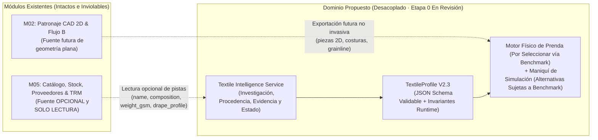
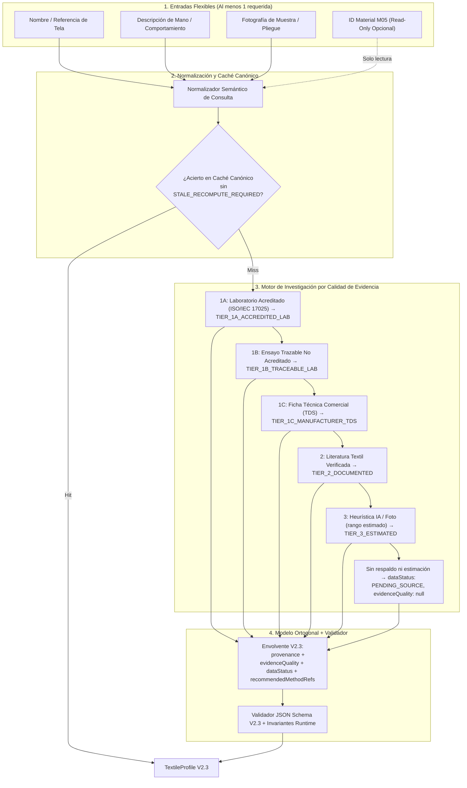
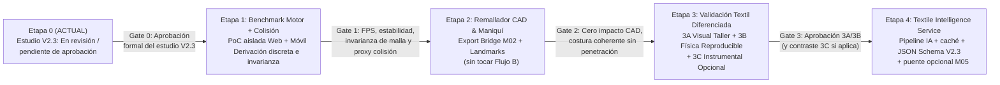

# ESTUDIO DE VIABILIDAD Y ARQUITECTURA TÉCNICA V2.3: SIMULADOR DE PRENDAS 3D E INTELIGENCIA TEXTIL INDEPENDIENTE
**Atelier Digital App — By Katherine Carroll**  
**Versión:** 2.3 (Corrección de Hallazgos Residuales de Auditoría sobre V2.2)  
**Estado del Documento:** **En revisión / pendiente de aprobación**  
**Fecha:** 2026-11-14  
**Naturaleza:** Estudio de Arquitectura, Modelo Metrológico Consistente, Contrato JSON Schema V2.3 y Plan de Validación Diferenciado (Sin modificación de código, dependencias, configuraciones ni base de datos)  
**Documento base revisado:** [`ESTUDIO_VIABILIDAD_SIMULADOR_PRENDAS_3D_V2.2.md`](file:///d:/Datos/Datos/DATOS%20JVINAS/Antigravity/2.ByKatherineCarroll/AtelierDigitalApp/ESTUDIO_VIABILIDAD_SIMULADOR_PRENDAS_3D_V2.2.md)

> [!IMPORTANT]
> **Declaración de Integridad Técnica y Alcance V2.3:**  
> Esta revisión V2.3 conserva íntegramente la arquitectura conceptual y todas las correcciones aprobadas en V2.1 y V2.2, resolviendo cuatro hallazgos residuales de coherencia formal, esquema JSON, atribución normativa y protocolo de validación en Etapa 3. **No modifica código fuente, dependencias, configuraciones, SQL, migraciones ni los módulos M00–M07.** M05 continúa opcional y de solo lectura; M02 y Flujo B permanecen intactos. No se inventan mediciones, acreditaciones, fuentes ni resultados.

---

## 1. Matriz de Correcciones V2.2 → V2.3

| # | Hallazgo Residual en V2.2 | Ubicación en V2.2 | Corrección Aplicada en V2.3 |
| :---: | :--- | :--- | :--- |
| **1** | **Incoherencia entre `PENDING_SOURCE` y `TIER_3_ESTIMATED` en el ejemplo JSON:** Las propiedades con `dataStatus: "PENDING_SOURCE"` y valores en `null` declaraban `evidenceQuality: "TIER_3_ESTIMATED"` y `sourceType: "AI_HEURISTIC"`, sugiriendo una estimación existente cuando aún no hay dato ni estimación alguna. | §7.1, §7.2.1, §7.2.2 | Cuando `dataStatus === "PENDING_SOURCE"`, el esquema exige ahora `evidenceQuality: null` y `provenance.sourceType: null` (sin estimación ni fuente atribuida), reflejando en `overallSummary` las cuentas reales (`UNASSIGNED_PENDING: 9`, `highestEvidenceQuality: null`, `lowestEvidenceQuality: null`). Se añade además `dataStatus: "ESTIMATED_RECORD"` específicamente para estimaciones `TIER_3_ESTIMATED` sí pobladas. |
| **2** | **Reglas condicionales incompletas en el JSON Schema:** El Schema V2.2 validaba reglas condicionales solo para `TIER_1A`, `TIER_1B`, `TIER_1C` y `PENDING_SOURCE`, sin cubrir `VERIFIED_RECORD`, `ESTIMATED_RECORD`, `WORKSHOP_OVERRIDDEN`, `TIER_2_DOCUMENTED`, `TIER_3_ESTIMATED`, la correspondencia obligatoria `provenance.sourceType ↔ evidenceQuality` ni las reglas de rangos. | §7.2.1 | Se completan las restricciones `allOf`/`if`/`then`/`anyOf` del **JSON Schema Draft 2020-12** para todos los valores de `dataStatus` y `evidenceQuality` (incluyendo acoplamiento estricto `sourceType ↔ evidenceQuality`), y se documenta explícitamente la validación complementaria en runtime para invariantes aritméticas entre campos hermanos (`range.min <= range.typical <= range.max` y suma de conteos), ya que Draft 2020-12 no compara propiedades hermanas de forma nativa. |
| **3** | **Normas declaradas como si hubieran sido aplicadas cuando solo son referencias recomendadas:** En V2.2 el ejemplo JSON ponía `"ISO 3801 / ASTM D3776"` dentro de `provenance.standardRef` aunque el dato estaba en `PENDING_SOURCE`. | §7.2.1, §7.2.2, §8.2 | Se separa **`recommendedMethodRefs`** (lista de normas o instrumentos recomendados si se decide ensayar, a nivel de definición de propiedad) de **`provenance.appliedStandardRef`** (estrictamente `null` en `PENDING_SOURCE` y `TIER_3_ESTIMATED`, y obligatorio únicamente cuando el valor proviene de `TIER_1A_ACCREDITED_LAB`, `TIER_1B_TRACEABLE_LAB` o literatura bajo norma identificada). |
| **4** | **Falta de separación en Etapa 3 entre comparación visual, prueba física reproducible y ensayo instrumental:** V2.2 agrupaba la calibración de retazos del taller bajo un único criterio visual/Cantilever en Gate 3. | §8.2, §12.2, §13 | Se desdobla la validación de **Etapa 3** en tres niveles claramente diferenciados y con alcance probatorio explícito: **(3A) Comparación visual cualitativa en taller**, **(3B) Prueba física reproducible de taller (cuasi-cuantitativa sin laboratorio acreditado)** y **(3C) Ensayo instrumental de laboratorio (referencia metrológica externa opcional)**, actualizando §8.2 y las sub-puertas de Gate 3. |

### Conservación Íntegra de Decisiones y Correcciones Aceptadas en V2.1 y V2.2
- Identificación exacta Kato Tech `KES-FB1`..`FB4` y `CSIRO FAST-1..4` (§4.1).
- Conversiones exactas a unidades SI y reclasificación del mapeo discreto XPBD como pendiente de derivación matemática específica e invarianza bajo remallado (§4.2).
- Desdoblamiento de `TIER_1A_ACCREDITED_LAB` (`ISO/IEC 17025:2017`), `TIER_1B_TRACEABLE_LAB` y `TIER_1C_MANUFACTURER_TDS`, manteniendo `TIER_2_DOCUMENTED` y `TIER_3_ESTIMATED` (§5 y §7.1).
- Separación ortogonal entre procedencia (`provenance`), calidad de evidencia (`evidenceQuality`) y estado del dato (`dataStatus`).
- Alternativas abiertas de geometría y colisión del maniquí sujetas a benchmark en Etapa 1 / Gate 2 (§10.2).
- Etapa 0 en estado **`En revisión / pendiente de aprobación`** (§13).
- M05 estrictamente opcional y de solo lectura; M02 y Flujo B intactos (§2, §9, §11).

---

## 2. Visión Funcional y Separación de Dominios

La visión funcional para *By Katherine Carroll* permanece invariable: habilitar una futura herramienta visual de simulación 3D de prendas que ayude a evaluar caída, volumen, tensión y proporciones textiles antes del corte físico, alimentada por un servicio independiente de inteligencia textil que no exija registro previo en inventario.



### Principios Inquebrantables de Frontera
1. **Independencia total de M05:** El simulador y el *Textile Intelligence Service* operan al 100% incluso con el inventario de M05 vacío o desvinculado. M05 nunca será dependencia obligatoria ni sufrirá cambios en sus tablas, flujos comerciales, stock o TRM.
2. **Preservación de M02 y Flujo B:** El motor de patronaje CAD 2D de M02 y el Flujo B conservan la autoridad geométrica y milimétrica para el corte físico de la tela. No se rediseña M02.
3. **Separación entre torso visual y maniquí de simulación:** El prototipo aislado [`src/components/mannequin3d/`](file:///d:/Datos/Datos/DATOS%20JVINAS/Antigravity/2.ByKatherineCarroll/AtelierDigitalApp/src/components/mannequin3d/) es exclusivamente un busto visual exploratorio (no integrado en producción) y no cumple por sí solo los requisitos funcionales para simulación física de prendas.

---

## 3. Motores Físicos de Simulación Textil: Evaluación Comparativa y Pruebas Pendientes

> [!CAUTION]
> **Estado de Verificación:** Ninguno de los motores siguientes ha sido ejecutado ni medido dentro de Atelier Digital (Web o móvil Expo). Toda caracterización de desempeño corresponde a literatura técnica externa y constituye una hipótesis sujeta a medición empírica antes de seleccionar un motor definitivo.

| Candidato / Familia | Fundamento Teórico | Ventajas Reportadas en Literatura | Riesgos y Limitaciones en Web/Expo | Estado en Atelier Digital |
| :--- | :--- | :--- | :--- | :--- |
| **XPBD** (*Extended Position-Based Dynamics*, Macklin et al., 2016) | Proyección de restricciones con *compliance* elástico ($\alpha$) y multiplicadores de Lagrange regularizados respecto a $\Delta t$ y número de iteraciones. | Estabilidad numérica alta; soporte directo de restricciones de distancia, flexión isométrica/diédrica y anisotropía; menor sensibilidad al paso de tiempo e iteraciones que PBD clásico. | La alta rigidez planar en tejidos sin elastano exige subpasos suficientes o aceleración en WebAssembly / GPU Compute para evitar elongación artificial o pérdida de fluidez en móvil. | **Candidato Principal a Evaluar (No seleccionado aún).** |
| **PBD Clásico** (Müller et al., 2007) | Proyección geométrica directa de restricciones sin *compliance* físico en unidades SI. | Implementación ligera en JS puro; estabilidad alta. | La rigidez efectiva depende del número de iteraciones y de $\Delta t$; sus coeficientes ($k \in [0,1]$) **no tienen correspondencia dimensional directa** con magnitudes textiles ($\text{N/m}$, $\mu\text{N}\cdot\text{m}$). | **Candidato Secundario de Contraste** (línea base comparativa). |
| **Mass-Spring Implícito / Semi-Implícito** | Red de partículas con fuerzas elásticas integradas mediante esquemas implícitos o Verlet amortiguado. | Formulación directa de la ley de Hooke. | Inestabilidad numérica con rigideces altas salvo resolución de sistemas lineales dispersos en cada paso, costosa en cliente ligero. | **Descartado preliminarmente para JS directo**, opcional solo como contraste implícito en Wasm. |
| **FEM Continuo** (*Finite Element Method*) | Mecánica del medio continuo no lineal sobre elementos finitos. | Referencia de precisión ingenieril para análisis estructural de tensiones. | Coste computacional incompatible con interactividad en tiempo real en navegadores móviles convencionales. | **Fuera de alcance** para simulación interactiva en cliente. |
| **Entorno de Ejecución (JS vs. Wasm vs. WebGPU/WebGL Compute)** | Runtime del bucle físico y detección de colisiones. | JS evita compilación nativa; Rust/C++ → **WebAssembly (Wasm)** acelera cómputo numérico y colisiones; WebGPU/WebGL GPGPU ofrece paralelismo masivo. | Expo móvil (iOS/Android) condiciona WebGPU nativo y exige evaluar `WebView` vs. `expo-gl` vs. módulos nativos JSI/C++ (incompatibles con Expo Go puro). | **Asunto Técnico Abierto:** Debe medirse en PoC real en Etapa 1. |

### Batería Obligatoria de Pruebas Comparativas de Motores (Previa a Selección Definitiva)
1. **Escalamiento por densidad de malla:** Tiempo por paso (`ms/step`) y FPS sostenidos a través de densidades crecientes definidas en el protocolo de Etapa 1.
2. **Entornos objetivo reales:** Web Desktop, Web Móvil y runtime móvil Expo evaluado (`WebView` vs. `expo-gl`).
3. **Prueba de no-estiramiento (*Locking / Super-elasticity Test*):** Verificar que un tejido plano no elástico bajo gravedad $\mathbf{g} = -9.81\ \text{m/s}^2$ no supere el criterio de elongación definido al aprobar el protocolo de Gate 1.
4. **Prueba de flexión diferencial (*Drape Contrast*):** Verificar contraste claro entre arquetipos rígido, intermedio y fluido frente a las muestras de Etapa 3.
5. **Auto-colisión multicapa y pliegues:** Ausencia de penetraciones severas en faldas con pliegues y tela principal + forro.

---

## 4. Taxonomía Textil Corregida: Normas, Unidades y Conversión Física

### 4.1 Tabla Maestra de Propiedades Físicas, Instrumentación, Normas de Referencia y Unidades

*(Nota: Las normas e instrumentos listados en esta tabla representan **métodos aplicables de referencia** para caracterización metrológica; su sola inclusión en un perfil sin ensayo ejecutado no implica que la norma haya sido aplicada al material).*

| Propiedad Requerida | Métodos Normativos e Instrumentos de Referencia | Unidad de Laboratorio / SI | Qué Mide Realmente el Ensayo (y Alcance) | Rol en el Simulador de Prenda |
| :--- | :--- | :---: | :--- | :--- |
| **Composición** | **ISO 1833** (análisis químico cuantitativo) · **AATCC TM20 / TM20A** · Declaración comercial de etiqueta | `%` en masa por fibra | Identidad y proporción de fibras constituyentes. | Condiciona densidad estimada, comportamiento elástico, recuperación e iluminación óptica PBR. |
| **Construcción / Ligamento** | **ISO 3572** (definiciones de ligamentos) · **ASTM D3775** (densidad de hilos en tejido plano) · Inspección macroscópica | Hilos/cm (urdimbre × trama) y clase estructural | Tipo de estructura (tafetán, sarga, raso, jacquard, punto) y densidad de hilos. | Determina la **anisotropía** entre urdimbre (*warp*), trama (*weft*) y bies (*bias*, 45°), además de la respuesta al cizallamiento. |
| **Peso / Masa Superficial** | **ISO 3801** · **ASTM D3776 / D3776M** (acondicionamiento bajo **ISO 139**) | $\text{g/m}^2$ ($\text{GSM}$) o $\text{oz/yd}^2$ ($1\ \text{oz/yd}^2 \approx 33.906\ \text{g/m}^2$) | Masa por unidad de área de tela acondicionada. | Define la masa nodal $m_i$ asignada a cada vértice/triángulo bajo gravedad. |
| **Grosor / Compresión** | **ISO 5084** · **ASTM D1777** · **KES-FB3** (*Compression Tester*: $T_0, T_m, EMC, WC, RC$) · **CSIRO FAST-1** (*Compression Meter*) | $\text{mm}$ (espesor); `%` ($EMC$, $RC$); $\text{gf}\cdot\text{cm/cm}^2$ ($WC$) | Espesor bajo presión estándar definida y compresibilidad normal al plano. | Define el margen de separación de colisión (*collision thickness offset*) contra el cuerpo y entre capas. |
| **Flexión / Rigidez Flexural** | **ASTM D1388** (Cantilever / longitud de flexión) · **ISO 9073-7** (no tejidos, método cantilever) · **KES-FB2** (*Pure Bending Tester*: $B, 2HB$) · **CSIRO FAST-2** (*Bending Meter*) | Longitud $c$ ($\text{cm}$ o $\text{mm}$); $G_{\text{D1388}}$ ($\text{mg}\cdot\text{cm}$); $B_{\text{KES}}$ ($\text{gf}\cdot\text{cm}^2/\text{cm} = \text{gf}\cdot\text{cm}$); SI ($\mu\text{N}\cdot\text{m}$ o $\text{N}\cdot\text{m}$) | Resistencia pura del tejido a curvarse fuera de su plano por peso propio o momento flector aplicado. | Controla el radio de curvatura de pliegues, caída en campana y volumen estructural. |
| **Elasticidad (Tracción de baja carga y alta carga)** | **Baja carga:** **KES-FB1** (*Tensile & Shear Tester*: $EMT, WT, LT$) · **CSIRO FAST-3** ($E_5, E_{20}, E_{100}$). **Tejidos elásticos:** **ASTM D3107**, **ASTM D2594 / D2594M**, **ISO 20932-1**. **Rotura:** **ISO 13934-1/-2**, **ASTM D5034 / D5035**. | Extensión `%` bajo carga definida ($\text{gf/cm}$ o $\text{N}$); rigidez lineal equivalente ($\text{N/m}$) | ⚠️ `ASTM D5034/D5035` e `ISO 13934` miden **fuerza y elongación a la rotura** en `N`, órdenes de magnitud por encima del régimen de caída en prenda. | Alimenta las restricciones de extensión en urdimbre, trama y bies. |
| **Recuperación Elástica** | **ASTM D3107** · **ASTM D2594 / D2594M** · **ISO 20932-1** · **KES-FB1** ($RT$ resiliencia a tracción %) | `%` de recuperación elástica y `%` de deformación residual (*growth*) | Capacidad de recuperar la longitud inicial tras retirar una carga de tracción. | Modela histéresis de ajuste y tendencia a ceder en prendas ceñidas. |
| **Cizallamiento (Shear)** | **KES-FB1** (*Tensile & Shear Tester* — módulo $G$, histéresis $2HG$, $2HG5$) · **CSIRO FAST-3** (extensión al bies $EB_5$) | $\text{gf}/(\text{cm}\cdot^\circ)$ (KES-FB1) o $\text{N}/(\text{m}\cdot\text{rad})$ (SI); `%` al bies (FAST-3) | Resistencia angular de urdimbre y trama a deformarse en paralelogramo bajo esfuerzo diagonal. | Crítico para modelar adaptación a curvas (busto, cadera) y cortes al bies. |
| **Caída (Drape)** | **ISO 9073-9** · **BS 5058** (Cusick Drapemeter) | Coeficiente de caída $DC$ (`%`) y morfología/ondas (*nodes*) | Área proyectada de sombra de un disco textil colgando por peso propio sobre pedestal circular. | **Métrica de validación, NO entrada física independiente:** emerge de peso + flexión + cizallamiento. |
| **Fricción y Rugosidad Superficial** | **KES-FB4** (*Surface Tester*: $MIU$, $MMD$, $SMD$) · **ASTM D1894** / **ISO 8295** (solo referencia adaptada para recubiertos/láminas) | $MIU$ y $MMD$ adimensionales; $SMD$ en $\mu\text{m}$ | Resistencia al deslizamiento superficial bajo carga normal baja y rugosidad geométrica. | Controla deslizamiento entre tela principal, forro y maniquí. |

> [!NOTE]
> **Desambiguación de Módulos Kawabata (KES-FB, Kato Tech Co., Ltd.) y CSIRO FAST:**  
> **KES-FB1:** *Tensile & Shear Tester*; **KES-FB2:** *Pure Bending Tester*; **KES-FB3:** *Compression Tester*; **KES-FB4:** *Surface Tester*.  
> **CSIRO FAST:** **FAST-1** (*Compression*), **FAST-2** (*Bending*), **FAST-3** (*Extension & bias shear*), **FAST-4** (*Dimensional Stability*).

---

### 4.2 Conversiones Dimensionales a SI y Ecuaciones Discretas Pendientes de Derivación

#### A. Conversiones Dimensionales Exactas a Unidades SI (Verificadas Algebraicamente)

1. **Flexión (*Bending Rigidity*) a SI ($\text{N}\cdot\text{m}$ y $\mu\text{N}\cdot\text{m}$):**
   - Desde **KES-FB2** ($B$ en $\text{gf}\cdot\text{cm}^2/\text{cm} = \text{gf}\cdot\text{cm}$):
     $$B_{\text{SI}}\ [\text{N}\cdot\text{m}] = B_{\text{KES}} \times 9.80665 \times 10^{-5}, \qquad B_{\mu\text{Nm}} = B_{\text{KES}} \times 98.0665$$
   - Desde **ASTM D1388** (longitud de flexión $c$ en $\text{cm}$ y masa superficial $\rho_{\text{gsm}}$ en $\text{g/m}^2$):
     $$G_{\text{D1388}}\ [\text{mg}\cdot\text{cm}] = 0.1 \cdot \rho_{\text{gsm}} \cdot c_{\text{cm}}^3, \qquad B_{\mu\text{Nm}} = G_{\text{D1388}} \times 0.0980665$$

2. **Cizallamiento (KES-FB1 $G$) a SI ($\text{N}/(\text{m}\cdot\text{rad})$):**
   $$G_{\text{SI}}\ [\text{N}/(\text{m}\cdot\text{rad})] = G_{\text{KES}}\ [\text{gf}/(\text{cm}\cdot^\circ)] \times \frac{0.980665}{\pi / 180} \approx G_{\text{KES}} \times 56.1879$$

3. **Rigidez Lineal Equivalente de Tracción de Baja Carga ($\text{N/m}$):**
   $$K_{\text{stretch}}\ [\text{N/m}] \approx \frac{F_w}{E_w / 100} \qquad (\text{ej. } F_w = 100\ \text{gf/cm} = 98.0665\ \text{N/m})$$
   - ⚠️ **Limitación física:** Las curvas fuerza-elongación textiles son no lineales; un escalar lineal único es solo una primera aproximación sujeta a ajuste por tramos según el motor elegido.

#### B. Mapeo a *Compliance* XPBD ($\alpha$) — **PENDIENTE DE DERIVACIÓN Y VERIFICACIÓN ESPECÍFICA**
En **XPBD** (Macklin et al., 2016), $\tilde{\alpha}_j = \alpha_j / \Delta t^2$ depende de la formulación discreta exacta $C_j(\mathbf{x})$ elegida (CST / StVK frente a *edge springs* para membrana; ángulo diédrico frente a curvatura isométrica para flexión). Todas las ecuaciones discretas de traducción permanecen **pendientes de derivación formal vinculada al operador seleccionado en Etapa 1** y sujetas a prueba numérica de invarianza bajo remallado antes de programar el solver.

---

## 5. Arquitectura del *Textile Intelligence Service* (Independiente de M05)



### Reglas de Operación del Servicio
1. **Nunca exigir M05:** Funciona íntegramente con nombre, descripción o fotografía sin tocar M05.
2. **Coherencia estricta entre ausencia de datos y calidad de evidencia:** Si una propiedad carece de fuente verificable y tampoco emite un rango heurístico poblado, debe registrarse con `dataStatus = "PENDING_SOURCE"`, `evidenceQuality = null`, `provenance.sourceType = null` y `provenance.appliedStandardRef = null`. Las normas candidatas se exponen únicamente en `recommendedMethodRefs`, nunca como normas ya aplicadas.
3. **Separación de laboratorio acreditado, trazable y TDS:** `TIER_1A_ACCREDITED_LAB` exige `accreditationRef` verificable y `appliedStandardRef`; `TIER_1B_TRACEABLE_LAB` prohíbe `accreditationRef` y exige `appliedStandardRef` + `documentRef`; `TIER_1C_MANUFACTURER_TDS` exige `documentRef` del TDS comercial.
4. **Prohibición de cifras puntuales heurísticas:** Una entrada con `dataStatus = "ESTIMATED_RECORD"` y `evidenceQuality = "TIER_3_ESTIMATED"` puede aportar únicamente un intervalo `range` acotado con `assumptionNote`, manteniendo `measuredValue = null`.

---

## 6. Análisis por Fotografía: Alcances Reales y Límites Físicos

| Capacidad | Viable por Fotografía | Evidencia Máxima | Justificación Física |
| :--- | :---: | :---: | :--- |
| **Acabado óptico superficial** (brillo, mate, relieve, transparencia) | ✅ Sí (Orientativo) | Óptico / PBR (`TIER_3_ESTIMATED`) | La respuesta especular describe apariencia superficial. |
| **Apariencia macroscópica de ligamento** | ✅ Sí (foto enfocada) | `TIER_3_ESTIMATED` | Orienta estructura probable sin confirmar densidad real ni fibra química. |
| **Mapas PBR visuales** (albedo, rugosidad visual, normales) | ✅ Sí | Visual únicamente | Realismo de render sin modificar constantes físicas del solver. |
| **Medición de masa superficial ($\text{g/m}^2$)** | ❌ **NO** | No aplicable | Telas visualmente similares difieren sustancialmente por densidad de fibra, título y torsión. |
| **Medición de flexión ($B$), tracción ($K$) o cizallamiento ($G$)** | ❌ **NO** | No aplicable | Sin fuerzas ni escala metrológica conocida, una foto no mide constantes mecánicas. |
| **Identificación química de fibra** | ❌ **NO** | No aplicable | Requiere ficha técnica, etiqueta o análisis (`ISO 1833` / `AATCC TM20`). |

---

## 7. Modelo Ortogonal Coherente y Contrato JSON Schema V2.3

### 7.1 Reglas de Coherencia entre `dataStatus`, `evidenceQuality` y `provenance.sourceType`

La tabla siguiente define la matriz normativa exacta que valida el Schema V2.3:

| `dataStatus` | Valores Permitidos en `evidenceQuality` | Valores Permitidos en `provenance.sourceType` | Regla de Valores (`measuredValue` / `range`) | Regla de `appliedStandardRef` y `accreditationRef` |
| :--- | :--- | :--- | :--- | :--- |
| **`PENDING_SOURCE`** | Exclusivamente **`null`** | Exclusivamente **`null`** | `measuredValue = null` **y** `range = null` | Ambos **`null`** (las normas posibles van solo en `recommendedMethodRefs`). |
| **`VERIFIED_RECORD`** | `TIER_1A_ACCREDITED_LAB`, `TIER_1B_TRACEABLE_LAB`, `TIER_1C_MANUFACTURER_TDS`, `TIER_2_DOCUMENTED` | Exactamente emparejado: `ACCREDITED_LAB` ↔ `1A`, `TRACEABLE_LAB` ↔ `1B`, `MANUFACTURER_TDS` ↔ `1C`, `SCIENTIFIC_LITERATURE` ↔ `2` | Al menos `measuredValue` (numérico) **o** `range` (`NumericRange`) no nulo, con `documentRef` obligatorio. | `appliedStandardRef` obligatorio en `1A`/`1B`; `accreditationRef` obligatorio solo en `1A` y `null` en los demás. |
| **`ESTIMATED_RECORD`** | Exclusivamente **`TIER_3_ESTIMATED`** | `AI_HEURISTIC`, `M05_READONLY_HINT` o `WORKSHOP_OBSERVATION` | `measuredValue = null` **y** `range` (`NumericRange`) no nulo + `assumptionNote` obligatorio. | Ambos **`null`**. |
| **`WORKSHOP_OVERRIDDEN`** | Exclusivamente **`TIER_3_ESTIMATED`** | Exclusivamente **`WORKSHOP_OBSERVATION`** | Al menos `measuredValue` **o** `range` no nulo + `previousValueAudit` obligatorio. | Ambos **`null`** (salvo registro documental separado). |
| **`STALE_RECOMPUTE_REQUIRED`** | `EvidenceQualityTier` (incluye `null` si nunca tuvo respaldo previo) | Coherente con su `evidenceQuality` | Conserva referencia previa pendiente de recálculo o re-consulta. | Coherente con su `evidenceQuality`. |

> [!NOTE]
> **Alcance de JSON Schema Draft 2020-12 vs. Validador Runtime Complementario:**  
> JSON Schema Draft 2020-12 valida estructura, tipos, nulabilidad y todas las reglas condicionales `if`/`then`/`anyOf` de la tabla anterior. Sin embargo, JSON Schema Draft 2020-12 estándar **no incluye comparación aritmética entre propiedades hermanas** (como `range.min <= range.max` o `range.min <= range.typical <= range.max`, ni verificar que la suma de `countsByEvidenceQuality` coincida con el número de propiedades). Por rigor técnico, estas **invariantes aritméticas entre campos hermanos** se especifican aquí y deben ejecutarse en una función determinista complementaria (`validateTextileProfileInvariants`) inmediatamente después de la validación contra el Schema.

---

### 7.2 Contrato Formal de Datos V2.3: JSON Schema y Ejemplo Válido Coherente

#### 7.2.1 JSON Schema V2.3 (`Draft 2020-12`, Validable)

```json
{
  "$schema": "https://json-schema.org/draft/2020-12/schema",
  "$id": "https://atelierdigital.local/schemas/textile-profile-v2.3.schema.json",
  "title": "TextileProfileV2_3",
  "description": "Contrato V2.3 con coherencia estricta PENDING_SOURCE/evidenceQuality/sourceType, reglas completas por estado y evidencia, y separación entre recommendedMethodRefs y appliedStandardRef.",
  "type": "object",
  "additionalProperties": false,
  "required": [
    "schemaVersion",
    "profileId",
    "cacheKey",
    "createdAt",
    "identification",
    "overallSummary",
    "physicalProperties",
    "solverTranslationMetadata",
    "optionalM05Link",
    "serviceProvenance"
  ],
  "properties": {
    "schemaVersion": {
      "const": "2.3.0-draft"
    },
    "profileId": {
      "type": "string",
      "minLength": 1
    },
    "cacheKey": {
      "type": "string",
      "minLength": 1
    },
    "createdAt": {
      "type": "string",
      "format": "date-time"
    },
    "identification": {
      "type": "object",
      "additionalProperties": false,
      "required": ["displayName", "composition", "weaveType"],
      "properties": {
        "displayName": {
          "type": "string",
          "minLength": 1
        },
        "composition": {
          "$ref": "#/$defs/StringMetadataEnvelope"
        },
        "weaveType": {
          "$ref": "#/$defs/StringMetadataEnvelope"
        }
      }
    },
    "overallSummary": {
      "type": "object",
      "additionalProperties": false,
      "required": [
        "highestEvidenceQuality",
        "lowestEvidenceQuality",
        "countsByEvidenceQuality",
        "countsByDataStatus",
        "requiresPhysicalCalibration"
      ],
      "properties": {
        "highestEvidenceQuality": { "$ref": "#/$defs/NullableEvidenceQualityTier" },
        "lowestEvidenceQuality": { "$ref": "#/$defs/NullableEvidenceQualityTier" },
        "countsByEvidenceQuality": {
          "type": "object",
          "additionalProperties": false,
          "required": [
            "TIER_1A_ACCREDITED_LAB",
            "TIER_1B_TRACEABLE_LAB",
            "TIER_1C_MANUFACTURER_TDS",
            "TIER_2_DOCUMENTED",
            "TIER_3_ESTIMATED",
            "UNASSIGNED_PENDING"
          ],
          "properties": {
            "TIER_1A_ACCREDITED_LAB": { "type": "integer", "minimum": 0 },
            "TIER_1B_TRACEABLE_LAB": { "type": "integer", "minimum": 0 },
            "TIER_1C_MANUFACTURER_TDS": { "type": "integer", "minimum": 0 },
            "TIER_2_DOCUMENTED": { "type": "integer", "minimum": 0 },
            "TIER_3_ESTIMATED": { "type": "integer", "minimum": 0 },
            "UNASSIGNED_PENDING": { "type": "integer", "minimum": 0 }
          }
        },
        "countsByDataStatus": {
          "type": "object",
          "additionalProperties": false,
          "required": [
            "PENDING_SOURCE",
            "VERIFIED_RECORD",
            "ESTIMATED_RECORD",
            "WORKSHOP_OVERRIDDEN",
            "STALE_RECOMPUTE_REQUIRED"
          ],
          "properties": {
            "PENDING_SOURCE": { "type": "integer", "minimum": 0 },
            "VERIFIED_RECORD": { "type": "integer", "minimum": 0 },
            "ESTIMATED_RECORD": { "type": "integer", "minimum": 0 },
            "WORKSHOP_OVERRIDDEN": { "type": "integer", "minimum": 0 },
            "STALE_RECOMPUTE_REQUIRED": { "type": "integer", "minimum": 0 }
          }
        },
        "requiresPhysicalCalibration": { "type": "boolean" }
      }
    },
    "physicalProperties": {
      "type": "object",
      "additionalProperties": false,
      "required": [
        "arealDensity_gsm",
        "thickness_mm",
        "bendingStiffness_warp_uNm",
        "bendingStiffness_weft_uNm",
        "stretchStiffness_lowStrain_warp_N_per_m",
        "stretchStiffness_lowStrain_weft_N_per_m",
        "elasticRecovery_percent",
        "shearStiffness_N_per_m_rad",
        "frictionCoefficient_clothToCloth"
      ],
      "properties": {
        "arealDensity_gsm": { "$ref": "#/$defs/PhysicalPropertyEnvelope" },
        "thickness_mm": { "$ref": "#/$defs/PhysicalPropertyEnvelope" },
        "bendingStiffness_warp_uNm": { "$ref": "#/$defs/PhysicalPropertyEnvelope" },
        "bendingStiffness_weft_uNm": { "$ref": "#/$defs/PhysicalPropertyEnvelope" },
        "stretchStiffness_lowStrain_warp_N_per_m": { "$ref": "#/$defs/PhysicalPropertyEnvelope" },
        "stretchStiffness_lowStrain_weft_N_per_m": { "$ref": "#/$defs/PhysicalPropertyEnvelope" },
        "elasticRecovery_percent": { "$ref": "#/$defs/PhysicalPropertyEnvelope" },
        "shearStiffness_N_per_m_rad": { "$ref": "#/$defs/PhysicalPropertyEnvelope" },
        "frictionCoefficient_clothToCloth": { "$ref": "#/$defs/PhysicalPropertyEnvelope" }
      }
    },
    "solverTranslationMetadata": {
      "type": "object",
      "additionalProperties": false,
      "required": [
        "targetSolverCandidate",
        "discreteFormulationStatus",
        "converterVersion",
        "notes"
      ],
      "properties": {
        "targetSolverCandidate": {
          "enum": ["PENDING_BENCHMARK_SELECTION", "XPBD", "PBD", "MASS_SPRING_IMPLICIT"]
        },
        "discreteFormulationStatus": {
          "enum": ["PENDING_OPERATOR_DERIVATION", "DERIVED_AND_REMESH_VERIFIED"]
        },
        "converterVersion": { "type": "string", "minLength": 1 },
        "notes": { "type": "string" }
      }
    },
    "optionalM05Link": {
      "type": "object",
      "additionalProperties": false,
      "required": ["linked", "materialId", "readOnlyFieldsUsed"],
      "properties": {
        "linked": { "type": "boolean" },
        "materialId": { "type": ["string", "null"] },
        "readOnlyFieldsUsed": {
          "type": "array",
          "items": { "type": "string" }
        }
      }
    },
    "serviceProvenance": {
      "type": "object",
      "additionalProperties": false,
      "required": ["aiAssisted", "aiModelId", "aiPromptVersion", "timestamp"],
      "properties": {
        "aiAssisted": { "type": "boolean" },
        "aiModelId": { "type": ["string", "null"] },
        "aiPromptVersion": { "type": ["string", "null"] },
        "timestamp": { "type": "string", "format": "date-time" }
      }
    }
  },
  "$defs": {
    "EvidenceQualityTier": {
      "type": "string",
      "enum": [
        "TIER_1A_ACCREDITED_LAB",
        "TIER_1B_TRACEABLE_LAB",
        "TIER_1C_MANUFACTURER_TDS",
        "TIER_2_DOCUMENTED",
        "TIER_3_ESTIMATED"
      ]
    },
    "NullableEvidenceQualityTier": {
      "type": ["string", "null"],
      "enum": [
        "TIER_1A_ACCREDITED_LAB",
        "TIER_1B_TRACEABLE_LAB",
        "TIER_1C_MANUFACTURER_TDS",
        "TIER_2_DOCUMENTED",
        "TIER_3_ESTIMATED",
        null
      ]
    },
    "DataStatus": {
      "type": "string",
      "enum": [
        "PENDING_SOURCE",
        "VERIFIED_RECORD",
        "ESTIMATED_RECORD",
        "WORKSHOP_OVERRIDDEN",
        "STALE_RECOMPUTE_REQUIRED"
      ]
    },
    "NullableSourceType": {
      "type": ["string", "null"],
      "enum": [
        "ACCREDITED_LAB",
        "TRACEABLE_LAB",
        "MANUFACTURER_TDS",
        "SCIENTIFIC_LITERATURE",
        "M05_READONLY_HINT",
        "AI_HEURISTIC",
        "WORKSHOP_OBSERVATION",
        null
      ]
    },
    "NumericRange": {
      "type": "object",
      "additionalProperties": false,
      "required": ["min", "max"],
      "properties": {
        "min": { "type": "number", "minimum": 0 },
        "typical": { "type": ["number", "null"], "minimum": 0 },
        "max": { "type": "number", "minimum": 0 }
      }
    },
    "PreviousValueAudit": {
      "type": "object",
      "additionalProperties": false,
      "required": [
        "previousDataStatus",
        "previousEvidenceQuality",
        "previousMeasuredValue",
        "previousRange",
        "overrideReason",
        "overriddenAt"
      ],
      "properties": {
        "previousDataStatus": { "$ref": "#/$defs/DataStatus" },
        "previousEvidenceQuality": { "$ref": "#/$defs/NullableEvidenceQualityTier" },
        "previousMeasuredValue": { "type": ["number", "null"], "minimum": 0 },
        "previousRange": {
          "oneOf": [
            { "type": "null" },
            { "$ref": "#/$defs/NumericRange" }
          ]
        },
        "overrideReason": { "type": "string", "minLength": 1 },
        "overriddenAt": { "type": "string", "format": "date-time" }
      }
    },
    "Provenance": {
      "type": "object",
      "additionalProperties": false,
      "required": [
        "sourceType",
        "sourceName",
        "documentRef",
        "appliedStandardRef",
        "accreditationRef",
        "conditioningProtocol",
        "actorOrModelId",
        "recordedAt",
        "previousValueAudit"
      ],
      "properties": {
        "sourceType": { "$ref": "#/$defs/NullableSourceType" },
        "sourceName": { "type": ["string", "null"] },
        "documentRef": { "type": ["string", "null"] },
        "appliedStandardRef": { "type": ["string", "null"] },
        "accreditationRef": { "type": ["string", "null"] },
        "conditioningProtocol": { "type": ["string", "null"] },
        "actorOrModelId": { "type": ["string", "null"] },
        "recordedAt": { "type": ["string", "null"], "format": "date-time" },
        "previousValueAudit": {
          "oneOf": [
            { "type": "null" },
            { "$ref": "#/$defs/PreviousValueAudit" }
          ]
        }
      }
    },
    "EvidenceProvenanceCoherenceRules": {
      "allOf": [
        {
          "if": { "properties": { "evidenceQuality": { "const": "TIER_1A_ACCREDITED_LAB" } } },
          "then": {
            "properties": {
              "provenance": {
                "properties": {
                  "sourceType": { "const": "ACCREDITED_LAB" },
                  "sourceName": { "type": "string", "minLength": 1 },
                  "accreditationRef": { "type": "string", "minLength": 1 },
                  "appliedStandardRef": { "type": "string", "minLength": 1 },
                  "documentRef": { "type": "string", "minLength": 1 },
                  "recordedAt": { "type": "string", "format": "date-time" }
                }
              }
            }
          }
        },
        {
          "if": { "properties": { "evidenceQuality": { "const": "TIER_1B_TRACEABLE_LAB" } } },
          "then": {
            "properties": {
              "provenance": {
                "properties": {
                  "sourceType": { "const": "TRACEABLE_LAB" },
                  "sourceName": { "type": "string", "minLength": 1 },
                  "accreditationRef": { "type": "null" },
                  "appliedStandardRef": { "type": "string", "minLength": 1 },
                  "documentRef": { "type": "string", "minLength": 1 },
                  "recordedAt": { "type": "string", "format": "date-time" }
                }
              }
            }
          }
        },
        {
          "if": { "properties": { "evidenceQuality": { "const": "TIER_1C_MANUFACTURER_TDS" } } },
          "then": {
            "properties": {
              "provenance": {
                "properties": {
                  "sourceType": { "const": "MANUFACTURER_TDS" },
                  "sourceName": { "type": "string", "minLength": 1 },
                  "accreditationRef": { "type": "null" },
                  "documentRef": { "type": "string", "minLength": 1 },
                  "recordedAt": { "type": "string", "format": "date-time" }
                }
              }
            }
          }
        },
        {
          "if": { "properties": { "evidenceQuality": { "const": "TIER_2_DOCUMENTED" } } },
          "then": {
            "properties": {
              "provenance": {
                "properties": {
                  "sourceType": { "const": "SCIENTIFIC_LITERATURE" },
                  "sourceName": { "type": "string", "minLength": 1 },
                  "accreditationRef": { "type": "null" },
                  "documentRef": { "type": "string", "minLength": 1 },
                  "recordedAt": { "type": "string", "format": "date-time" }
                }
              }
            }
          }
        },
        {
          "if": { "properties": { "evidenceQuality": { "const": "TIER_3_ESTIMATED" } } },
          "then": {
            "properties": {
              "provenance": {
                "properties": {
                  "sourceType": {
                    "type": "string",
                    "enum": ["AI_HEURISTIC", "M05_READONLY_HINT", "WORKSHOP_OBSERVATION"]
                  },
                  "accreditationRef": { "type": "null" },
                  "appliedStandardRef": { "type": "null" },
                  "recordedAt": { "type": "string", "format": "date-time" }
                }
              }
            }
          }
        }
      ]
    },
    "StringMetadataEnvelope": {
      "type": "object",
      "additionalProperties": false,
      "required": [
        "value",
        "recommendedMethodRefs",
        "evidenceQuality",
        "dataStatus",
        "provenance"
      ],
      "properties": {
        "value": { "type": ["string", "null"] },
        "recommendedMethodRefs": {
          "type": "array",
          "items": { "type": "string", "minLength": 1 }
        },
        "evidenceQuality": { "$ref": "#/$defs/NullableEvidenceQualityTier" },
        "dataStatus": { "$ref": "#/$defs/DataStatus" },
        "provenance": { "$ref": "#/$defs/Provenance" }
      },
      "allOf": [
        { "$ref": "#/$defs/EvidenceProvenanceCoherenceRules" },
        {
          "if": { "properties": { "dataStatus": { "const": "PENDING_SOURCE" } } },
          "then": {
            "properties": {
              "value": { "type": "null" },
              "evidenceQuality": { "type": "null" },
              "provenance": {
                "properties": {
                  "sourceType": { "type": "null" },
                  "sourceName": { "type": "null" },
                  "documentRef": { "type": "null" },
                  "appliedStandardRef": { "type": "null" },
                  "accreditationRef": { "type": "null" },
                  "conditioningProtocol": { "type": "null" },
                  "previousValueAudit": { "type": "null" }
                }
              }
            }
          }
        },
        {
          "if": { "properties": { "dataStatus": { "const": "VERIFIED_RECORD" } } },
          "then": {
            "properties": {
              "value": { "type": "string", "minLength": 1 },
              "evidenceQuality": {
                "type": "string",
                "enum": [
                  "TIER_1A_ACCREDITED_LAB",
                  "TIER_1B_TRACEABLE_LAB",
                  "TIER_1C_MANUFACTURER_TDS",
                  "TIER_2_DOCUMENTED"
                ]
              }
            }
          }
        },
        {
          "if": { "properties": { "dataStatus": { "const": "ESTIMATED_RECORD" } } },
          "then": {
            "properties": {
              "value": { "type": "string", "minLength": 1 },
              "evidenceQuality": { "const": "TIER_3_ESTIMATED" }
            }
          }
        },
        {
          "if": { "properties": { "dataStatus": { "const": "WORKSHOP_OVERRIDDEN" } } },
          "then": {
            "properties": {
              "value": { "type": "string", "minLength": 1 },
              "evidenceQuality": { "const": "TIER_3_ESTIMATED" },
              "provenance": {
                "properties": {
                  "sourceType": { "const": "WORKSHOP_OBSERVATION" },
                  "previousValueAudit": { "$ref": "#/$defs/PreviousValueAudit" }
                }
              }
            }
          }
        }
      ]
    },
    "PhysicalPropertyEnvelope": {
      "type": "object",
      "additionalProperties": false,
      "required": [
        "unit",
        "recommendedMethodRefs",
        "measuredValue",
        "range",
        "evidenceQuality",
        "dataStatus",
        "provenance",
        "assumptionNote"
      ],
      "properties": {
        "unit": { "type": "string", "minLength": 1 },
        "recommendedMethodRefs": {
          "type": "array",
          "items": { "type": "string", "minLength": 1 }
        },
        "measuredValue": { "type": ["number", "null"], "minimum": 0 },
        "range": {
          "oneOf": [
            { "type": "null" },
            { "$ref": "#/$defs/NumericRange" }
          ]
        },
        "evidenceQuality": { "$ref": "#/$defs/NullableEvidenceQualityTier" },
        "dataStatus": { "$ref": "#/$defs/DataStatus" },
        "provenance": { "$ref": "#/$defs/Provenance" },
        "assumptionNote": { "type": ["string", "null"] }
      },
      "allOf": [
        { "$ref": "#/$defs/EvidenceProvenanceCoherenceRules" },
        {
          "if": { "properties": { "dataStatus": { "const": "PENDING_SOURCE" } } },
          "then": {
            "properties": {
              "measuredValue": { "type": "null" },
              "range": { "type": "null" },
              "evidenceQuality": { "type": "null" },
              "provenance": {
                "properties": {
                  "sourceType": { "type": "null" },
                  "sourceName": { "type": "null" },
                  "documentRef": { "type": "null" },
                  "appliedStandardRef": { "type": "null" },
                  "accreditationRef": { "type": "null" },
                  "conditioningProtocol": { "type": "null" },
                  "previousValueAudit": { "type": "null" }
                }
              }
            }
          }
        },
        {
          "if": { "properties": { "dataStatus": { "const": "VERIFIED_RECORD" } } },
          "then": {
            "properties": {
              "evidenceQuality": {
                "type": "string",
                "enum": [
                  "TIER_1A_ACCREDITED_LAB",
                  "TIER_1B_TRACEABLE_LAB",
                  "TIER_1C_MANUFACTURER_TDS",
                  "TIER_2_DOCUMENTED"
                ]
              }
            },
            "anyOf": [
              { "properties": { "measuredValue": { "type": "number", "minimum": 0 } } },
              { "properties": { "range": { "$ref": "#/$defs/NumericRange" } } }
            ]
          }
        },
        {
          "if": { "properties": { "dataStatus": { "const": "ESTIMATED_RECORD" } } },
          "then": {
            "properties": {
              "evidenceQuality": { "const": "TIER_3_ESTIMATED" },
              "measuredValue": { "type": "null" },
              "range": { "$ref": "#/$defs/NumericRange" },
              "assumptionNote": { "type": "string", "minLength": 1 }
            }
          }
        },
        {
          "if": { "properties": { "dataStatus": { "const": "WORKSHOP_OVERRIDDEN" } } },
          "then": {
            "properties": {
              "evidenceQuality": { "const": "TIER_3_ESTIMATED" },
              "provenance": {
                "properties": {
                  "sourceType": { "const": "WORKSHOP_OBSERVATION" },
                  "previousValueAudit": { "$ref": "#/$defs/PreviousValueAudit" }
                }
              }
            },
            "anyOf": [
              { "properties": { "measuredValue": { "type": "number", "minimum": 0 } } },
              { "properties": { "range": { "$ref": "#/$defs/NumericRange" } } }
            ]
          }
        },
        {
          "if": { "properties": { "evidenceQuality": { "const": "TIER_3_ESTIMATED" } } },
          "then": {
            "properties": {
              "assumptionNote": { "type": "string", "minLength": 1 }
            }
          }
        }
      ]
    }
  }
}
```

#### 7.2.2 Ejemplo JSON Coherente y Validado Conforme al Schema V2.3 (Sin Cifras Inventadas ni Normas Falsamente Aplicadas)

```json
{
  "schemaVersion": "2.3.0-draft",
  "profileId": "example-profile-pending-v23-001",
  "cacheKey": "norm:silk_mikado|weave:unknown|gsm:unknown|v2.3",
  "createdAt": "2026-11-14T21:15:00Z",
  "identification": {
    "displayName": "Consulta inicial sin ensayo ni ficha tecnica adjunta",
    "composition": {
      "value": null,
      "recommendedMethodRefs": ["ISO 1833", "AATCC TM20"],
      "evidenceQuality": null,
      "dataStatus": "PENDING_SOURCE",
      "provenance": {
        "sourceType": null,
        "sourceName": null,
        "documentRef": null,
        "appliedStandardRef": null,
        "accreditationRef": null,
        "conditioningProtocol": null,
        "actorOrModelId": null,
        "recordedAt": null,
        "previousValueAudit": null
      }
    },
    "weaveType": {
      "value": null,
      "recommendedMethodRefs": ["ISO 3572", "ASTM D3775"],
      "evidenceQuality": null,
      "dataStatus": "PENDING_SOURCE",
      "provenance": {
        "sourceType": null,
        "sourceName": null,
        "documentRef": null,
        "appliedStandardRef": null,
        "accreditationRef": null,
        "conditioningProtocol": null,
        "actorOrModelId": null,
        "recordedAt": null,
        "previousValueAudit": null
      }
    }
  },
  "overallSummary": {
    "highestEvidenceQuality": null,
    "lowestEvidenceQuality": null,
    "countsByEvidenceQuality": {
      "TIER_1A_ACCREDITED_LAB": 0,
      "TIER_1B_TRACEABLE_LAB": 0,
      "TIER_1C_MANUFACTURER_TDS": 0,
      "TIER_2_DOCUMENTED": 0,
      "TIER_3_ESTIMATED": 0,
      "UNASSIGNED_PENDING": 9
    },
    "countsByDataStatus": {
      "PENDING_SOURCE": 9,
      "VERIFIED_RECORD": 0,
      "ESTIMATED_RECORD": 0,
      "WORKSHOP_OVERRIDDEN": 0,
      "STALE_RECOMPUTE_REQUIRED": 0
    },
    "requiresPhysicalCalibration": true
  },
  "physicalProperties": {
    "arealDensity_gsm": {
      "unit": "g/m2",
      "recommendedMethodRefs": ["ISO 3801", "ASTM D3776"],
      "measuredValue": null,
      "range": null,
      "evidenceQuality": null,
      "dataStatus": "PENDING_SOURCE",
      "provenance": {
        "sourceType": null,
        "sourceName": null,
        "documentRef": null,
        "appliedStandardRef": null,
        "accreditationRef": null,
        "conditioningProtocol": null,
        "actorOrModelId": null,
        "recordedAt": null,
        "previousValueAudit": null
      },
      "assumptionNote": "Sin pesaje ni ficha documental; ninguna norma ha sido aplicada."
    },
    "thickness_mm": {
      "unit": "mm",
      "recommendedMethodRefs": ["ISO 5084", "ASTM D1777", "KES-FB3", "CSIRO FAST-1"],
      "measuredValue": null,
      "range": null,
      "evidenceQuality": null,
      "dataStatus": "PENDING_SOURCE",
      "provenance": {
        "sourceType": null,
        "sourceName": null,
        "documentRef": null,
        "appliedStandardRef": null,
        "accreditationRef": null,
        "conditioningProtocol": null,
        "actorOrModelId": null,
        "recordedAt": null,
        "previousValueAudit": null
      },
      "assumptionNote": "Pendiente de fuente documental o medicion."
    },
    "bendingStiffness_warp_uNm": {
      "unit": "uN*m",
      "recommendedMethodRefs": ["ASTM D1388", "KES-FB2", "CSIRO FAST-2"],
      "measuredValue": null,
      "range": null,
      "evidenceQuality": null,
      "dataStatus": "PENDING_SOURCE",
      "provenance": {
        "sourceType": null,
        "sourceName": null,
        "documentRef": null,
        "appliedStandardRef": null,
        "accreditationRef": null,
        "conditioningProtocol": null,
        "actorOrModelId": null,
        "recordedAt": null,
        "previousValueAudit": null
      },
      "assumptionNote": "Pendiente de prueba reproducible Cantilever o ensayo instrumental en urdimbre."
    },
    "bendingStiffness_weft_uNm": {
      "unit": "uN*m",
      "recommendedMethodRefs": ["ASTM D1388", "KES-FB2", "CSIRO FAST-2"],
      "measuredValue": null,
      "range": null,
      "evidenceQuality": null,
      "dataStatus": "PENDING_SOURCE",
      "provenance": {
        "sourceType": null,
        "sourceName": null,
        "documentRef": null,
        "appliedStandardRef": null,
        "accreditationRef": null,
        "conditioningProtocol": null,
        "actorOrModelId": null,
        "recordedAt": null,
        "previousValueAudit": null
      },
      "assumptionNote": "Pendiente de prueba reproducible Cantilever o ensayo instrumental en trama."
    },
    "stretchStiffness_lowStrain_warp_N_per_m": {
      "unit": "N/m",
      "recommendedMethodRefs": ["KES-FB1", "CSIRO FAST-3", "ASTM D3107", "ISO 20932-1"],
      "measuredValue": null,
      "range": null,
      "evidenceQuality": null,
      "dataStatus": "PENDING_SOURCE",
      "provenance": {
        "sourceType": null,
        "sourceName": null,
        "documentRef": null,
        "appliedStandardRef": null,
        "accreditationRef": null,
        "conditioningProtocol": null,
        "actorOrModelId": null,
        "recordedAt": null,
        "previousValueAudit": null
      },
      "assumptionNote": "Traccion de baja carga en urdimbre; pendiente de fuente."
    },
    "stretchStiffness_lowStrain_weft_N_per_m": {
      "unit": "N/m",
      "recommendedMethodRefs": ["KES-FB1", "CSIRO FAST-3", "ASTM D3107", "ISO 20932-1"],
      "measuredValue": null,
      "range": null,
      "evidenceQuality": null,
      "dataStatus": "PENDING_SOURCE",
      "provenance": {
        "sourceType": null,
        "sourceName": null,
        "documentRef": null,
        "appliedStandardRef": null,
        "accreditationRef": null,
        "conditioningProtocol": null,
        "actorOrModelId": null,
        "recordedAt": null,
        "previousValueAudit": null
      },
      "assumptionNote": "Traccion de baja carga en trama; pendiente de fuente."
    },
    "elasticRecovery_percent": {
      "unit": "%",
      "recommendedMethodRefs": ["ISO 20932-1", "ASTM D3107", "ASTM D2594", "KES-FB1"],
      "measuredValue": null,
      "range": null,
      "evidenceQuality": null,
      "dataStatus": "PENDING_SOURCE",
      "provenance": {
        "sourceType": null,
        "sourceName": null,
        "documentRef": null,
        "appliedStandardRef": null,
        "accreditationRef": null,
        "conditioningProtocol": null,
        "actorOrModelId": null,
        "recordedAt": null,
        "previousValueAudit": null
      },
      "assumptionNote": "Pendiente de fuente verificable."
    },
    "shearStiffness_N_per_m_rad": {
      "unit": "N/(m*rad)",
      "recommendedMethodRefs": ["KES-FB1", "CSIRO FAST-3"],
      "measuredValue": null,
      "range": null,
      "evidenceQuality": null,
      "dataStatus": "PENDING_SOURCE",
      "provenance": {
        "sourceType": null,
        "sourceName": null,
        "documentRef": null,
        "appliedStandardRef": null,
        "accreditationRef": null,
        "conditioningProtocol": null,
        "actorOrModelId": null,
        "recordedAt": null,
        "previousValueAudit": null
      },
      "assumptionNote": "Pendiente de ensayo instrumental o literatura tecnica."
    },
    "frictionCoefficient_clothToCloth": {
      "unit": "dimensionless",
      "recommendedMethodRefs": ["KES-FB4"],
      "measuredValue": null,
      "range": null,
      "evidenceQuality": null,
      "dataStatus": "PENDING_SOURCE",
      "provenance": {
        "sourceType": null,
        "sourceName": null,
        "documentRef": null,
        "appliedStandardRef": null,
        "accreditationRef": null,
        "conditioningProtocol": null,
        "actorOrModelId": null,
        "recordedAt": null,
        "previousValueAudit": null
      },
      "assumptionNote": "Pendiente de caracterizacion superficial."
    }
  },
  "solverTranslationMetadata": {
    "targetSolverCandidate": "PENDING_BENCHMARK_SELECTION",
    "discreteFormulationStatus": "PENDING_OPERATOR_DERIVATION",
    "converterVersion": "0.1.0-spec",
    "notes": "Conversiones dimensionales SI exactas documentadas; mapeo discreto pendiente de derivacion en Etapa 1."
  },
  "optionalM05Link": {
    "linked": false,
    "materialId": null,
    "readOnlyFieldsUsed": []
  },
  "serviceProvenance": {
    "aiAssisted": false,
    "aiModelId": null,
    "aiPromptVersion": null,
    "timestamp": "2026-11-14T21:15:00Z"
  }
}
```

---

## 8. Estrategia de Caché, Procedencia y Niveles de Calibración en Etapa 3

### 8.1 Caché Canónico Versionado
1. **Clave Canónica Normalizada (`CanonicalCacheKey`):** Tokenización ordenada de entrada textual + hash binario/perceptual si existe fotografía adjunta.
2. **Versionado Triple:** `(schemaVersion, converterVersion, aiModelId)`. Cambios en el traductor marcan `STALE_RECOMPUTE_REQUIRED` sin perder procedencia original.
3. **Política de Expiración (TTL):**
   - `TIER_1A_ACCREDITED_LAB` y `TIER_1B_TRACEABLE_LAB`: Inmutables por informe específico salvo corrección documental.
   - `TIER_1C_MANUFACTURER_TDS`: Vigente mientras corresponda a la revisión activa de ficha técnica.
   - `TIER_2_DOCUMENTED` y `TIER_3_ESTIMATED`: Sujetos a TTL configurable en Etapa 4.
   - `WORKSHOP_OVERRIDDEN`: Nunca sobrescrito automáticamente desde caché.
4. **Latencia Realista:** Sujeta a medición en dispositivo (nunca *"0 ms"*).

### 8.2 Biblioteca de Arquetipos y Diferenciación entre Comparación Visual, Prueba Física Reproducible y Ensayo Instrumental (Etapa 3)

Los arquetipos iniciales de alta costura (gasa muselina, crepé georgette, tafetán, satén duquesa, mikado, terciopelo, organza, tul) parten sin valores certificados hasta ser contrastados mediante tres niveles de validación estrictamente separados:

| Modalidad en Etapa 3 | Naturaleza y Requisitos | Qué Valida Realmente | Alcance y Clasificación Resultante (`evidenceQuality` / `dataStatus`) |
| :--- | :--- | :--- | :--- |
| **Nivel 3A: Comparación Visual en Taller** | Observación presencial junto a Katherine Carroll comparando caída, silueta de ondas y volumen entre retazos físicos (colgados o sobre maniquí real) y el render 3D bajo iluminación neutra. | Coherencia estética percibida y diferenciación visual clara entre familias textiles (fluida vs. estructurada vs. rígida). | **No produce mediciones SI** ni eleva `evidenceQuality`; genera aceptación visual cualitativa y, cuando la diseñadora afina parámetros manualmente, registra `dataStatus = WORKSHOP_OVERRIDDEN` (`TIER_3_ESTIMATED`, `sourceType = WORKSHOP_OBSERVATION`). |
| **Nivel 3B: Prueba Física Reproducible en Taller** | Protocolo simple y repetible con equipo básico de taller (sin laboratorio acreditado): pesaje en balanza calibrada de taller para masa superficial ($\text{g/m}^2$), medición geométrica de espesor si hay calibre, y ensayo tipo Cantilever sobre mesa con ángulo de referencia documentado (inspirado en el principio geométrico de `ASTM D1388`) + fotografía fija de silueta de caída sobre pedestal circular. | Repetibilidad intra-taller entre muestras, masa superficial aproximada y ordenamiento relativo de rigidez flexural aparente en urdimbre y trama. | Al realizarse fuera de atmósfera acondicionada (`ISO 139`) y sin calibración acreditada de laboratorio, **no constituye `TIER_1A_ACCREDITED_LAB`** ni ensayo normativo completo; se registra explícitamente como calibración física reproducible de taller (con margen de error documentado) y **no** declara aplicadas normas `ISO`/`ASTM` como certificación formal. |
| **Nivel 3C: Ensayo Instrumental de Laboratorio (Referencia Externa Opcional)** | Caracterización en laboratorio externo acreditado (`ISO/IEC 17025:2017`) o laboratorio textil trazable (`KES-FB1..4`, `CSIRO FAST-1..4`, `ISO 3801`, `ASTM D1388`, `ISO 9073-9`, `ISO 20932-1`) bajo atmósfera `ISO 139`. | Constantes mecánicas reales de baja tensión (flexión, cizallamiento, tracción inicial, histéresis, fricción superficial $MIU$) e incertidumbre declarada. | Única vía que legitima **`TIER_1A_ACCREDITED_LAB`** o **`TIER_1B_TRACEABLE_LAB`** con `appliedStandardRef` no nulo y permite auditar cuantitativamente la brecha entre la simulación calibrada en taller (3A/3B) y el ensayo instrumental real. |

---

## 9. Integración Opcional y de Solo Lectura con M05 (`src/types/commercial.ts`)

Verificado directamente sobre [`src/types/commercial.ts`](file:///d:/Datos/Datos/DATOS%20JVINAS/Antigravity/2.ByKatherineCarroll/AtelierDigitalApp/src/types/commercial.ts#L223-L254) (`MaterialItem`) y [`src/components/commercial/materialLabels.ts`](file:///d:/Datos/Datos/DATOS%20JVINAS/Antigravity/2.ByKatherineCarroll/AtelierDigitalApp/src/components/commercial/materialLabels.ts#L49-L67):

| Campo Real en `MaterialItem` (M05) | Tipo Actual en M05 | Uso Opcional en Textile Intelligence Service | Procedencia (`sourceType`) y Calidad Máxima (`evidenceQuality`) |
| :--- | :--- | :--- | :--- |
| `name`, `category` | `string` / `MaterialCategory` | Semilla de búsqueda y distinción tela principal / forro / entretela. | `M05_READONLY_HINT` · Informativo |
| `composition` | `string \| null` | Pista inicial de composición registrada en taller. | `M05_READONLY_HINT` · `TIER_3_ESTIMATED` (salvo TDS/lab externo trazado con `documentRef`) |
| `weight_gsm` | `number \| null` | Pista de masa superficial registrada en taller. | `M05_READONLY_HINT` · `TIER_3_ESTIMATED` salvo vínculo verificable a TDS (`TIER_1C`) o lab |
| `drape_profile` | `'fluid' \| 'structured' \| 'crisp' \| 'sheer' \| 'heavy' \| 'stretch' \| 'delicate'` | Restricción cualitativa inicial cuando faltan ensayos. | `M05_READONLY_HINT` · `TIER_3_ESTIMATED` (con `appliedStandardRef: null`) |
| `supplier_name`, `supplier_ref`, `sku_code` | `string \| null` | Pistas comerciales para localizar un TDS real (`TIER_1C_MANUFACTURER_TDS`). | `M05_READONLY_HINT` · Pista de búsqueda |
| `width_cm`, `photo_url`, `tags`, `notes` | varios | Contexto auxiliar y PBR visual. | `M05_READONLY_HINT` · Visual / `TIER_3_ESTIMATED` |

---

## 10. Maniquí de Simulación: Brechas del Prototipo Actual y Alternativas Sujetas a Benchmark

Según inspección de [`src/components/mannequin3d/mannequinMeshBuilder.ts`](file:///d:/Datos/Datos/DATOS%20JVINAS/Antigravity/2.ByKatherineCarroll/AtelierDigitalApp/src/components/mannequin3d/mannequinMeshBuilder.ts#L80-L243):

### 10.1 Brechas Verificadas del Prototipo Actual
1. Discretización gruesa de **720 triángulos** totales en el torso (11 capas verticales × 36 segmentos radiales).
2. Ausencia de brazos y piernas/entrepierna.
3. Ausencia de *landmarks* 3D paramétricos exportables.
4. Sin proxy ni aceleración espacial de colisión en tiempo real.
5. Únicamente silueta femenina adulta.

### 10.2 Requisitos Funcionales y Alternativas Técnicas Sujetas a Benchmark (Etapa 1 / Gate 2)
- **Requisitos funcionales mínimos:** Suavidad geométrica en zonas de contacto, extremidades articulables/desmontables según prenda, diccionario de *landmarks* 3D acoplado a medidas, zonas de fricción diferenciadas y estabilidad sin penetración persistente.
- **Alternativas abiertas sujetas a benchmark empírico:**
  - **Alternativa A:** Malla paramétrica refinada (densidad determinada por prueba de convergencia sin prefijar conteo) + BVH / Spatial Hash.
  - **Alternativa B:** Jerarquía analítica de cápsulas / elipsoides sincronizada + malla visual separada.
  - **Alternativa C:** Campo de distancia con signo (SDF) en grilla 3D o esquema híbrido SDF + cápsulas.

---

## 11. Conexión Futura con M02 CAD (Sin Alterar Flujo B)

Operará mediante un **adaptador unidireccional de solo lectura (*Export Bridge*)** sobre piezas 2D ya trazadas por M02 (contornos cerrados en milímetros, aristas de costura pareadas y vector de hilo *grainline*), resolviendo el remallado triangular interno en Etapa 2 sin alterar Flujo B ni el motor CAD actual.

---

## 12. Decisiones Conceptuales, Asuntos Pendientes y Riesgos

1. **Decisiones arquitectónicas base:** Servicio textil 100% independiente de M05; M05 opcional y de solo lectura; separación estricta `provenance` / `evidenceQuality` / `dataStatus` + `recommendedMethodRefs` vs `appliedStandardRef`; foto no mide física; M02 y Flujo B inviolables.
2. **Asuntos pendientes:** Aprobación formal de Etapa 0 (V2.3); benchmark de motores físicos en Web + Expo móvil; derivación matemática formal e invarianza de remallado del traductor XPBD; selección entre Alternativas A/B/C del maniquí; remallado CAD 2D→3D; ejecución diferenciada de validación 3A/3B/3C en taller.

---

## 13. Plan de Validación por Etapas (Puertas Go / No-Go)



- **Gate 0 (Revisión y Aprobación de V2.3):** Aprobación formal del estudio antes de iniciar prototipos o código.
- **Gate 1 (Motor, Derivación Discreta y Alternativas de Colisión):** Medición en Web y móvil; estabilidad sin elongación excesiva; derivación matemática formal del operador discreto bajo prueba de invarianza por remallado; comparativa empírica de Alternativas A/B/C del maniquí.
- **Gate 2 (Geometría CAD + Maniquí):** Validación del maniquí elegido con *landmarks* 3D y costura virtual estable de patrones base sin modificar M02 ni Flujo B.
- **Gate 3 (Validación Textil Diferenciada en Etapa 3):**
  - **Sub-puerta 3A (Visual):** Aprobación presencial de Katherine Carroll verificando diferenciación clara entre tejidos fluidos, estructurados y rígidos frente a retazos del taller.
  - **Sub-puerta 3B (Física Reproducible en Taller):** Repetibilidad documentada de masa superficial y deflexión tipo Cantilever en muestras del taller, sin atribuirles carácter de certificación de laboratorio acreditado.
  - **Sub-puerta 3C (Instrumental Opcional):** Si se ensayan muestras testigo en laboratorio (`TIER_1A` / `TIER_1B`), verificación de consistencia entre el perfil simulado y los datos medidos bajo norma aplicada explícita.
- **Gate 4 (IA, Esquema V2.3 e Independencia M05):** Auditoría comprobando validación completa contra el JSON Schema V2.3 + validador de invariantes runtime, coherencia `PENDING_SOURCE ↔ evidenceQuality: null`, cero normas declaradas como aplicadas sin ensayo/fuente real, e independencia absoluta de M05.

---

## 14. Referencias Técnicas Verificables

### Acreditación, Acondicionamiento y Normas de Ensayo Textil (Catálogos Oficiales)
1. **ISO/IEC 17025:2017:** *General requirements for the competence of testing and calibration laboratories.* https://www.iso.org/
2. **ISO 139:** *Textiles — Standard atmospheres for conditioning and testing.* https://www.iso.org/
3. **ISO 1833 (serie):** *Textiles — Quantitative chemical analysis.* https://www.iso.org/
4. **ISO 3572:** *Textiles — Weaves — Definitions of general terms and basic weaves.* https://www.iso.org/
5. **ASTM D3775:** *Standard Test Method for End (Warp) and Pick (Filling) Count of Woven Fabrics.* https://www.astm.org/
6. **ISO 3801:** *Textiles — Woven fabrics — Determination of mass per unit length and mass per unit area.* https://www.iso.org/
7. **ASTM D3776 / D3776M:** *Standard Test Methods for Mass Per Unit Area (Weight) of Fabric.* https://www.astm.org/
8. **ISO 5084:** *Textiles — Determination of thickness of textiles and textile products.* https://www.iso.org/
9. **ASTM D1777:** *Standard Test Method for Thickness of Textile Materials.* https://www.astm.org/
10. **ASTM D1388:** *Standard Test Method for Stiffness of Fabrics* (Cantilever test). https://www.astm.org/
11. **ISO 9073-7:** *Textiles — Test methods for nonwovens — Part 7: Determination of bending length.* https://www.iso.org/
12. **ISO 9073-9:** *Textiles — Test methods for nonwovens — Part 9: Determination of drapability including drape coefficient.* https://www.iso.org/
13. **BS 5058:** *Method for the assessment of drape of fabrics.* https://www.bsigroup.com/
14. **ISO 13934-1 / ISO 13934-2:** *Textiles — Tensile properties of fabrics.* https://www.iso.org/
15. **ASTM D5034 / ASTM D5035:** *Standard Test Methods for Breaking Strength and Elongation of Textile Fabrics.* https://www.astm.org/
16. **ASTM D3107:** *Standard Test Methods for Stretch Properties of Fabrics Woven from Stretch Yarns.* https://www.astm.org/
17. **ASTM D2594 / D2594M:** *Standard Test Method for Stretch Properties of Knitted Fabrics Having Low Power.* https://www.astm.org/
18. **ISO 20932-1:** *Textiles — Determination of the elasticity of fabrics — Part 1: Strip tests.* https://www.iso.org/
19. **ASTM D1894** / **ISO 8295** (solo referencia adaptada para plásticos, láminas o recubiertos).

### Instrumentación Textil, Esquema JSON y Simulación Física
20. **Kato Tech Co., Ltd. — Kawabata Evaluation System (`KES-FB1`..`KES-FB4`):** https://www.keskato.co.jp/en/
21. **CSIRO FAST (`FAST-1`..`FAST-4`):** Commonwealth Scientific and Industrial Research Organisation (CSIRO, Australia).
22. **JSON Schema Draft 2020-12:** https://json-schema.org/draft/2020-12/schema
23. **Macklin, M., Müller, M., & Chentanez, N. (2016).** *XPBD: Position-Based Simulation of Compliant Constrained Dynamics.* ACM DOI: [`10.1145/2994258.2994272`](https://dl.acm.org/doi/10.1145/2994258.2994272)
24. **Müller, M., Heidelberger, B., Hennix, M., & Ratcliff, J. (2007).** *Position Based Dynamics.* DOI: [`10.1016/j.jvcir.2007.01.005`](https://doi.org/10.1016/j.jvcir.2007.01.005)

### Referencias Internas del Proyecto Verificadas
25. **Contrato real M05 (`MaterialItem` y `MaterialDrapeProfile`):** [`src/types/commercial.ts`](file:///d:/Datos/Datos/DATOS%20JVINAS/Antigravity/2.ByKatherineCarroll/AtelierDigitalApp/src/types/commercial.ts#L101-L254)
26. **Etiquetas canónicas M05:** [`src/components/commercial/materialLabels.ts`](file:///d:/Datos/Datos/DATOS%20JVINAS/Antigravity/2.ByKatherineCarroll/AtelierDigitalApp/src/components/commercial/materialLabels.ts#L17-L68)
27. **Constructor de malla del prototipo visual 3D actual:** [`src/components/mannequin3d/mannequinMeshBuilder.ts`](file:///d:/Datos/Datos/DATOS%20JVINAS/Antigravity/2.ByKatherineCarroll/AtelierDigitalApp/src/components/mannequin3d/mannequinMeshBuilder.ts#L80-L243)
28. **Estudio previo revisado (V2.2):** [`ESTUDIO_VIABILIDAD_SIMULADOR_PRENDAS_3D_V2.2.md`](file:///d:/Datos/Datos/DATOS%20JVINAS/Antigravity/2.ByKatherineCarroll/AtelierDigitalApp/ESTUDIO_VIABILIDAD_SIMULADOR_PRENDAS_3D_V2.2.md)

---

## 15. Confirmación de No Alteración

Se confirma expresamente que durante la elaboración de esta versión **V2.3**:
- ✅ **NO** se modificó ningún archivo de código fuente (`src/`, `app/`).
- ✅ **NO** se modificó `package.json`, dependencias ni archivos de configuración.
- ✅ **NO** se modificó la base de datos, tablas, RPCs ni migraciones SQL.
- ✅ **NO** se alteraron los módulos M00–M07 (M02 y su Flujo B permanecen intactos; M05 continúa opcional y de solo lectura).
- ✅ **NO** se modificaron los documentos previos `V1`, `V2`, `V2.1` ni `V2.2`.
- ✅ Se creó únicamente el nuevo documento `ESTUDIO_VIABILIDAD_SIMULADOR_PRENDAS_3D_V2.3.md`.

