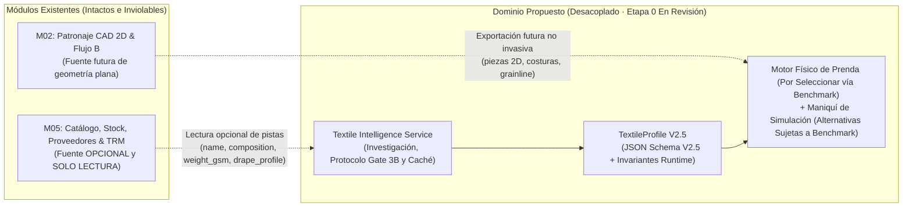
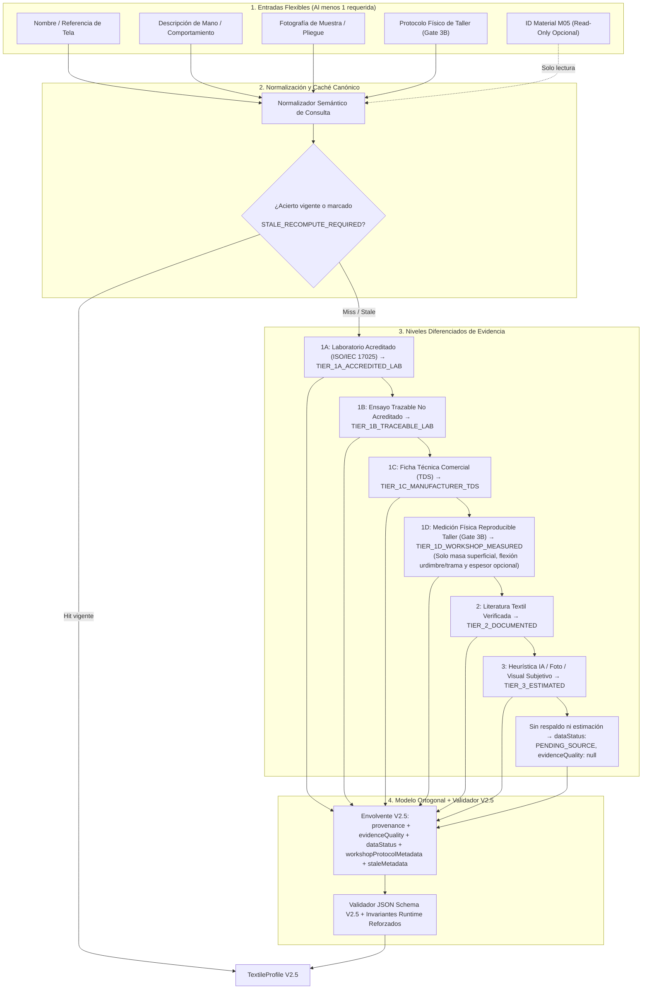

# ESTUDIO DE VIABILIDAD Y ARQUITECTURA TÉCNICA V2.5: SIMULADOR DE PRENDAS 3D E INTELIGENCIA TEXTIL INDEPENDIENTE
**Atelier Digital App — By Katherine Carroll**  
**Versión:** 2.5 (Corrección de Tres Hallazgos Residuales de Auditoría sobre V2.4)  
**Estado del Documento:** **En revisión / pendiente de aprobación**  
**Fecha:** 2026-11-14  
**Naturaleza:** Estudio de Arquitectura, Modelo Metrológico Separado por Propiedad, Contrato JSON Schema V2.5, Validador Runtime Reforzado y Protocolo Reproducible Gate 3B (Sin modificación de código, dependencias, configuraciones ni base de datos)  
**Documento base revisado:** [`ESTUDIO_VIABILIDAD_SIMULADOR_PRENDAS_3D_V2.4.md`](file:///d:/Datos/Datos/DATOS%20JVINAS/Antigravity/2.ByKatherineCarroll/AtelierDigitalApp/ESTUDIO_VIABILIDAD_SIMULADOR_PRENDAS_3D_V2.4.md)

> [!IMPORTANT]
> **Declaración de Integridad Técnica y Alcance V2.5:**  
> Esta revisión V2.5 preserva todas las decisiones conceptuales y correcciones aceptadas en V2.1, V2.2, V2.3 y V2.4, resolviendo tres hallazgos residuales de auditoría sobre V2.4. **No modifica código fuente, dependencias, configuraciones, SQL, migraciones ni los módulos M00–M07.** M05 continúa opcional y de solo lectura; M02 y Flujo B permanecen intactos. No se inventan mediciones, tolerancias, acreditaciones ni resultados. No se selecciona definitivamente XPBD ni ninguna alternativa de maniquí.

---

## 1. Matriz de Correcciones V2.4 → V2.5

| # | Hallazgo Residual de Auditoría sobre V2.4 | Ubicación en V2.4 | Corrección Aplicada en V2.5 |
| :---: | :--- | :--- | :--- |
| **1** | **Falta de exigibilidad estructural y en runtime de los requisitos de Gate 3B en `WorkshopProtocolMetadata` y `validateTextileProfileInvariants`:** V2.4 permitía `repetitionsCount: 1`, `orientationsTested` sin distinguir propiedad ni caras asimétricas, `ambientTemperature_C` / `relativeHumidity_percent` / `combinedUncertainty` nulos, y `TIER_1D_WORKSHOP_MEASURED` incluso en propiedades sin protocolo taller definido, sin diferenciar protocolo completo de excepción por tamaño de retazo. | §7.2, §7.3, §7.4 | Se refuerza `WorkshopProtocolMetadata` con **`protocolCompletenessStatus`** (`COMPLETE_GATE_3B` vs `DOCUMENTED_SWATCH_EXCEPTION`), **`exceptionReasonCode`** + **`exceptionJustification`**, **`faceSymmetry`** (`SYMMETRIC` / `ASYMMETRIC`), **`specimenGeometry`** tipada por instrumento, **`ambientLog`** obligatorio no nulo (`iso139Conditioned: false`, $T$ y $\text{HR}$ inicio/cierre, estabilización) y **`uncertaintyBreakdown`** no nulo. Se restringe `TIER_1D_WORKSHOP_MEASURED` únicamente a propiedades con protocolo Gate 3B (`arealDensity_gsm`, `thickness_mm`, `bendingStiffness_warp_uNm`, `bendingStiffness_weft_uNm`) y se exige en Schema + `validateTextileProfileInvariants` repeticiones ($n \ge 5$ completo; $n \ge 2$ con excepción justificada), orientaciones (`WARP`/`WEFT`, `FACE_UP`+`FACE_DOWN` si `ASYMMETRIC`, `UNORIENTED_AREA`), cuadre de área y `overallSummary.gate3BProtocolCompleteness`. |
| **2** | **Criterio de aceptación 8.3.5.3 físicamente inconsistente:** Exigía correlación monotónica simultánea `(fluida < intermedia < rígida)` tanto en rigidez flexural $B_{\mu\text{Nm}}$ como en masa superficial $\bar{\rho}_{\text{gsm}}$, ignorando que telas ligeras y rígidas (p. ej. organza o tafetán liviano) poseen menor GSM pero mayor rigidez flexural que telas pesadas y fluidas (p. ej. crepé pesado, satén denso o punto viscosa). | §8.3.5 (criterio 3) | Se desacopla físicamente el criterio **§8.3.5.3**: la consistencia flexural entre medidas de taller y respuesta simulada se evalúa exclusivamente mediante rigidez flexural aparente ($B_{\text{urdimbre}}$, $B_{\text{trama}}$) y longitud de flexión ($c$), **sin exigir correlación monotónica ni ordenamiento conjunto con $\bar{\rho}_{\text{gsm}}$**, mientras que $\bar{\rho}_{\text{gsm}}$ se verifica de forma independiente como entrada de densidad másica gravitacional. |
| **3** | **Colisión de notación matemática y falta de separación formal de incertidumbres Tipo A, Tipo B y combinada por propiedad con unidad individual:** V2.4 utilizaba $u_A$ tanto para incertidumbre Tipo A como para incertidumbre de área $A$, y mezclaba en un solo campo `combinedUncertainty` las componentes sin desglose por masa superficial ($\text{g/m}^2$), flexión ($\mu\text{N}\cdot\text{m}$) y espesor ($\text{mm}$). | §7.2, §8.3.4 | Se adopta **$S_i$ / $\bar{S}$** (*superficie de probeta* en $\text{m}^2$) eliminando toda colisión con **$u_{\mathrm{A}}$** (*Tipo A*) y **$u_{\mathrm{B}}$** (*Tipo B*); se formulan ecuaciones explícitas separadas de **$u_{\mathrm{A}}$, $u_{\mathrm{B}}$, $u_c$ y $U = k\,u_c$** para masa superficial ($\text{g/m}^2$), longitud de flexión ($c$ en $\text{cm}$) → rigidez flexural ($B$ en $\mu\text{N}\cdot\text{m}$) y espesor ($\text{mm}$); y en el contrato Schema V2.5 `uncertaintyBreakdown.unit` se vincula estrictamente a la unidad individual de cada propiedad (`g/m2`, `uN*m`, `mm`) verificada en Schema y en runtime ($u_c = \sqrt{u_{\mathrm{A}}^2 + u_{\mathrm{B}}^2}$). |

### Conservación Íntegra de Decisiones y Correcciones Previas (V2.1–V2.4)
- Identificación exacta Kato Tech `KES-FB1`..`FB4` y `CSIRO FAST-1`..`4` (§4.1).
- Conversiones exactas a unidades SI y ecuaciones discretas XPBD clasificadas como pendientes de derivación matemática específica e invarianza bajo remallado (§4.2).
- Seis niveles de `evidenceQuality` (`TIER_1A_ACCREDITED_LAB`, `TIER_1B_TRACEABLE_LAB`, `TIER_1C_MANUFACTURER_TDS`, `TIER_1D_WORKSHOP_MEASURED`, `TIER_2_DOCUMENTED`, `TIER_3_ESTIMATED`).
- Coherencia estricta `PENDING_SOURCE` ↔ `evidenceQuality: null` ↔ `sourceType: null`; `STALE_RECOMPUTE_REQUIRED` con `StaleMetadata` y conservación íntegra de procedencia y auditoría previa (§7.1–§7.3).
- Alternativas abiertas de geometría y colisión del maniquí sujetas a benchmark en Etapa 1 / Gate 2 (§10).
- Etapa 0 en estado **`En revisión / pendiente de aprobación`** (§13).
- M05 estrictamente opcional y de solo lectura; M02 y Flujo B intactos (§2, §9, §11).

---

## 2. Visión Funcional y Separación de Dominios

La visión funcional para *By Katherine Carroll* permanece intacta: habilitar una futura herramienta visual de simulación 3D de prendas que ayude a evaluar caída, volumen, tensión y proporciones textiles antes del corte físico, alimentada por un servicio independiente de inteligencia textil que no exija registro previo en inventario.



### Principios Inquebrantables de Frontera
1. **Independencia total de M05:** El simulador y el *Textile Intelligence Service* operan al 100% incluso con el inventario de M05 vacío o desvinculado.
2. **Preservación de M02 y Flujo B:** El motor CAD 2D de M02 y el Flujo B conservan la autoridad geométrica y milimétrica para el corte físico de tela. No se rediseña M02.
3. **Separación entre torso visual y maniquí de simulación:** El prototipo aislado [`src/components/mannequin3d/`](file:///d:/Datos/Datos/DATOS%20JVINAS/Antigravity/2.ByKatherineCarroll/AtelierDigitalApp/src/components/mannequin3d/) es exclusivamente un busto visual exploratorio (no integrado en producción) y no es apto para simulación física de prendas.

---

## 3. Motores Físicos de Simulación Textil: Evaluación Comparativa y Pruebas Pendientes

> [!CAUTION]
> **Estado de Verificación:** Ninguno de los motores siguientes ha sido ejecutado ni medido dentro de Atelier Digital (Web o móvil Expo). Toda caracterización corresponde a literatura externa y constituye hipótesis sujeta a benchmark antes de elegir motor definitivo.

| Candidato / Familia | Fundamento Teórico | Ventajas Reportadas en Literatura | Riesgos y Limitaciones en Web/Expo | Estado en Atelier Digital |
| :--- | :--- | :--- | :--- | :--- |
| **XPBD** (*Extended Position-Based Dynamics*, Macklin et al., 2016) | Proyección de restricciones con *compliance* elástico ($\alpha$) y multiplicadores de Lagrange regularizados respecto a $\Delta t$ e iteraciones. | Estabilidad numérica alta; soporte de restricciones de distancia, flexión y anisotropía; menor sensibilidad a iteraciones que PBD clásico. | La alta rigidez planar de sedas/tafetanes exige subpasos suficientes o aceleración en Wasm/GPU Compute para evitar estiramiento artificial o caída de FPS en móvil. | **Candidato Principal a Evaluar (No seleccionado definitivamente).** |
| **PBD Clásico** (Müller et al., 2007) | Proyección geométrica directa sin *compliance* físico en unidades SI. | Ligero en JS puro; estable. | Coeficientes ($k \in [0,1]$) dependientes de $\Delta t$ e iteraciones, sin correspondencia dimensional directa con $\text{N/m}$ o $\mu\text{N}\cdot\text{m}$. | **Candidato Secundario de Contraste.** |
| **Mass-Spring Implícito / Semi-Implícito** | Fuerzas elásticas integradas mediante esquemas implícitos o Verlet amortiguado. | Expresión directa de ley de Hooke. | Inestabilidad ante altas rigideces o alto coste lineal disperso por paso en JS. | **Descartado preliminarmente para JS directo** (opcional en Wasm). |
| **FEM Continuo** | Elementos finitos no lineales del medio continuo. | Referencia de precisión en análisis estructural. | Inviable en tiempo real en clientes móviles convencionales. | **Fuera de alcance interactivo.** |
| **Runtime (JS vs. Wasm vs. WebGPU/WebGL Compute)** | Entorno de ejecución del bucle físico y colisiones. | Wasm acelera cálculo numérico/BVH; WebGPU ofrece paralelismo masivo. | Expo móvil limita WebGPU y exige evaluar `WebView` vs. `expo-gl` vs. módulos nativos JSI. | **Asunto Técnico Abierto (Etapa 1).** |

### Batería Obligatoria de Pruebas Comparativas de Motores (Previa a Selección Definitiva)
1. **Escalamiento por densidad de malla:** `ms/step` y FPS sostenidos en matriz escalonada definida en Etapa 1.
2. **Entornos reales:** Web Desktop, Web Móvil y runtime móvil Expo evaluado (`WebView` vs. `expo-gl`).
3. **Prueba de no-estiramiento (*Locking Test*):** Verificar bajo gravedad $\mathbf{g} = -9.81\ \text{m/s}^2$ que un tejido no elástico cumpla el criterio de elongación máxima fijado al aprobar el protocolo de Gate 1.
4. **Prueba de flexión diferencial (*Drape Contrast*):** Contraste claro entre tejidos con menor y mayor rigidez flexural $B$ frente a muestras reales de Etapa 3.
5. **Auto-colisión multicapa:** Ausencia de penetración severa en pliegues y conjuntos tela principal + forro.

---

## 4. Taxonomía Textil Corregida: Normas, Unidades y Conversión Física

### 4.1 Tabla Maestra de Propiedades Físicas, Instrumentación, Normas de Referencia y Unidades

*(Nota: Las normas e instrumentos siguientes son **métodos de referencia aplicables**; su cita no implica que se hayan ejecutado en un material dado sin informe o protocolo explícito).*

| Propiedad Requerida | Métodos Normativos e Instrumentos de Referencia | Unidad de Laboratorio / SI | Qué Mide Realmente el Ensayo (y Alcance) | Rol en el Simulador de Prenda |
| :--- | :--- | :---: | :--- | :--- |
| **Composición** | **ISO 1833** · **AATCC TM20 / TM20A** · Declaración comercial | `%` en masa por fibra | Identidad y proporción de fibras. | Condiciona densidad estimada, elasticidad, recuperación y acabado PBR. |
| **Construcción / Ligamento** | **ISO 3572** · **ASTM D3775** · Inspección macroscópica | Hilos/cm (urdimbre × trama) y clase | Tipo estructural (tafetán, sarga, raso, punto) y densidad de hilos. | Determina **anisotropía** urdimbre / trama / bies (45°) y resistencia al cizallamiento. |
| **Peso / Masa Superficial** | **ISO 3801** · **ASTM D3776 / D3776M** (acondicionamiento **ISO 139** en laboratorio) | $\text{g/m}^2$ ($\text{GSM}$) o $\text{oz/yd}^2$ ($1\ \text{oz/yd}^2 \approx 33.906\ \text{g/m}^2$) | Masa por unidad de superficie. | Define masa nodal $m_i$ bajo gravedad. |
| **Grosor / Compresión** | **ISO 5084** · **ASTM D1777** · **KES-FB3** (*Compression Tester*: $T_0, T_m, EMC, WC, RC$) · **CSIRO FAST-1** (*Compression Meter*) | $\text{mm}$; `%` ($EMC$, $RC$); $\text{gf}\cdot\text{cm/cm}^2$ ($WC$) | Espesor bajo presión normal definida y compresibilidad. | Margen mínimo de separación (*collision thickness offset*) cuerpo-tela y entre capas. |
| **Flexión / Rigidez Flexural** | **ASTM D1388** · **ISO 9073-7** · **KES-FB2** (*Pure Bending Tester*: $B, 2HB$) · **CSIRO FAST-2** (*Bending Meter*) | $c$ ($\text{cm}$); $G_{\text{D1388}}$ ($\text{mg}\cdot\text{cm}$); $B_{\text{KES}}$ ($\text{gf}\cdot\text{cm}^2/\text{cm} = \text{gf}\cdot\text{cm}$); SI ($\mu\text{N}\cdot\text{m}$ o $\text{N}\cdot\text{m}$) | Resistencia pura del tejido a curvarse fuera de su plano por peso propio o momento flector. | Controla radio de curvatura de pliegues y volumen estructural. |
| **Elasticidad (Tracción de baja y alta carga)** | **Baja carga:** **KES-FB1** (*Tensile & Shear Tester*: $EMT, WT, LT$) · **CSIRO FAST-3** ($E_5, E_{20}, E_{100}$). **Elásticos:** **ASTM D3107**, **ASTM D2594 / D2594M**, **ISO 20932-1**. **Rotura:** **ISO 13934-1/-2**, **ASTM D5034 / D5035**. | Extensión `%` bajo carga definida ($\text{gf/cm}$ o $\text{N}$); rigidez equivalente ($\text{N/m}$) | ⚠️ `ASTM D5034/D5035` e `ISO 13934` miden rotura en `N`, órdenes de magnitud por encima del régimen de caída en prenda. | Restricciones de extensión en urdimbre, trama y bies. |
| **Recuperación Elástica** | **ASTM D3107** · **ASTM D2594 / D2594M** · **ISO 20932-1** · **KES-FB1** ($RT$ %) | `%` recuperación y `%` deformación residual | Capacidad de recuperación tras retirar carga cíclica. | Histéresis de ajuste y cedimiento en prendas entalladas. |
| **Cizallamiento (Shear)** | **KES-FB1** ($G$, $2HG$, $2HG5$) · **CSIRO FAST-3** ($EB_5$) | $\text{gf}/(\text{cm}\cdot^\circ)$ o $\text{N}/(\text{m}\cdot\text{rad})$; `%` al bies | Resistencia angular de los hilos a deslizarse en paralelogramo bajo carga diagonal. | Adaptación suave a busto, cadera y cortes al bies. |
| **Caída (Drape)** | **ISO 9073-9** · **BS 5058** (Cusick Drapemeter) | $DC$ (`%`) y nodos (*nodes*) | Área proyectada de sombra de disco suspendido bajo peso propio. | **Métrica de validación, NO entrada independiente:** emerge de peso + flexión + cizallamiento. |
| **Fricción y Rugosidad Superficial** | **KES-FB4** (*Surface Tester*: $MIU$, $MMD$, $SMD$) · **ASTM D1894** / **ISO 8295** (solo recubiertos/láminas) | $MIU$, $MMD$ adimensionales; $SMD$ ($\mu\text{m}$) | Resistencia al deslizamiento superficial bajo carga normal baja y rugosidad geométrica. | Deslizamiento tela-tela, tela-forro y tela-maniquí. |

> [!NOTE]
> **Kawabata (KES-FB, Kato Tech Co., Ltd.):** **KES-FB1** (*Tensile & Shear*), **KES-FB2** (*Pure Bending*), **KES-FB3** (*Compression*), **KES-FB4** (*Surface*).  
> **CSIRO FAST:** **FAST-1** (*Compression*), **FAST-2** (*Bending*), **FAST-3** (*Extension & bias shear*), **FAST-4** (*Dimensional Stability*).

---

### 4.2 Conversiones Dimensionales a SI y Ecuaciones Discretas Pendientes de Derivación

#### A. Conversiones Dimensionales Exactas a SI (Verificadas Algebraicamente)
1. **Flexión a SI ($\text{N}\cdot\text{m}$ y $\mu\text{N}\cdot\text{m}$):**
   $$B_{\text{SI}}\ [\text{N}\cdot\text{m}] = B_{\text{KES}}\ [\text{gf}\cdot\text{cm}] \times 9.80665 \times 10^{-5}, \qquad B_{\mu\text{Nm}} = B_{\text{KES}} \times 98.0665$$
   $$G_{\text{D1388}}\ [\text{mg}\cdot\text{cm}] = 0.1 \cdot \rho_{\text{gsm}} \cdot c_{\text{cm}}^3, \qquad B_{\mu\text{Nm}} = G_{\text{D1388}} \times 0.0980665 = 0.00980665 \cdot \rho_{\text{gsm}} \cdot c_{\text{cm}}^3$$
2. **Cizallamiento (KES-FB1 $G$) a SI ($\text{N}/(\text{m}\cdot\text{rad})$):**
   $$G_{\text{SI}}\ [\text{N}/(\text{m}\cdot\text{rad})] = G_{\text{KES}}\ [\text{gf}/(\text{cm}\cdot^\circ)] \times \frac{0.980665}{\pi / 180} \approx G_{\text{KES}} \times 56.1879$$
3. **Rigidez Lineal Equivalente de Tracción de Baja Carga ($\text{N/m}$):**
   $$K_{\text{stretch}}\ [\text{N/m}] \approx \frac{F_w}{E_w / 100} \qquad (\text{ej. } F_w = 100\ \text{gf/cm} = 98.0665\ \text{N/m})$$
   - ⚠️ **Limitación física:** Comportamiento no lineal; un escalar lineal único es solo una primera aproximación sujeta a calibración según el motor elegido.

#### B. Mapeo a *Compliance* XPBD ($\alpha$) — **PENDIENTE DE DERIVACIÓN Y VERIFICACIÓN ESPECÍFICA**
En **XPBD** (Macklin et al., 2016), $\tilde{\alpha}_j = \alpha_j / \Delta t^2$ depende del operador discreto específico $C_j(\mathbf{x})$ elegido para membrana y flexión. Todas las ecuaciones discretas permanecen clasificadas como **pendientes de derivación formal vinculada al operador elegido en Etapa 1** y sujetas a prueba de invarianza bajo remallado antes de codificar el solver.

---

## 5. Arquitectura del *Textile Intelligence Service* (Independiente de M05)



### Reglas de Operación del Servicio
1. **Independencia de M05:** Funciona íntegramente sin consultar M05.
2. **Separación de seis niveles de evidencia (`evidenceQuality`):**
   - `TIER_1A_ACCREDITED_LAB`: Laboratorio acreditado (`ISO/IEC 17025:2017` o equivalente) con `accreditationRef` y `appliedStandardRef`.
   - `TIER_1B_TRACEABLE_LAB`: Laboratorio no acreditado con ensayo normado trazable (`appliedStandardRef` y `documentRef`, `accreditationRef = null`).
   - `TIER_1C_MANUFACTURER_TDS`: Ficha comercial nominal de fabricante (`documentRef` del TDS, `accreditationRef = null`).
   - **`TIER_1D_WORKSHOP_MEASURED`**: Exclusivo de las propiedades con protocolo físico reproducible en taller definido en §8.3 (`arealDensity_gsm`, `thickness_mm` con calibrador documentado, `bendingStiffness_warp_uNm`, `bendingStiffness_weft_uNm`). Exige `dataStatus = WORKSHOP_MEASURED_RECORD`, `sourceType = WORKSHOP_MEASURED_PROTOCOL`, `appliedStandardRef = null` y bloque obligatorio **`WorkshopProtocolMetadata`** completo (`ambientLog`, `specimenGeometry`, `orientationsTested`, `repetitionsCount`, `uncertaintyBreakdown`, `protocolCompletenessStatus`). Cualquier medición informal que incumpla estos mínimos **no** puede ingresar como `TIER_1D_WORKSHOP_MEASURED` y se degrada explícitamente a `TIER_3_ESTIMATED` o queda `PENDING_SOURCE`.
   - `TIER_2_DOCUMENTED`: Literatura técnica verificable.
   - `TIER_3_ESTIMATED`: Estimación heurística IA, pista visual o ajuste subjetivo (`WORKSHOP_OVERRIDDEN` + `WORKSHOP_VISUAL_OBSERVATION`).
3. **Conservación íntegra al transicionar a `STALE_RECOMPUTE_REQUIRED`:** Cuando vence un TTL, cambia `converterVersion` o una fuente queda obsoleta, el registro preserva intactos `evidenceQuality`, `provenance`, mediciones y metadatos previos (`workshopProtocolMetadata` o `previousValueAudit`), cambiando `dataStatus` a `STALE_RECOMPUTE_REQUIRED` y poblando `staleMetadata`.

---

## 6. Análisis por Fotografía: Alcances Reales y Límites Físicos

| Capacidad | Viable por Fotografía | Evidencia Máxima | Justificación Física |
| :--- | :---: | :---: | :--- |
| **Acabado óptico superficial y PBR** (color, brillo, relieve, transparencia) | ✅ Sí (Orientativo) | Visual / PBR (`TIER_3_ESTIMATED`) | Propiedades ópticas de superficie sin impacto directo en constantes SI. |
| **Apariencia macroscópica de ligamento** | ✅ Sí (foto enfocada) | `TIER_3_ESTIMATED` | Orienta clase constructiva probable sin confirmar densidad real ni fibra. |
| **Medición de masa superficial, flexión, tracción o cizallamiento** | ❌ **NO** | No aplicable | Sin escala metrológica ni fuerzas conocidas, una imagen no mide constantes mecánicas. |
| **Identificación química de fibra** | ❌ **NO** | No aplicable | Requiere ficha técnica, etiqueta o análisis químico (`ISO 1833` / `AATCC TM20`). |

---

## 7. Modelo Ortogonal V2.5, JSON Schema Draft 2020-12, Validador Runtime Reforzado y Ejemplos

### 7.1 Matriz Completa de Coherencia (`dataStatus` ↔ `evidenceQuality` ↔ `provenance.sourceType`)

| `dataStatus` | `evidenceQuality` Permitido | `provenance.sourceType` Permitido | Alcance de Propiedades y Sub-objetos Obligatorios | `appliedStandardRef` / `accreditationRef` |
| :--- | :--- | :--- | :--- | :--- |
| **`PENDING_SOURCE`** | Exclusivamente **`null`** | Exclusivamente **`null`** | `measuredValue = null`, `range = null`, `workshopProtocolMetadata = null`, `staleMetadata = null`. | Ambos **`null`** (normas sugeridas solo en `recommendedMethodRefs`). |
| **`VERIFIED_RECORD`** | `TIER_1A_ACCREDITED_LAB`, `TIER_1B_TRACEABLE_LAB`, `TIER_1C_MANUFACTURER_TDS`, `TIER_2_DOCUMENTED` | `ACCREDITED_LAB` ↔ `1A`, `TRACEABLE_LAB` ↔ `1B`, `MANUFACTURER_TDS` ↔ `1C`, `SCIENTIFIC_LITERATURE` ↔ `2` | Al menos `measuredValue` o `range` no nulo + `documentRef` no nulo; `workshopProtocolMetadata = null`, `staleMetadata = null`. | `appliedStandardRef` obligatorio en `1A`/`1B`; `accreditationRef` obligatorio solo en `1A`. |
| **`WORKSHOP_MEASURED_RECORD`** | Exclusivamente **`TIER_1D_WORKSHOP_MEASURED`** | Exclusivamente **`WORKSHOP_MEASURED_PROTOCOL`** | **Solo en `arealDensity_gsm`, `thickness_mm`, `bendingStiffness_warp_uNm`, `bendingStiffness_weft_uNm`.** Al menos `measuredValue` o `range` no nulo; **`workshopProtocolMetadata` obligatorio no nulo** (`protocolCompletenessStatus` = `COMPLETE_GATE_3B` o `DOCUMENTED_SWATCH_EXCEPTION`, `ambientLog` completo, `uncertaintyBreakdown` completo en la unidad de la propiedad, `orientationsTested` válido); `staleMetadata = null`. | Ambos **`null`** (el método geométrico inspirador va en `workshopProtocolMetadata.adaptedFromMethodRef`; `ambientLog.iso139Conditioned = false`). |
| **`ESTIMATED_RECORD`** | Exclusivamente **`TIER_3_ESTIMATED`** | `AI_HEURISTIC`, `M05_READONLY_HINT` o `WORKSHOP_VISUAL_OBSERVATION` | `measuredValue = null`, `range` no nulo + `assumptionNote` obligatorio; `workshopProtocolMetadata = null`, `staleMetadata = null`. | Ambos **`null`**. |
| **`WORKSHOP_OVERRIDDEN`** | Exclusivamente **`TIER_3_ESTIMATED`** | Exclusivamente **`WORKSHOP_VISUAL_OBSERVATION`** | Al menos `measuredValue` o `range` no nulo + **`previousValueAudit` obligatorio**; `workshopProtocolMetadata = null`, `staleMetadata = null`. | Ambos **`null`**. |
| **`STALE_RECOMPUTE_REQUIRED`** | **No nulo** (`TIER_1A` .. `TIER_3`, con `1D` solo en propiedades Gate 3B) | Coherente con su `evidenceQuality` previo (vía `EvidenceProvenanceCoherenceRules`) | **`staleMetadata` obligatorio no nulo**; conserva mediciones, `provenance` completo y sub-vínculos coherentes con `staleMetadata.priorDataStatus` (`VERIFIED_RECORD`, `WORKSHOP_MEASURED_RECORD`, `ESTIMATED_RECORD` o `WORKSHOP_OVERRIDDEN`). | Coherente íntegramente con `evidenceQuality` previo (conservado sin pérdida). |

---

### 7.2 Contrato JSON Schema Draft 2020-12 (`TextileProfileV2_5`)

```json
{
  "$schema": "https://json-schema.org/draft/2020-12/schema",
  "$id": "https://atelierdigital.local/schemas/textile-profile-v2.5.schema.json",
  "title": "TextileProfileV2_5",
  "description": "Contrato V2.5 con refuerzo estricto de WorkshopProtocolMetadata (completo vs excepcion documentada, orientaciones, ambiente no ISO 139 y desglose formal Tipo A/Tipo B/combinada con unidad individual por propiedad) y reglas STALE_RECOMPUTE_REQUIRED.",
  "type": "object",
  "additionalProperties": false,
  "required": [
    "schemaVersion",
    "profileId",
    "cacheKey",
    "createdAt",
    "identification",
    "overallSummary",
    "physicalProperties",
    "solverTranslationMetadata",
    "optionalM05Link",
    "serviceProvenance"
  ],
  "properties": {
    "schemaVersion": { "const": "2.5.0-draft" },
    "profileId": { "type": "string", "minLength": 1 },
    "cacheKey": { "type": "string", "minLength": 1 },
    "createdAt": { "type": "string", "format": "date-time" },
    "identification": {
      "type": "object",
      "additionalProperties": false,
      "required": ["displayName", "composition", "weaveType"],
      "properties": {
        "displayName": { "type": "string", "minLength": 1 },
        "composition": { "$ref": "#/$defs/StringMetadataEnvelope" },
        "weaveType": { "$ref": "#/$defs/StringMetadataEnvelope" }
      }
    },
    "overallSummary": {
      "type": "object",
      "additionalProperties": false,
      "required": [
        "highestEvidenceQuality",
        "lowestEvidenceQuality",
        "countsByEvidenceQuality",
        "countsByDataStatus",
        "gate3BProtocolCompleteness",
        "requiresPhysicalCalibration"
      ],
      "properties": {
        "highestEvidenceQuality": { "$ref": "#/$defs/NullableEvidenceQualityTier" },
        "lowestEvidenceQuality": { "$ref": "#/$defs/NullableEvidenceQualityTier" },
        "countsByEvidenceQuality": {
          "type": "object",
          "additionalProperties": false,
          "required": [
            "TIER_1A_ACCREDITED_LAB",
            "TIER_1B_TRACEABLE_LAB",
            "TIER_1C_MANUFACTURER_TDS",
            "TIER_1D_WORKSHOP_MEASURED",
            "TIER_2_DOCUMENTED",
            "TIER_3_ESTIMATED",
            "UNASSIGNED_PENDING"
          ],
          "properties": {
            "TIER_1A_ACCREDITED_LAB": { "type": "integer", "minimum": 0 },
            "TIER_1B_TRACEABLE_LAB": { "type": "integer", "minimum": 0 },
            "TIER_1C_MANUFACTURER_TDS": { "type": "integer", "minimum": 0 },
            "TIER_1D_WORKSHOP_MEASURED": { "type": "integer", "minimum": 0 },
            "TIER_2_DOCUMENTED": { "type": "integer", "minimum": 0 },
            "TIER_3_ESTIMATED": { "type": "integer", "minimum": 0 },
            "UNASSIGNED_PENDING": { "type": "integer", "minimum": 0 }
          }
        },
        "countsByDataStatus": {
          "type": "object",
          "additionalProperties": false,
          "required": [
            "PENDING_SOURCE",
            "VERIFIED_RECORD",
            "WORKSHOP_MEASURED_RECORD",
            "ESTIMATED_RECORD",
            "WORKSHOP_OVERRIDDEN",
            "STALE_RECOMPUTE_REQUIRED"
          ],
          "properties": {
            "PENDING_SOURCE": { "type": "integer", "minimum": 0 },
            "VERIFIED_RECORD": { "type": "integer", "minimum": 0 },
            "WORKSHOP_MEASURED_RECORD": { "type": "integer", "minimum": 0 },
            "ESTIMATED_RECORD": { "type": "integer", "minimum": 0 },
            "WORKSHOP_OVERRIDDEN": { "type": "integer", "minimum": 0 },
            "STALE_RECOMPUTE_REQUIRED": { "type": "integer", "minimum": 0 }
          }
        },
        "gate3BProtocolCompleteness": {
          "enum": ["NOT_APPLICABLE", "COMPLETE", "WITH_DOCUMENTED_EXCEPTIONS"]
        },
        "requiresPhysicalCalibration": { "type": "boolean" }
      }
    },
    "physicalProperties": {
      "type": "object",
      "additionalProperties": false,
      "required": [
        "arealDensity_gsm",
        "thickness_mm",
        "bendingStiffness_warp_uNm",
        "bendingStiffness_weft_uNm",
        "stretchStiffness_lowStrain_warp_N_per_m",
        "stretchStiffness_lowStrain_weft_N_per_m",
        "elasticRecovery_percent",
        "shearStiffness_N_per_m_rad",
        "frictionCoefficient_clothToCloth"
      ],
      "properties": {
        "arealDensity_gsm": {
          "allOf": [
            { "$ref": "#/$defs/PhysicalPropertyEnvelope" },
            { "properties": { "unit": { "const": "g/m2" } } },
            {
              "if": { "properties": { "workshopProtocolMetadata": { "type": "object" } } },
              "then": {
                "properties": {
                  "workshopProtocolMetadata": {
                    "properties": {
                      "specimenGeometry": {
                        "properties": { "measurementKind": { "const": "AREAL_MASS_SWATCH" } }
                      },
                      "uncertaintyBreakdown": {
                        "properties": { "unit": { "const": "g/m2" } }
                      }
                    }
                  }
                }
              }
            }
          ]
        },
        "thickness_mm": {
          "allOf": [
            { "$ref": "#/$defs/PhysicalPropertyEnvelope" },
            { "properties": { "unit": { "const": "mm" } } },
            {
              "if": { "properties": { "workshopProtocolMetadata": { "type": "object" } } },
              "then": {
                "properties": {
                  "workshopProtocolMetadata": {
                    "properties": {
                      "specimenGeometry": {
                        "properties": { "measurementKind": { "const": "THICKNESS_GAUGE" } }
                      },
                      "uncertaintyBreakdown": {
                        "properties": { "unit": { "const": "mm" } }
                      }
                    }
                  }
                }
              }
            }
          ]
        },
        "bendingStiffness_warp_uNm": {
          "allOf": [
            { "$ref": "#/$defs/PhysicalPropertyEnvelope" },
            { "properties": { "unit": { "const": "uN*m" } } },
            {
              "if": { "properties": { "workshopProtocolMetadata": { "type": "object" } } },
              "then": {
                "properties": {
                  "workshopProtocolMetadata": {
                    "properties": {
                      "orientationsTested": { "contains": { "const": "WARP" } },
                      "specimenGeometry": {
                        "properties": { "measurementKind": { "const": "CANTILEVER_STRIP" } }
                      },
                      "uncertaintyBreakdown": {
                        "properties": { "unit": { "const": "uN*m" } }
                      }
                    }
                  }
                }
              }
            }
          ]
        },
        "bendingStiffness_weft_uNm": {
          "allOf": [
            { "$ref": "#/$defs/PhysicalPropertyEnvelope" },
            { "properties": { "unit": { "const": "uN*m" } } },
            {
              "if": { "properties": { "workshopProtocolMetadata": { "type": "object" } } },
              "then": {
                "properties": {
                  "workshopProtocolMetadata": {
                    "properties": {
                      "orientationsTested": { "contains": { "const": "WEFT" } },
                      "specimenGeometry": {
                        "properties": { "measurementKind": { "const": "CANTILEVER_STRIP" } }
                      },
                      "uncertaintyBreakdown": {
                        "properties": { "unit": { "const": "uN*m" } }
                      }
                    }
                  }
                }
              }
            }
          ]
        },
        "stretchStiffness_lowStrain_warp_N_per_m": {
          "allOf": [
            { "$ref": "#/$defs/PhysicalPropertyEnvelope" },
            { "$ref": "#/$defs/NoGate3BWorkshopMeasurementAllowed" },
            { "properties": { "unit": { "const": "N/m" } } }
          ]
        },
        "stretchStiffness_lowStrain_weft_N_per_m": {
          "allOf": [
            { "$ref": "#/$defs/PhysicalPropertyEnvelope" },
            { "$ref": "#/$defs/NoGate3BWorkshopMeasurementAllowed" },
            { "properties": { "unit": { "const": "N/m" } } }
          ]
        },
        "elasticRecovery_percent": {
          "allOf": [
            { "$ref": "#/$defs/PhysicalPropertyEnvelope" },
            { "$ref": "#/$defs/NoGate3BWorkshopMeasurementAllowed" },
            { "properties": { "unit": { "const": "%" } } }
          ]
        },
        "shearStiffness_N_per_m_rad": {
          "allOf": [
            { "$ref": "#/$defs/PhysicalPropertyEnvelope" },
            { "$ref": "#/$defs/NoGate3BWorkshopMeasurementAllowed" },
            { "properties": { "unit": { "const": "N/(m*rad)" } } }
          ]
        },
        "frictionCoefficient_clothToCloth": {
          "allOf": [
            { "$ref": "#/$defs/PhysicalPropertyEnvelope" },
            { "$ref": "#/$defs/NoGate3BWorkshopMeasurementAllowed" },
            { "properties": { "unit": { "const": "dimensionless" } } }
          ]
        }
      }
    },
    "solverTranslationMetadata": {
      "type": "object",
      "additionalProperties": false,
      "required": [
        "targetSolverCandidate",
        "discreteFormulationStatus",
        "converterVersion",
        "notes"
      ],
      "properties": {
        "targetSolverCandidate": {
          "enum": ["PENDING_BENCHMARK_SELECTION", "XPBD", "PBD", "MASS_SPRING_IMPLICIT"]
        },
        "discreteFormulationStatus": {
          "enum": ["PENDING_OPERATOR_DERIVATION", "DERIVED_AND_REMESH_VERIFIED"]
        },
        "converterVersion": { "type": "string", "minLength": 1 },
        "notes": { "type": "string" }
      }
    },
    "optionalM05Link": {
      "type": "object",
      "additionalProperties": false,
      "required": ["linked", "materialId", "readOnlyFieldsUsed"],
      "properties": {
        "linked": { "type": "boolean" },
        "materialId": { "type": ["string", "null"] },
        "readOnlyFieldsUsed": {
          "type": "array",
          "items": { "type": "string" }
        }
      }
    },
    "serviceProvenance": {
      "type": "object",
      "additionalProperties": false,
      "required": ["aiAssisted", "aiModelId", "aiPromptVersion", "timestamp"],
      "properties": {
        "aiAssisted": { "type": "boolean" },
        "aiModelId": { "type": ["string", "null"] },
        "aiPromptVersion": { "type": ["string", "null"] },
        "timestamp": { "type": "string", "format": "date-time" }
      }
    }
  },
  "$defs": {
    "EvidenceQualityTier": {
      "type": "string",
      "enum": [
        "TIER_1A_ACCREDITED_LAB",
        "TIER_1B_TRACEABLE_LAB",
        "TIER_1C_MANUFACTURER_TDS",
        "TIER_1D_WORKSHOP_MEASURED",
        "TIER_2_DOCUMENTED",
        "TIER_3_ESTIMATED"
      ]
    },
    "NullableEvidenceQualityTier": {
      "type": ["string", "null"],
      "enum": [
        "TIER_1A_ACCREDITED_LAB",
        "TIER_1B_TRACEABLE_LAB",
        "TIER_1C_MANUFACTURER_TDS",
        "TIER_1D_WORKSHOP_MEASURED",
        "TIER_2_DOCUMENTED",
        "TIER_3_ESTIMATED",
        null
      ]
    },
    "DataStatus": {
      "type": "string",
      "enum": [
        "PENDING_SOURCE",
        "VERIFIED_RECORD",
        "WORKSHOP_MEASURED_RECORD",
        "ESTIMATED_RECORD",
        "WORKSHOP_OVERRIDDEN",
        "STALE_RECOMPUTE_REQUIRED"
      ]
    },
    "PriorActiveDataStatus": {
      "type": "string",
      "enum": [
        "VERIFIED_RECORD",
        "WORKSHOP_MEASURED_RECORD",
        "ESTIMATED_RECORD",
        "WORKSHOP_OVERRIDDEN"
      ]
    },
    "NullableSourceType": {
      "type": ["string", "null"],
      "enum": [
        "ACCREDITED_LAB",
        "TRACEABLE_LAB",
        "MANUFACTURER_TDS",
        "WORKSHOP_MEASURED_PROTOCOL",
        "SCIENTIFIC_LITERATURE",
        "M05_READONLY_HINT",
        "AI_HEURISTIC",
        "WORKSHOP_VISUAL_OBSERVATION",
        null
      ]
    },
    "NumericRange": {
      "type": "object",
      "additionalProperties": false,
      "required": ["min", "max"],
      "properties": {
        "min": { "type": "number", "minimum": 0 },
        "typical": { "type": ["number", "null"], "minimum": 0 },
        "max": { "type": "number", "minimum": 0 }
      }
    },
    "PreviousValueAudit": {
      "type": "object",
      "additionalProperties": false,
      "required": [
        "previousDataStatus",
        "previousEvidenceQuality",
        "previousMeasuredValue",
        "previousRange",
        "overrideReason",
        "overriddenAt"
      ],
      "properties": {
        "previousDataStatus": { "$ref": "#/$defs/DataStatus" },
        "previousEvidenceQuality": { "$ref": "#/$defs/NullableEvidenceQualityTier" },
        "previousMeasuredValue": { "type": ["number", "null"], "minimum": 0 },
        "previousRange": {
          "oneOf": [{ "type": "null" }, { "$ref": "#/$defs/NumericRange" }]
        },
        "overrideReason": { "type": "string", "minLength": 1 },
        "overriddenAt": { "type": "string", "format": "date-time" }
      }
    },
    "SpecimenGeometry": {
      "type": "object",
      "additionalProperties": false,
      "required": [
        "measurementKind",
        "shape",
        "width_mm",
        "length_mm",
        "effectiveArea_cm2",
        "inclinedPlaneAngle_deg",
        "presserFootDiameter_mm",
        "presserPressure_kPa"
      ],
      "properties": {
        "measurementKind": {
          "enum": ["AREAL_MASS_SWATCH", "CANTILEVER_STRIP", "THICKNESS_GAUGE"]
        },
        "shape": {
          "enum": ["RECTANGULAR", "CIRCULAR_DIE", "PRESSER_FOOT_SPOT"]
        },
        "width_mm": { "type": "number", "exclusiveMinimum": 0 },
        "length_mm": { "type": "number", "exclusiveMinimum": 0 },
        "effectiveArea_cm2": { "type": "number", "exclusiveMinimum": 0 },
        "inclinedPlaneAngle_deg": { "type": ["number", "null"], "exclusiveMinimum": 0, "maximum": 90 },
        "presserFootDiameter_mm": { "type": ["number", "null"], "exclusiveMinimum": 0 },
        "presserPressure_kPa": { "type": ["number", "null"], "exclusiveMinimum": 0 }
      },
      "allOf": [
        {
          "if": { "properties": { "measurementKind": { "const": "AREAL_MASS_SWATCH" } } },
          "then": {
            "properties": {
              "shape": { "enum": ["RECTANGULAR", "CIRCULAR_DIE"] },
              "effectiveArea_cm2": { "type": "number", "minimum": 13 },
              "inclinedPlaneAngle_deg": { "type": "null" },
              "presserFootDiameter_mm": { "type": "null" },
              "presserPressure_kPa": { "type": "null" }
            }
          }
        },
        {
          "if": { "properties": { "measurementKind": { "const": "CANTILEVER_STRIP" } } },
          "then": {
            "properties": {
              "shape": { "const": "RECTANGULAR" },
              "width_mm": { "type": "number", "minimum": 25, "maximum": 75 },
              "inclinedPlaneAngle_deg": { "const": 41.5 },
              "presserFootDiameter_mm": { "type": "null" },
              "presserPressure_kPa": { "type": "null" }
            }
          }
        },
        {
          "if": { "properties": { "measurementKind": { "const": "THICKNESS_GAUGE" } } },
          "then": {
            "properties": {
              "shape": { "const": "PRESSER_FOOT_SPOT" },
              "inclinedPlaneAngle_deg": { "type": "null" },
              "presserFootDiameter_mm": { "type": "number", "exclusiveMinimum": 0 },
              "presserPressure_kPa": { "type": "number", "exclusiveMinimum": 0 }
            }
          }
        }
      ]
    },
    "AmbientConditionLog": {
      "type": "object",
      "additionalProperties": false,
      "required": [
        "iso139Conditioned",
        "temperatureStart_C",
        "temperatureEnd_C",
        "relativeHumidityStart_percent",
        "relativeHumidityEnd_percent",
        "stabilizationDuration_min"
      ],
      "properties": {
        "iso139Conditioned": { "const": false },
        "temperatureStart_C": { "type": "number" },
        "temperatureEnd_C": { "type": "number" },
        "relativeHumidityStart_percent": { "type": "number", "minimum": 0, "maximum": 100 },
        "relativeHumidityEnd_percent": { "type": "number", "minimum": 0, "maximum": 100 },
        "stabilizationDuration_min": { "type": "number", "minimum": 0 }
      }
    },
    "UncertaintyBreakdown": {
      "type": "object",
      "additionalProperties": false,
      "required": [
        "unit",
        "typeA",
        "typeB",
        "combined",
        "coverageFactorK",
        "expandedUncertainty",
        "calculationNote"
      ],
      "properties": {
        "unit": { "enum": ["g/m2", "uN*m", "mm"] },
        "typeA": { "type": "number", "minimum": 0 },
        "typeB": { "type": "number", "minimum": 0 },
        "combined": { "type": "number", "minimum": 0 },
        "coverageFactorK": { "type": "number", "exclusiveMinimum": 0 },
        "expandedUncertainty": { "type": "number", "minimum": 0 },
        "calculationNote": { "type": "string", "minLength": 1 }
      }
    },
    "WorkshopProtocolMetadata": {
      "type": "object",
      "additionalProperties": false,
      "required": [
        "protocolVersion",
        "protocolCompletenessStatus",
        "exceptionReasonCode",
        "exceptionJustification",
        "adaptedFromMethodRef",
        "specimenGeometry",
        "faceSymmetry",
        "orientationsTested",
        "repetitionsCount",
        "instrumentNameAndResolution",
        "ambientLog",
        "uncertaintyBreakdown"
      ],
      "properties": {
        "protocolVersion": { "type": "string", "minLength": 1 },
        "protocolCompletenessStatus": {
          "enum": ["COMPLETE_GATE_3B", "DOCUMENTED_SWATCH_EXCEPTION"]
        },
        "exceptionReasonCode": {
          "type": ["string", "null"],
          "enum": [
            "REDUCED_REPETITIONS_SWATCH_LIMIT",
            "REDUCED_AREA_MIN_13CM2",
            "SHORTENED_CANTILEVER_STRIP_SWATCH_LIMIT",
            "COMBINED_SWATCH_CONSTRAINT",
            null
          ]
        },
        "exceptionJustification": { "type": ["string", "null"] },
        "adaptedFromMethodRef": { "type": ["string", "null"] },
        "specimenGeometry": { "$ref": "#/$defs/SpecimenGeometry" },
        "faceSymmetry": { "enum": ["SYMMETRIC", "ASYMMETRIC"] },
        "orientationsTested": {
          "type": "array",
          "minItems": 1,
          "items": {
            "enum": ["WARP", "WEFT", "BIAS_45", "FACE_UP", "FACE_DOWN", "UNORIENTED_AREA"]
          }
        },
        "repetitionsCount": { "type": "integer", "minimum": 2 },
        "instrumentNameAndResolution": { "type": "string", "minLength": 1 },
        "ambientLog": { "$ref": "#/$defs/AmbientConditionLog" },
        "uncertaintyBreakdown": { "$ref": "#/$defs/UncertaintyBreakdown" }
      },
      "allOf": [
        {
          "if": { "properties": { "protocolCompletenessStatus": { "const": "COMPLETE_GATE_3B" } } },
          "then": {
            "properties": {
              "repetitionsCount": { "type": "integer", "minimum": 5 },
              "exceptionReasonCode": { "type": "null" },
              "exceptionJustification": { "type": "null" }
            },
            "allOf": [
              {
                "if": {
                  "properties": {
                    "specimenGeometry": {
                      "properties": { "measurementKind": { "const": "AREAL_MASS_SWATCH" } }
                    }
                  }
                },
                "then": {
                  "properties": {
                    "specimenGeometry": {
                      "properties": { "effectiveArea_cm2": { "type": "number", "minimum": 100 } }
                    }
                  }
                }
              },
              {
                "if": {
                  "properties": {
                    "specimenGeometry": {
                      "properties": { "measurementKind": { "const": "CANTILEVER_STRIP" } }
                    }
                  }
                },
                "then": {
                  "properties": {
                    "specimenGeometry": {
                      "properties": { "length_mm": { "type": "number", "minimum": 200 } }
                    }
                  }
                }
              }
            ]
          }
        },
        {
          "if": {
            "properties": { "protocolCompletenessStatus": { "const": "DOCUMENTED_SWATCH_EXCEPTION" } }
          },
          "then": {
            "properties": {
              "repetitionsCount": { "type": "integer", "minimum": 2 },
              "exceptionReasonCode": {
                "type": "string",
                "enum": [
                  "REDUCED_REPETITIONS_SWATCH_LIMIT",
                  "REDUCED_AREA_MIN_13CM2",
                  "SHORTENED_CANTILEVER_STRIP_SWATCH_LIMIT",
                  "COMBINED_SWATCH_CONSTRAINT"
                ]
              },
              "exceptionJustification": { "type": "string", "minLength": 10 }
            }
          }
        },
        {
          "if": {
            "properties": {
              "specimenGeometry": {
                "properties": { "measurementKind": { "const": "CANTILEVER_STRIP" } }
              },
              "faceSymmetry": { "const": "ASYMMETRIC" }
            }
          },
          "then": {
            "properties": {
              "orientationsTested": {
                "allOf": [
                  { "contains": { "const": "FACE_UP" } },
                  { "contains": { "const": "FACE_DOWN" } }
                ]
              }
            }
          }
        },
        {
          "if": {
            "properties": {
              "specimenGeometry": {
                "properties": { "measurementKind": { "const": "CANTILEVER_STRIP" } }
              },
              "faceSymmetry": { "const": "SYMMETRIC" }
            }
          },
          "then": {
            "properties": {
              "orientationsTested": {
                "anyOf": [
                  { "contains": { "const": "FACE_UP" } },
                  { "contains": { "const": "FACE_DOWN" } }
                ]
              }
            }
          }
        },
        {
          "if": {
            "properties": {
              "specimenGeometry": {
                "properties": {
                  "measurementKind": { "enum": ["AREAL_MASS_SWATCH", "THICKNESS_GAUGE"] }
                }
              }
            }
          },
          "then": {
            "properties": {
              "orientationsTested": { "contains": { "const": "UNORIENTED_AREA" } }
            }
          }
        }
      ]
    },
    "NoGate3BWorkshopMeasurementAllowed": {
      "properties": {
        "evidenceQuality": {
          "type": ["string", "null"],
          "enum": [
            "TIER_1A_ACCREDITED_LAB",
            "TIER_1B_TRACEABLE_LAB",
            "TIER_1C_MANUFACTURER_TDS",
            "TIER_2_DOCUMENTED",
            "TIER_3_ESTIMATED",
            null
          ]
        },
        "dataStatus": {
          "enum": [
            "PENDING_SOURCE",
            "VERIFIED_RECORD",
            "ESTIMATED_RECORD",
            "WORKSHOP_OVERRIDDEN",
            "STALE_RECOMPUTE_REQUIRED"
          ]
        },
        "workshopProtocolMetadata": { "type": "null" }
      },
      "if": { "properties": { "staleMetadata": { "type": "object" } } },
      "then": {
        "properties": {
          "staleMetadata": {
            "properties": {
              "priorDataStatus": {
                "enum": ["VERIFIED_RECORD", "ESTIMATED_RECORD", "WORKSHOP_OVERRIDDEN"]
              },
              "priorEvidenceQuality": {
                "enum": [
                  "TIER_1A_ACCREDITED_LAB",
                  "TIER_1B_TRACEABLE_LAB",
                  "TIER_1C_MANUFACTURER_TDS",
                  "TIER_2_DOCUMENTED",
                  "TIER_3_ESTIMATED"
                ]
              }
            }
          }
        }
      }
    },
    "StaleMetadata": {
      "type": "object",
      "additionalProperties": false,
      "required": [
        "staleReason",
        "markedStaleAt",
        "priorDataStatus",
        "priorEvidenceQuality",
        "priorConverterVersion"
      ],
      "properties": {
        "staleReason": {
          "enum": [
            "CONVERTER_VERSION_CHANGED",
            "CACHE_TTL_EXPIRED",
            "SOURCE_SUPERSEDED",
            "WORKSHOP_RECALIBRATION_NEEDED"
          ]
        },
        "markedStaleAt": { "type": "string", "format": "date-time" },
        "priorDataStatus": { "$ref": "#/$defs/PriorActiveDataStatus" },
        "priorEvidenceQuality": { "$ref": "#/$defs/EvidenceQualityTier" },
        "priorConverterVersion": { "type": ["string", "null"] }
      }
    },
    "Provenance": {
      "type": "object",
      "additionalProperties": false,
      "required": [
        "sourceType",
        "sourceName",
        "documentRef",
        "appliedStandardRef",
        "accreditationRef",
        "conditioningProtocol",
        "actorOrModelId",
        "recordedAt",
        "previousValueAudit"
      ],
      "properties": {
        "sourceType": { "$ref": "#/$defs/NullableSourceType" },
        "sourceName": { "type": ["string", "null"] },
        "documentRef": { "type": ["string", "null"] },
        "appliedStandardRef": { "type": ["string", "null"] },
        "accreditationRef": { "type": ["string", "null"] },
        "conditioningProtocol": { "type": ["string", "null"] },
        "actorOrModelId": { "type": ["string", "null"] },
        "recordedAt": { "type": ["string", "null"], "format": "date-time" },
        "previousValueAudit": {
          "oneOf": [{ "type": "null" }, { "$ref": "#/$defs/PreviousValueAudit" }]
        }
      }
    },
    "EvidenceProvenanceCoherenceRules": {
      "allOf": [
        {
          "if": { "properties": { "evidenceQuality": { "const": "TIER_1A_ACCREDITED_LAB" } } },
          "then": {
            "properties": {
              "provenance": {
                "properties": {
                  "sourceType": { "const": "ACCREDITED_LAB" },
                  "sourceName": { "type": "string", "minLength": 1 },
                  "accreditationRef": { "type": "string", "minLength": 1 },
                  "appliedStandardRef": { "type": "string", "minLength": 1 },
                  "documentRef": { "type": "string", "minLength": 1 },
                  "recordedAt": { "type": "string", "format": "date-time" }
                }
              }
            }
          }
        },
        {
          "if": { "properties": { "evidenceQuality": { "const": "TIER_1B_TRACEABLE_LAB" } } },
          "then": {
            "properties": {
              "provenance": {
                "properties": {
                  "sourceType": { "const": "TRACEABLE_LAB" },
                  "sourceName": { "type": "string", "minLength": 1 },
                  "accreditationRef": { "type": "null" },
                  "appliedStandardRef": { "type": "string", "minLength": 1 },
                  "documentRef": { "type": "string", "minLength": 1 },
                  "recordedAt": { "type": "string", "format": "date-time" }
                }
              }
            }
          }
        },
        {
          "if": { "properties": { "evidenceQuality": { "const": "TIER_1C_MANUFACTURER_TDS" } } },
          "then": {
            "properties": {
              "provenance": {
                "properties": {
                  "sourceType": { "const": "MANUFACTURER_TDS" },
                  "sourceName": { "type": "string", "minLength": 1 },
                  "accreditationRef": { "type": "null" },
                  "documentRef": { "type": "string", "minLength": 1 },
                  "recordedAt": { "type": "string", "format": "date-time" }
                }
              }
            }
          }
        },
        {
          "if": { "properties": { "evidenceQuality": { "const": "TIER_1D_WORKSHOP_MEASURED" } } },
          "then": {
            "properties": {
              "provenance": {
                "properties": {
                  "sourceType": { "const": "WORKSHOP_MEASURED_PROTOCOL" },
                  "sourceName": { "type": "string", "minLength": 1 },
                  "accreditationRef": { "type": "null" },
                  "appliedStandardRef": { "type": "null" },
                  "documentRef": { "type": "string", "minLength": 1 },
                  "recordedAt": { "type": "string", "format": "date-time" }
                }
              }
            }
          }
        },
        {
          "if": { "properties": { "evidenceQuality": { "const": "TIER_2_DOCUMENTED" } } },
          "then": {
            "properties": {
              "provenance": {
                "properties": {
                  "sourceType": { "const": "SCIENTIFIC_LITERATURE" },
                  "sourceName": { "type": "string", "minLength": 1 },
                  "accreditationRef": { "type": "null" },
                  "documentRef": { "type": "string", "minLength": 1 },
                  "recordedAt": { "type": "string", "format": "date-time" }
                }
              }
            }
          }
        },
        {
          "if": { "properties": { "evidenceQuality": { "const": "TIER_3_ESTIMATED" } } },
          "then": {
            "properties": {
              "provenance": {
                "properties": {
                  "sourceType": {
                    "type": "string",
                    "enum": ["AI_HEURISTIC", "M05_READONLY_HINT", "WORKSHOP_VISUAL_OBSERVATION"]
                  },
                  "accreditationRef": { "type": "null" },
                  "appliedStandardRef": { "type": "null" },
                  "recordedAt": { "type": "string", "format": "date-time" }
                }
              }
            }
          }
        }
      ]
    },
    "StringMetadataEnvelope": {
      "type": "object",
      "additionalProperties": false,
      "required": [
        "value",
        "recommendedMethodRefs",
        "evidenceQuality",
        "dataStatus",
        "provenance",
        "staleMetadata"
      ],
      "properties": {
        "value": { "type": ["string", "null"] },
        "recommendedMethodRefs": {
          "type": "array",
          "items": { "type": "string", "minLength": 1 }
        },
        "evidenceQuality": { "$ref": "#/$defs/NullableEvidenceQualityTier" },
        "dataStatus": { "$ref": "#/$defs/DataStatus" },
        "provenance": { "$ref": "#/$defs/Provenance" },
        "staleMetadata": {
          "oneOf": [{ "type": "null" }, { "$ref": "#/$defs/StaleMetadata" }]
        }
      },
      "allOf": [
        { "$ref": "#/$defs/EvidenceProvenanceCoherenceRules" },
        {
          "if": { "properties": { "dataStatus": { "const": "PENDING_SOURCE" } } },
          "then": {
            "properties": {
              "value": { "type": "null" },
              "evidenceQuality": { "type": "null" },
              "staleMetadata": { "type": "null" },
              "provenance": {
                "properties": {
                  "sourceType": { "type": "null" },
                  "sourceName": { "type": "null" },
                  "documentRef": { "type": "null" },
                  "appliedStandardRef": { "type": "null" },
                  "accreditationRef": { "type": "null" },
                  "conditioningProtocol": { "type": "null" },
                  "previousValueAudit": { "type": "null" }
                }
              }
            }
          }
        },
        {
          "if": { "properties": { "dataStatus": { "const": "VERIFIED_RECORD" } } },
          "then": {
            "properties": {
              "value": { "type": "string", "minLength": 1 },
              "staleMetadata": { "type": "null" },
              "evidenceQuality": {
                "type": "string",
                "enum": [
                  "TIER_1A_ACCREDITED_LAB",
                  "TIER_1B_TRACEABLE_LAB",
                  "TIER_1C_MANUFACTURER_TDS",
                  "TIER_2_DOCUMENTED"
                ]
              }
            }
          }
        },
        {
          "if": { "properties": { "dataStatus": { "const": "WORKSHOP_MEASURED_RECORD" } } },
          "then": {
            "properties": {
              "value": { "type": "string", "minLength": 1 },
              "staleMetadata": { "type": "null" },
              "evidenceQuality": { "const": "TIER_1D_WORKSHOP_MEASURED" }
            }
          }
        },
        {
          "if": { "properties": { "dataStatus": { "const": "ESTIMATED_RECORD" } } },
          "then": {
            "properties": {
              "value": { "type": "string", "minLength": 1 },
              "staleMetadata": { "type": "null" },
              "evidenceQuality": { "const": "TIER_3_ESTIMATED" }
            }
          }
        },
        {
          "if": { "properties": { "dataStatus": { "const": "WORKSHOP_OVERRIDDEN" } } },
          "then": {
            "properties": {
              "value": { "type": "string", "minLength": 1 },
              "staleMetadata": { "type": "null" },
              "evidenceQuality": { "const": "TIER_3_ESTIMATED" },
              "provenance": {
                "properties": {
                  "sourceType": { "const": "WORKSHOP_VISUAL_OBSERVATION" },
                  "previousValueAudit": { "$ref": "#/$defs/PreviousValueAudit" }
                }
              }
            }
          }
        },
        {
          "if": { "properties": { "dataStatus": { "const": "STALE_RECOMPUTE_REQUIRED" } } },
          "then": {
            "properties": {
              "value": { "type": "string", "minLength": 1 },
              "evidenceQuality": { "$ref": "#/$defs/EvidenceQualityTier" },
              "staleMetadata": { "$ref": "#/$defs/StaleMetadata" }
            }
          }
        }
      ]
    },
    "PhysicalPropertyEnvelope": {
      "type": "object",
      "additionalProperties": false,
      "required": [
        "unit",
        "recommendedMethodRefs",
        "measuredValue",
        "range",
        "evidenceQuality",
        "dataStatus",
        "provenance",
        "workshopProtocolMetadata",
        "staleMetadata",
        "assumptionNote"
      ],
      "properties": {
        "unit": { "type": "string", "minLength": 1 },
        "recommendedMethodRefs": {
          "type": "array",
          "items": { "type": "string", "minLength": 1 }
        },
        "measuredValue": { "type": ["number", "null"], "minimum": 0 },
        "range": {
          "oneOf": [{ "type": "null" }, { "$ref": "#/$defs/NumericRange" }]
        },
        "evidenceQuality": { "$ref": "#/$defs/NullableEvidenceQualityTier" },
        "dataStatus": { "$ref": "#/$defs/DataStatus" },
        "provenance": { "$ref": "#/$defs/Provenance" },
        "workshopProtocolMetadata": {
          "oneOf": [{ "type": "null" }, { "$ref": "#/$defs/WorkshopProtocolMetadata" }]
        },
        "staleMetadata": {
          "oneOf": [{ "type": "null" }, { "$ref": "#/$defs/StaleMetadata" }]
        },
        "assumptionNote": { "type": ["string", "null"] }
      },
      "allOf": [
        { "$ref": "#/$defs/EvidenceProvenanceCoherenceRules" },
        {
          "if": { "properties": { "dataStatus": { "const": "PENDING_SOURCE" } } },
          "then": {
            "properties": {
              "measuredValue": { "type": "null" },
              "range": { "type": "null" },
              "evidenceQuality": { "type": "null" },
              "workshopProtocolMetadata": { "type": "null" },
              "staleMetadata": { "type": "null" },
              "provenance": {
                "properties": {
                  "sourceType": { "type": "null" },
                  "sourceName": { "type": "null" },
                  "documentRef": { "type": "null" },
                  "appliedStandardRef": { "type": "null" },
                  "accreditationRef": { "type": "null" },
                  "conditioningProtocol": { "type": "null" },
                  "previousValueAudit": { "type": "null" }
                }
              }
            }
          }
        },
        {
          "if": { "properties": { "dataStatus": { "const": "VERIFIED_RECORD" } } },
          "then": {
            "properties": {
              "workshopProtocolMetadata": { "type": "null" },
              "staleMetadata": { "type": "null" },
              "evidenceQuality": {
                "type": "string",
                "enum": [
                  "TIER_1A_ACCREDITED_LAB",
                  "TIER_1B_TRACEABLE_LAB",
                  "TIER_1C_MANUFACTURER_TDS",
                  "TIER_2_DOCUMENTED"
                ]
              }
            },
            "anyOf": [
              { "properties": { "measuredValue": { "type": "number", "minimum": 0 } } },
              { "properties": { "range": { "$ref": "#/$defs/NumericRange" } } }
            ]
          }
        },
        {
          "if": { "properties": { "dataStatus": { "const": "WORKSHOP_MEASURED_RECORD" } } },
          "then": {
            "properties": {
              "evidenceQuality": { "const": "TIER_1D_WORKSHOP_MEASURED" },
              "workshopProtocolMetadata": { "$ref": "#/$defs/WorkshopProtocolMetadata" },
              "staleMetadata": { "type": "null" }
            },
            "anyOf": [
              { "properties": { "measuredValue": { "type": "number", "minimum": 0 } } },
              { "properties": { "range": { "$ref": "#/$defs/NumericRange" } } }
            ]
          }
        },
        {
          "if": { "properties": { "dataStatus": { "const": "ESTIMATED_RECORD" } } },
          "then": {
            "properties": {
              "evidenceQuality": { "const": "TIER_3_ESTIMATED" },
              "measuredValue": { "type": "null" },
              "range": { "$ref": "#/$defs/NumericRange" },
              "workshopProtocolMetadata": { "type": "null" },
              "staleMetadata": { "type": "null" },
              "assumptionNote": { "type": "string", "minLength": 1 }
            }
          }
        },
        {
          "if": { "properties": { "dataStatus": { "const": "WORKSHOP_OVERRIDDEN" } } },
          "then": {
            "properties": {
              "evidenceQuality": { "const": "TIER_3_ESTIMATED" },
              "workshopProtocolMetadata": { "type": "null" },
              "staleMetadata": { "type": "null" },
              "provenance": {
                "properties": {
                  "sourceType": { "const": "WORKSHOP_VISUAL_OBSERVATION" },
                  "previousValueAudit": { "$ref": "#/$defs/PreviousValueAudit" }
                }
              }
            },
            "anyOf": [
              { "properties": { "measuredValue": { "type": "number", "minimum": 0 } } },
              { "properties": { "range": { "$ref": "#/$defs/NumericRange" } } }
            ]
          }
        },
        {
          "if": { "properties": { "dataStatus": { "const": "STALE_RECOMPUTE_REQUIRED" } } },
          "then": {
            "properties": {
              "evidenceQuality": { "$ref": "#/$defs/EvidenceQualityTier" },
              "staleMetadata": { "$ref": "#/$defs/StaleMetadata" }
            },
            "anyOf": [
              { "properties": { "measuredValue": { "type": "number", "minimum": 0 } } },
              { "properties": { "range": { "$ref": "#/$defs/NumericRange" } } }
            ],
            "allOf": [
              {
                "if": {
                  "properties": {
                    "staleMetadata": {
                      "properties": { "priorDataStatus": { "const": "VERIFIED_RECORD" } }
                    }
                  }
                },
                "then": {
                  "properties": {
                    "workshopProtocolMetadata": { "type": "null" },
                    "evidenceQuality": {
                      "type": "string",
                      "enum": [
                        "TIER_1A_ACCREDITED_LAB",
                        "TIER_1B_TRACEABLE_LAB",
                        "TIER_1C_MANUFACTURER_TDS",
                        "TIER_2_DOCUMENTED"
                      ]
                    }
                  }
                }
              },
              {
                "if": {
                  "properties": {
                    "staleMetadata": {
                      "properties": { "priorDataStatus": { "const": "WORKSHOP_MEASURED_RECORD" } }
                    }
                  }
                },
                "then": {
                  "properties": {
                    "evidenceQuality": { "const": "TIER_1D_WORKSHOP_MEASURED" },
                    "workshopProtocolMetadata": { "$ref": "#/$defs/WorkshopProtocolMetadata" }
                  }
                }
              },
              {
                "if": {
                  "properties": {
                    "staleMetadata": {
                      "properties": { "priorDataStatus": { "const": "ESTIMATED_RECORD" } }
                    }
                  }
                },
                "then": {
                  "properties": {
                    "evidenceQuality": { "const": "TIER_3_ESTIMATED" },
                    "measuredValue": { "type": "null" },
                    "range": { "$ref": "#/$defs/NumericRange" },
                    "workshopProtocolMetadata": { "type": "null" },
                    "assumptionNote": { "type": "string", "minLength": 1 }
                  }
                }
              },
              {
                "if": {
                  "properties": {
                    "staleMetadata": {
                      "properties": { "priorDataStatus": { "const": "WORKSHOP_OVERRIDDEN" } }
                    }
                  }
                },
                "then": {
                  "properties": {
                    "evidenceQuality": { "const": "TIER_3_ESTIMATED" },
                    "workshopProtocolMetadata": { "type": "null" },
                    "provenance": {
                      "properties": {
                        "sourceType": { "const": "WORKSHOP_VISUAL_OBSERVATION" },
                        "previousValueAudit": { "$ref": "#/$defs/PreviousValueAudit" }
                      }
                    }
                  }
                }
              }
            ]
          }
        },
        {
          "if": { "properties": { "evidenceQuality": { "const": "TIER_3_ESTIMATED" } } },
          "then": {
            "properties": {
              "assumptionNote": { "type": "string", "minLength": 1 }
            }
          }
        }
      ]
    }
  }
}
```

---

### 7.3 Reglas Obligatorias del Validador Determinista de Runtime (`validateTextileProfileInvariants`)

Toda implementación deberá ejecutar obligatoriamente estas **ocho reglas deterministas de runtime** tras superar el Schema V2.5:

1. **Invariante de rangos (`NumericRange`):** Para cualquier `range !== null` (y `previousRange !== null`), exigir `range.min <= range.max` y, si `range.typical !== null`, `range.min <= range.typical <= range.max`. En `elasticRecovery_percent`, exigir además todo valor en `[0, 100]`.
2. **Igualdad de conservación en `STALE_RECOMPUTE_REQUIRED`:** Cuando `dataStatus === "STALE_RECOMPUTE_REQUIRED"`, exigir `staleMetadata.priorEvidenceQuality === evidenceQuality`.
3. **Coherencia estricta Gate 3B en `WorkshopProtocolMetadata` (Protocolo Completo vs. Excepción Documentada):**
   - **Aplicabilidad por propiedad:** Solo `arealDensity_gsm`, `thickness_mm`, `bendingStiffness_warp_uNm` y `bendingStiffness_weft_uNm` pueden tener `workshopProtocolMetadata !== null` o `evidenceQuality === "TIER_1D_WORKSHOP_MEASURED"`.
   - **Unidad individual exacta:** Exigir `workshopProtocolMetadata.uncertaintyBreakdown.unit === prop.unit` (`g/m2` en masa superficial, `uN*m` en flexión urdimbre/trama, `mm` en espesor).
   - **Cuadratura matemática de incertidumbre:** Verificar dentro de tolerancia de punto flotante ($\max(10^{-6}, 10^{-6}\cdot\text{combined})$) que `combined ≈ Math.hypot(typeA, typeB)` y `expandedUncertainty ≈ combined * coverageFactorK`, y verificar `ambientLog.iso139Conditioned === false`.
   - **Geometría vs. Área declarada:** En `shape === "RECTANGULAR"`, exigir `Math.abs(effectiveArea_cm2 - (width_mm * length_mm) / 100) <= 0.01 * effectiveArea_cm2` (y en `CIRCULAR_DIE`, área circular $\pi (w/2)^2 / 100$ con `width_mm === length_mm`).
   - **Consistencia de `DOCUMENTED_SWATCH_EXCEPTION`:** Si `protocolCompletenessStatus === "COMPLETE_GATE_3B"`, exigir `repetitionsCount >= 5`, `exceptionReasonCode === null`, `exceptionJustification === null`, área $\ge 100\ \text{cm}^2$ en `AREAL_MASS_SWATCH` y `length_mm >= 200` en `CANTILEVER_STRIP`. Si `protocolCompletenessStatus === "DOCUMENTED_SWATCH_EXCEPTION"`, exigir `repetitionsCount >= 2` y coherencia estricta del `exceptionReasonCode`:
     - `REDUCED_REPETITIONS_SWATCH_LIMIT`: `2 <= repetitionsCount < 5` (con área/longitud nominal íntegra).
     - `REDUCED_AREA_MIN_13CM2`: `measurementKind === "AREAL_MASS_SWATCH"` y `13 <= effectiveArea_cm2 < 100`.
     - `SHORTENED_CANTILEVER_STRIP_SWATCH_LIMIT`: `measurementKind === "CANTILEVER_STRIP"` y `length_mm < 200`.
     - `COMBINED_SWATCH_CONSTRAINT`: `2 <= repetitionsCount < 5` **y** (`effectiveArea_cm2 < 100` en masa o `length_mm < 200` en cantilever).
   - **Orientación por propiedad y simetría de caras:** En `bendingStiffness_warp_uNm` exigir `"WARP"` (y en `weft`, `"WEFT"`); si `faceSymmetry === "ASYMMETRIC"`, exigir presencia conjunta de `"FACE_UP"` y `"FACE_DOWN"`; en `arealDensity_gsm` y `thickness_mm`, exigir `"UNORIENTED_AREA"`.
4. **Cuadre exacto de `overallSummary` (incluyendo `gate3BProtocolCompleteness`):**
   - Suma exacta de `countsByEvidenceQuality` y `countsByDataStatus` igual a `9`, coincidiendo propiedad por propiedad.
   - `highestEvidenceQuality` y `lowestEvidenceQuality` coherentes con la jerarquía `TIER_1A_ACCREDITED_LAB > TIER_1B_TRACEABLE_LAB > TIER_1C_MANUFACTURER_TDS > TIER_1D_WORKSHOP_MEASURED > TIER_2_DOCUMENTED > TIER_3_ESTIMATED` (`null` si todas están en `PENDING_SOURCE`).
   - `gate3BProtocolCompleteness`: si hay `0` propiedades con `evidenceQuality === "TIER_1D_WORKSHOP_MEASURED"`, exigir `"NOT_APPLICABLE"`; si todas las propiedades `TIER_1D_WORKSHOP_MEASURED` tienen `protocolCompletenessStatus === "COMPLETE_GATE_3B"`, exigir `"COMPLETE"`; si al menos una tiene `"DOCUMENTED_SWATCH_EXCEPTION"`, exigir `"WITH_DOCUMENTED_EXCEPTIONS"`.
5. **Coherencia de vínculo opcional M05:** Si `optionalM05Link.linked === false`, exigir `materialId === null` y `readOnlyFieldsUsed.length === 0`; si `linked === true`, exigir `materialId` no vacío.
6. **Rechazo de fabricación de fuentes:** Prohibir el paso a `VERIFIED_RECORD` o `WORKSHOP_MEASURED_RECORD` si `documentRef` no existe en almacén de bitácoras, TDS o informes adjuntos.
7. **Consistencia física de rango por propiedad:** Exigir consistencia de unidades entre `unit` y la clave de `physicalProperties`.
8. **Registro ambiental no invertido:** Si se registra duración de estabilización y cierre, garantizar `ambientLog` completo no nulo con humedad en `[0, 100]`.

---

### 7.4 Ejemplos Coherentes V2.5

#### Ejemplo 1: Perfil Inicial Sin Datos (`PENDING_SOURCE`, cero cifras físicas)

```json
{
  "schemaVersion": "2.5.0-draft",
  "profileId": "example-pending-v25-001",
  "cacheKey": "norm:silk_mikado|weave:unknown|gsm:unknown|v2.5",
  "createdAt": "2026-11-14T21:40:00Z",
  "identification": {
    "displayName": "Consulta inicial sin datos ni estimacion",
    "composition": {
      "value": null,
      "recommendedMethodRefs": ["ISO 1833", "AATCC TM20"],
      "evidenceQuality": null,
      "dataStatus": "PENDING_SOURCE",
      "provenance": {
        "sourceType": null,
        "sourceName": null,
        "documentRef": null,
        "appliedStandardRef": null,
        "accreditationRef": null,
        "conditioningProtocol": null,
        "actorOrModelId": null,
        "recordedAt": null,
        "previousValueAudit": null
      },
      "staleMetadata": null
    },
    "weaveType": {
      "value": null,
      "recommendedMethodRefs": ["ISO 3572", "ASTM D3775"],
      "evidenceQuality": null,
      "dataStatus": "PENDING_SOURCE",
      "provenance": {
        "sourceType": null,
        "sourceName": null,
        "documentRef": null,
        "appliedStandardRef": null,
        "accreditationRef": null,
        "conditioningProtocol": null,
        "actorOrModelId": null,
        "recordedAt": null,
        "previousValueAudit": null
      },
      "staleMetadata": null
    }
  },
  "overallSummary": {
    "highestEvidenceQuality": null,
    "lowestEvidenceQuality": null,
    "countsByEvidenceQuality": {
      "TIER_1A_ACCREDITED_LAB": 0,
      "TIER_1B_TRACEABLE_LAB": 0,
      "TIER_1C_MANUFACTURER_TDS": 0,
      "TIER_1D_WORKSHOP_MEASURED": 0,
      "TIER_2_DOCUMENTED": 0,
      "TIER_3_ESTIMATED": 0,
      "UNASSIGNED_PENDING": 9
    },
    "countsByDataStatus": {
      "PENDING_SOURCE": 9,
      "VERIFIED_RECORD": 0,
      "WORKSHOP_MEASURED_RECORD": 0,
      "ESTIMATED_RECORD": 0,
      "WORKSHOP_OVERRIDDEN": 0,
      "STALE_RECOMPUTE_REQUIRED": 0
    },
    "gate3BProtocolCompleteness": "NOT_APPLICABLE",
    "requiresPhysicalCalibration": true
  },
  "physicalProperties": {
    "arealDensity_gsm": {
      "unit": "g/m2",
      "recommendedMethodRefs": ["ISO 3801", "ASTM D3776"],
      "measuredValue": null,
      "range": null,
      "evidenceQuality": null,
      "dataStatus": "PENDING_SOURCE",
      "provenance": {
        "sourceType": null,
        "sourceName": null,
        "documentRef": null,
        "appliedStandardRef": null,
        "accreditationRef": null,
        "conditioningProtocol": null,
        "actorOrModelId": null,
        "recordedAt": null,
        "previousValueAudit": null
      },
      "workshopProtocolMetadata": null,
      "staleMetadata": null,
      "assumptionNote": "Sin medicion ni estimacion todavia."
    },
    "thickness_mm": {
      "unit": "mm",
      "recommendedMethodRefs": ["ISO 5084", "ASTM D1777", "KES-FB3", "CSIRO FAST-1"],
      "measuredValue": null,
      "range": null,
      "evidenceQuality": null,
      "dataStatus": "PENDING_SOURCE",
      "provenance": {
        "sourceType": null,
        "sourceName": null,
        "documentRef": null,
        "appliedStandardRef": null,
        "accreditationRef": null,
        "conditioningProtocol": null,
        "actorOrModelId": null,
        "recordedAt": null,
        "previousValueAudit": null
      },
      "workshopProtocolMetadata": null,
      "staleMetadata": null,
      "assumptionNote": "Pendiente."
    },
    "bendingStiffness_warp_uNm": {
      "unit": "uN*m",
      "recommendedMethodRefs": ["ASTM D1388", "KES-FB2", "CSIRO FAST-2"],
      "measuredValue": null,
      "range": null,
      "evidenceQuality": null,
      "dataStatus": "PENDING_SOURCE",
      "provenance": {
        "sourceType": null,
        "sourceName": null,
        "documentRef": null,
        "appliedStandardRef": null,
        "accreditationRef": null,
        "conditioningProtocol": null,
        "actorOrModelId": null,
        "recordedAt": null,
        "previousValueAudit": null
      },
      "workshopProtocolMetadata": null,
      "staleMetadata": null,
      "assumptionNote": "Pendiente."
    },
    "bendingStiffness_weft_uNm": {
      "unit": "uN*m",
      "recommendedMethodRefs": ["ASTM D1388", "KES-FB2", "CSIRO FAST-2"],
      "measuredValue": null,
      "range": null,
      "evidenceQuality": null,
      "dataStatus": "PENDING_SOURCE",
      "provenance": {
        "sourceType": null,
        "sourceName": null,
        "documentRef": null,
        "appliedStandardRef": null,
        "accreditationRef": null,
        "conditioningProtocol": null,
        "actorOrModelId": null,
        "recordedAt": null,
        "previousValueAudit": null
      },
      "workshopProtocolMetadata": null,
      "staleMetadata": null,
      "assumptionNote": "Pendiente."
    },
    "stretchStiffness_lowStrain_warp_N_per_m": {
      "unit": "N/m",
      "recommendedMethodRefs": ["KES-FB1", "CSIRO FAST-3", "ASTM D3107", "ISO 20932-1"],
      "measuredValue": null,
      "range": null,
      "evidenceQuality": null,
      "dataStatus": "PENDING_SOURCE",
      "provenance": {
        "sourceType": null,
        "sourceName": null,
        "documentRef": null,
        "appliedStandardRef": null,
        "accreditationRef": null,
        "conditioningProtocol": null,
        "actorOrModelId": null,
        "recordedAt": null,
        "previousValueAudit": null
      },
      "workshopProtocolMetadata": null,
      "staleMetadata": null,
      "assumptionNote": "Pendiente."
    },
    "stretchStiffness_lowStrain_weft_N_per_m": {
      "unit": "N/m",
      "recommendedMethodRefs": ["KES-FB1", "CSIRO FAST-3", "ASTM D3107", "ISO 20932-1"],
      "measuredValue": null,
      "range": null,
      "evidenceQuality": null,
      "dataStatus": "PENDING_SOURCE",
      "provenance": {
        "sourceType": null,
        "sourceName": null,
        "documentRef": null,
        "appliedStandardRef": null,
        "accreditationRef": null,
        "conditioningProtocol": null,
        "actorOrModelId": null,
        "recordedAt": null,
        "previousValueAudit": null
      },
      "workshopProtocolMetadata": null,
      "staleMetadata": null,
      "assumptionNote": "Pendiente."
    },
    "elasticRecovery_percent": {
      "unit": "%",
      "recommendedMethodRefs": ["ISO 20932-1", "ASTM D3107", "ASTM D2594", "KES-FB1"],
      "measuredValue": null,
      "range": null,
      "evidenceQuality": null,
      "dataStatus": "PENDING_SOURCE",
      "provenance": {
        "sourceType": null,
        "sourceName": null,
        "documentRef": null,
        "appliedStandardRef": null,
        "accreditationRef": null,
        "conditioningProtocol": null,
        "actorOrModelId": null,
        "recordedAt": null,
        "previousValueAudit": null
      },
      "workshopProtocolMetadata": null,
      "staleMetadata": null,
      "assumptionNote": "Pendiente."
    },
    "shearStiffness_N_per_m_rad": {
      "unit": "N/(m*rad)",
      "recommendedMethodRefs": ["KES-FB1", "CSIRO FAST-3"],
      "measuredValue": null,
      "range": null,
      "evidenceQuality": null,
      "dataStatus": "PENDING_SOURCE",
      "provenance": {
        "sourceType": null,
        "sourceName": null,
        "documentRef": null,
        "appliedStandardRef": null,
        "accreditationRef": null,
        "conditioningProtocol": null,
        "actorOrModelId": null,
        "recordedAt": null,
        "previousValueAudit": null
      },
      "workshopProtocolMetadata": null,
      "staleMetadata": null,
      "assumptionNote": "Pendiente."
    },
    "frictionCoefficient_clothToCloth": {
      "unit": "dimensionless",
      "recommendedMethodRefs": ["KES-FB4"],
      "measuredValue": null,
      "range": null,
      "evidenceQuality": null,
      "dataStatus": "PENDING_SOURCE",
      "provenance": {
        "sourceType": null,
        "sourceName": null,
        "documentRef": null,
        "appliedStandardRef": null,
        "accreditationRef": null,
        "conditioningProtocol": null,
        "actorOrModelId": null,
        "recordedAt": null,
        "previousValueAudit": null
      },
      "workshopProtocolMetadata": null,
      "staleMetadata": null,
      "assumptionNote": "Pendiente."
    }
  },
  "solverTranslationMetadata": {
    "targetSolverCandidate": "PENDING_BENCHMARK_SELECTION",
    "discreteFormulationStatus": "PENDING_OPERATOR_DERIVATION",
    "converterVersion": "0.1.0-spec",
    "notes": "Sin estimacion ni datos aun."
  },
  "optionalM05Link": {
    "linked": false,
    "materialId": null,
    "readOnlyFieldsUsed": []
  },
  "serviceProvenance": {
    "aiAssisted": false,
    "aiModelId": null,
    "aiPromptVersion": null,
    "timestamp": "2026-11-14T21:40:00Z"
  }
}
```

#### Ejemplo 2: Fixture Sintético V2.5 de Cobertura Completa (`TIER_1A`..`TIER_3` + Gate 3B Completo + `STALE_RECOMPUTE_REQUIRED`)

> [!NOTE]
> **Advertencia Explícita sobre Datos Sintéticos de Validación:**  
> El JSON siguiente es exclusivamente un **fixture sintético de prueba del contrato Schema V2.5 + validador runtime**. Los campos dimensionales de plantilla (`width_mm: 25`, `length_mm: 200`, `effectiveArea_cm2: 50`, `inclinedPlaneAngle_deg: 41.5`) corresponden a la geometría nominal del método `ASTM D1388` Opción A (no a resultados de tela), mientras que las lecturas físicas e incertidumbres usan marcador numérico neutro `0` para no inventar mediciones, temperaturas reales ni acreditaciones existentes.

```json
{
  "schemaVersion": "2.5.0-draft",
  "profileId": "SYNTHETIC-FIXTURE-ALL-TIERS-V25",
  "cacheKey": "fixture:synthetic:all_tiers:v2.5",
  "createdAt": "2026-11-14T21:45:00Z",
  "identification": {
    "displayName": "SYNTHETIC_FIXTURE_COBERTURA_COMPLETA_ESQUEMA_V25",
    "composition": {
      "value": "SYNTHETIC_FIXTURE_FIBRA",
      "recommendedMethodRefs": ["ISO 1833"],
      "evidenceQuality": "TIER_1C_MANUFACTURER_TDS",
      "dataStatus": "VERIFIED_RECORD",
      "provenance": {
        "sourceType": "MANUFACTURER_TDS",
        "sourceName": "SYNTHETIC_FIXTURE_TDS_NAME",
        "documentRef": "SYNTHETIC_FIXTURE_TDS_DOC_REF",
        "appliedStandardRef": null,
        "accreditationRef": null,
        "conditioningProtocol": null,
        "actorOrModelId": "fixture-validator",
        "recordedAt": "2026-11-14T21:45:00Z",
        "previousValueAudit": null
      },
      "staleMetadata": null
    },
    "weaveType": {
      "value": "SYNTHETIC_FIXTURE_LIGAMENTO",
      "recommendedMethodRefs": ["ISO 3572"],
      "evidenceQuality": "TIER_3_ESTIMATED",
      "dataStatus": "ESTIMATED_RECORD",
      "provenance": {
        "sourceType": "AI_HEURISTIC",
        "sourceName": null,
        "documentRef": null,
        "appliedStandardRef": null,
        "accreditationRef": null,
        "conditioningProtocol": null,
        "actorOrModelId": "SYNTHETIC_FIXTURE_MODEL",
        "recordedAt": "2026-11-14T21:45:00Z",
        "previousValueAudit": null
      },
      "staleMetadata": null
    }
  },
  "overallSummary": {
    "highestEvidenceQuality": "TIER_1A_ACCREDITED_LAB",
    "lowestEvidenceQuality": "TIER_3_ESTIMATED",
    "countsByEvidenceQuality": {
      "TIER_1A_ACCREDITED_LAB": 1,
      "TIER_1B_TRACEABLE_LAB": 2,
      "TIER_1C_MANUFACTURER_TDS": 1,
      "TIER_1D_WORKSHOP_MEASURED": 1,
      "TIER_2_DOCUMENTED": 1,
      "TIER_3_ESTIMATED": 3,
      "UNASSIGNED_PENDING": 0
    },
    "countsByDataStatus": {
      "PENDING_SOURCE": 0,
      "VERIFIED_RECORD": 4,
      "WORKSHOP_MEASURED_RECORD": 1,
      "ESTIMATED_RECORD": 1,
      "WORKSHOP_OVERRIDDEN": 1,
      "STALE_RECOMPUTE_REQUIRED": 2
    },
    "gate3BProtocolCompleteness": "COMPLETE",
    "requiresPhysicalCalibration": true
  },
  "physicalProperties": {
    "arealDensity_gsm": {
      "unit": "g/m2",
      "recommendedMethodRefs": ["ISO 3801", "ASTM D3776"],
      "measuredValue": 0,
      "range": null,
      "evidenceQuality": "TIER_1A_ACCREDITED_LAB",
      "dataStatus": "VERIFIED_RECORD",
      "provenance": {
        "sourceType": "ACCREDITED_LAB",
        "sourceName": "SYNTHETIC_FIXTURE_ACCREDITED_LAB",
        "documentRef": "SYNTHETIC_FIXTURE_LAB_REPORT_1A",
        "appliedStandardRef": "ISO 3801",
        "accreditationRef": "SYNTHETIC_FIXTURE_ISO_IEC_17025_ACCREDITATION",
        "conditioningProtocol": "ISO 139",
        "actorOrModelId": "fixture-lab-1a",
        "recordedAt": "2026-11-14T21:45:00Z",
        "previousValueAudit": null
      },
      "workshopProtocolMetadata": null,
      "staleMetadata": null,
      "assumptionNote": "Fixture sintactico TIER_1A_ACCREDITED_LAB; valor 0 neutro."
    },
    "thickness_mm": {
      "unit": "mm",
      "recommendedMethodRefs": ["ISO 5084", "ASTM D1777", "KES-FB3", "CSIRO FAST-1"],
      "measuredValue": 0,
      "range": null,
      "evidenceQuality": "TIER_1B_TRACEABLE_LAB",
      "dataStatus": "VERIFIED_RECORD",
      "provenance": {
        "sourceType": "TRACEABLE_LAB",
        "sourceName": "SYNTHETIC_FIXTURE_TRACEABLE_UNACCREDITED_LAB",
        "documentRef": "SYNTHETIC_FIXTURE_LAB_REPORT_1B",
        "appliedStandardRef": "ISO 5084",
        "accreditationRef": null,
        "conditioningProtocol": "ISO 139",
        "actorOrModelId": "fixture-lab-1b",
        "recordedAt": "2026-11-14T21:45:00Z",
        "previousValueAudit": null
      },
      "workshopProtocolMetadata": null,
      "staleMetadata": null,
      "assumptionNote": "Fixture sintactico TIER_1B_TRACEABLE_LAB; valor 0 neutro."
    },
    "bendingStiffness_warp_uNm": {
      "unit": "uN*m",
      "recommendedMethodRefs": ["ASTM D1388", "KES-FB2", "CSIRO FAST-2"],
      "measuredValue": 0,
      "range": null,
      "evidenceQuality": "TIER_1C_MANUFACTURER_TDS",
      "dataStatus": "VERIFIED_RECORD",
      "provenance": {
        "sourceType": "MANUFACTURER_TDS",
        "sourceName": "SYNTHETIC_FIXTURE_MILL_TDS",
        "documentRef": "SYNTHETIC_FIXTURE_TDS_REF_1C",
        "appliedStandardRef": null,
        "accreditationRef": null,
        "conditioningProtocol": null,
        "actorOrModelId": "fixture-tds",
        "recordedAt": "2026-11-14T21:45:00Z",
        "previousValueAudit": null
      },
      "workshopProtocolMetadata": null,
      "staleMetadata": null,
      "assumptionNote": "Fixture sintactico TIER_1C_MANUFACTURER_TDS; valor 0 neutro."
    },
    "bendingStiffness_weft_uNm": {
      "unit": "uN*m",
      "recommendedMethodRefs": ["ASTM D1388", "KES-FB2", "CSIRO FAST-2"],
      "measuredValue": 0,
      "range": null,
      "evidenceQuality": "TIER_1D_WORKSHOP_MEASURED",
      "dataStatus": "WORKSHOP_MEASURED_RECORD",
      "provenance": {
        "sourceType": "WORKSHOP_MEASURED_PROTOCOL",
        "sourceName": "SYNTHETIC_FIXTURE_ATELIER_WORKSHOP_PROTOCOL",
        "documentRef": "SYNTHETIC_FIXTURE_WORKSHOP_LOG_3B",
        "appliedStandardRef": null,
        "accreditationRef": null,
        "conditioningProtocol": null,
        "actorOrModelId": "fixture-atelier-operator",
        "recordedAt": "2026-11-14T21:45:00Z",
        "previousValueAudit": null
      },
      "workshopProtocolMetadata": {
        "protocolVersion": "Gate3B-v2.5",
        "protocolCompletenessStatus": "COMPLETE_GATE_3B",
        "exceptionReasonCode": null,
        "exceptionJustification": null,
        "adaptedFromMethodRef": "Principio geometrico ASTM D1388 Opcion A (no certificado)",
        "specimenGeometry": {
          "measurementKind": "CANTILEVER_STRIP",
          "shape": "RECTANGULAR",
          "width_mm": 25,
          "length_mm": 200,
          "effectiveArea_cm2": 50,
          "inclinedPlaneAngle_deg": 41.5,
          "presserFootDiameter_mm": null,
          "presserPressure_kPa": null
        },
        "faceSymmetry": "ASYMMETRIC",
        "orientationsTested": ["WEFT", "FACE_UP", "FACE_DOWN"],
        "repetitionsCount": 5,
        "instrumentNameAndResolution": "SYNTHETIC_FIXTURE_CANTILEVER_RULER_MM",
        "ambientLog": {
          "iso139Conditioned": false,
          "temperatureStart_C": 0,
          "temperatureEnd_C": 0,
          "relativeHumidityStart_percent": 0,
          "relativeHumidityEnd_percent": 0,
          "stabilizationDuration_min": 0
        },
        "uncertaintyBreakdown": {
          "unit": "uN*m",
          "typeA": 0,
          "typeB": 0,
          "combined": 0,
          "coverageFactorK": 2,
          "expandedUncertainty": 0,
          "calculationNote": "Fixture sintactico neutro Tipo A=0, Tipo B=0, uc=0, U=2*uc=0 en uN*m."
        }
      },
      "staleMetadata": null,
      "assumptionNote": "Fixture sintactico TIER_1D_WORKSHOP_MEASURED completo Gate 3B; valor 0 neutro."
    },
    "stretchStiffness_lowStrain_warp_N_per_m": {
      "unit": "N/m",
      "recommendedMethodRefs": ["KES-FB1", "CSIRO FAST-3", "ASTM D3107", "ISO 20932-1"],
      "measuredValue": null,
      "range": { "min": 0, "typical": 0, "max": 0 },
      "evidenceQuality": "TIER_2_DOCUMENTED",
      "dataStatus": "VERIFIED_RECORD",
      "provenance": {
        "sourceType": "SCIENTIFIC_LITERATURE",
        "sourceName": "SYNTHETIC_FIXTURE_LITERATURE_SOURCE",
        "documentRef": "SYNTHETIC_FIXTURE_DOI_REF",
        "appliedStandardRef": null,
        "accreditationRef": null,
        "conditioningProtocol": null,
        "actorOrModelId": "fixture-literature",
        "recordedAt": "2026-11-14T21:45:00Z",
        "previousValueAudit": null
      },
      "workshopProtocolMetadata": null,
      "staleMetadata": null,
      "assumptionNote": "Fixture sintactico TIER_2_DOCUMENTED; rango neutro 0."
    },
    "stretchStiffness_lowStrain_weft_N_per_m": {
      "unit": "N/m",
      "recommendedMethodRefs": ["KES-FB1", "CSIRO FAST-3", "ASTM D3107", "ISO 20932-1"],
      "measuredValue": null,
      "range": { "min": 0, "typical": 0, "max": 0 },
      "evidenceQuality": "TIER_3_ESTIMATED",
      "dataStatus": "ESTIMATED_RECORD",
      "provenance": {
        "sourceType": "AI_HEURISTIC",
        "sourceName": null,
        "documentRef": null,
        "appliedStandardRef": null,
        "accreditationRef": null,
        "conditioningProtocol": null,
        "actorOrModelId": "SYNTHETIC_FIXTURE_MODEL",
        "recordedAt": "2026-11-14T21:45:00Z",
        "previousValueAudit": null
      },
      "workshopProtocolMetadata": null,
      "staleMetadata": null,
      "assumptionNote": "Fixture sintactico TIER_3_ESTIMATED + ESTIMATED_RECORD (measuredValue nulo)."
    },
    "elasticRecovery_percent": {
      "unit": "%",
      "recommendedMethodRefs": ["ISO 20932-1", "ASTM D3107", "ASTM D2594", "KES-FB1"],
      "measuredValue": 0,
      "range": null,
      "evidenceQuality": "TIER_3_ESTIMATED",
      "dataStatus": "WORKSHOP_OVERRIDDEN",
      "provenance": {
        "sourceType": "WORKSHOP_VISUAL_OBSERVATION",
        "sourceName": "SYNTHETIC_FIXTURE_VISUAL_WORKSHOP",
        "documentRef": null,
        "appliedStandardRef": null,
        "accreditationRef": null,
        "conditioningProtocol": null,
        "actorOrModelId": "KatherineCarroll-Fixture",
        "recordedAt": "2026-11-14T21:45:00Z",
        "previousValueAudit": {
          "previousDataStatus": "ESTIMATED_RECORD",
          "previousEvidenceQuality": "TIER_3_ESTIMATED",
          "previousMeasuredValue": null,
          "previousRange": { "min": 0, "typical": 0, "max": 0 },
          "overrideReason": "SYNTHETIC_FIXTURE_AJUSTE_VISUAL_3A",
          "overriddenAt": "2026-11-14T21:45:00Z"
        }
      },
      "workshopProtocolMetadata": null,
      "staleMetadata": null,
      "assumptionNote": "Fixture sintactico WORKSHOP_OVERRIDDEN con auditoria previa conservada."
    },
    "shearStiffness_N_per_m_rad": {
      "unit": "N/(m*rad)",
      "recommendedMethodRefs": ["KES-FB1", "CSIRO FAST-3"],
      "measuredValue": 0,
      "range": null,
      "evidenceQuality": "TIER_1B_TRACEABLE_LAB",
      "dataStatus": "STALE_RECOMPUTE_REQUIRED",
      "provenance": {
        "sourceType": "TRACEABLE_LAB",
        "sourceName": "SYNTHETIC_FIXTURE_TRACEABLE_LAB_PRESERVED",
        "documentRef": "SYNTHETIC_FIXTURE_LAB_REPORT_PRESERVED",
        "appliedStandardRef": "KES-FB1",
        "accreditationRef": null,
        "conditioningProtocol": "ISO 139",
        "actorOrModelId": "fixture-lab-1b",
        "recordedAt": "2026-11-14T21:00:00Z",
        "previousValueAudit": null
      },
      "workshopProtocolMetadata": null,
      "staleMetadata": {
        "staleReason": "CONVERTER_VERSION_CHANGED",
        "markedStaleAt": "2026-11-14T21:45:00Z",
        "priorDataStatus": "VERIFIED_RECORD",
        "priorEvidenceQuality": "TIER_1B_TRACEABLE_LAB",
        "priorConverterVersion": "0.0.9-spec"
      },
      "assumptionNote": "Fixture STALE_RECOMPUTE_REQUIRED sobre TIER_1B conservando procedencia original."
    },
    "frictionCoefficient_clothToCloth": {
      "unit": "dimensionless",
      "recommendedMethodRefs": ["KES-FB4"],
      "measuredValue": 0,
      "range": null,
      "evidenceQuality": "TIER_3_ESTIMATED",
      "dataStatus": "STALE_RECOMPUTE_REQUIRED",
      "provenance": {
        "sourceType": "WORKSHOP_VISUAL_OBSERVATION",
        "sourceName": "SYNTHETIC_FIXTURE_VISUAL_WORKSHOP_PRESERVED",
        "documentRef": null,
        "appliedStandardRef": null,
        "accreditationRef": null,
        "conditioningProtocol": null,
        "actorOrModelId": "KatherineCarroll-Fixture",
        "recordedAt": "2026-11-14T21:00:00Z",
        "previousValueAudit": {
          "previousDataStatus": "PENDING_SOURCE",
          "previousEvidenceQuality": null,
          "previousMeasuredValue": null,
          "previousRange": null,
          "overrideReason": "SYNTHETIC_FIXTURE_OVERRIDE_PRESERVED",
          "overriddenAt": "2026-11-14T21:00:00Z"
        }
      },
      "workshopProtocolMetadata": null,
      "staleMetadata": {
        "staleReason": "CACHE_TTL_EXPIRED",
        "markedStaleAt": "2026-11-14T21:45:00Z",
        "priorDataStatus": "WORKSHOP_OVERRIDDEN",
        "priorEvidenceQuality": "TIER_3_ESTIMATED",
        "priorConverterVersion": "0.1.0-spec"
      },
      "assumptionNote": "Fixture STALE_RECOMPUTE_REQUIRED sobre WORKSHOP_OVERRIDDEN preservando auditoria."
    }
  },
  "solverTranslationMetadata": {
    "targetSolverCandidate": "PENDING_BENCHMARK_SELECTION",
    "discreteFormulationStatus": "PENDING_OPERATOR_DERIVATION",
    "converterVersion": "0.1.0-spec",
    "notes": "Fixture multi-categoria validado contra Schema V2.5 + Invariantes Runtime."
  },
  "optionalM05Link": {
    "linked": false,
    "materialId": null,
    "readOnlyFieldsUsed": []
  },
  "serviceProvenance": {
    "aiAssisted": true,
    "aiModelId": "SYNTHETIC_FIXTURE_MODEL",
    "aiPromptVersion": "SYNTHETIC_FIXTURE_PROMPT",
    "timestamp": "2026-11-14T21:45:00Z"
  }
}
```

---

## 8. Estrategia de Caché, Niveles de Validación y Protocolo Reproducible Gate 3B

### 8.1 Caché Canónico Versionado
1. **Clave Canónica Normalizada (`CanonicalCacheKey`):** Tokenización ordenada de texto + hash de imagen si aplica.
2. **Versionado Triple `(schemaVersion, converterVersion, aiModelId)`:** Al cambiar la versión de conversión o caducar el TTL, las propiedades afectadas transicionan a `dataStatus = STALE_RECOMPUTE_REQUIRED` poblando `staleMetadata` y preservando intactas `evidenceQuality`, `provenance` y mediciones originales.
3. **Política de TTL según `evidenceQuality` y `dataStatus`:**
   - `TIER_1A_ACCREDITED_LAB` y `TIER_1B_TRACEABLE_LAB`: Inmutables por certificado/informe.
   - `TIER_1C_MANUFACTURER_TDS`: Vigente por revisión de TDS.
   - `TIER_1D_WORKSHOP_MEASURED`: Vigente mientras corresponda al mismo rollo/lote medido del taller y versión de convertidor vigente.
   - `TIER_2_DOCUMENTED` y `TIER_3_ESTIMATED` (`ESTIMATED_RECORD`): Sujetos a TTL configurable en Etapa 4.
   - `WORKSHOP_OVERRIDDEN`: Nunca sobrescrito automáticamente desde caché.

### 8.2 Separación entre Comparación Visual (3A), Medición Física de Taller (3B) y Ensayo Instrumental (3C)

| Modalidad en Etapa 3 | Naturaleza y Requisitos | Clasificación Resultante en Schema V2.5 | Límite Explícito |
| :--- | :--- | :--- | :--- |
| **Nivel 3A: Comparación Visual en Taller** | Evaluación cualitativa lado a lado entre caída física del retazo y render 3D junto a Katherine Carroll. | `TIER_3_ESTIMATED` · `WORKSHOP_OVERRIDDEN` · `sourceType = WORKSHOP_VISUAL_OBSERVATION` | No genera mediciones SI ni sustituye pruebas reproducibles ni laboratorio. |
| **Nivel 3B: Medición Física Reproducible en Taller** | Protocolo cuantitativo repetible de taller especificado en §8.3 con bitácora completa, dimensiones, orientaciones, repeticiones ($n \ge 5$ o excepción documentada $n \ge 2$), ambiente e incertidumbre separada Tipo A/B/combinada. | **`TIER_1D_WORKSHOP_MEASURED`** · **`WORKSHOP_MEASURED_RECORD`** · **`sourceType = WORKSHOP_MEASURED_PROTOCOL`** (solo masa superficial, flexión y espesor opcional) | Al no contar con cámara `ISO 139` (`iso139Conditioned: false`) ni acreditación `ISO/IEC 17025`, `appliedStandardRef = null`. |
| **Nivel 3C: Ensayo Instrumental de Laboratorio (Opcional)** | Ensayos en laboratorio externo acreditado o trazable (`KES-FB1..4`, `CSIRO FAST-1..4`, `ISO 3801`, `ASTM D1388`, `ISO 9073-9`, `ISO 20932-1`) bajo `ISO 139`. | `TIER_1A_ACCREDITED_LAB` o `TIER_1B_TRACEABLE_LAB` · `VERIFIED_RECORD` | Única vía habilitada para declarar `appliedStandardRef` no nulo e incertidumbre acreditada. |

---

### 8.3 Protocolo Reproducible Detallado para Gate 3B (Medición Física de Taller)

Este protocolo rige las mediciones físicas repetibles en taller sobre muestrario testigo sin pretender sustituir un ensayo de laboratorio acreditado:

#### 1. Preparación, Dimensiones de Muestras, Orientación y Regla de Excepciones
- **Masa superficial (adaptado del principio geométrico de `ISO 3801` Método 5 / `ASTM D3776` Opción C):**
  - **Dimensiones protocolo completo (`COMPLETE_GATE_3B`):** Probetas cuadradas o circulares de superficie efectiva $S_i \ge 100\ \text{cm}^2$ (p. ej. plantilla metálica rígida $100\ \text{mm} \times 100\ \text{mm}$).
  - **Repeticiones protocolo completo (`COMPLETE_GATE_3B`):** Mínimo **$n_\rho = 5$ probetas** tomadas de zonas distintas evitando orillos y zonas arrugadas.
  - **Excepción documentada por tamaño de retazo (`DOCUMENTED_SWATCH_EXCEPTION`):** Si un retazo histórico o de muestrario impide extraer $5$ probetas de $100\ \text{cm}^2$, puede reducirse $S_i$ (nunca por debajo del umbral mínimo de referencia $13\ \text{cm}^2$ de `ASTM D3776` Opción C) o reducirse repeticiones hasta mínimo absoluto **$n_\rho \ge 2$**, registrando obligatoriamente `exceptionReasonCode` y `exceptionJustification` y midiendo ancho $w_i$ y largo $\ell_i$ reales de cada probeta. Por debajo de $n_\rho = 2$ o $13\ \text{cm}^2$, la entrada **no** califica como `TIER_1D_WORKSHOP_MEASURED`.
- **Rigidez flexural aparente (adaptado del principio geométrico Cantilever de `ASTM D1388` Opción A):**
  - **Dimensiones protocolo completo (`COMPLETE_GATE_3B`):** Tiras rectangulares de ancho **$25\ \text{mm} \times 200\ \text{mm}$** de longitud (ampliable en ancho hasta **$75\ \text{mm}$** únicamente en tejidos con fuerte enrollamiento de borde, registrando el ancho exacto).
  - **Orientación obligatoria:** Cortar y medir juegos independientes en **urdimbre (`WARP`)** para `bendingStiffness_warp_uNm` y **trama (`WEFT`)** para `bendingStiffness_weft_uNm`. Declarar **`faceSymmetry`** (`SYMMETRIC` vs. `ASYMMETRIC`); en telas asimétricas (satén, crepé marcado, recubiertos) es obligatorio medir cada tira tanto **cara arriba (`FACE_UP`)** como **envés arriba (`FACE_DOWN`)**.
  - **Repeticiones:** Mínimo **$n_c = 5$ tiras** por orientación (`COMPLETE_GATE_3B`) o mínimo absoluto **$n_c \ge 2$** en `DOCUMENTED_SWATCH_EXCEPTION` justificada.
- **Espesor opcional en taller (`THICKNESS_GAUGE`, únicamente si se dispone de medidor de espesor con fuerza y palpador conocidos):**
  - Mínimo $n_t = 5$ puntos (`COMPLETE_GATE_3B`) o $n_t \ge 2$ (`DOCUMENTED_SWATCH_EXCEPTION`), registrando obligatoriamente `presserFootDiameter_mm`, `presserPressure_kPa` y `orientationsTested` con `"UNORIENTED_AREA"`.

#### 2. Instrumentos Requeridos y Registro de Resolución
1. **Balanza digital calibrada de taller:** Registrar modelo, fecha de verificación con pesa patrón y legibilidad $d_m$ en gramos ($\text{g}$; idealmente $0.001\ \text{g}$ para `ISO 3801` Método 5, o legibilidad disponible propagada explícitamente en $u_{\mathrm{B}}(m)$).
2. **Dispositivo Cantilever de sobremesa con plano inclinado a $41.5^\circ$ ($0.724\ \text{rad}$):** Superficie plana horizontal de baja fricción y regla milimetrada fija (legibilidad $\delta_L$ en $\text{mm}$ / $\text{cm}$), midiendo la longitud en voladizo $L_j$ al contacto de la punta con el plano inclinado ($c_j = L_j / 2$).
3. **Plantilla metálica de corte y calibre/regla metálica** (legibilidad $\delta_w, \delta_\ell$ en $\text{mm}$) para verificar dimensiones reales post-corte de cada probeta.
4. **Termohigrómetro digital de taller** para bitácora ambiental inicio/cierre.

#### 3. Condiciones Ambientales en Bitácora (`ambientLog`, sin cámara `ISO 139`)
- Estabilizar los retazos extendidos sin tensión sobre superficie plana en el taller durante `stabilizationDuration_min` antes de iniciar lecturas.
- Registrar obligatoriamente al **inicio y al cierre** de cada sesión: temperatura ambiente (`temperatureStart_C`, `temperatureEnd_C` en $^\circ\text{C}$) y humedad relativa (`relativeHumidityStart_percent`, `relativeHumidityEnd_percent` en $\%$).
- Fijar estrictamente `iso139Conditioned = false`, declarando la ausencia de atmósfera normalizada `ISO 139`.

#### 4. Cómputo Separado de Propiedades e Incertidumbres ($u_{\mathrm{A}}$, $u_{\mathrm{B}}$, $u_c$, $U$) con Unidades Individuales

Para eliminar toda ambigüedad notacional, **$S_i = w_i \cdot \ell_i$ ($\text{m}^2$)** denota la **superficie real de la probeta $i$**, mientras que **$u_{\mathrm{A}}$** denota exclusivamente incertidumbre estadística **Tipo A** (dispersión experimental repetida) y **$u_{\mathrm{B}}$** denota exclusivamente incertidumbre instrumental/geométrica **Tipo B** (resolución, tolerancia dimensional y calibración). Cada propiedad reporta su propia terna $(u_{\mathrm{A}}, u_{\mathrm{B}}, u_c)$ y su incertidumbre expandida $U = k\,u_c$ ($k = 2$) en su **unidad individual**:

1. **Masa Superficial $\bar{\rho}$ — Unidad individual obligatoria: $\text{g/m}^2$ (`g/m2`):**
   - Medición por probeta: $\rho_i = \frac{m_i\ [\text{g}]}{S_i\ [\text{m}^2]}$, $\bar{\rho} = \frac{1}{n_\rho} \sum_{i=1}^{n_\rho} \rho_i$.
   - **Tipo A ($u_{\mathrm{A}}(\rho)$ en $\text{g/m}^2$):**
     $$s_\rho = \sqrt{\frac{1}{n_\rho - 1} \sum_{i=1}^{n_\rho} (\rho_i - \bar{\rho})^2}, \qquad u_{\mathrm{A}}(\rho) = \frac{s_\rho}{\sqrt{n_\rho}} \quad (n_\rho \ge 2)$$
   - **Tipo B ($u_{\mathrm{B}}(\rho)$ en $\text{g/m}^2$):** combinando resolución/calibración de balanza $u_{\mathrm{B}}(m) = \sqrt{\left(\frac{d_m}{2\sqrt{3}}\right)^2 + u_{\mathrm{cal},m}^2}$ e incertidumbre geométrica de superficie rectangular $u_{\mathrm{B}}(S) = \sqrt{(\bar{\ell}\,u_{\mathrm{B},w})^2 + (\bar{w}\,u_{\mathrm{B},\ell})^2}$:
     $$u_{\mathrm{B}}(\rho) = \bar{\rho} \sqrt{\left(\frac{u_{\mathrm{B}}(m)}{\bar{m}}\right)^2 + \left(\frac{u_{\mathrm{B}}(S)}{\bar{S}}\right)^2}$$
   - **Combinada y expandida ($u_c(\rho)$ y $U(\rho)$ en $\text{g/m}^2$):**
     $$u_c(\rho) = \sqrt{\big(u_{\mathrm{A}}(\rho)\big)^2 + \big(u_{\mathrm{B}}(\rho)\big)^2}, \qquad U(\rho) = k\,u_c(\rho)$$

2. **Rigidez Flexural Aparente por Dirección ($B_{\text{urdimbre}}$, $B_{\text{trama}}$) — Unidad individual obligatoria: $\mu\text{N}\cdot\text{m}$ (`uN*m`):**
   - Longitud flexural por tira: $c_j = \frac{L_j\ [\text{cm}]}{2}$, $\bar{c} = \frac{1}{n_c} \sum_{j=1}^{n_c} c_j$ (sobre `FACE_UP` + `FACE_DOWN` si `ASYMMETRIC`), con componentes previas en $\text{cm}$:
     $$u_{\mathrm{A}}(c) = \frac{s_c}{\sqrt{n_c}}, \qquad u_{\mathrm{B}}(c) = \frac{1}{2}\,\sqrt{\left(\frac{\delta_L}{2\sqrt{3}}\right)^2 + u_{\mathrm{ang/reg}}^2}$$
   - Valor nominal de rigidez flexural en $\mu\text{N}\cdot\text{m}$ ($\kappa = 0.00980665\ \frac{\mu\text{N}\cdot\text{m}}{(\text{g/m}^2)\cdot\text{cm}^3}$):
     $$B = \kappa \cdot \bar{\rho} \cdot \bar{c}^3$$
   - **Tipo A propagada en $B$ ($u_{\mathrm{A}}(B)$ en $\mu\text{N}\cdot\text{m}$):** reúne exclusivamente las componentes estadísticas Tipo A de masa y voladizo:
     $$u_{\mathrm{A}}(B) = B \sqrt{\left(\frac{u_{\mathrm{A}}(\rho)}{\bar{\rho}}\right)^2 + \left(3\,\frac{u_{\mathrm{A}}(c)}{\bar{c}}\right)^2}$$
   - **Tipo B propagada en $B$ ($u_{\mathrm{B}}(B)$ en $\mu\text{N}\cdot\text{m}$):** reúne exclusivamente las componentes instrumentales/geométricas Tipo B de masa y voladizo:
     $$u_{\mathrm{B}}(B) = B \sqrt{\left(\frac{u_{\mathrm{B}}(\rho)}{\bar{\rho}}\right)^2 + \left(3\,\frac{u_{\mathrm{B}}(c)}{\bar{c}}\right)^2}$$
   - **Combinada y expandida ($u_c(B)$ y $U(B)$ en $\mu\text{N}\cdot\text{m}$):**
     $$u_c(B) = \sqrt{\big(u_{\mathrm{A}}(B)\big)^2 + \big(u_{\mathrm{B}}(B)\big)^2} = B \sqrt{\left(\frac{u_c(\rho)}{\bar{\rho}}\right)^2 + \left(3\,\frac{u_c(c)}{\bar{c}}\right)^2}, \qquad U(B) = k\,u_c(B)$$

3. **Espesor Opcional en Taller $\bar{t}$ (`THICKNESS_GAUGE`) — Unidad individual obligatoria: $\text{mm}$ (`mm`):**
   - Media sobre $n_t$ puntos ($n_t \ge 5$ completo, $n_t \ge 2$ excepción documentada): $\bar{t} = \frac{1}{n_t} \sum_{r=1}^{n_t} t_r\ [\text{mm}]$.
   - **Tipo A ($u_{\mathrm{A}}(t)$ en $\text{mm}$):** $u_{\mathrm{A}}(t) = \frac{s_t}{\sqrt{n_t}}$.
   - **Tipo B ($u_{\mathrm{B}}(t)$ en $\text{mm}$):** $u_{\mathrm{B}}(t) = \sqrt{\left(\frac{d_t}{2\sqrt{3}}\right)^2 + u_{\mathrm{cal},t}^2}$ (donde $d_t$ es la legibilidad en $\text{mm}$ del medidor bajo palpador `presserFootDiameter_mm` y presión `presserPressure_kPa`).
   - **Combinada y expandida ($u_c(t)$ y $U(t)$ en $\text{mm}$):**
     $$u_c(t) = \sqrt{\big(u_{\mathrm{A}}(t)\big)^2 + \big(u_{\mathrm{B}}(t)\big)^2}, \qquad U(t) = k\,u_c(t)$$

*(Ninguna tolerancia numérica ni cifra de instrumento se inventa a priori antes de asignar los equipos reales del taller).*

#### 5. Criterios Objetivos de Aceptación (Pass / No-Go de Gate 3B — Físicamente Coherentes)
1. **Cumplimiento contractual y distinción Completo vs. Excepción:** El 100% de los registros de taller aprueba tanto JSON Schema V2.5 como `validateTextileProfileInvariants`, declarando explícitamente `COMPLETE_GATE_3B` o `DOCUMENTED_SWATCH_EXCEPTION` con justificación válida y reflejando el estado agregado en `overallSummary.gate3BProtocolCompleteness`.
2. **Validez de repetibilidad operativa:** Ausencia de muestras dañadas/enrolladas sin compensar; repetición documentada de toda tirada afectada por defecto de corte o corriente de aire.
3. **Consistencia física desacoplada (flexión vs. masa superficial):**
   - **Consistencia flexural (independiente del GSM):** Para arquetipos contrastados del muestrario, el ordenamiento cualitativo observado en rigidez flexural aparente ($B_{\text{urdimbre}}$, $B_{\text{trama}}$) y longitud flexural ($c$) coincide con la rigidez flexural efectiva del modelo simulado, **sin exigir ni asumir correlación monotónica con la masa superficial $\bar{\rho}_{\text{gsm}}$** (admitiendo explícitamente tejidos livianos rígidos como organza/tafetán fino frente a tejidos pesados fluidos como crepé pesado, satén denso o punto viscosa).
   - **Consistencia gravitacional de masa superficial:** $\bar{\rho}_{\text{gsm}}$ se valida independientemente como entrada de masa por unidad de área al solver (peso total suspendido y elongación vertical bajo gravedad, nunca como indicador ordinal de rigidez flexural).
4. **Fidelidad de clasificación:** Ningún registro de Gate 3B figura como `TIER_1A_ACCREDITED_LAB`, `TIER_1B_TRACEABLE_LAB`, con `appliedStandardRef !== null` ni con `ambientLog.iso139Conditioned !== false`.

---

## 9. Integración Opcional y de Solo Lectura con M05 (`src/types/commercial.ts`)

Verificado sobre [`src/types/commercial.ts`](file:///d:/Datos/Datos/DATOS%20JVINAS/Antigravity/2.ByKatherineCarroll/AtelierDigitalApp/src/types/commercial.ts#L223-L254) (`MaterialItem`) y [`src/components/commercial/materialLabels.ts`](file:///d:/Datos/Datos/DATOS%20JVINAS/Antigravity/2.ByKatherineCarroll/AtelierDigitalApp/src/components/commercial/materialLabels.ts#L49-L67):

| Campo Real en `MaterialItem` (M05) | Tipo Actual en M05 | Uso Opcional en Textile Intelligence Service | Procedencia (`sourceType`) y Calidad Máxima (`evidenceQuality`) |
| :--- | :--- | :--- | :--- |
| `name`, `category` | `string` / `MaterialCategory` | Semilla de búsqueda y distinción tela/forro/entretela. | `M05_READONLY_HINT` · Informativo |
| `composition`, `weight_gsm`, `drape_profile` | `string \| null`, `number \| null`, `MaterialDrapeProfile \| null` | Pistas iniciales no certificadas de composición, masa y comportamiento cualitativo. | `M05_READONLY_HINT` · `TIER_3_ESTIMATED` (`appliedStandardRef: null`, salvo enlace verificable a TDS `TIER_1C` o informe externo `TIER_1A/1B`) |
| `supplier_name`, `supplier_ref`, `sku_code` | `string \| null` | Pistas comerciales para localizar TDS verificable (`TIER_1C_MANUFACTURER_TDS`). | `M05_READONLY_HINT` · Pista de búsqueda |
| `width_cm`, `photo_url`, `tags`, `notes` | varios | Contexto auxiliar y PBR visual. | `M05_READONLY_HINT` · Visual / `TIER_3_ESTIMATED` |

---

## 10. Maniquí de Simulación: Brechas del Prototipo Actual y Alternativas Sujetas a Benchmark

Según [`src/components/mannequin3d/mannequinMeshBuilder.ts`](file:///d:/Datos/Datos/DATOS%20JVINAS/Antigravity/2.ByKatherineCarroll/AtelierDigitalApp/src/components/mannequin3d/mannequinMeshBuilder.ts#L80-L243), el prototipo actual posee **720 triángulos** totales en el torso (11 capas × 36 segmentos), sin extremidades, sin *landmarks* 3D, sin estructura de colisión y solo silueta femenina adulta. En Etapa 1 / Gate 2 permanecen abiertas y sujetas a benchmark tres alternativas (**no** se selecciona ninguna definitivamente en este documento):
- **Alternativa A:** Malla paramétrica refinada (densidad determinada por convergencia en benchmark) + BVH / Spatial Hash.
- **Alternativa B:** Jerarquía analítica de cápsulas / elipsoides sincronizada + malla visual separada.
- **Alternativa C:** Campo de distancia con signo (SDF) en grilla 3D o esquema híbrido SDF + cápsulas.

---

## 11. Conexión Futura con M02 CAD (Sin Alterar Flujo B)

Operará mediante un **adaptador unidireccional de solo lectura (*Export Bridge*)** sobre piezas 2D ya generadas en M02 (contornos cerrados en milímetros, costuras pareadas y vector de hilo *grainline*), resolviendo el remallado interno en Etapa 2 sin modificar Flujo B.

---

## 12. Decisiones Conceptuales, Asuntos Pendientes y Riesgos

1. **Decisiones base conservadas:** Servicio textil desacoplado de M05; M05 opcional/solo lectura; separación estricta `provenance` / `evidenceQuality` / `dataStatus`; Gate 3B restringido a propiedades aplicables con `WorkshopProtocolMetadata` obligatorio (completo o excepción justificada) e incertidumbre separada Tipo A / Tipo B / combinada por unidad; desacoplamiento físico entre rigidez flexural y masa superficial; M02 y Flujo B inviolables.
2. **Asuntos pendientes:** Aprobación formal de Etapa 0 (V2.5); benchmark de motores físicos (sin seleccionar XPBD aún); derivación matemática formal XPBD e invarianza por remallado; benchmark de Alternativas A/B/C de maniquí; remallador CAD; ejecución diferenciada de Etapa 3A/3B/3C.

---

## 13. Plan de Validación por Etapas (Puertas Go / No-Go)

```mermaid
flowchart LR
    E0["Etapa 0 (ACTUAL)
    Estudio V2.5: En revisión /
    pendiente de aprobación"] -->|"Gate 0: Aprobación
    formal del estudio V2.5"| E1["Etapa 1: Benchmark Motor + Colisión
    PoC aislada Web + Móvil
    Derivación discreta e invarianza"]
    E1 -->|"Gate 1: FPS, estabilidad,
    invarianza de malla y proxy colisión"| E2["Etapa 2: Remallador CAD & Maniquí
    Export Bridge M02 + Landmarks
    (sin tocar Flujo B)"]
    E2 -->|"Gate 2: Cero impacto CAD,
    costura coherente sin penetración"| E3["Etapa 3: Validación Textil Diferenciada
    3A Visual Taller + 3B Protocolo Físico
    Reproducible + 3C Instrumental Opcional"]
    E3 -->|"Gate 3: Aprobación 3A + 3B
    (y contraste 3C si aplica)"| E4["Etapa 4: Textile Intelligence Service
    Pipeline IA + caché + JSON Schema V2.5
    + validador runtime + puente M05"]
```



- **Gate 0:** Aprobación formal de V2.5 antes de iniciar prototipos o código.
- **Gate 1:** Medición empírica Web + móvil; estabilidad sin elongación excesiva; derivación matemática formal verificada bajo remallado; benchmark comparativo de Alternativas A/B/C del maniquí.
- **Gate 2:** Maniquí elegido con *landmarks* 3D y costura virtual estable de patrones base sin tocar M02 ni Flujo B.
- **Gate 3 (Diferenciado):**
  - **3A (Visual):** Aprobación presencial de Katherine Carroll frente a muestras físicas.
  - **3B (Medición Física Reproducible en Taller):** Cumplimiento íntegro del protocolo §8.3 (`TIER_1D_WORKSHOP_MEASURED` / `WORKSHOP_MEASURED_RECORD`) con separación `COMPLETE_GATE_3B` vs. `DOCUMENTED_SWATCH_EXCEPTION`, incertidumbres $u_{\mathrm{A}}, u_{\mathrm{B}}, u_c, U$ por unidad y consistencia flexural desacoplada del GSM.
  - **3C (Instrumental Opcional):** Contraste cuantitativo con ensayos `TIER_1A` / `TIER_1B` si se envían testigos a laboratorio.
- **Gate 4:** Auditoría comprobando validación positiva/negativa completa contra JSON Schema V2.5 + validador runtime (§7.3) e independencia total de M05.

---

## 14. Referencias Técnicas Verificables

1. **ISO/IEC 17025:2017:** *General requirements for the competence of testing and calibration laboratories.* https://www.iso.org/
2. **ISO 139:** *Textiles — Standard atmospheres for conditioning and testing.* https://www.iso.org/
3. **JCGM 100:2008 (GUM):** *Evaluation of measurement data — Guide to the expression of uncertainty in measurement* (propagación separada Tipo A, Tipo B y combinada). https://www.bipm.org/
4. **ISO 1833 (serie)**, **ISO 3572**, **ASTM D3775**, **ISO 3801** (incl. Método 5 $100\ \text{cm}^2$, $0.001\ \text{g}$), **ASTM D3776 / D3776M** (incl. Opción C $\ge 13\ \text{cm}^2$, $\pm 0.1\%$), **ISO 5084**, **ASTM D1777**, **ASTM D1388** (incl. Opción A $25 \times 200\ \text{mm}$, $41.5^\circ$), **ISO 9073-7**, **ISO 9073-9**, **BS 5058**, **ISO 13934-1/-2**, **ASTM D5034/D5035**, **ASTM D3107**, **ASTM D2594/D2594M**, **ISO 20932-1**, **ASTM D1894** / **ISO 8295** (solo recubiertos/láminas): https://www.iso.org/ · https://www.astm.org/ · https://www.bsigroup.com/
5. **Kato Tech Co., Ltd. (`KES-FB1`..`KES-FB4`):** https://www.keskato.co.jp/en/
6. **CSIRO FAST (`FAST-1`..`FAST-4`):** CSIRO (Australia).
7. **JSON Schema Draft 2020-12:** https://json-schema.org/draft/2020-12/schema
8. **Macklin et al. (2016) XPBD:** ACM DOI [`10.1145/2994258.2994272`](https://dl.acm.org/doi/10.1145/2994258.2994272) · **Müller et al. (2007) PBD:** DOI [`10.1016/j.jvcir.2007.01.005`](https://doi.org/10.1016/j.jvcir.2007.01.005)
9. **Referencias internas del proyecto:** [`src/types/commercial.ts`](file:///d:/Datos/Datos/DATOS%20JVINAS/Antigravity/2.ByKatherineCarroll/AtelierDigitalApp/src/types/commercial.ts#L101-L254), [`src/components/commercial/materialLabels.ts`](file:///d:/Datos/Datos/DATOS%20JVINAS/Antigravity/2.ByKatherineCarroll/AtelierDigitalApp/src/components/commercial/materialLabels.ts#L17-L68), [`src/components/mannequin3d/mannequinMeshBuilder.ts`](file:///d:/Datos/Datos/DATOS%20JVINAS/Antigravity/2.ByKatherineCarroll/AtelierDigitalApp/src/components/mannequin3d/mannequinMeshBuilder.ts#L80-L243), [`ESTUDIO_VIABILIDAD_SIMULADOR_PRENDAS_3D_V2.4.md`](file:///d:/Datos/Datos/DATOS%20JVINAS/Antigravity/2.ByKatherineCarroll/AtelierDigitalApp/ESTUDIO_VIABILIDAD_SIMULADOR_PRENDAS_3D_V2.4.md).

---

## 15. Confirmación de No Alteración

Se confirma expresamente que durante la elaboración de esta versión **V2.5**:
- ✅ **NO** se modificó código fuente (`src/`, `app/`), `package.json`, configuraciones, SQL, migraciones ni módulos M00–M07.
- ✅ **NO** se modificaron los documentos previos `V1`, `V2`, `V2.1`, `V2.2`, `V2.3` ni `V2.4`.
- ✅ Se creó únicamente `ESTUDIO_VIABILIDAD_SIMULADOR_PRENDAS_3D_V2.5.md`.

