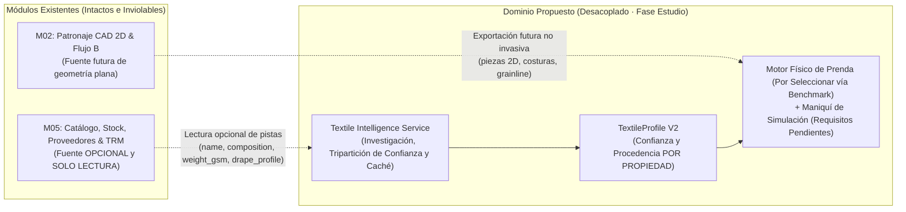
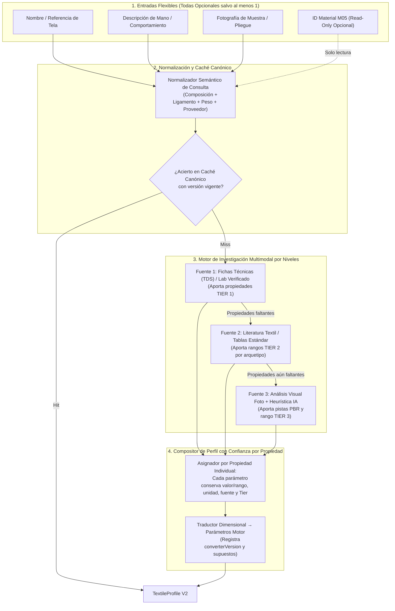
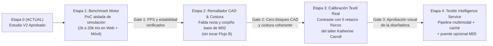

# ESTUDIO DE VIABILIDAD Y ARQUITECTURA TÉCNICA V2: SIMULADOR DE PRENDAS 3D E INTELIGENCIA TEXTIL INDEPENDIENTE
**Atelier Digital App — By Katherine Carroll**  
**Versión:** 2.0 (Revisión Técnica Correctiva sobre V1)  
**Fecha:** 2026-11-14  
**Naturaleza:** Estudio de Arquitectura, Corrección Metodológica y Plan de Validación (Sin modificación de código, dependencias, configuraciones ni base de datos)  
**Documento base auditado:** `ESTUDIO_VIABILIDAD_SIMULADOR_PRENDAS_3D.md` (V1)

> [!IMPORTANT]
> **Declaración de Integridad Técnica y Alcance:**  
> Este documento **no modifica código fuente, dependencias, base de datos, migraciones ni los módulos M00–M07**. Asimismo, separa de forma explícita las **decisiones arquitectónicas conceptuales** de las **hipótesis no verificadas** (rendimiento de motores en dispositivos reales, precisión de drapeado y viabilidad de colisión). Ninguna afirmación no medida en este proyecto se presenta como un hecho comprobado, ni se utilizan cifras de laboratorio fabricadas.

---

## 1. Matriz de Cambios frente a V1

La auditoría técnica de `ESTUDIO_VIABILIDAD_SIMULADOR_PRENDAS_3D.md` (V1) identificó inconsistencias en normas textiles, unidades físicas, ecuaciones de conversión al solver, atribución de confianza, citas ilustrativas presentadas como reales y decisiones tecnológicas declaradas sin pruebas comparativas. La tabla siguiente resume las correcciones introducidas en V2:

| Área Auditada | Hallazgo en V1 | Corrección Aplicada en V2 |
| :--- | :--- | :--- |
| **Selección de motor físico y rendimiento** | Declaraba `XPBD` como *"SELECCIÓN PRINCIPAL (Recomendado)"* y afirmaba *"60 FPS en WebGL / WebGPU / Wasm"* sin haber ejecutado pruebas. | Se reclasifica `XPBD` como **candidato principal a evaluar** junto con `PBD`, `Mass-Spring` amortiguado y motores Wasm/GPU. Se elimina la cifra no verificada de 60 FPS y se exige un benchmark comparativo por etapas. |
| **Normas de tracción vs. elasticidad de drapeado** | Asignaba `ASTM D5034` (Grab Test de fuerza de rotura en N) como fuente directa de módulo de tracción en `N/m` para drapeado. | Se aclara que `ASTM D5034`, `ASTM D5035`, `ISO 13934-1` e `ISO 13934-2` miden **fuerza y elongación a la rotura** en Newtons (`N`), no comportamiento de baja deformación. Para drapeado y elasticidad se incorporan `KES-FB1`, `CSIRO FAST-3`, `ASTM D3107`, `ASTM D2594` e `ISO 20932-1`. |
| **Propiedades faltantes (elasticidad y recuperación)** | Omitía **elasticidad** y **recuperación elástica** en la tabla de taxonomía de V1. | Se integran explícitamente con sus normas (`ASTM D3107`, `ASTM D2594`, `ISO 20932-1`, `KES-FB1 RT`), unidades (`%` extensión, `%` recuperación, `%` deformación permanente). |
| **Unidades de flexión y cizallamiento** | Citaba `g/cm·grado` (unidad de masa, no fuerza) para cizallamiento `KES-FB3`, omitía la conversión de longitud de flexión `ASTM D1388` a rigidez flexural y no normalizaba las unidades del solver. | Se corrige a `gf/(cm·°)` en `KES-FB3` (con factor de conversión a `N/(m·rad)`), y se documentan las conversiones exactas de `ASTM D1388` (`mg·cm` → `µN·m`) y `KES-FB2` (`gf·cm²/cm = gf·cm` → `µN·m`). |
| **Normas de caída y fricción** | Citaba `ISO 9073-9` sin contexto de origen (serie de no tejidos) ni `BS 5058`; citaba `ASTM D1894` (películas plásticas) como norma textil general. | Se precisa el alcance de `ISO 9073-9` y `BS 5058` (Cusick Drapemeter) advirtiendo sus límites como índice escalar agregado; se prioriza `KES-FB4` (`MIU`, `MMD`, `SMD`) para fricción textil superficial, acotando `ASTM D1894` a textiles recubiertos o técnicos. |
| **Conversión física → parámetros del motor** | Escribía $\alpha_{\text{stretch}}^{-1}$ y $\alpha_{\text{bend}}^{-1}$ sin ecuaciones de discretización ni dependencia del paso de tiempo $\Delta t$. | Se formalizan las ecuaciones de *compliance* $\tilde{\alpha} = \alpha / \Delta t^2$, las diferencias entre modelos discretos dependientes de malla (resortes) y continuos independientes de discretización (CST / Saint Venant-Kirchhoff / flexión isométrica normalizada por longitud y área). |
| **Niveles de confianza** | Aplicaba un único `tier` y porcentaje (`95-100%`, `75-94%`, `40-74%`) a todo el perfil sin respaldo estadístico. | Se establece **nivel de confianza por propiedad individual** (`PropertyValue<T>`), eliminando porcentajes pseudocientíficos y usando niveles auditables basados en evidencia (`VERIFIED_TDS_LAB`, `DOCUMENTED_LITERATURE`, `ESTIMATED_AI_HEURISTIC`, `DESIGNER_OVERRIDE`). |
| **Ejemplos JSON, fuentes y citas** | Incluía ejemplo de *"Mikado Silk 4-Ply"* atribuido a *"Gratacós SA"* con datos numéricos marcados como `verifiedByLab: true`, modelo inexistente y URL de esquema ficticio. | Se eliminan las citas, fichas técnicas y certificaciones fabricadas. El esquema V2 usa **marcadores sintácticos ilustrativos explícitos** sin valores de laboratorio simulados como reales. |
| **Estrategia de caché** | Afirmaba *"recupera en 0 milisegundos"* y usaba un hash de texto plano sin normalización ni políticas de invalidación. | Se diseña clave canónica normalizada (`cacheKey`), versionado triple (`schemaVersion`, `converterVersion`, `modelId`), políticas de invalidación/TTL, separación entre perfil base y ajustes de taller, y latencias realistas no nulas. |
| **Integración con M05** | Mencionaba campos genéricos inventados (`name, type, notes`). | Se mapean los campos reales verificados de `MaterialItem` en [`src/types/commercial.ts`](file:///d:/Datos/Datos/DATOS%20JVINAS/Antigravity/2.ByKatherineCarroll/AtelierDigitalApp/src/types/commercial.ts) (`weight_gsm`, `drape_profile`, `composition`, `width_cm`, `supplier_name`, `supplier_ref`, `photo_url`, `tags`, `notes`) como lectura estrictamente opcional. |
| **Requisitos del maniquí** | Asumía que se coserían prendas directamente sobre el prototipo `mannequin3d` actual. | Se audita el prototipo actual (torso aislado de 720 triángulos, 11 capas, sin extremidades, sin landmarks 3D ni SDF de colisión) y se declaran los requisitos mínimos antes de cualquier integración física. |

---

## 2. Visión Funcional y Separación de Dominios

La visión funcional para *By Katherine Carroll* se mantiene intacta: habilitar en el futuro una herramienta visual de simulación tridimensional de prendas que ayude a evaluar caída, volumen, tensión y proporciones textiles antes del corte físico, alimentada por un servicio independiente de inteligencia textil asistido por IA que no exija que las telas estén registradas en inventario.



### Principios Inquebrantables de Frontera
1. **Independencia total de M05:** El simulador y el *Textile Intelligence Service* deben funcionar al 100% aunque el inventario de M05 esté vacío o no se utilice. M05 nunca será dependencia obligatoria ni sufrirá cambios en sus tablas, flujos comerciales, stock o TRM.
2. **Preservación de M02 y Flujo B:** El motor de patronaje CAD 2D de M02 y el Flujo B conservan la autoridad geométrica y milimétrica para el corte físico de la tela. No se rediseña M02 en este estudio.
3. **Separación entre torso visual y maniquí físico:** El prototipo actual [`src/components/mannequin3d/`](file:///d:/Datos/Datos/DATOS%20JVINAS/Antigravity/2.ByKatherineCarroll/AtelierDigitalApp/src/components/mannequin3d/) es exclusivamente un busto visual exploratorio (no integrado) y no cumple los requisitos para simulación física de prendas.

---

## 3. Motores Físicos de Simulación Textil: Evaluación Comparativa y Pruebas Pendientes

> [!CAUTION]
> **Estado de Verificación:** Ninguno de los motores siguientes ha sido ejecutado ni medido aún dentro de Atelier Digital (Web o móvil Expo). Toda afirmación de desempeño en este apartado corresponde a literatura técnica externa y requiere validación empírica en el proyecto antes de elegir un motor definitivo.

| Candidato / Familia | Fundamento Teórico | Ventajas Reportadas en Literatura | Riesgos y Limitaciones en Web/Expo | Estado en Atelier Digital |
| :--- | :--- | :--- | :--- | :--- |
| **XPBD** (*Extended Position-Based Dynamics*, Macklin et al., 2016) | Proyección de restricciones con *compliance* elástico ($\alpha$) y multiplicadores de Lagrange desacoplados del paso temporal $\Delta t$ y del número de iteraciones. | Estabilidad numérica alta; soporte directo de restricciones de distancia, flexión isométrica/diédrica y anisotropía; menor sensibilidad al paso de tiempo que PBD clásico. | La rigidez extrema (ej. sedas inelásticas de alta costura) exige múltiples subpasos (*substeps*) o resolución en WebAssembly / GPU Compute para evitar artefactos de estiramiento o pérdida de FPS en móvil. | **Candidato Principal a Evaluar (No aprobado aún).** |
| **PBD Clásico** (Müller et al., 2007) | Proyección geométrica directa de restricciones de posición sin *compliance* físico. | Implementación ligera en JS puro; estabilidad alta. | La rigidez depende del número de iteraciones y de $\Delta t$; los parámetros numéricos ($k \in [0,1]$) **no tienen correspondencia directa** con unidades textiles físicas ($\text{N/m}$, $\mu\text{N}\cdot\text{m}$). | **Candidato Secundario de Contraste** (útil solo como línea base rápida si XPBD no alcanza rendimiento móvil). |
| **Mass-Spring Implícito / Semi-Implícito** | Red de partículas con fuerzas elásticas lineales/angulares integradas (ej. Euler implícito o Verlet amortiguado). | Conceptualización directa de la ley de Hooke. | Sensible a explosión numérica con rigideces altas (típicas de tejidos planos sin elastano) a menos que se resuelvan sistemas lineales dispersos (Baraff & Witkin), costosos en JS. | **Descartado preliminarmente para interacción móvil directa**, salvo prueba de contraste implícita en Wasm. |
| **FEM Continuo** (*Finite Element Method*) | Mecánica del medio continuo no lineal sobre elementos finitos (triángulos/cuadriláteros). | Mayor fidelidad física en ingeniería mecánica textil y análisis exacto de tensiones. | Coste computacional incompatible con interactividad en tiempo real en dispositivos móviles y navegadores convencionales. | **Fuera de alcance** para simulación interactiva en cliente. |
| **Arquitectura de Ejecución (JS vs. Wasm vs. Compute Shaders / WebGPU)** | Entorno de ejecución del bucle físico y colisiones (auto-colisión + cuerpo). | JS puro evita compilación nativa; Rust/C++ → **WebAssembly (Wasm)** acelera bucles numéricos y colisión espacial (BVH/Spatial Hash); WebGPU/WebGL GPGPU ofrece paralelismo masivo. | React Native / Expo en móvil (iOS/Android) restringe WebGPU nativo y exige puente `expo-gl`, `react-native-webview` o módulos nativos C++/JSI (incompatible con Expo Go puro). | **Asunto Técnico Abierto:** Debe medirse en PoC real antes de decidir arquitectura. |

### Batería Obligatoria de Pruebas Comparativas de Motores (Previa a Selección Definitiva)
Antes de declarar un motor definitivo, deberán ejecutarse pruebas reproducibles midiendo:
1. **Escalamiento por densidad de malla:** Tiempo por paso de simulación (`ms/step`) y FPS sostenidos con mallas de **2,000**, **5,000**, **10,000** y **20,000 triángulos** (vestido completo con vuelo vs. corpiño).
2. **Entornos objetivo reales:** Web Desktop (Chrome/Edge), Web Móvil (Safari iOS / Chrome Android) y runtime Expo nativo evaluado (`WebView` vs `expo-gl`).
3. **Prueba de no-estiramiento (*Locking / Super-elasticity Test*):** Simular un tejido plano no elástico (ej. tafetán o mikado) colgado por gravedad y verificar que la elongación longitudinal vertical no supere un umbral aceptable (< 2–3%) a tasa de cuadros interactiva.
4. **Prueba de flexión diferencial (*Virtual Cantilever / Drape Contrast*):** Verificar que el motor reproduce visualmente diferencias claras entre un arquetipo rígido (tipo mikado), uno intermedio (tafetán) y uno fluido (gasa), comparando contra muestras físicas reales del taller de Katherine Carroll.
5. **Auto-colisión en capas y pliegues:** Verificar comportamiento sin penetración severa en faldas con pliegues o dos capas (tela principal + forro).

---

## 4. Taxonomía Textil Corregida: Normas, Unidades y Conversión Física

Esta sección corrige las normas, unidades y fórmulas de conversión de V1 para garantizar rigor de ingeniería textil.

### 4.1 Tabla Maestra de Propiedades Físicas, Normas y Unidades

| Propiedad Requerida | Normas Técnicas Aplicables | Unidad de Laboratorio | Qué Mide Realmente la Norma (y Alcance) | Rol en el Simulador de Prenda |
| :--- | :--- | :---: | :--- | :--- |
| **Composición** | ISO 1833 (análisis químico cuantitativo) / AATCC TM20-20A / Declaración comercial de etiqueta. | `%` en masa por fibra | Identidad y porcentaje de fibras (seda, lana, poliéster, elastano, etc.). | Condiciona recuperación elástica, estimación de densidad de fibra, fricción y acabado óptico PBR. |
| **Construcción / Ligamento** | ISO 3572 (definiciones de ligamentos) / ASTM D3775 (densidad de hilos) / Inspección visual. | Hilos/cm (urdimbre × trama) y tipo de ligamento | Tipo de estructura (tafetán, sarga, raso, jacquard, punto) y densidad de tejido. | Determina la **anisotropía** entre urdimbre (*warp*), trama (*weft*) y bies (*bias*, 45°), y la resistencia al cizallamiento. |
| **Peso / Masa Superficial** | **ISO 3801** · **ASTM D3776 / D3776M** | $\text{g/m}^2$ (GSM) o $\text{oz/yd}^2$ ($1\ \text{oz/yd}^2 \approx 33.906\ \text{g/m}^2$) | Masa por unidad de área de tela acondicionada. | Define la masa nodal $m_i$ del triángulo bajo gravedad $\mathbf{g} = -9.81\ \text{m/s}^2$. |
| **Grosor / Espesor** | **ISO 5084** · **ASTM D1777** · **CSIRO FAST-1** | $\text{mm}$ | Espesor bajo presión normal estándar (ej. $1\ \text{kPa}$ en ISO 5084). | Define el margen mínimo de separación (*collision thickness offset* $d_c$) contra el cuerpo y entre capas. |
| **Flexión / Rigidez Flexural** | **ASTM D1388** (Cantilever / Longitud de flexión) · **ISO 9073-7** · **KES-FB2** ($B$) · **CSIRO FAST-2** | Longitud de flexión $c$ ($\text{cm}$ o $\text{mm}$); Rigidez $G_{\text{D1388}}$ ($\text{mg}\cdot\text{cm}$); Rigidez $B_{\text{KES}}$ ($\text{gf}\cdot\text{cm}^2/\text{cm} = \text{gf}\cdot\text{cm}$) o $\mu\text{N}\cdot\text{m}$ | Resistencia pura del tejido a curvarse fuera de su plano bajo cargas pequeñas o peso propio. | Controla directamente el radio de curvatura de pliegues y volumen estructural en faldas y mangas. |
| **Elasticidad (Tracción de baja carga y alta carga)** | **Baja carga (drapeado):** **KES-FB1** ($EMT$, $WT$, $LT$) · **CSIRO FAST-3** ($E_5, E_{20}, E_{100}$ %). **Tejidos elásticos:** **ASTM D3107** (plano), **ASTM D2594** (punto), **ISO 20932-1**. **Rotura (límite máximo):** **ISO 13934-1/-2**, **ASTM D5035 / D5034**. | Extensión `%` bajo carga definida ($\text{gf/cm}$ o $\text{N}$); rigidez lineal equivalente $E_t$ ($\text{N/m}$). | ⚠️ *Corrección V1:* `ASTM D5034/D5035` miden **fuerza y elongación a la rotura** en `N` (no el módulo elástico en el rango de caída de prenda, donde las tensiones son 10–100 veces menores). | Alimenta las restricciones de estiramiento en urdimbre, trama y bies (clave en prendas ajustadas o con elastano). |
| **Recuperación Elástica** | **ASTM D3107** · **ASTM D2594** · **ISO 20932-1** · **KES-FB1** ($RT$ resilencia %) | `%` de recuperación elástica y `%` de deformación permanente (*growth*) | Capacidad de la tela de volver a su longitud inicial tras retirar una carga cíclica. | Define si la prenda sufre deformación residual/bolsas o conserva la tensión y el entalle (histéresis). |
| **Cizallamiento (Shear)** | **KES-FB1** (módulo $G$, histéresis $2HG$, $2HG5$) · Ensayo de extensión al bies (derivado en **FAST-3** $EB_5$) | $\text{gf}/(\text{cm}\cdot^\circ)$ (KES) o $\text{N}/(\text{m}\cdot\text{rad})$ (SI) | Resistencia angular de los hilos de urdimbre y trama a deslizarse en rombo al aplicar fuerza diagonal. | Crucial para predecir cómo la tela abraza curvas tridimensionales (busto, cadera) y cortes al bies sin formar arrugas rígidas. |
| **Caída (Drape)** | **ISO 9073-9** (aplicable a no tejidos, tejidos planos y punto) · **BS 5058** (Cusick Drapemeter) | Coeficiente de caída $DC$ (`%`, $0\%–100\%$) y número/profundidad de ondas (*nodes*) | Área proyectada de sombra de un disco de tela colgando por peso propio sobre un pedestal circular. | **Métrica de validación visual, NO parámetro de entrada independiente:** en física es el resultado emergente de peso + flexión + cizallamiento. |
| **Fricción Superficial** | **KES-FB4** ($MIU$, $MMD$, $SMD$) · Adaptaciones de **ASTM D1894** / **ISO 8295** (solo como referencia en tejidos recubiertos o técnicos). | Adimensional $\mu_{\text{estático}}$, $\mu_{\text{dinámico}}$; rugosidad geométrica $SMD$ ($\mu\text{m}$) | Resistencia al deslizamiento tela-sobre-tela o tela-sobre-piel/forro bajo baja presión normal. | Controla si la falda desliza libremente sobre el forro/maniquí o si se adhiere y genera pliegues estancados. |

### 4.2 Ecuaciones Explícitas de Conversión Física → Parámetros del Motor

Para que un perfil textil pueda alimentar a un solver basado en XPBD o restricciones continuas sin que la simulación cambie al variar el tamaño de los triángulos de la prenda, la capa traductora debe aplicar conversiones dimensionales explícitas:

1. **Conversión de Unidades de Flexión (Bending) a SI ($\text{N}\cdot\text{m}$):**
   - Desde **KES-FB2** ($B$ en $\text{gf}\cdot\text{cm}^2/\text{cm} = \text{gf}\cdot\text{cm}$):
     $$B_{\text{SI}}\ [\text{N}\cdot\text{m}] = B_{\text{KES}} \times (9.80665 \times 10^{-3}\ \text{N/gf}) \times 10^{-2}\ \text{m/cm} = B_{\text{KES}} \times 9.80665 \times 10^{-5}$$
     $$B_{\mu\text{Nm}} = B_{\text{KES}} \times 98.0665\ \mu\text{N}\cdot\text{m}$$
   - Desde **ASTM D1388** (longitud de flexión $c$ en $\text{cm}$ y masa superficial $\rho_{\text{areal}}$ en $\text{mg/cm}^2$ o $\text{g/m}^2$, donde $1\ \text{g/m}^2 = 0.1\ \text{mg/cm}^2$):
     $$G_{\text{D1388}}\ [\text{mg}\cdot\text{cm}] = 0.1 \cdot \rho_{\text{gsm}} \cdot c_{\text{cm}}^3$$
     $$B_{\mu\text{Nm}} = G_{\text{D1388}} \times 0.0980665\ \mu\text{N}\cdot\text{m}$$

2. **Conversión de Unidades de Cizallamiento (KES-FB1 $G$) a SI ($\text{N}/(\text{m}\cdot\text{rad})$):**
   - Dado $1\ \text{gf/cm} = 0.980665\ \text{N/m}$ y $1^\circ = \frac{\pi}{180}\ \text{rad} \approx 0.0174533\ \text{rad}$:
     $$G_{\text{SI}}\ [\text{N}/(\text{m}\cdot\text{rad})] = G_{\text{KES}}\ [\text{gf}/(\text{cm}\cdot^\circ)] \times \frac{0.980665}{0.0174533} \approx G_{\text{KES}} \times 56.1879$$

3. **Conversión de Tracción de Baja Carga (CSIRO FAST-3 o pendiente inicial KES-FB1):**
   - Si se dispone de extensión $E_{100}$ (%) bajo carga lineal $F_w = 100\ \text{gf/cm} = 98.0665\ \text{N/m}$ (deformación $\varepsilon = E_{100} / 100$):
     $$K_{\text{stretch}}\ [\text{N/m}] \approx \frac{F_w}{\varepsilon} = \frac{98.0665}{E_{100} / 100}$$
   - ⚠️ **Limitación reconocida:** Los tejidos presentan curvas fuerza-deformación no lineales (región de baja rigidez inicial de *crimp removal* seguida de una pendiente mucho más rígida). Un único valor lineal es una aproximación que debe documentarse o calibrarse por tramos si el motor lo soporta.

4. **Mapeo a *Compliance* XPBD Independiente de Discretización ($\alpha$):**
   En XPBD (Macklin et al., 2016, DOI: [`10.1145/2994258.2994272`](https://dl.acm.org/doi/10.1145/2994258.2994272)), el multiplicador efectivo depende de $\tilde{\alpha} = \frac{\alpha}{\Delta t^2}$. Sin embargo, $\alpha = \frac{1}{k_{\text{discreto}}}$ **no equivale directamente** a $1 / K_{\text{continuo}}$ porque el resorte de una arista depende de la geometría del triángulo:
   - En un **modelo continuo por triángulo** (ej. tensor de deformación de Green / CST sobre triángulo de área de reposo $A_0$ y espesor efectivo): la energía elástica es proporcional al área $A_0$, por lo que $\alpha_{\text{XPBD}} = \frac{1}{K_{\text{continuo}} \cdot A_0}$.
   - En **restricciones simples de distancia por arista** (*edge springs*), la rigidez del resorte debe ponderarse por la relación área-longitud ($\propto \frac{A_{\text{dual}}}{L_0^2}$); de lo contrario, subdividir una malla a la mitad alterará drásticamente la caída aparente de la tela.
   - En **flexión diédrica entre dos triángulos contiguos** (compartiendo arista de longitud $e$ y áreas combinadas $A_1 + A_2$, altura promedio $h = \frac{A_1 + A_2}{e}$): siguiendo formulaciones discretas de láminas delgadas, la rigidez diédrica efectiva escala proporcionalmente a $B_{\text{SI}} \cdot \frac{3 e^2}{A_1 + A_2}$ (o factor geométrico equivalente según el operador discreto de curvatura elegido).

---

## 5. Arquitectura del *Textile Intelligence Service* (Independiente de M05)

El servicio actúa como una tubería de investigación y normalización que separa estrictamente los **datos recopilados de fuentes reales** de las **inferencias estimadas**.



### Reglas de Operación del Servicio
1. **Nunca exigir M05:** Si la diseñadora escribe `"tafetán tornasol de seda con mucho cuerpo"`, el servicio investiga y entrega un `TextileProfile V2` completo sin tocar M05 ni requerir registro previo.
2. **Investigación por propiedad, no "todo o nada":** Es muy habitual que un fabricante publique el peso en $\text{g/m}^2$ y la composición, pero no publique el módulo de cizallamiento KES-FB. El servicio registra el peso como `TIER_1` (con su ficha como fuente) y rellena el cizallamiento como `TIER_2` o `TIER_3` documentado/estimado, declarando claramente el origen de cada dato.
3. **Prohibición de fabricación de citas o cifras:** Si la IA no encuentra una ficha técnica verificable en una fuente real accesible, **queda estrictamente prohibido** devolver nombres de fabricantes, códigos de normas o valores puntuales fingidos bajo etiqueta de laboratorio.

---

## 6. Análisis por Fotografía: Alcances Reales y Límites Físicos

El análisis visual mediante IA multimodal cumple una función de **clasificación morfológica y texturizado óptico**, jamás de instrumentación metrológica:

| Capacidad | Viable por Fotografía | Nivel de Confianza Máximo | Justificación Física |
| :--- | :---: | :---: | :--- |
| **Identificación de textura y acabado superficial** (brillo satinado, mate lanoso, relieve brocado, transparencia de tul/organza) | ✅ Sí (Orientativo) | Óptico / PBR (`TIER_3` si se usa para inferir física) | La distribución especular y textura pixelada reflejan propiedades ópticas de superficie. |
| **Orientación aparente de ligamento y grano** (tafetán, sarga diagonal, raso, encaje) | ✅ Sí (en foto macro enfocada) | `TIER_3` (requiere confirmación de composición) | Patrones periódicos de hilo visibles permiten inferir la clase constructiva probable. |
| **Generación de texturas PBR de renderizado** (mapa de color/albedo, rugosidad visual, mapa normal aproximado) | ✅ Sí | Visual únicamente | Útil para realismo visual del visor 3D sin afectar al solver físico. |
| **Medición de masa superficial ($\text{g/m}^2$)** | ❌ **NO** | No aplicable | Dos telas visualmente idénticas pueden diferir en densidad de fibra y torsión de hilo en un factor de 2× a 3×. |
| **Medición de rigidez flexural ($B$), tracción ($K$) o cizallamiento ($G$)** | ❌ **NO** | No aplicable | Sin fuerzas conocidas ni escala física calibrada (como un ensayo Cantilever o dinamómetro), una foto estática no contiene información mecánica suficiente. |
| **Determinación de composición química** (ej. seda 100% vs. poliéster satinado de alto lustre) | ❌ **NO** | No aplicable | Requiere ficha técnica, etiqueta, prueba de combustión o análisis ISO 1833. |

> [!WARNING]
> **Regla Irrevocable:** Si la diseñadora aporta **únicamente** una fotografía sin ficha técnica ni composición confirmada, **todas las propiedades mecánicas del perfil resultante serán `TIER_3_ESTIMATED`**, se expresarán preferiblemente con rangos sugeridos por arquetipo visual, y la UI deberá mostrar un aviso visible indicando que la simulación parte de una hipótesis visual no medida.

---

## 7. Niveles de Confianza por Propiedad Individual y Esquema V2

Se corrige el defecto de V1 donde un único sello global ocultaba la mezcla de datos medidos con estimaciones heurísticas. En V2, **cada propiedad física individual** implementa la estructura `MeasuredOrEstimatedField<T>`:

### 7.1 Definición de Niveles de Confianza (Basados en Evidencia, Sin Puntajes Arbitrarios)

| Código de Nivel (`DataTier`) | Criterio Objetivo de Asignación | Representación Requerida |
| :--- | :--- | :--- |
| **`TIER_1_VERIFIED`** | Dato proveniente directamente de ficha técnica verificable del fabricante o certificado de ensayo bajo norma identificable (`ISO`, `ASTM`, `KES-FB`, `FAST`) cuyo documento/URL o código de ficha esté adjunto. | Valor puntual medido (o valor + tolerancia oficial de norma), código de norma y referencia exacta al documento. |
| **`TIER_2_DOCUMENTED`** | Dato tomado de literatura técnica textil reconocida o tablas de arquetipos textiles documentados (sin ensayo específico del lote actual). | **Rango documentado** `{ min, typical, max }` y cita bibliográfica verificable de la obra o compendio técnico. |
| **`TIER_3_ESTIMATED`** | Parámetro inferido por heurística IA, extrapolación desde descripción cualitativa, pista visual fotográfica o analogía constructiva. | **Rango estimado acotado** `{ min, typical, max }` + explicación explícita del supuesto de inferencia. Prohibido mostrarlo como medición. |
| **`DESIGNER_OVERRIDE`** | Ajuste manual aplicado por Katherine Carroll sobre el simulador (ej. ajustar rigidez o caída tras comparar con retazo físico en taller). | Valor ajustado + identificador del parámetro base del que partió el ajuste + timestamp de edición. |

### 7.2 Contrato JSON Estructural V2 (Ejemplo Sintáctico Ilustrativo)

> [!NOTE]
> El siguiente bloque JSON muestra únicamente la **estructura formal del esquema de datos propuesto**. Los valores con formato `<...>` son marcadores de esquema para evitar fabricar mediciones de laboratorio ficticias.

```json
{
  "schemaVersion": "2.0.0-draft",
  "profileId": "tp_draft_001",
  "cacheKey": "norm:silk_mikado|weave:twill|gsm:unknown|src:user_query|v2",
  "createdAt": "2026-11-14T20:00:00Z",
  "identification": {
    "displayName": "Consulta ilustrativa: Seda estructurada tipo Mikado",
    "composition": {
      "value": "100% Seda (declarada por usuaria)",
      "tier": "TIER_3_ESTIMATED",
      "source": "Entrada textual de la diseñadora (sin ficha técnica adjunta)"
    },
    "weaveType": {
      "value": "twill_or_heavy_plain",
      "tier": "TIER_3_ESTIMATED",
      "source": "Clasificación por descripción comercial"
    }
  },
  "overallConfidenceSummary": {
    "highestTierPresent": "TIER_2_DOCUMENTED",
    "lowestTierPresent": "TIER_3_ESTIMATED",
    "verifiedPropertiesCount": 0,
    "documentedPropertiesCount": 1,
    "estimatedPropertiesCount": 7,
    "requiresPhysicalCalibration": true
  },
  "physicalProperties": {
    "arealDensity_gsm": {
      "unit": "g/m2",
      "tier": "TIER_2_DOCUMENTED",
      "value": null,
      "range": { "min": 220, "typical": 290, "max": 380 },
      "standardRef": "ISO 3801 / ASTM D3776 (método aplicable si se mide)",
      "source": "<Referencia bibliográfica textil verificada pendiente de curación>",
      "assumptionNote": "Rango típico reportado para tejidos estructurados pesados tipo mikado; el lote real requiere pesaje."
    },
    "thickness_mm": {
      "unit": "mm",
      "tier": "TIER_3_ESTIMATED",
      "value": null,
      "range": { "min": 0.45, "typical": 0.60, "max": 0.85 },
      "standardRef": "ISO 5084 / ASTM D1777 (referencia metodológica)",
      "source": "Inferencia proporcional al rango de gramaje y ligamento",
      "assumptionNote": "Estimación no medida; usada solo como margen inicial de colisión."
    },
    "bendingStiffness_uNm": {
      "unit": "uN*m",
      "tier": "TIER_3_ESTIMATED",
      "warpRange": { "min": 15.0, "typical": 28.0, "max": 45.0 },
      "weftRange": { "min": 12.0, "typical": 22.0, "max": 35.0 },
      "standardRef": "ASTM D1388 / KES-FB2 (pendiente de ensayo)",
      "source": "Inferencia heurística para arquetipo estructurado",
      "assumptionNote": "No existe medición Cantilever ni KES-FB2."
    },
    "stretchStiffness_lowStrain_N_per_m": {
      "unit": "N/m",
      "tier": "TIER_3_ESTIMATED",
      "warpRange": { "min": 4000, "typical": 12000, "max": 25000 },
      "weftRange": { "min": 3500, "typical": 10000, "max": 20000 },
      "standardRef": "CSIRO FAST-3 / KES-FB1 (baja tensión, NO rotura D5034)",
      "source": "Inferencia por tejido plano sin elastano",
      "assumptionNote": "Representa pendiente elástica inicial simulable, sujeta a ajuste numérico del solver."
    },
    "elasticRecovery_percent": {
      "unit": "%",
      "tier": "TIER_3_ESTIMATED",
      "range": { "min": 75, "typical": 85, "max": 95 },
      "standardRef": "ISO 20932-1 / ASTM D3107 (referencia)",
      "source": "Comportamiento esperado en tejido plano de seda sin elastano bajo baja deformación",
      "assumptionNote": "No medido en dinamómetro cíclico."
    },
    "shearStiffness_N_per_m_rad": {
      "unit": "N/(m*rad)",
      "tier": "TIER_3_ESTIMATED",
      "range": { "min": 800, "typical": 1500, "max": 2400 },
      "standardRef": "KES-FB1 shear (referencia)",
      "source": "Estimación para ligamento tupido de baja deformación diagonal",
      "assumptionNote": "Requiere verificación en ángulo al bies."
    },
    "frictionCoefficient": {
      "unit": "dimensionless",
      "tier": "TIER_3_ESTIMATED",
      "clothToClothDynamicRange": { "min": 0.22, "typical": 0.30, "max": 0.40 },
      "standardRef": "KES-FB4 MIU (referencia)",
      "source": "Heurística superficial para ligamento sarga/mikado de seda",
      "assumptionNote": "No ensayado."
    }
  },
  "solverTranslationMetadata": {
    "targetSolverCandidate": "XPBD_TO_BE_BENCHMARKED",
    "converterVersion": "0.1.0-spec",
    "discretizationPolicy": "AREA_WEIGHTED_CONTINUUM",
    "notes": "Los coeficientes numéricos finales dependen del Δt y tamaño medio de arista de la malla de prenda."
  },
  "optionalM05Link": {
    "linked": false,
    "materialId": null,
    "readOnlyFieldsUsed": []
  },
  "provenance": {
    "aiAssisted": true,
    "aiModelId": "<identificador_real_del_modelo_al_momento_de_ejecucion>",
    "aiPromptVersion": "<hash_prompt_sistema>",
    "timestamp": "2026-11-14T20:00:00Z"
  }
}
```

---

## 8. Estrategia de Caché, Procedencia y Arquetipos Textiles

### 8.1 Caché Canónico Versionado (Corrección frente a V1)
En V1 se afirmaba erróneamente una recuperación en *"0 ms"* y una clave basada en cadenas literales sin normalización. En V2 se diseña una estrategia realista:

1. **Clave Canónica Normalizada (`CanonicalCacheKey`):**
   Antes de generar el hash SHA-256, el servicio normaliza el texto eliminando variaciones lingüísticas triviales y ordenando tokens clave:
   - Ejemplo: `"Mikado de seda 320 gsm"` y `"seda mikado 320g/m2"` normalizan ambas a `fiber:silk|type:mikado|gsm:320`.
   - Si existe fotografía adjunta, se añade un *perceptual hash* (pHash) o SHA-256 binario para no mezclar resultados de dos muestras visuales diferentes.
2. **Versionado Triple en Caché:**
   Cada registro cacheado almacena `(schemaVersion, converterVersion, aiModelId)`. Si se mejora el algoritmo de conversión física o cambia el motor objetivo tras las pruebas, las entradas antiguas se marcan como `stale` para recomputar los parámetros del solver sin borrar los datos documentales de laboratorio ya recabados.
3. **Política de Expiración (TTL) y Anulación:**
   - **Perfiles `TIER_1` (TDS adjunto):** Sin expiración temporal automática (salvo cambio de versión de ficha del fabricante).
   - **Perfiles `TIER_2` y `TIER_3`:** TTL sugerido (ej. 90 días) para permitir re-investigación si se incorporan nuevas fichas de molinos o bases de conocimiento textil.
   - **Variantes `DESIGNER_OVERRIDE`:** Nunca se sobrescriben automáticamente desde caché; se almacenan como derivaciones personales de autor vinculadas a la creación o biblioteca personal de Katherine Carroll.
4. **Latencia Realista:** Recuperación en caché local (SQLite/AsyncStorage o Supabase) esperada en el orden de pocos milisegundos (< 10–50 ms según medio de almacenamiento), nunca *"0 ms"*.

### 8.2 Biblioteca de Arquetipos Textiles (Como Puntos de Partida Por Calibrar)
V1 presentaba 8 telas de alta costura como *"perfiles Tier 1/2 inmutables pre-calibrados"*. V2 corrige este enfoque:

> [!IMPORTANT]
> **Política de Arquetipos Iniciales:**  
> Mientras no existan ensayos físicos reales realizados sobre muestras del taller de Katherine Carroll (vía kit físico o laboratorio textil), la biblioteca inicial de arquetipos (Gasa muselina, Crepé Georgette, Tafetán, Satén Duquesa, Mikado, Terciopelo, Organza, Tul) debe operar estrictamente como **rangos orientativos `TIER_2` / `TIER_3` sujetos a calibración visual en taller**, nunca como constantes físicas certificadas.

La calibración futura recomendada consiste en realizar la **prueba de caída comparativa física vs. virtual** con retazos reales de 30×30 cm (o ensayo Cantilever doméstico simple sobre borde de mesa según el principio de longitud de caída libre de `ASTM D1388`), ajustando los arquetipos en presencia de la diseñadora.

---

## 9. Integración Opcional y de Solo Lectura con M05 (`src/types/commercial.ts`)

Tras inspeccionar el contrato real de [`src/types/commercial.ts`](file:///d:/Datos/Datos/DATOS%20JVINAS/Antigravity/2.ByKatherineCarroll/AtelierDigitalApp/src/types/commercial.ts#L223-L254) y [`src/components/commercial/materialLabels.ts`](file:///d:/Datos/Datos/DATOS%20JVINAS/Antigravity/2.ByKatherineCarroll/AtelierDigitalApp/src/components/commercial/materialLabels.ts#L49-L67), se verifica que M05 **ya posee campos técnicos básicos de gran utilidad** que pueden servir como pistas de entrada opcionales en modo estrictamente de solo lectura (*Read-Only*):

| Campo Real en `MaterialItem` (M05) | Tipo Actual en M05 | Uso Opcional en Textile Intelligence Service | Tier Asignado al Extraerse de M05 |
| :--- | :--- | :--- | :--- |
| `name` | `string` | Semilla principal de búsqueda comercial. | Informativo |
| `category` | `'fabric' \| 'lining' \| 'interfacing' \| ...` | Filtra si es tela principal, forro o entretela (comportamiento rígido por termofijado). | Informativo |
| `composition` | `string \| null` | Pista directa de composición de fibras (ej. `"100% Seda Natural"`). | `TIER_2` o `TIER_3` (salvo que exista TDS) |
| `weight_gsm` | `number \| null` | Si fue ingresado desde etiqueta del proveedor, sirve como masa superficial inicial. | `TIER_2` (declaración de etiqueta/M05) o `TIER_1` si adjunta TDS |
| `drape_profile` | `'fluid' \| 'structured' \| 'crisp' \| 'sheer' \| 'heavy' \| 'stretch' \| 'delicate'` | Traducción directa a restricciones iniciales de acotación cualitativa en la IA (ej. `'crisp'` orienta alta rigidez de flexión + bajo grosor para organza/tafetán). | `TIER_3` (cualitativo de taller) |
| `supplier_name`, `supplier_ref` | `string \| null` | Permite buscar fichas técnicas oficiales del fabricante o casa textil real si existe en fuentes públicas. | Fuente de búsqueda para aspirar a `TIER_1` |
| `width_cm`, `photo_url`, `tags`, `notes` | varios | Contexto adicional (notas de caída, ancho útil para futura disposición de patrones, imagen de referencia PBR). | `TIER_3` / PBR |

**Garantía de desacoplamiento:** Si `optionalM05Link.linked === false`, el simulador no realiza ninguna consulta a las tablas de M05.

---

## 10. Requisitos del Maniquí para Simulación vs. Prototipo Actual (`mannequin3d`)

El prototipo visual aislado [`src/components/mannequin3d/`](file:///d:/Datos/Datos/DATOS%20JVINAS/Antigravity/2.ByKatherineCarroll/AtelierDigitalApp/src/components/mannequin3d/) demostró viabilidad de renderizado en Three.js, pero **no es apto para recibir física de prendas ni debe integrarse como base del simulador**.

### 10.1 Brechas Críticas del Prototipo Actual (`mannequinMeshBuilder.ts`)
1. **Resolución vertical insuficiente (720 triángulos totales):** El torso consta de solo 11 anillos verticales (10 bandas longitudinales). A baja densidad, la superficie colisionadora presenta facetas angulares que causan vibraciones (*jitter*) o penetraciones de los vértices de la tela en zonas curvas (busto y cadera).
2. **Ausencia total de extremidades superiores e inferiores:** No existen brazos ni separación de piernas/entrepierna. Es imposible simular mangas, sisas reales, pantalones, monos o escotes sostenidos sobre el Trapecio/Hombro exterior.
3. **Ausencia de marcas anatómicas 3D (*Landmarks*):** El prototipo no exporta coordenadas de referencia en espacio mundial para el centro delantero de cuello, hombro acromial, ápice de busto, sisa, cintura lateral y línea de cadera, indispensables para posicionar y coser automáticamente piezas 2D alrededor del cuerpo.
4. **Falta de proxy de colisión optimizado (SDF / Cápsulas):** Evaluar colisión continua tela-vs-malla triángulo a triángulo es costoso en tiempo real; un maniquí de simulación requiere un campo de distancia con signo (SDF) o jerarquía de cápsulas/esferoides sincronizada con la deformación paramétrica.
5. **Solo perfil femenino adulto:** Falta cobertura de siluetas masculinas y rangos infantiles/juveniles ya presentes en `DemographicCategory` de M02.

### 10.2 Requisitos Mínimos del Maniquí de Simulación (Pre-requisitos)
- Malla anatómica parametrizable de alta suavidad (o subdividida localmente en zonas de contacto: $\ge 6,000–12,000$ triángulos para render + proxy SDF/cápsulas para colisión).
- Brazos desmontables o estilizados hasta codo/muñeca y nacimiento anatómico de muslos para pantalones/vestidos ceñidos.
- Diccionario de *landmarks* 3D acoplados a los mismos parámetros morfológicos de medidas.
- Zonas de fricción diferenciadas (piel/desnudo vs. tela de forro base del busto de sastre).

---

## 11. Conexión Futura con M02 CAD (Sin Alterar Flujo B)

La integración futura con M02 no debe modificar el motor de trazado 2D actual ni su flujo de sesiones. La interfaz de entrada hacia el simulador debe ser un **adaptador unidireccional (*Export Bridge*)** que lea los trazos ya generados por M02 y aporte lo siguiente:
1. Contornos cerrados de piezas 2D en milímetros (delantero, espalda, falda, manga).
2. Etiquetado de **aristas de costura pareadas** (ej. hombro delantero $\leftrightarrow$ hombro espalda) para que el simulador aplique fuerzas de unión inicial (*sewing springs*) antes de soltar la tela sobre el maniquí.
3. Vector de **dirección de hilo (*grainline*)** de cada pieza para orientar correctamente la matriz anisotrópica del perfil textil (distinguiendo corte al hilo de corte al bies 45°).
4. **Asunto abierto:** Muchos patrones 2D de M02 pueden necesitar remallado uniforme (*isotropic triangular remeshing* mediante algoritmos como Delaunay restringido) porque los vértices de curvas Bézier del CAD no forman por sí mismos triángulos internos adecuados para simulación física sin distorsión.

---

## 12. Decisiones Aprobadas, Asuntos Pendientes y Riesgos

### 12.1 Decisiones Arquitectónicas Aprobadas a Nivel de Estudio
1. El *Textile Intelligence Service* será un módulo 100% desacoplado e independiente de M05.
2. M05 funcionará únicamente como fuente opcional y de solo lectura (*read-only*).
3. La confianza y procedencia se registrarán **por cada propiedad física individual**, distinguiendo estrictamente datos verificados de laboratorio (`TIER_1`), rangos documentados (`TIER_2`), estimaciones heurísticas (`TIER_3`) y ajustes de diseñadora (`DESIGNER_OVERRIDE`).
4. Una fotografía nunca se tratará como medición de masa, rigidez o elasticidad.
5. No se modificará ni rediseñará M02 ni el Flujo B para acomodar la simulación 3D.

### 12.2 Asuntos Pendientes de Decisión y Validación
1. **Selección definitiva del motor y runtime de ejecución:** Requiere benchmark comparativo (XPBD en JS vs. Wasm vs. WebGPU/WebGL; compatibilidad real en Expo móvil `WebView` vs `expo-gl`).
2. **Estrategia de generación de malla 3D desde M02 CAD:** Definir si el remallado triangular (Delaunay 2D) corre en el navegador del cliente o en un microservicio ligero.
3. **Evolución del maniquí 3D:** Decidir si se amplía la malla paramétrica propia (con brazos/piernas y SDF) o se utilizan avatares paramétricos externos auditados en licencia (ej. licencia libre comercial), manteniendo el actual `mannequin3d` exclusivamente como visor estético de proporciones hasta entonces.
4. **Protocolo de calibración textil de taller:** Definir un conjunto de 5–8 telas físicas reales del taller de Katherine Carroll para calibrar visualmente las curvas del motor elegido antes de abrir la herramienta a creaciones reales.

### 12.3 Matriz de Riesgos Técnicos y de Negocio

| Riesgo | Probabilidad | Impacto | Mitigación Propuesta |
| :--- | :---: | :---: | :--- |
| **Falsa sensación de precisión física ("efecto caja negra")** | Alta | Crítico | Badges obligatorios por propiedad (`TIER_1/2/3`), rangos en lugar de cifras falsas, y advertencia explícita cuando no existan ensayos de laboratorio. |
| **Rendimiento insuficiente en móvil (Expo / React Native)** | Media-Alta | Alto | Benchmark obligatorio previo en dispositivos reales; considerar Wasm o pre-cálculo progresivo / simulación bajo demanda en lugar de cálculo continuo de 60 FPS en dispositivos limitados. |
| **Desajuste entre piezas CAD 2D y postura de maniquí** | Media | Alto | Validar el adaptador de costura y *landmarks* 3D en una prenda base simple (corpiño o falda recta) antes de abordar diseños complejos de gala. |
| **Alucinación de la IA al citar normas o fichas técnicas** | Alta sin control | Crítico | Exigir URL/documento real adjunto para otorgar `TIER_1`; degradar automáticamente a `TIER_3` toda cifra generada por el modelo sin documento verificable de respaldo. |

---

## 13. Plan de Validación por Etapas (Puertas Go / No-Go)

Ninguna etapa puede comenzar sin haber superado los criterios objetivos de la etapa previa:



- **Gate 1 (Motor):** Medición documentada de FPS, tiempo por paso (`ms/step`) y estabilidad de telas no elásticas sin explosión numérica. Si JS puro no cumple en móvil, evaluar Wasm o simular en servidor/WebView.
- **Gate 2 (Geometría CAD + Maniquí):** Aprobación del maniquí con malla de colisión suave y landmarks 3D; costura virtual exitosa de al menos 2 patrones de prueba sin modificar M02.
- **Gate 3 (Fidelidad Textil):** Validación ciega o comparativa junto a Katherine Carroll verificando que la caída virtual distingue con claridad telas fluidas, crujientes y pesadas.
- **Gate 4 (IA y Procedencia):** Auditoría de 20 consultas reales confirmando cero citas inventadas, correcta separación `TIER_1/2/3` por propiedad e independencia total de M05.

---

## 14. Referencias Técnicas Verificables

### Normas Internacionales de Ensayo Textil
1. **ISO 3801:** *Textiles — Woven fabrics — Determination of mass per unit length and mass per unit area.* Catálogo oficial ISO: https://www.iso.org/
2. **ASTM D3776 / D3776M:** *Standard Test Methods for Mass Per Unit Area (Weight) of Fabric.* Catálogo ASTM: https://www.astm.org/
3. **ISO 5084:** *Textiles — Determination of thickness of textiles and textile products.* Catálogo ISO: https://www.iso.org/
4. **ASTM D1777:** *Standard Test Method for Thickness of Textile Materials.* Catálogo ASTM: https://www.astm.org/
5. **ASTM D1388:** *Standard Test Method for Stiffness of Fabrics* (Cantilever bending length & flexural rigidity). Catálogo ASTM: https://www.astm.org/
6. **ISO 13934-1 / ISO 13934-2:** *Textiles — Tensile properties of fabrics (Strip method / Grab method — maximum force and elongation).* Catálogo ISO: https://www.iso.org/
7. **ASTM D5034 / ASTM D5035:** *Breaking Strength and Elongation of Textile Fabrics (Grab Test / Strip Test).* Catálogo ASTM: https://www.astm.org/
8. **ASTM D3107:** *Standard Test Methods for Stretch Properties of Fabrics Woven from Stretch Yarns.* Catálogo ASTM: https://www.astm.org/
9. **ASTM D2594 / D2594M:** *Standard Test Method for Stretch Properties of Knitted Fabrics Having Low Power.* Catálogo ASTM: https://www.astm.org/
10. **ISO 20932-1:** *Textiles — Determination of the elasticity of fabrics — Part 1: Strip tests.* Catálogo ISO: https://www.iso.org/
11. **ISO 9073-9:** *Textiles — Test methods for nonwovens — Part 9: Determination of drapability including drape coefficient* (metodología de drapeado aplicada también a tejidos planos y punto). Catálogo ISO: https://www.iso.org/
12. **ASTM D1894:** *Standard Test Method for Static and Kinetic Coefficients of Friction of Plastic Film and Sheeting* (referencia secundaria aplicable solo en adaptaciones para recubiertos/técnicos). Catálogo ASTM: https://www.astm.org/

### Literatura Científica de Simulación Física y Caracterización Objetiva
13. **Macklin, M., Müller, M., & Chentanez, N. (2016).** *XPBD: Position-Based Simulation of Compliant Constrained Dynamics.* Proceedings of the 9th International Conference on Motion in Games (MIG '16). ACM DOI: [`10.1145/2994258.2994272`](https://dl.acm.org/doi/10.1145/2994258.2994272)
14. **Müller, M., Heidelberger, B., Hennix, M., & Ratcliff, J. (2007).** *Position Based Dynamics.* Journal of Visual Communication and Image Representation, 18(2), 109–118. DOI: [`10.1016/j.jvcir.2007.01.005`](https://doi.org/10.1016/j.jvcir.2007.01.005)
15. **Kawabata Evaluation System (KES-FB1 / FB2 / FB3 / FB4)** & **CSIRO FAST (Fabric Assurance by Simple Testing):** Sistemas canónicos de evaluación objetiva de propiedades mecánicas de baja tensión (*low-stress fabric mechanics*). Documentación de referencia académica textil: NC State University Wilson College of Textiles / CSIRO Publishing.

### Referencias Internas del Proyecto Verificadas
16. **Contrato real M05 (`MaterialItem` y `MaterialDrapeProfile`):** [`src/types/commercial.ts`](file:///d:/Datos/Datos/DATOS%20JVINAS/Antigravity/2.ByKatherineCarroll/AtelierDigitalApp/src/types/commercial.ts#L101-L254)
17. **Etiquetas canónicas M05:** [`src/components/commercial/materialLabels.ts`](file:///d:/Datos/Datos/DATOS%20JVINAS/Antigravity/2.ByKatherineCarroll/AtelierDigitalApp/src/components/commercial/materialLabels.ts#L17-L68)
18. **Constructor de malla del prototipo visual 3D actual:** [`src/components/mannequin3d/mannequinMeshBuilder.ts`](file:///d:/Datos/Datos/DATOS%20JVINAS/Antigravity/2.ByKatherineCarroll/AtelierDigitalApp/src/components/mannequin3d/mannequinMeshBuilder.ts)
19. **Evaluación visual previa del prototipo 3D:** [`MANNEQUIN3D_EVALUACION_VISUAL.md`](file:///C:/Users/jvinas/.gemini/antigravity/brain/f0d24702-4b54-4757-9671-293240ae40e5/MANNEQUIN3D_EVALUACION_VISUAL.md)

---

## 15. Confirmación de No Alteración

Se confirma expresamente que para elaborar esta versión correctiva V2:
- ✅ **NO** se modificó ningún archivo de código fuente (`src/`, `app/`).
- ✅ **NO** se modificó `package.json`, dependencias ni archivos de configuración.
- ✅ **NO** se modificó la base de datos, tablas, RPCs ni migraciones SQL.
- ✅ **NO** se alteraron los módulos M00–M07 (incluyendo M02 Flujo B y M05).
- ✅ Se creó únicamente el archivo solicitado `ESTUDIO_VIABILIDAD_SIMULADOR_PRENDAS_3D_V2.md`.

