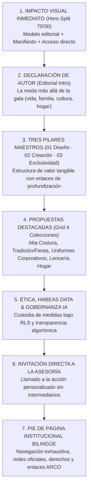

# INFORME CONCEPTUAL Y ARQUITECTURA DE LA LANDING PAGE PÚBLICA
## Modelo de Referencia Atelier Digital para Transferencia al Proyecto Louka

---

## 1. Resumen Ejecutivo y Propósito de Transferencia

El presente documento recopila la arquitectura conceptual, narrativa, estética, técnica y de gobernanza desarrollada para la Landing Page pública de **Atelier Digital – By Katherine Carroll** (`app/index.tsx`, `PublicFooter.tsx`, `LandingLanguageContext.tsx`). 

Su propósito es servir como **especificación maestra y plantilla de prompt técnico de alta fidelidad** para implementar la landing page del **Proyecto Louka**, asegurando la transferencia de todas las soluciones ergonómicas, responsive, de conversión comercial y de internacionalización bilingüe (ES/EN) sin incurrir en deuda técnica ni en consumo innecesario de tokens.

---

## 2. Fundamentos Conceptuales y Narrativa de Marca

### 2.1 El Manifiesto de Marca (Brand Storytelling)
La landing page no opera como una simple tienda online ni como un formulario de captura genérico. Se concibe como una **experiencia editorial de alta costura** que comunica simultáneamente:
1. **El Oficio Tradicional (Savoir-Faire):** Atención minuciosa al detalle, siluetas a medida, telas seleccionadas y calce anatómico.
2. **La Innovación Tecnológica Responsable:** Digitalización de medidas, patronaje asistido y copilotos geométricos, siempre bajo estricta dirección artística humana.
3. **La Exclusividad y Confianza:** Custodia reservada de datos personales y biométricos (Habeas Data / Ley 1581) y trato preferencial personalizado.

### 2.2 Progresión Psicológica del Visitante (Funnel de 7 Niveles)


---

## 3. Especificación Anatómica Sección por Sección

### Sección 1: Hero Principal en Pantalla Dividida (Split-Screen 70/30 locked at 100vh)
* **Objetivo:** Captar la atención en menos de 3 segundos y resolver el acceso a la plataforma sin requerir scroll inicial en computadores.
* **Panel Izquierdo (~70% en Escritorio):**
  - **Fondo:** Ébano atelier (`#171411`) con fotografía editorial de alta resolución integrada suavemente en el costado derecho mediante canal alfa.
  - **Cabecera de Marca (`topHeader`):** Placa con marco fino dorado champagne conteniendo el isotipo, subtítulo en capiteles espaciados (`ATELIER DIGITAL`), menú de navegación editorial (`Diseño · Creación · Exclusividad`) y **Selector de Idioma cápsula (`ES | EN`)**.
  - **Titular y Lema:** Tipografía serif de lujo (`Playfair Display` / `Georgia`) a gran tamaño: *«La creatividad detrás de cada creación»*.
  - **Florón de Autor:** Ornamento central dorado con líneas horizontales simétricas que divide el titular de las líneas maestras.
  - **Trilogía de Cotas de Especialidad:** Tres columnas con iconografía de trazo lineal dorado (*maniquí*, *vestido*, *costura*) con titulares de 2 líneas y microenlaces directos.
  - **Pie Editorial Izquierdo:** Barra sutil de geolocalización y canal social oficial (`BARRANQUILLA · COLOMBIA | @CARROLLKATHERINE`).
* **Borde Curvo de Transición:** Divisor ornamental vertical que separa fluidamente el panel izquierdo del derecho en pantallas grandes.
* **Panel Derecho (~30% en Escritorio):**
  - **Fondo:** Marfil cálido (`#FBF8F3`) con borde fino dorado arena.
  - **Tarjeta de Bienvenida:** Titular acogedor y descripción de la propuesta digital.
  - **Detección Dinámica de Autenticación:**
    * *Visitante no autenticado:* Botón primario dorado `[INICIAR SESIÓN →]` y botón secundario `[CREAR CUENTA →]`, con pie legal de acceso para mayores de 18 años y accesos rápidos a Términos, Privacidad y Transparencia IA.
    * *Usuario con sesión activa:* Caja de perfil con email, rol (`DISEÑADORA` o `CLIENTA`), botón inteligente `[CONTINUAR AL ATELIER →]` o `[IR A MI ESPACIO DE CLIENTA →]`, y opción de cerrar sesión.
  - **Firma Inferior:** Ilustración de remate en satén *«Diseño que inspira»*.

### Sección 2: Introducción Editorial de Autor
* **Overline dorado:** `ATELIER DE AUTOR · [CIUDAD], [PAÍS]`.
* **Titular:** *Moda, confección y soluciones textiles a medida*.
* **Cuerpo:** Manifiesto que explica que la marca abarca desde momentos íntimos y familiares hasta prendas corporativas y textiles de alta durabilidad.
* **Separador de Marca:** Florón dorado centrado.

### Sección 3: Los Tres Pilares Fundamentales
Cuadrícula de 3 tarjetas editoriales simétricas:
1. **01 Diseño:** Creatividad, asesoría personalizada y siluetas anatómicas únicas. Enlace: `Descubrir Diseño →`.
2. **02 Creación:** Confección minuciosa, acabados de alta sastrería y rigurosos controles de calidad. Enlace: `Descubrir Creación →`.
3. **03 Exclusividad:** Curaduría textil de origen fino y acompañamiento de inicio a fin. Enlace: `Descubrir Exclusividad →`.

### Sección 4: Cuadrícula de Servicios Destacados
* **Estructura:** 4 tarjetas visuales con imagen de cobertura, badge de numeración `01`, `02`, `03`, `04`, título, subtítulo contextual, línea dorada separadora, descripción sintética y botón `[CONSULTAR ESTE SERVICIO →]`.
* **Las 4 Líneas Portada:**
  1. *Alta Costura y Vestidos para Toda Ocasión* (Mujer y Niña).
  2. *Tradición Cultural / Ocasión Festiva* (Tocados, apliques, calzado y camisetas).
  3. *Uniformes para Empresas y Negocios* (Elegancia profesional e identidad corporativa).
  4. *Textiles para el Hogar* (Ropa de cama bordada, toallas de alta densidad y salidas de baño).
* **Botón de Exploración Total:** Botón centrado ancho `[EXPLORAR TODOS LOS SERVICIOS (8 LÍNEAS) →]`.

### Sección 5: Ética de Atelier, Confidencialidad y Gobernanza IA
Sección de máxima reputación y cumplimiento legal:
* **Tarjeta 1 (Protección de Datos Personales & Habeas Data):** Explicación clara de cómo se custodian las fichas antropométricas, fotos técnicas y datos de contacto bajo control de roles y Row Level Security (RLS). Acceso exclusivo para mayores de 18 años con ejercicio de derechos ARCO.
* **Tarjeta 2 (Dirección Humana & Gobernanza IA):** Declaración transparente sobre el uso de visuales ilustrativas y algoritmos de validación geométrica, garantizando que el diseño y el calce son siempre decisiones artesanales humanas y que jamás se comparten medidas con modelos externos.
* **Pies de imagen editoriales:** Leyenda con glifo `✦ Fotografía editorial ilustrativa asistida con IA`.

### Sección 6: Banner de Conversión Directa
* Fondo oscuro con reborde dorado y texto de invitación a medida.
* Pregunta de cierre: *«¿Planeas un evento o requieres confección a medida?»*.
* Botón de contacto directo: `[CONTACTAR AL ATELIER →]`.

### Sección 7: Pie de Página Institucional y Navegación Profunda (`PublicFooter`)
* **Columna de Marca:** Isotipo, lema de autor y descripción institucional.
* **Columna 1 (Explorar):** Inicio, Diseño, Creación, Exclusividad, Servicios, Contacto.
* **Columna 2 (Colecciones / Líneas):** Enlaces directos a las distintas categorías de confección.
* **Columna 3 (Legal & Transparencia):** Términos y Condiciones, Política de Privacidad, Aviso de Privacidad, Cookies, Transparencia IA.
* **Columna 4 (Atelier Digital & Redes):** Iniciar sesión, Registro, Solicitud ARCO y botón directo con flecha externa hacia Instagram oficial (`@usuario`).
* **Barra de Derechos Inferior:** Copyright dinámico con año en curso, enlaces legales inline y geolocalización.

### Sección 8: Internacionalización Bilingüe Instantánea (ES / EN)
* **Arquitectura:** React Context ligero (`LandingLanguageContext`) alimentado por un diccionario TypeScript tipado (`landingTranslations.ts`).
* **Predeterminado:** Español (ES) en primera visita; persistencia en storage (`@atelier_landing_language`) entre recargas.
* **Conmutador Visual:** Selector cápsula `[ ES | EN ]` en la cabecera superior.
* **SEO Web:** Actualización en tiempo real de `document.documentElement.lang`, `document.title` y `meta[name="description"]` sin refresco de página.

---

## 4. Mejoras Técnicas y de Ergonomía Aplicadas

1. **Bloqueo 100vh en Escritorio (`heroHeight`):**
   Uso de `Platform.select({ web: '100vh', default: Math.max(windowHeight, 660) })` para garantizar que la pantalla inicial encaje exactamente en la ventana del navegador sin barras de desplazamiento involuntarias en el primer vistazo.
2. **Cero Dependencias Pesadas para i18n:**
   Sin recurrir a paquetes voluminosos (`i18next`), se logró una internacionalización 100% tipada, reactiva y liviana.
3. **Control de Desbordamiento y Escalado de Fuentes:**
   Márgenes adaptativos (`isDesktop ? styles.desktop : styles.mobile`), uso de `useWindowDimensions()` y tipografía dual (Serif para encabezados y Sans-serif para lecturabilidad técnica).
4. **Paleta Cromática de Lujo:**
   - Ébano Atelier: `#171411`
   - Oro Champagne: `#C5A880` / `#C8A870`
   - Marfil Cálido: `#FBF8F3` / `#FAF6F0`
   - Arena Neutra: `#EFE7DC` / `#D8CDC0`
   - Verde Esmeralda Discreto (Estados activos): `#2E7D32`

---

## 5. MASTER PROMPT PARA IMPLEMENTAR LA LANDING PAGE EN PROYECTO LOUKA

> [!TIP]
> Copia y pega el bloque siguiente en el chat de tu agente en el **Proyecto Louka** para reproducir fielmente esta misma arquitectura adaptada a sus requerimientos de marca.

```markdown
**OBJETIVO:** Implementar la Landing Page comercial y pública de alta fidelidad para el proyecto [NOMBRE_DEL_PROYECTO_LOUKA], adoptando la arquitectura conceptual, estética editorial de lujo y funcionalidad bilingüe (Español predeterminado / Inglés) comprobada en Atelier Digital By Katherine Carroll.

**ARCHIVOS Y ESTRUCTURA A CREAR / MODIFICAR:**
1. `app/index.tsx`: Pantalla principal pública con composición Hero de dos paneles (70/30 en escritorio, 100vh bloqueado), expansión editorial, tres pilares, grid de 4 servicios destacados, sección de ética y custodia de datos, y banner de conversión.
2. `src/i18n/landingTranslations.ts`: Diccionario bilingüe tipado estricto (ES / EN) con 100% de los textos visibles (navegación, titulares, cotas, tarjeta de acceso, pilares, servicios, gobernanza, footer y metadatos SEO).
3. `src/context/LandingLanguageContext.tsx`: Contexto ligero de idioma con persistencia en AsyncStorage / localStorage (`@[PROYECTO]_landing_language`), español por defecto y sincronización dinámica de `document.documentElement.lang`, `document.title` y `meta[name="description"]`.
4. `src/components/LanguageSelector.tsx`: Selector visual cápsula elegante `[ ES | EN ]` integrado en la cabecera superior y adaptable a móvil.
5. `src/components/PublicFooter.tsx`: Pie de página editorial con misión de marca, 4 columnas temáticas de enlaces, botón oficial a redes sociales y barra inferior de copyright y derechos legales.

**RESTRICCIONES Y REGLAS DE DISEÑO:**
- **No duplicar rutas ni páginas:** Toda la internacionalización debe resolverse mediante el contexto reactivo `useLandingLanguage()` sin recargar la página.
- **Español predeterminado:** Si el visitante llega por primera vez o no hay datos almacenados, debe iniciar siempre en Español sin parpadeos ni textos mezclados.
- **Estética de Lujo Editorial:** Paleta en fondo ébano oscuro (`#171411`), acentos en oro champagne (`#C5A880`), fondos marfil suave (`#FBF8F3`) y tipografías combinadas (Serif refinada para titulares de autor y Sans-serif nítida para textos de lectura).
- **Hero Split-Screen 70/30:**
  * Panel izquierdo (70%): Logotipo, navegación editorial, selector de idioma, titular de impacto con florón dorado, tres cotas lineales de especialidad y pie de ciudad/país.
  * Panel derecho (30%): Tarjeta de bienvenida de tono acogedor, detección de estado de sesión (si está autenticado mostrar email, rol y botón inteligente de continuar; si no, botones de Iniciar Sesión y Registrarse).
  * En escritorio, bloquear la altura a `100vh` exactos para evitar scroll no deseado en la primera vista.
- **Transparencia y Habeas Data:** Incluir la sección de dos tarjetas para custodia de datos personales / expedientes técnicos bajo control de roles y la declaración ética de uso de herramientas digitales bajo supervisión humana directa.
- **Cero dependencias innecesarias:** No instalar librerías pesadas de i18n; utilizar React Context puro y tipado.
- **No destructividad:** No modificar esquemas de backend, autenticación ni módulos internos de la plataforma.

**VALIDACIÓN OBLIGATORIA:**
- Comprobar que en primera visita carga en Español y que al pulsar `EN` traduce instantáneamente el 100% de los elementos visibles.
- Comprobar que la preferencia se mantiene al recargar el navegador.
- Comprobar que la vista responde impecablemente en móvil (<768px) en columna vertical y en escritorio (>=940px) en dos paneles 70/30.
- Ejecutar `cmd /c npx tsc --noEmit` y confirmar cero errores de tipado.
```

---

## 6. Parámetros de Personalización para Louka

Al aplicar el Master Prompt anterior en el Proyecto Louka, personalizar los siguientes valores:

| Parámetro | Valor en Atelier Digital (Referencia) | Campo a Configurar en Proyecto Louka |
| :--- | :--- | :--- |
| **`[NOMBRE_MARCA]`** | By Katherine Carroll | Nombre comercial o identidad del Proyecto Louka |
| **`[SUBTITULO_MARCA]`** | ATELIER DIGITAL | Subtítulo distintivo del proyecto |
| **`[CIUDAD_PAIS]`** | Barranquilla · Colombia | Ubicación sede o mercado principal |
| **`[CANAL_SOCIAL]`** | `@carrollkatherine` (Instagram) | Canal oficial de Instagram, TikTok o LinkedIn de Louka |
| **`[ROL_PRIMARIO]`** | `designer` (Diseñadora) | Rol administrativo / profesional en Louka |
| **`[ROL_SECUNDARIO]`** | `client` (Clienta) | Rol de cliente / usuario final en Louka |
| **`[STORAGE_KEY]`** | `@atelier_landing_language` | `@[proyecto_louka]_language_pref` |
| **`[LINEAS_CATALOGO]`** | 4 destacadas / 8 generales | Catálogo de servicios o productos específico de Louka |

---
*Documento preparado por Antigravity para el equipo de desarrollo de Atelier Digital y Proyecto Louka.*

