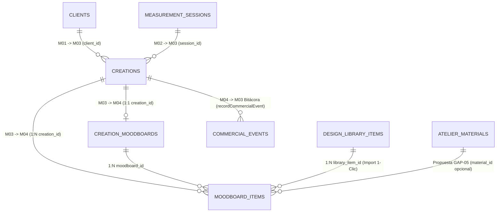

# MÓDULO 04 — ARQUITECTURA TÉCNICA Y MODELO DE DATOS
**Diseño, Moodboard y Biblioteca de Autor — Atelier Digital By Katherine Carroll**  
**Fecha de auditoría:** 2026-11-09

---

## 1. Principios Arquitectónicos

1. **Arquitectura Satélite No Destructiva:**
   - La tabla núcleo `public.creations` (compartida con los Módulos 01, 02 y 03) **permanece 100% intacta**.
   - Toda la información de dirección de arte, arquitectura de prenda, paleta cromática y referencias visuales se aloja en 3 tablas satélite dedicadas (`creation_moodboards`, `moodboard_items`, `design_library_items`) vinculadas mediante claves foráneas (`creation_id` con `ON DELETE CASCADE` y `library_item_id` con `ON DELETE SET NULL`).
2. **Resiliencia Dual (Supabase + Fallback en Memoria):**
   - `src/services/designService.ts` intenta primero las operaciones sobre Supabase (`public.creation_moodboards`, `public.moodboard_items`, `public.design_library_items`). Si las tablas remotas aún no han sido migradas o no hay sesión activa en modo preview, conmuta de forma transparente al catálogo en memoria (`src/services/designMockData.ts`) sin bloquear el trabajo de la diseñadora.
3. **Estructuración Semántica para IA (Preparación Módulo 10):**
   - En lugar de guardar descripciones amorfas, las decisiones de diseño quedan normalizadas en códigos canónicos (`silhouette_code`, `neckline_code`, `sleeve_code`), arreglos tipados JSONB (`color_palette` con `hex`, `finish`, `role`) y etiquetas (`tags: text[]`).

---

## 2. Diagrama de Entidad-Relación y Flujo entre Módulos (M01 – M04)

---

## 3. Modelo de Base de Datos y Seguridad (`supabase/migrations/20261109000000_design_moodboard_library_m04.sql`)

### 3.1. Tabla `public.creation_moodboards` (Relación 1:1 con `public.creations`)
Almacena la dirección artística general y la arquitectura sartorial de una creación.
- `id` (`uuid`, PK, `gen_random_uuid()`)
- `creation_id` (`uuid`, NOT NULL, UNIQUE, FK → `public.creations(id) ON DELETE CASCADE`)
- `title` (`text`, NOT NULL) — Título conceptual del tablero.
- `theme_concept` (`text`) — Concepto narrativo e inspiración de la pieza.
- `silhouette_code` (`text`) — Código estructural (ej. `hourglass_corset`, `evase_imperial`, `mermaid_bias`, `tailored_bespoke`).
- `neckline_code` (`text`) — Código de escote/cuello (ej. `sweetheart_deep`, `bateau_royal`, `peak_lapel`).
- `sleeve_code` (`text`) — Código de manga/hombro (ej. `sleeveless_clean`, `tailored_two_piece`, `bishop_silk`).
- `color_palette` (`jsonb`, DEFAULT `'[]'::jsonb`) — Arreglo de objetos `MoodboardColorSwatch` (`{ id, name, hex, finish, role }`).
- `artistic_notes` (`text`) — Directrices de aguja, caída textil y acabados para el taller.
- `status` (`text`, CHECK `draft | in_review | approved | archived`).
- `approved_at` (`timestamptz`), `created_by` (`uuid`), `created_at` (`timestamptz`), `updated_at` (`timestamptz`).

### 3.2. Tabla `public.moodboard_items` (Relación 1:N con `public.creations`)
Almacena cada pieza o tarjeta fijada en el Pinboard de la creación.
- `id` (`uuid`, PK)
- `moodboard_id` (`uuid`, FK → `public.creation_moodboards(id) ON DELETE CASCADE`)
- `creation_id` (`uuid`, NOT NULL, FK → `public.creations(id) ON DELETE CASCADE`)
- `item_type` (`text`, CHECK `sketch | fabric_swatch | silhouette_ref | detail_finish | color_inspiration | editorial_note`)
- `title` (`text`, NOT NULL), `subtitle` (`text`), `description` (`text`)
- `image_key` (`text`) — Clave de fotografía editorial del atelier (`dress`, `jacket`, `corset`, `bodice`, `skirt`, `coat`, `blouse`, `sleeve`).
- `image_url` (`text`) — URL externa o firmada.
- `storage_path` (`text`) — Ruta privada dentro del bucket `design-assets`.
- `color_hex` (`text`), `tags` (`text[]`), `is_pinned` (`boolean`), `sort_order` (`integer`)
- `library_item_id` (`uuid`, FK → `public.design_library_items(id) ON DELETE SET NULL`) — Trazabilidad de origen cuando se importa desde la Biblioteca.
- `metadata` (`jsonb`, DEFAULT `'{}'::jsonb`) — Permite alojar `material_id` (vínculo opcional con `atelier_materials` de M03) y dimensiones de imagen.

### 3.3. Tabla `public.design_library_items` (Catálogo Permanente de Autor)
Repositorio transversal de recursos reutilizables de la Casa *By Katherine Carroll*.
- `id` (`uuid`, PK)
- `category` (`text`, CHECK `silhouette | neckline | sleeve | fabric_drape | embroidery_finish | color_palette | historical_archive`)
- `code` (`text`, UNIQUE, NOT NULL) — Código oficial (ej. `SIL-KC-001`, `ESC-KC-001`, `TEX-KC-001`, `BOR-KC-001`).
- `title` (`text`, NOT NULL), `subtitle` (`text`), `description` (`text`, NOT NULL)
- `technical_notes` (`text`) — Directrices de patronaje CAD, entretelas, bies o costura a mano.
- `compatible_garments` (`text[]`) — Tipos de prenda compatibles con M02 (`dress`, `bodice`, `jacket`, `skirt`, `pants`, `blouse`).
- `image_key` (`text`), `image_url` (`text`), `accent_hex` (`text`), `palette_swatches` (`jsonb`), `tags` (`text[]`)
- `is_signature` (`boolean`, DEFAULT `true`) — Sello de Autor *By Katherine Carroll*.
- `is_active` (`boolean`, DEFAULT `true`).

### 3.4. Almacenamiento Privado (`storage.buckets`: `design-assets`) y Políticas RLS
- **Bucket:** `design-assets` (`public = false`, límite `15 MB`, MIME permitidos: `image/jpeg`, `image/png`, `image/webp`, `application/pdf`).
- **RLS en Tablas y Storage:** Basadas en `public.is_admin_or_designer()` (función `SECURITY DEFINER` con `SET search_path = ''` que verifica `public.profiles.role IN ('admin', 'designer')` y `id = auth.uid()`), restringidas explícitamente con `TO authenticated` y `REVOKE ALL FROM anon, PUBLIC`. Ningún usuario anónimo ni rol `client` tiene permisos sobre la biblioteca o los moodboards de taller.

---

## 4. Arquitectura de Capas en el Frontend (Expo / React Native Web & Mobile)

| Capa | Archivo | Líneas | Responsabilidad Técnica |
|---|---|---|---|
| **1. Contratos y Tipos** | [src/types/design.ts](file:///d:/Datos/Datos/DATOS%20JVINAS/Antigravity/2.ByKatherineCarroll/AtelierDigitalApp/src/types/design.ts) | 178 | Define `CreationMoodboard`, `MoodboardItem`, `DesignLibraryItem`, `MoodboardColorSwatch`, categorías, estados y DTOs de creación/actualización. |
| **2. Catálogo Maestro & Mocks** | [src/services/designMockData.ts](file:///d:/Datos/Datos/DATOS%20JVINAS/Antigravity/2.ByKatherineCarroll/AtelierDigitalApp/src/services/designMockData.ts) | 338 | Define `SILHOUETTE_OPTIONS`, `NECKLINE_OPTIONS`, `SLEEVE_OPTIONS`, `SIGNATURE_COLOR_PALETTES` (4 colecciones), `SAMPLE_DESIGN_LIBRARY` (9 piezas insignia) y moodboards semilla. |
| **3. Capa de Servicio** | [src/services/designService.ts](file:///d:/Datos/Datos/DATOS%20JVINAS/Antigravity/2.ByKatherineCarroll/AtelierDigitalApp/src/services/designService.ts) | 436 | CRUD de moodboards, aprobación con registro en `commercial_events` (M03), CRUD de items de pinboard, consulta filtrada de biblioteca e importación en 1 clic (`importLibraryItemToCreation`). *(Pendiente añadir subida a Storage, edición/archivo de biblioteca y reapertura de moodboard)*. |
| **4. Estilos Editoriales** | [src/components/design/designStyles.ts](file:///d:/Datos/Datos/DATOS%20JVINAS/Antigravity/2.ByKatherineCarroll/AtelierDigitalApp/src/components/design/designStyles.ts) | 485 | Hoja de estilos compartida bajo paleta `Atelier de Autor` (`#F8F2E9`, `#171411`, `#A78350`). |
| **5. Subcomponente Paleta** | [src/components/design/ColorPaletteSection.tsx](file:///d:/Datos/Datos/DATOS%20JVINAS/Antigravity/2.ByKatherineCarroll/AtelierDigitalApp/src/components/design/ColorPaletteSection.tsx) | 245 | Renderiza muestras cromáticas circulares, roles textiles, acabados y cargador de armonías de firma. |
| **6. Modal Pinboard** | [src/components/design/MoodboardItemModal.tsx](file:///d:/Datos/Datos/DATOS%20JVINAS/Antigravity/2.ByKatherineCarroll/AtelierDigitalApp/src/components/design/MoodboardItemModal.tsx) | 265 | Formulario modal para añadir o editar bocetos, muestras de tela, siluetas y notas en el Pinboard. |
| **7. Modal Biblioteca** | [src/components/design/DesignLibraryModal.tsx](file:///d:/Datos/Datos/DATOS%20JVINAS/Antigravity/2.ByKatherineCarroll/AtelierDigitalApp/src/components/design/DesignLibraryModal.tsx) | 364 | Explorador emergente invocado desde una Creación para importar recursos de autor en 1 clic o catalogar uno nuevo. |
| **8. Pestaña Moodboard (Creación)** | [src/components/design/CreationMoodboardTab.tsx](file:///d:/Datos/Datos/DATOS%20JVINAS/Antigravity/2.ByKatherineCarroll/AtelierDigitalApp/src/components/design/CreationMoodboardTab.tsx) | 528 | Orquestador de M04 dentro de `CreationDetailView.tsx` (soporta `compactMode` en pestaña `Resumen` y vista completa en `Concepto & Moodboard`). |
| **9. Pantalla Global Biblioteca** | [src/components/design/DesignLibraryScreen.tsx](file:///d:/Datos/Datos/DATOS%20JVINAS/Antigravity/2.ByKatherineCarroll/AtelierDigitalApp/src/components/design/DesignLibraryScreen.tsx) | 712 | Pantalla independiente de la Biblioteca de Diseño con 3 vistas: Archivo Visual & Textil, Armonías Cromáticas de Firma y Guía de Siluetas/Escotes/Mangas. |
| **10. Rutas Expo Router** | [app/(designer)/library.tsx](file:///d:/Datos/Datos/DATOS%20JVINAS/Antigravity/2.ByKatherineCarroll/AtelierDigitalApp/app/(designer)/library.tsx) [app/preview-modulo4.tsx](file:///d:/Datos/Datos/DATOS%20JVINAS/Antigravity/2.ByKatherineCarroll/AtelierDigitalApp/app/preview-modulo4.tsx) | 18 / 36 | Rutas de navegación para rol `designer` y entorno de validación E2E. |

