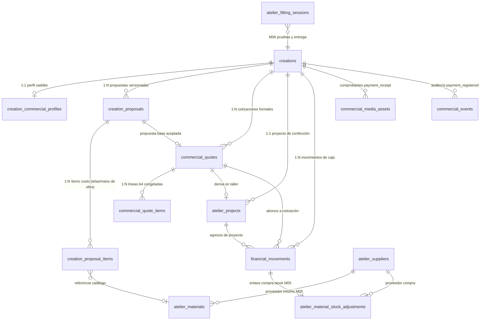
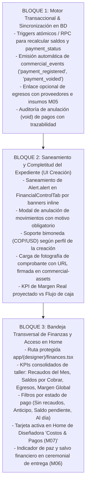

# MÓDULO 07 — ANÁLISIS DE CAPACIDADES EXISTENTES Y DEFINICIÓN MVP
**Costos y Pagos (*Estructuración Económica, Control de Egresos de Taller, Recaudos y Saldos de Alta Costura*) — Atelier Digital By Katherine Carroll**  
**Fecha:** 2026-11-13  
**Tipo de documento:** Auditoría técnica y funcional de solo lectura (sin mutaciones en código, SQL, migraciones, BD ni interfaces).

---

## 1. Propósito y Criterios del Análisis

El presente informe examina de forma exhaustiva las capacidades preexistentes desplegadas en el repositorio (Módulos M00–M06) con el fin de dimensionar la implementación de **M07: Costos y Pagos**. El objetivo es reutilizar al máximo la infraestructura ya probada, evitar duplicidades con M03 (Creaciones y Ciclo Comercial), M05 (Materiales y Proveedores) y M06 (Pruebas y Entrega), y diseñar un **MVP sobrio y ágil de alta costura**, descartando frontalmente la complejidad de un ERP corporativo o contabilidad de partida doble.

### Fuentes Verificadas en el Repositorio
- **Migraciones y Catálogo PostgreSQL:** `20261108000000_commercial_cycle_module_03.sql`, `20261110000000_materials_suppliers_m05.sql`, `20261112000000_fittings_adjustments_m06.sql`.
- **Tipos y Contratos Canónicos:** `src/types/commercial.ts`, `src/types/fitting.ts`, `src/types/creation.ts`.
- **Servicios:** `src/services/commercialService.ts`, `src/services/fittingService.ts`.
- **Componentes de Interfaz Existentes:** `src/components/commercial/FinancialControlTab.tsx`, `src/components/commercial/CreationMaterialsTab.tsx`, `src/components/commercial/CreationQuotesTab.tsx`, `src/components/commercial/commercialStyles.ts`, `src/components/creations/CreationDetailView.tsx`, `app/(designer)/index.tsx`.

---

## 2. Inventario de Capacidades Reutilizables Existentes

Contrario a una concepción aislada, **más del 70% de la estructura de datos que necesita M07 ya fue desplegada en M03 y ampliada en M05**. El siguiente inventario detalla qué existe hoy y cómo debe ser aprovechado por M07:

| Capa | Entidad / Artefacto | Capacidad Real Verificada en Código y BD | Rol frente a M07 |
| :--- | :--- | :--- | :--- |
| **SQL** | `public.financial_movements` | **Tabla real desplegada (19 columnas):** `id`, `creation_id`, `quote_id`, `project_id`, `movement_type` (`advance`, `installment`, `final_payment`, `material_purchase`, `workshop_expense`, `refund`), `amount` (> 0), `currency` (`COP`, `USD`), `payment_method` (`transfer`, `wompi`, `bold`, `cash`, `card`, `other`), `reference_number`, `receipt_url`, `movement_date`, `idempotency_key` (UNIQUE), `is_void`, `voided_at`, `voided_by`, `void_reason`, `created_by`, `created_at`. RLS activo para `is_admin_or_designer()`. | **Entidad principal de M07.** Reutilizar directamente como libro de movimientos de ingresos y egresos. |
| **SQL** | `public.creation_commercial_profiles` | Satélite 1:1 con `payment_status` (`unpaid`, `partially_paid`, `paid_in_full`), `currency`, `estimated_budget_cop`, `estimated_budget_usd`, `delivery_status` y vínculos a `active_proposal_id`, `accepted_quote_id` y `active_project_id`. | **Sincronizar automáticamente** el `payment_status` ante cualquier recaudo o anulación de pago. |
| **SQL** | `public.commercial_quotes` | Snapshot congelado con `subtotal_gross`, `discount_amount`, `subtotal_net`, `tax_rate_pct`, `tax_amount`, `total_price`, `advance_suggested_amount`, `advance_paid_amount`, `balance_pending_amount` y `status` (`draft`, `sent`, `accepted`, `rejected`, `expired`). | **Contrato financiero formal:** Es la base vinculante del saldo pendiente (`balance_pending = total_price - advance_paid`). |
| **SQL** | `public.creation_proposals` & `items` | Versionado v1..vn de estructuración de precios con `materials_subtotal`, `labor_subtotal`, `total_price`, `suggested_advance_pct` (50%) e ítems relacionales `item_type IN ('material', 'labor', 'service')` con `required_quantity` vs `billable_quantity`. | **Costeo presupuestado:** Define la estructura de costos proyectada para comparar contra egresos reales. |
| **SQL** | `public.atelier_materials` | Catálogo maestro textil con `unit_price_cop`, `unit_price_usd`, `min_purchase_unit`, `current_stock`, `supplier_id` y 8 categorías canónicas. | **Tarifario base de insumos** para costeo de telas y forros. |
| **SQL** | `public.atelier_suppliers` | Directorio de 7 tipos de proveedores con moneda predeterminada, términos comerciales y contacto. | **Destino de egresos de compras** de telas y avíos. |
| **SQL** | `public.atelier_material_stock_adjustments` | Bitácora append-only de inventario con columna existente **`financial_movement_id`** (FK -> `financial_movements`), `creation_id` y `supplier_id`. | **Vínculo directo M05 ↔ M07:** Cuando un movimiento es de tipo `material_purchase`, puede enlazar el ajuste de stock correspondiente. |
| **SQL** | `public.atelier_currency_rates` | TRM manual activa por par de divisas (`USD/COP`, `EUR/COP`) gestionada por la diseñadora sin valores quemados. | **Referencia cambiaria informativa** al liquidar compras o cotizaciones bimoneda. |
| **SQL** | `public.commercial_media_assets` | Tabla de archivos con tipo **`'payment_receipt'`** y Storage privado `commercial-assets`. | **Soporte documental:** Almacenamiento seguro de vouchers, transferencias y actas de pago con URLs firmadas. |
| **SQL** | `public.commercial_events` | Bitácora inmutable con tipos de eventos ya contemplados: **`'payment_registered'`** y **`'payment_voided'`**. | **Auditoría inmutable:** Registrar cada anticipo, abono, cancelación o anulación de pago. |
| **Tipos** | `src/types/commercial.ts` | Definidos `FinancialTransaction`, `TransactionType`, `PaymentMethod`, `CreateTransactionDTO`, `VoidTransactionDTO`, `FinancialSummary`. | **Contratos TypeScript al 90% listos:** Requieren ajustes mínimos de normalización. |
| **Servicios** | `src/services/commercialService.ts` | Implementados `fetchTransactionsByCreation`, `createTransaction`, `voidTransaction`, `calculateFinancialSummary`. | **Lógica base operativa:** Requiere endurecimiento de persistencia atómica y erradicación de fallbacks legados. |
| **UI** | `FinancialControlTab.tsx` | Componente de 451 líneas integrado en `CreationDetailView.tsx` (Sección 8, pestaña `Finanzas`), con KPIs de cotizado/recaudado/saldo/egresos/margen, tabla de transacciones y modal de creación. | **Componente ancla por Creación:** Requiere saneamiento de `Alert.alert`, incorporación del flujo de anulación y subida de comprobantes. |

---

## 3. Mapa de Tablas, Claves Foráneas y Relaciones Relacionales

### Matriz de Integridad y Claves Foráneas Clave
1. `financial_movements.creation_id` ➔ `creations(id) ON DELETE CASCADE`: Todo movimiento pertenece obligatoriamente a una Creación.
2. `financial_movements.quote_id` ➔ `commercial_quotes(id) ON DELETE SET NULL`: Asocia abonos o anticipos directamente a la cotización contractual que amortizan.
3. `financial_movements.project_id` ➔ `atelier_projects(id) ON DELETE SET NULL`: Asocia egresos reales (confección, tintorería, bordados externos) a la orden de taller.
4. `financial_movements.idempotency_key` ➔ `UNIQUE`: Previene dobles registros de pagos o cobros en reintentos de red.
5. `atelier_material_stock_adjustments.financial_movement_id` ➔ `financial_movements(id) ON DELETE SET NULL`: Vincula la compra física de insumo con la salida de dinero registrada.

---

## 4. Análisis Técnico-Funcional por Ejes Clave

### 4.1. Materiales, Insumos y Costos Directos (Presupuestado vs. Real de Taller)
- **Estado Actual:**
  - En la propuesta comercial (`CreationMaterialsTab.tsx`), la diseñadora compone las telas y avíos requeridos multiplicando el metraje facturable (`billable_quantity` derivado de `min_purchase_unit`) por la tarifa unitaria, consolidando `materials_subtotal`.
  - En el catálogo (`atelier_materials`), cada tela tiene `unit_price_cop` y `unit_price_usd`.
  - En compras reales de taller, `financial_movements` permite registrar movimientos con `movement_type = 'material_purchase'`.
- **Diferencia entre Costo Estimado y Egreso Real:**
  - El monto en propuesta representa el **precio presupuestado/cobrado** a la clienta (que a menudo incluye un margen de corte/merma de alta costura).
  - El monto en `financial_movements` representa el **dinero real desembolsado** a la casa textil o mercería.
- **Vacío detectado:** Cuando la diseñadora registra un egreso `'material_purchase'`, el formulario actual de `FinancialControlTab.tsx` solo pide monto y concepto en texto libre; no permite vincular a qué material de la creación corresponde ni enlazar al proveedor M05 (`atelier_suppliers`), perdiendo trazabilidad de si la seda costó más o menos de lo presupuestado.

### 4.2. Mano de Obra, Confección y Servicios de Taller
- **Estado Actual:**
  - Las propuestas desglosan mano de obra en `creation_proposal_items` con `item_type = 'labor'` o `'service'` (ej. *"Corte y Modelado Anatómico"*, *"Bordado a mano en canutillos"*), consolidando `labor_subtotal`.
  - Los egresos operativos reales se registran como `movement_type = 'workshop_expense'`.
  - En `atelier_projects` existe el campo `assigned_tailor` (sastre asignado).
- **Vacío detectado:** No hay desglose de a quién se paga el egreso de confección (sastre interno o taller externo especializado) ni control de si los honorarios de confección reales superaron el rubro presupuestado de mano de obra.

### 4.3. Estructura de Precios, Multidivisa (COP / USD) y Margen Real
- **Estado Actual:**
  - Cada creación y cotización tiene una moneda base fija (`COP` o `USD`), respetando la directriz de M03/M05 de no forzar conversiones dinámicas que descalibren los contratos pactados.
  - El cálculo actual de `FinancialControlTab.tsx` define:
    - $\text{balance\_pending} = \max(0, \text{quoted\_total} - \text{total\_income})$
    - $\text{project\_gross\_margin} = \text{total\_income} - \text{total\_expenses}$
- **Limitación conceptual del Margen:**
  - El cálculo actual de `project_gross_margin` mide únicamente el **flujo de caja neto recibido** ($\text{Recaudos} - \text{Gastos Pagados}$).
  - Si una clienta ya pagó el 50% ($3.000.000) y se han gastado $1.500.000 en telas, el sistema muestra "Margen: $1.500.000", lo cual distorsiona la rentabilidad real de la prenda.
  - La métrica real de rentabilidad esperada del encargo debe ser:
    - $\text{Margen Bruto Proyectado} = \text{Total Cotizado} - \text{Total Egresos Reales}$
    - $\text{Margen \%} = \frac{\text{Total Cotizado} - \text{Total Egresos}}{\text{Total Cotizado}} \times 100$
    manteniendo en paralelo el KPI de liquidez (*Flujo de Caja Neto*).

### 4.4. Anticipos, Abonos de Clienta, Recibos y Saldos Pendientes
- **Regla Canónica del Atelier By Katherine Carroll:**
  - **Anticipo Inicial (50%):** Condición contractual previa para ordenar telas y habilitar el patronaje/corte en taller.
  - **Abonos Intermedios:** Opcionales durante las pruebas de calce (M06).
  - **Cancelación Final (Saldo 50% restante):** Exigible al concluir la última prueba física antes de la entrega ceremonial.
- **Vacío Crítico de Sincronización:**
  - Cuando se inserta un movimiento de tipo `'advance'` en `financial_movements`:
    - `commercial_quotes.advance_paid_amount` **no se actualiza** en la base de datos.
    - `commercial_quotes.balance_pending_amount` **no se actualiza** en la base de datos.
    - `creation_commercial_profiles.payment_status` **no se actualiza** en la base de datos (`unpaid` / `partially_paid` / `paid_in_full`).
  - La UI de `FinancialControlTab.tsx` recalcula estos valores en memoria al cargar las transacciones, pero las tablas maestras permanecen desactualizadas para reportes globales o consultas externas.

### 4.5. Intersección con M06 (Pruebas, Calce y Entrega Solemne)
- **Principio de Alta Costura:** La entrega solemne de la prenda no debe efectuarse con saldo pendiente sin una dispensa financiera expresa de la diseñadora.
- **Estado en M06:** La RPC `confirm_creation_delivery_m06` verifica minuciosamente que la sesión esté aprobada (`final_for_delivery`) y que no existan ajustes físicos abiertos (`openCount === 0`), pero **no valida el estado financiero**.
- **Oportunidad M07:** Sin bloquear destructivamente a la diseñadora si decide entregar con crédito comercial, M07 debe brindar:
  1. La validación visual inmediata en la entrega (insignia de *Paz y Salvo Financiero*).
  2. La capacidad de registrar el `final_payment` simultáneamente al ceremonial de entrega de M06.

---

## 5. Identificación de Duplicidades, Inconsistencias y Vacíos Funcionales

| # | Hallazgo / Vacío Crítico | Impacto Técnico-Operativo | Solución Propuesta para M07 |
| :-: | :--- | :--- | :--- |
| **G-01** | **Falta de sincronización atómica entre movimientos y saldos:** `financial_movements` no dispara la actualización de `creation_commercial_profiles.payment_status` ni los saldos de `commercial_quotes`. | Desincronización silenciosa: la base de datos dice que la creación está `unpaid` aunque existan 3 recibos registrados. | Implementar trigger transaccional o RPC atómica `record_financial_movement_m07` que recalcule saldos y actualice `payment_status` bajo `FOR UPDATE`. |
| **G-02** | **Desconexión entre compras y proveedores M05:** Los egresos `'material_purchase'` no se vinculan con `atelier_materials` ni `atelier_suppliers`. | Pérdida de trazabilidad de compras y cuentas por pagar a casas textiles. | Enlazar `financial_movements` opcionalmente con `supplier_id` y `material_id`, permitiendo ligar el registro con `atelier_material_stock_adjustments`. |
| **G-03** | **Sin carga de comprobantes privados en Storage:** `financial_movements.receipt_url` es un texto libre; no se utiliza `commercial_media_assets` (`asset_type: 'payment_receipt'`). | La diseñadora no puede adjuntar la foto del comprobante de transferencia o voucher con URL firmada. | Integrar subida a `commercial-assets/receipts/...` con `pickAndUploadCommercialAssetImage` y registrar activo en `commercial_media_assets`. |
| **G-04** | **Inconsistencia de nombres y fallbacks legados en servicio:** `commercialService.ts` intenta hacer fallback hacia `financial_transactions` ante `PGRST205`, y normaliza campos `movement_type` vs `transaction_type`. | Código defensivo confuso que enmascara fallos de esquema. | Limpiar `commercialService.ts` para apuntar exclusivamente a la tabla canónica `financial_movements` y normalizar contratos. |
| **G-05** | **UI incompleta y `Alert.alert` en `FinancialControlTab.tsx`:** 1. Presencia de `Alert.alert` (L9 y L124) que falla silenciosamente en Web. 2. Cero interfaz para invocar `voidTransaction` (no se puede anular un pago errado). 3. Moneda fija en COP en formulario, sin soporte para cotizaciones USD. | Riesgo de fallos en producción Web, imposibilidad de corregir errores de digitación de pagos y desalineación con encargos internacionales. | Saneamiento integral de `FinancialControlTab.tsx`: banners inline de feedback, modal de anulación con motivo obligatorio y selector de divisa respetando la cotización. |
| **G-06** | **Inexistencia de Bandeja Transversal de Costos y Finanzas:** Toda la gestión financiera está enterrada dentro del tab 8 de `CreationDetailView.tsx`. La diseñadora no tiene visión global de atelier. | Imposible saber rápidamente cuánto se ha recaudado en el mes, qué clientas deben saldo, o cuáles son las cuentas por pagar a proveedores. | Crear la pantalla transversal `app/(designer)/finances.tsx` accesible desde la barra superior y Home de Diseñadora, con KPIs globales de atelier. |
| **G-07** | **Eventos comerciales no emitidos:** `createTransaction` y `voidTransaction` no registran eventos en `commercial_events` (`'payment_registered'`, `'payment_voided'`). | La bitácora editorial de la creación queda ciega ante los hitos económicos. | Emitir automáticamente el evento correspondiente en `commercial_events` con metadata del monto, medio y recibo. |

---

## 6. Riesgos Técnicos y Antipatrones a Evitar

> [!WARNING]
> **Riesgo 1: La Trampa del ERP Corporativo (Complejidad Innecesaria)**  
> Convertir M07 en un software contable (asientos de partida doble, balances generales, cuentas contables PUC, facturación electrónica masiva DIAN, nómina electrónica) destruirá la ergonomía del atelier. Katherine Carroll opera un modelo de **alta costura a medida**, donde lo que se necesita es un **cuaderno de control de encargos**: saber con precisión cuánto costó hacer la prenda (telas + taller), cuánto se le cobró a la clienta, cuánto ha pagado de anticipo y cuánto resta por cobrar.

> [!IMPORTANT]
> **Riesgo 2: Concurrencia y Carrera en Cobros Simultáneos**  
> Si dos pagos entran en paralelo o se anula un abono mientras se registra otro, el cálculo del saldo en cliente puede generar desajustes. La solución debe garantizar transaccionalidad atómica a nivel de PostgreSQL para que la suma de abonos válidos (`is_void = FALSE`) determine de forma inmutable el `payment_status`.

> [!NOTE]
> **Riesgo 3: Conversión Forzada de Divisas**  
> Si una cotización se cerró en 1.800 USD, todos los abonos de ese encargo deben registrarse en USD (o en COP con la TRM pactada del día del abono), sin alterar retrospectivamente el total de la cotización ni recalcular los saldos históricos ante fluctuaciones del mercado.

---

## 7. Propuesta de Alcance MVP para M07 (Costos y Pagos de Atelier)

Para lograr un módulo robusto, útil y sin sobreingeniería, se propone estructurar M07 en **3 Bloques Claros y Secuenciales**:

### 7.1. Qué ENTRA en el MVP de M07
1. **Control de Ingresos por Encargo:** Registro formal de Anticipos (50%), Abonos parciales y Pagos finales, con fecha, medio de pago, referencia y comprobante adjunto.
2. **Control de Egresos Directos de Taller:** Registro de compras de telas/avíos (con opción de indicar proveedor M05) y pagos de servicios de taller/confección.
3. **Sincronización Automática de Saldos:** Amortización instantánea de la cotización aceptada y cambio automático de `payment_status` en la Creación (`unpaid` -> `partially_paid` -> `paid_in_full`).
4. **Anulación Auditada:** Registro del motivo y autoría de cualquier anulación de pago sin borrado físico destructivo.
5. **Comprobantes en Storage Privado:** Carga de vouchers o recibos fotográficos en `commercial-assets/receipts/` accesibles con URLs firmadas temporales.
6. **Bandeja Transversal de Finanzas del Atelier:** Tablero general para que la diseñadora supervise el flujo económico global sin tener que entrar creación por creación.
7. **Paz y Salvo Informativo en Entrega:** Conexión visual con M06 para alertar si una prenda lista para entrega tiene saldo pendiente.

### 7.2. Qué queda FUERA de M07 (Aplazado / No Aplica)
- **Facturación Electrónica DIAN:** No aplica a esta etapa de taller interno.
- **Pasarelas de Pago Desatendidas con Webhooks (Wompi / Bold en tiempo real):** Corresponde a M09 (Portal de Clientas). En M07, la diseñadora registra manualmente el pago recibido por cualquier medio.
- **Nómina y Contabilidad General:** Se descarta para preservar la identidad de *Atelier de Autor*.

