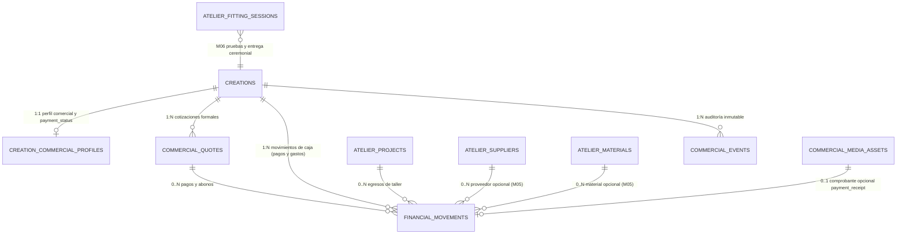

# MÓDULO 07 — DISEÑO TÉCNICO DEFINITIVO (MVP ALTA COSTURA SIMPLIFICADO)
**Costos y Pagos (*Dos Acciones: Registrar Pago y Registrar Gasto · Mínima Digitación · Cálculos Automáticos · Integridad Transaccional ACID*)**  
**Proyecto:** Atelier Digital — *By Katherine Carroll*  
**Fecha:** 2026-11-13  
**Estado:** Especificación técnica definitiva de solo documentación (sin mutaciones en código, SQL, migraciones, BD ni interfaces).

---

## 0. Trazabilidad de Resolución de Hallazgos y Ajustes de Revisión

El presente diseño técnico resuelve de forma exhaustiva los siete hallazgos funcionales detectados en [`M07_ANALISIS_CAPACIDADES_EXISTENTES.md`](M07_ANALISIS_CAPACIDADES_EXISTENTES.md) e incorpora las correcciones técnicas esenciales identificadas en la revisión de arquitectura:

| ID | Hallazgo / Requisito Técnico | Solución Técnica Definitiva Diseñada en este Documento |
| :---: | :--- | :--- |
| **G-01** | **Falta de sincronización atómica entre movimientos y saldos:** `financial_movements` no actualizaba cotizaciones ni perfiles. | **RPC transaccional atómica `record_financial_movement_m07`**: ejecuta recálculo de saldos bajo locks jerárquicos estrictos (Locks 1→5), actualizando en la misma transacción atómica `commercial_quotes.advance_paid_amount`, `balance_pending_amount` y `creation_commercial_profiles.payment_status` (`unpaid`, `partially_paid`, `paid_in_full`). |
| **G-02** | **Desconexión entre compras y proveedores M05:** Los egresos no podían vincularse con `atelier_materials` ni `atelier_suppliers`. | **Extensión aditiva 100% opcional y retrocompatible** en `financial_movements`: columnas `supplier_id UUID NULL` y `material_id UUID NULL`. **Preservación total de M05:** La vinculación es estrictamente opcional para la diseñadora (cero fricción en el registro rápido de gastos). M05 permanece intacto e inalterado en su propia pantalla y servicios. |
| **G-03** | **Sin carga de comprobantes privados en Storage:** `receipt_url` era texto libre sin aprovechar `commercial_media_assets`. | **Vínculo opcional con `commercial_media_assets`**: columna aditiva `media_asset_id UUID NULL` y subida determinista a `commercial-assets/receipts/${creationId}/${idem}.${ext}` con URL firmada temporal. Adjuntar comprobante es 100% voluntario. |
| **G-04** | **Inconsistencia de nombres y fallbacks legados en servicio:** Consultas hacia tablas inexistentes (`financial_transactions`) y mezcla de campos. | **Normalización canónica estricta**: erradicación total de fallbacks legados; `financial_movements` se ratifica como la única fuente de verdad; contratos TypeScript unificados con nombres canónicos de columna. |
| **G-05** | **UI compleja y uso de `Alert.alert` en `FinancialControlTab.tsx`:** Formularios pesados, `Alert.alert` que falla en Web y ausencia de modal de anulación. | **Rediseño en MVP ultra-simplificado de dos acciones:** Solo dos botones principales: **`[+ Registrar Pago]`** y **`[− Registrar Gasto]`**. Mínima digitación (fecha local y moneda contractual automáticas, sugerencias a 1 toque de 50% de anticipo o liquidación de saldo). Erradicación de `Alert.alert` sustituyéndolo por banners inline (`feedbackNotice`). Modal de anulación auditada con motivo obligatorio. |
| **G-06** | **Inexistencia de Bandeja Transversal de Costos y Finanzas:** Toda la gestión económica estaba recluida en el detalle de la creación. | **Nueva pantalla transversal `app/(designer)/finances.tsx` (`FinancialStudioScreen.tsx`)**: tablero global con KPIs de taller separados por divisa (`COP` y `USD`), filtros rápidos por estado de pago y acceso directo a los expedientes. Activación de tarjeta M07 en Home de diseñadora. |
| **G-07** | **Eventos comerciales no emitidos:** Mutaciones financieras sin trazabilidad en `commercial_events`. | **Emisión transaccional obligatoria**: las RPCs `record_financial_movement_m07` y `void_financial_movement_m07` insertan atómicamente el evento en `public.commercial_events` (`'payment_registered'`, `'payment_voided'`). |
| **CORR-01** | **Inconsistencia en orden de locks (Riesgo de Deadlock `40P01`):** `void_financial_movement_m07` bloqueaba primero el movimiento y luego la creación, invirtiendo el orden de registro. | **Unificación rigurosa del orden jerárquico 1→5:** En `void_financial_movement_m07`, se resuelve primero el `creation_id` y `quote_id` del movimiento (lectura previa sin lock) y luego se adquieren los locks exactamente en el mismo orden: `creations (1) → commercial_quotes (2) → financial_movements (3) → creation_commercial_profiles (4) → commercial_events (5)`. Deadlocks erradicados de raíz. |
| **CORR-02** | **RPC de lectura con mutaciones (`UPDATE` dentro de un GET):** `get_creation_financial_summary_m07` llamaba a la función de recálculo que ejecutaba `UPDATE`. | **Separación estricta de lectura y mutación:** `get_creation_financial_summary_m07` se define como función pura de lectura (`STABLE`), que calcula o lee métricas sin mutar ninguna tabla. La función `m07_recalculate_creation_financial_state` queda restringida a uso interno exclusivo de las RPCs mutadoras. |
| **CORR-03** | **Idempotencia no validada en anulación:** `void_financial_movement_m07` recibía `p_idempotency_key` pero no lo almacenaba ni verificaba la clave del replay. | **Idempotencia formal de anulación:** Se adiciona la columna `void_idempotency_key TEXT UNIQUE` a `financial_movements`. Si el movimiento ya está anulado y coincide la llave de anulación, retorna `idempotent_replay: true`. Si la llave difiere, rechaza por colisión de anulación (`23505`). |
| **CORR-04** | **Mezcla aritmética de monedas y cálculo de reembolsos:** Suma ciega de montos sin filtrar divisa y tratamiento ambiguo de devoluciones. | **Aislamiento bimoneda y lógica contable limpia:** La amortización de la cotización y el estado de pago se calculan exclusivamente en la **moneda contractual del encargo** (`v_contract_currency`). Los egresos se discriminan en `COP` y `USD`. Los reembolsos (`refund`) descuentan formalmente de los ingresos recaudados sin permitir saldos negativos. |

---

## 1. Principios Arquitectónicos e Irrenunciables de M07

El diseño de M07 se fundamenta en diez principios directores que garantizan robustez técnica, simplicidad de uso y preservación de la identidad del Atelier:

1. **Principio Anti-ERP y Máxima Simplicidad (Dos Acciones de Alta Costura):**  
   M07 es un **cuaderno de control económico de taller**, no un software contable empresarial. No implementa asientos de partida doble, cuentas PUC, depreciaciones ni facturación electrónica masiva DIAN. La diseñadora solo realiza **dos acciones esenciales**:
   - **`[+ Registrar Pago]`**: para abonos, anticipos o cobros recibidos de la clienta.
   - **`[− Registrar Gasto]`**: para compras de telas, forrería, insumos o confección externa.
   El sistema realiza automáticamente todos los cálculos de saldos, porcentajes de amortización, paz y salvo y márgenes de ganancia.

2. **Preservación Integral de M05 (Materiales, Proveedores & TRM):**  
   **PROHIBIDO eliminar, reducir, sustituir o alterar funcionalidades de M05.** El Módulo 05 permanece 100% operativo con su pantalla independiente (`app/(designer)/materials.tsx`), catálogo textil, directorio de proveedores, bitácora de stock append-only y TRM manual. En M07, asociar un gasto a un proveedor o tela de M05 es **100% opcional** y se realiza mediante consultas de solo lectura. Si la diseñadora no desea seleccionar proveedor ni tela, registra el gasto en 3 segundos únicamente con monto y concepto.

3. **Reutilización Canónica de `public.financial_movements`:**  
   No se crean tablas financieras paralelas ni tablas puente redundantes. Se reutiliza la tabla existente creada en M03, aplicando exclusivamente adiciones aditivas mínimas y retrocompatibles.

4. **Separación Estricta de Lectura y Mutación:**  
   Ninguna RPC de consulta o lectura (`get_*`) ejecuta operaciones de escritura (`UPDATE` o `INSERT`). Las mutaciones y el recálculo físico de saldos quedan encapsulados exclusivamente en las RPCs de mutación (`record_financial_movement_m07` y `void_financial_movement_m07`).

5. **Orden Jerárquico Global de Bloqueos Anti-Deadlocks (Locks 1→5):**  
   Todas las operaciones de mutación económica adquieren bloqueos exclusivos (`FOR UPDATE`) en un único orden unidireccional y ascendente:
   $$\text{creations (1)} \longrightarrow \text{commercial\_quotes (2)} \longrightarrow \text{financial\_movements (3)} \longrightarrow \text{creation\_commercial\_profiles (4)} \longrightarrow \text{commercial\_events (5)}$$
   Tanto el registro de movimientos como su anulación auditada respetan rigurosamente esta secuencia, eliminando por completo los interbloqueos (`40P01`).

6. **Control Optimista con Códigos Nativos (`PT409`):**  
   Siguiendo el estándar validado en M06, la anulación y modificación de movimientos exige `p_expected_row_version`. Los conflictos de concurrencia optimista retornan `ERRCODE = 'PT409'`, mapeado por PostgREST a `HTTP 409` instantáneo, erradicando reintentos ciegos y timeouts de 125 segundos.

7. **Idempotencia Estricta Bidireccional (`23505`):**  
   - Registro de movimiento: gobernado por `idempotency_key TEXT UNIQUE`. Repeticiones idénticas devuelven `idempotent_replay: true`; discrepancias de payload se rechazan con `23505`.
   - Anulación auditada: gobernada por `void_idempotency_key TEXT UNIQUE`. Reintentos de red de la misma anulación devuelven `idempotent_replay: true` sin duplicar eventos.

8. **Política de Anulación Auditada (Cero Borrado Físico):**  
   Los movimientos financieros erróneos nunca se eliminan físicamente de la base de datos (`DELETE` denegado en RLS a usuarios operativos). Se anulan formalmente mediante `is_void = TRUE`, estampando `voided_at`, `voided_by` y un motivo obligatorio `void_reason`.

9. **Gestión Bimoneda Limpia sin Conversiones Destructivas:**  
   Cada encargo opera bajo su moneda contractual pactada (`COP` o `USD`). M07 no realiza conversiones automáticas retroactivas ni recalcula presupuestos históricos ante oscilaciones del mercado cambiario. Los egresos se registran en la moneda real en que ocurrieron (`COP` o `USD`) y se consolidan en paralelo.

10. **Paz y Salvo Informativo para el Ceremonial de Entrega (M06):**  
    M07 expone el indicador de paz y salvo financiero (`is_financially_cleared`), que se conecta informativamente con el modal de entrega ceremonial de M06 (`DeliveryCeremonyModal.tsx`). La diseñadora visualiza el estado de cobro sin que el sistema bloquee arbitrariamente la entrega física si Katherine autoriza crédito comercial.

---

## 2. Modelo de Datos y Extensiones Aditivas Justificadas

### 2.1. Evolución Aditiva de `public.financial_movements`

La tabla cuenta con 19 columnas operativas desplegadas en M03. Se proponen **6 extensiones aditivas (todas nullable o con valor por defecto)**, 100% retrocompatibles:

```sql
-- Adiciones aditivas en public.financial_movements (M07)
ALTER TABLE public.financial_movements
    ADD COLUMN IF NOT EXISTS row_version INT NOT NULL DEFAULT 1,
    ADD COLUMN IF NOT EXISTS void_idempotency_key TEXT UNIQUE,
    ADD COLUMN IF NOT EXISTS supplier_id UUID NULL REFERENCES public.atelier_suppliers(id) ON DELETE SET NULL,
    ADD COLUMN IF NOT EXISTS material_id UUID NULL REFERENCES public.atelier_materials(id) ON DELETE SET NULL,
    ADD COLUMN IF NOT EXISTS media_asset_id UUID NULL REFERENCES public.commercial_media_assets(id) ON DELETE SET NULL,
    ADD COLUMN IF NOT EXISTS updated_at TIMESTAMPTZ NOT NULL DEFAULT pg_catalog.now();
```

#### Justificación Técnica de Cada Campo:
- `row_version`: Soporta el control de concurrencia optimista en el flujo de anulación auditada (`void_financial_movement_m07`).
- `void_idempotency_key`: Garantiza la idempotencia estricta en reintentos de red durante la anulación auditada, evitando colisiones o eventos duplicados.
- `supplier_id` *(Opcional)*: Permite asociar voluntariamente un egreso de taller a un proveedor del directorio M05.
- `material_id` *(Opcional)*: Permite vincular voluntariamente el egreso a una tela o insumo específico del catálogo M05.
- `media_asset_id` *(Opcional)*: Enlaza el comprobante o voucher de pago almacenado en `commercial_media_assets` con metadatos de Storage.
- `updated_at`: Registra la fecha de última modificación (gobernada automáticamente por trigger).

### 2.2. Diagrama Entidad-Relación Consolidado



---

## 3. Especificación DDL de la Migración Aditiva M07

```sql
-- ==============================================================================
-- ATELIER DIGITAL — MÓDULO 07: COSTOS Y PAGOS (MVP ALTA COSTURA)
-- Migración Aditiva: 20261114000000_costs_payments_m07.sql
-- ==============================================================================

BEGIN;

-- 1. EXTENSIÓN ADITIVA DE public.financial_movements
ALTER TABLE public.financial_movements
    ADD COLUMN IF NOT EXISTS row_version INT NOT NULL DEFAULT 1,
    ADD COLUMN IF NOT EXISTS void_idempotency_key TEXT UNIQUE,
    ADD COLUMN IF NOT EXISTS supplier_id UUID NULL REFERENCES public.atelier_suppliers(id) ON DELETE SET NULL,
    ADD COLUMN IF NOT EXISTS material_id UUID NULL REFERENCES public.atelier_materials(id) ON DELETE SET NULL,
    ADD COLUMN IF NOT EXISTS media_asset_id UUID NULL REFERENCES public.commercial_media_assets(id) ON DELETE SET NULL,
    ADD COLUMN IF NOT EXISTS updated_at TIMESTAMPTZ NOT NULL DEFAULT pg_catalog.now();

-- 2. ÍNDICES DE RENDIMIENTO ADITIVOS
CREATE INDEX IF NOT EXISTS idx_financial_movements_supplier_id 
    ON public.financial_movements(supplier_id) WHERE supplier_id IS NOT NULL;

CREATE INDEX IF NOT EXISTS idx_financial_movements_material_id 
    ON public.financial_movements(material_id) WHERE material_id IS NOT NULL;

CREATE INDEX IF NOT EXISTS idx_financial_movements_void_idem 
    ON public.financial_movements(void_idempotency_key) WHERE void_idempotency_key IS NOT NULL;

CREATE INDEX IF NOT EXISTS idx_financial_movements_active_calc 
    ON public.financial_movements(creation_id, currency, movement_type, is_void) 
    WHERE is_void = FALSE;

-- 3. TRIGGER DE ACTUALIZACIÓN AUTOMÁTICA updated_at Y row_version
CREATE OR REPLACE FUNCTION public.handle_m07_updated_at()
RETURNS TRIGGER
LANGUAGE plpgsql
SECURITY DEFINER
SET search_path = ''
AS $$
BEGIN
    NEW.updated_at = pg_catalog.now();
    NEW.row_version = OLD.row_version + 1;
    RETURN NEW;
END;
$$;

DROP TRIGGER IF EXISTS trg_financial_movements_updated_at ON public.financial_movements;
CREATE TRIGGER trg_financial_movements_updated_at
    BEFORE UPDATE ON public.financial_movements
    FOR EACH ROW EXECUTE FUNCTION public.handle_m07_updated_at();

-- 4. FUNCIÓN INTERNA ATÓMICA DE RECÁLCULO DE SALDOS
-- NOTA: Esta función es de uso INTERNO exclusivo para transacciones de mutación bajo Lock 1->2->4.
CREATE OR REPLACE FUNCTION public.m07_recalculate_creation_financial_state(
    p_creation_id UUID,
    p_actor_id UUID
)
RETURNS JSONB
LANGUAGE plpgsql
SECURITY DEFINER
SET search_path = ''
AS $$
DECLARE
    v_contract_currency TEXT := 'COP';
    v_total_income_contract NUMERIC(14,2) := 0;
    v_total_expenses_cop NUMERIC(14,2) := 0;
    v_total_expenses_usd NUMERIC(14,2) := 0;
    v_quote public.commercial_quotes%ROWTYPE;
    v_profile public.creation_commercial_profiles%ROWTYPE;
    v_new_payment_status TEXT := 'unpaid';
    v_balance_pending NUMERIC(14,2) := 0;
    v_quoted_total NUMERIC(14,2) := 0;
    v_is_cleared BOOLEAN := FALSE;
BEGIN
    -- 1. Identificar cotización formal aceptada (o más reciente)
    SELECT * INTO v_quote
    FROM public.commercial_quotes
    WHERE creation_id = p_creation_id
      AND status = 'accepted'
    LIMIT 1;

    IF NOT FOUND THEN
        SELECT * INTO v_quote
        FROM public.commercial_quotes
        WHERE creation_id = p_creation_id
        ORDER BY created_at DESC
        LIMIT 1;
    END IF;

    -- 2. Resolver moneda contractual del encargo
    IF v_quote.id IS NOT NULL THEN
        v_contract_currency := v_quote.currency;
        v_quoted_total := COALESCE(v_quote.total_price, 0);
    ELSE
        SELECT currency INTO v_contract_currency
        FROM public.creation_commercial_profiles
        WHERE creation_id = p_creation_id;
        v_contract_currency := COALESCE(v_contract_currency, 'COP');
    END IF;

    -- 3. Calcular ingresos netos en la moneda contractual (anticipos y pagos menos reembolsos)
    SELECT 
        GREATEST(0, COALESCE(SUM(CASE 
            WHEN movement_type IN ('advance', 'installment', 'final_payment') THEN amount 
            WHEN movement_type = 'refund' THEN -amount 
            ELSE 0 
        END), 0))
    INTO v_total_income_contract
    FROM public.financial_movements
    WHERE creation_id = p_creation_id
      AND currency = v_contract_currency
      AND is_void = FALSE;

    -- 4. Calcular egresos de taller discriminados por moneda
    SELECT 
        COALESCE(SUM(CASE WHEN currency = 'COP' AND movement_type IN ('material_purchase', 'workshop_expense') THEN amount ELSE 0 END), 0),
        COALESCE(SUM(CASE WHEN currency = 'USD' AND movement_type IN ('material_purchase', 'workshop_expense') THEN amount ELSE 0 END), 0)
    INTO v_total_expenses_cop, v_total_expenses_usd
    FROM public.financial_movements
    WHERE creation_id = p_creation_id
      AND is_void = FALSE;

    -- 5. Calcular saldo pendiente y amortización de la cotización
    IF v_quoted_total > 0 THEN
        v_balance_pending := GREATEST(0, v_quoted_total - v_total_income_contract);
    ELSE
        v_balance_pending := 0;
    END IF;

    -- 6. Actualizar cotización formal aceptada si existe
    IF v_quote.id IS NOT NULL THEN
        UPDATE public.commercial_quotes
        SET
            advance_paid_amount = LEAST(v_quoted_total, v_total_income_contract),
            balance_pending_amount = v_balance_pending,
            updated_at = pg_catalog.now()
        WHERE id = v_quote.id;
    END IF;

    -- 7. Determinar estado de pago formal del encargo
    IF v_total_income_contract <= 0 THEN
        v_new_payment_status := 'unpaid';
    ELSIF v_quoted_total > 0 AND v_total_income_contract >= v_quoted_total THEN
        v_new_payment_status := 'paid_in_full';
    ELSE
        v_new_payment_status := 'partially_paid';
    END IF;

    -- 8. Actualizar satélite creation_commercial_profiles (Lock 4)
    UPDATE public.creation_commercial_profiles
    SET
        payment_status = v_new_payment_status,
        updated_at = pg_catalog.now()
    WHERE creation_id = p_creation_id;

    v_is_cleared := (v_new_payment_status = 'paid_in_full' OR (v_quoted_total > 0 AND v_balance_pending = 0));

    RETURN pg_catalog.jsonb_build_object(
        'contract_currency', v_contract_currency,
        'total_income', v_total_income_contract,
        'quoted_total', v_quoted_total,
        'balance_pending', v_balance_pending,
        'total_expenses_cop', v_total_expenses_cop,
        'total_expenses_usd', v_total_expenses_usd,
        'payment_status', v_new_payment_status,
        'is_financially_cleared', v_is_cleared
    );
END;
$$;

COMMIT;
```

---

## 4. Catálogo de RPCs Transaccionales ACID y de Lectura Pura

### 4.1. `record_financial_movement_m07` (Mutación ACID)

Registra un movimiento económico de taller (**pago o gasto**), valida el payload, adquiere locks en secuencia 1→5, persiste el registro, recalcula los saldos atómicamente y emite el evento comercial.

```sql
CREATE OR REPLACE FUNCTION public.record_financial_movement_m07(
    p_creation_id UUID,
    p_movement_type TEXT,
    p_amount NUMERIC,
    p_currency TEXT,
    p_payment_method TEXT,
    p_idempotency_key TEXT,
    p_movement_date DATE DEFAULT NULL,
    p_reference_number TEXT DEFAULT NULL,
    p_notes TEXT DEFAULT NULL,
    p_quote_id UUID DEFAULT NULL,
    p_project_id UUID DEFAULT NULL,
    p_supplier_id UUID DEFAULT NULL,
    p_material_id UUID DEFAULT NULL,
    p_receipt_asset JSONB DEFAULT NULL
)
RETURNS JSONB
LANGUAGE plpgsql
SECURITY DEFINER
SET search_path = ''
AS $$
DECLARE
    v_actor_id UUID := auth.uid();
    v_clean_idem TEXT := NULLIF(pg_catalog.btrim(p_idempotency_key), '');
    v_effective_date DATE := COALESCE(p_movement_date, CURRENT_DATE);
    v_existing public.financial_movements%ROWTYPE;
    v_inserted public.financial_movements%ROWTYPE;
    v_media_id UUID := NULL;
    v_summary JSONB;
BEGIN
    -- 0. Guarda de Seguridad y Roles
    IF v_actor_id IS NULL OR NOT public.is_admin_or_designer() THEN
        RAISE EXCEPTION 'Acceso denegado M07: requiere rol admin o designer autenticado.'
            USING ERRCODE = '42501';
    END IF;

    -- Validaciones de Dominio
    IF p_amount IS NULL OR p_amount <= 0 THEN
        RAISE EXCEPTION 'Regla M07: el monto debe ser estrictamente superior a cero.'
            USING ERRCODE = '23514';
    END IF;

    IF v_clean_idem IS NULL THEN
        RAISE EXCEPTION 'Regla M07: p_idempotency_key es obligatorio.'
            USING ERRCODE = '23514';
    END IF;

    IF p_currency NOT IN ('COP', 'USD') THEN
        RAISE EXCEPTION 'Regla M07: la divisa debe ser COP o USD.'
            USING ERRCODE = '23514';
    END IF;

    IF p_movement_type NOT IN ('advance', 'installment', 'final_payment', 'material_purchase', 'workshop_expense', 'refund') THEN
        RAISE EXCEPTION 'Regla M07: tipo de movimiento (%) no válido.' USING ERRCODE = '23514';
    END IF;

    -- [ORDEN DE BLOQUEOS 1 -> 2 -> 3 -> 4 -> 5]
    -- Nivel 1: Lock en Creación raíz
    PERFORM 1 FROM public.creations WHERE id = p_creation_id FOR UPDATE;

    -- Nivel 2: Lock en Cotización si aplica
    IF p_quote_id IS NOT NULL THEN
        PERFORM 1 FROM public.commercial_quotes WHERE id = p_quote_id FOR UPDATE;
    END IF;

    -- Nivel 3: Evaluar Idempotencia bajo lock
    SELECT * INTO v_existing
    FROM public.financial_movements
    WHERE idempotency_key = v_clean_idem
    LIMIT 1;

    IF FOUND THEN
        -- Validar coincidencia de payload (detección de divergencia)
        IF v_existing.creation_id IS DISTINCT FROM p_creation_id
           OR v_existing.movement_type IS DISTINCT FROM p_movement_type
           OR v_existing.amount IS DISTINCT FROM p_amount
           OR v_existing.currency IS DISTINCT FROM p_currency
        THEN
            RAISE EXCEPTION 'Conflicto de idempotencia M07: la llave (%) ya fue utilizada con otro payload.', v_clean_idem
                USING ERRCODE = '23505';
        END IF;

        -- Replay idéntico seguro: recalcular saldos y retornar
        v_summary := public.m07_recalculate_creation_financial_state(p_creation_id, v_actor_id);

        RETURN pg_catalog.jsonb_build_object(
            'success', true,
            'idempotent_replay', true,
            'movement', pg_catalog.to_jsonb(v_existing),
            'summary', v_summary
        );
    END IF;

    -- Registrar comprobante opcional en commercial_media_assets si viene en payload
    IF p_receipt_asset IS NOT NULL AND pg_catalog.jsonb_typeof(p_receipt_asset) = 'object' THEN
        INSERT INTO public.commercial_media_assets (
            creation_id, quote_id, project_id, asset_type,
            file_path, file_name, mime_type, file_size_bytes, description,
            idempotency_key, created_by
        )
        VALUES (
            p_creation_id, p_quote_id, p_project_id, 'payment_receipt',
            p_receipt_asset->>'file_path',
            COALESCE(p_receipt_asset->>'file_name', 'comprobante_pago'),
            p_receipt_asset->>'mime_type',
            (p_receipt_asset->>'file_size_bytes')::bigint,
            p_receipt_asset->>'description',
            'receipt:' || v_clean_idem,
            v_actor_id
        )
        RETURNING id INTO v_media_id;
    END IF;

    -- Nivel 3: Inserción del Movimiento
    INSERT INTO public.financial_movements (
        creation_id, quote_id, project_id, movement_type, amount, currency,
        payment_method, reference_number, receipt_url, movement_date, notes,
        idempotency_key, is_void, supplier_id, material_id, media_asset_id,
        created_by, created_at, row_version
    )
    VALUES (
        p_creation_id, p_quote_id, p_project_id, p_movement_type, p_amount, p_currency,
        p_payment_method, NULLIF(pg_catalog.btrim(p_reference_number), ''),
        p_receipt_asset->>'file_path', v_effective_date, NULLIF(pg_catalog.btrim(p_notes), ''),
        v_clean_idem, FALSE, p_supplier_id, p_material_id, v_media_id,
        v_actor_id, pg_catalog.now(), 1
    )
    RETURNING * INTO v_inserted;

    -- Nivel 4: Recálculo atómico de saldos y payment_status
    v_summary := public.m07_recalculate_creation_financial_state(p_creation_id, v_actor_id);

    -- Nivel 5: Evento de auditoría en commercial_events
    INSERT INTO public.commercial_events (
        creation_id, quote_id, project_id, event_type, title, description, metadata, created_by
    )
    VALUES (
        p_creation_id, p_quote_id, p_project_id, 'payment_registered',
        'Movimiento financiero registrado · ' || p_movement_type,
        COALESCE(p_notes, 'Registro formal en caja de taller'),
        pg_catalog.jsonb_build_object(
            'movement_id', v_inserted.id,
            'movement_type', v_inserted.movement_type,
            'amount', v_inserted.amount,
            'currency', v_inserted.currency,
            'payment_method', v_inserted.payment_method,
            'reference_number', v_inserted.reference_number,
            'idempotency_key', v_clean_idem
        ),
        v_actor_id
    );

    RETURN pg_catalog.jsonb_build_object(
        'success', true,
        'idempotent_replay', false,
        'movement', pg_catalog.to_jsonb(v_inserted),
        'summary', v_summary
    );
END;
$$;
```

---

### 4.2. `void_financial_movement_m07` (Mutación ACID con Orden de Locks Unificado e Idempotencia Formal)

Anula un movimiento financiero existente de forma auditada, adquiriendo los locks en la misma secuencia jerárquica 1→5, validando el control optimista (`PT409`) e idempotencia de anulación (`void_idempotency_key`), revirtiendo atómicamente los saldos.

```sql
CREATE OR REPLACE FUNCTION public.void_financial_movement_m07(
    p_movement_id UUID,
    p_expected_row_version INT,
    p_idempotency_key TEXT,
    p_void_reason TEXT
)
RETURNS JSONB
LANGUAGE plpgsql
SECURITY DEFINER
SET search_path = ''
AS $$
DECLARE
    v_actor_id UUID := auth.uid();
    v_clean_idem TEXT := NULLIF(pg_catalog.btrim(p_idempotency_key), '');
    v_clean_reason TEXT := NULLIF(pg_catalog.btrim(p_void_reason), '');
    v_creation_id UUID;
    v_quote_id UUID;
    v_current public.financial_movements%ROWTYPE;
    v_updated public.financial_movements%ROWTYPE;
    v_summary JSONB;
BEGIN
    -- 0. Guarda de Seguridad y Roles
    IF v_actor_id IS NULL OR NOT public.is_admin_or_designer() THEN
        RAISE EXCEPTION 'Acceso denegado M07: requiere rol admin o designer autenticado.'
            USING ERRCODE = '42501';
    END IF;

    IF v_clean_reason IS NULL THEN
        RAISE EXCEPTION 'Regla M07: debe proporcionar un motivo detallado para anular el movimiento.'
            USING ERRCODE = '23514';
    END IF;

    IF v_clean_idem IS NULL THEN
        RAISE EXCEPTION 'Regla M07: p_idempotency_key de anulación es obligatorio.'
            USING ERRCODE = '23514';
    END IF;

    -- Resolución previa de IDs para orden consistente de locks (sin bloquear todavía)
    SELECT creation_id, quote_id INTO v_creation_id, v_quote_id
    FROM public.financial_movements
    WHERE id = p_movement_id;

    IF NOT FOUND THEN
        RAISE EXCEPTION 'Movimiento financiero (%) no encontrado.', p_movement_id
            USING ERRCODE = '23503';
    END IF;

    -- [ORDEN DE BLOQUEOS JERÁRQUICO UNIFICADO: 1 -> 2 -> 3 -> 4 -> 5]
    -- Nivel 1: Lock en Creación padre
    PERFORM 1 FROM public.creations WHERE id = v_creation_id FOR UPDATE;

    -- Nivel 2: Lock en Cotización si aplica
    IF v_quote_id IS NOT NULL THEN
        PERFORM 1 FROM public.commercial_quotes WHERE id = v_quote_id FOR UPDATE;
    END IF;

    -- Nivel 3: Lock sobre el movimiento objetivo
    SELECT * INTO v_current
    FROM public.financial_movements
    WHERE id = p_movement_id
    FOR UPDATE;

    -- Idempotencia Formal de Anulación
    IF v_current.is_void THEN
        IF v_current.void_idempotency_key = v_clean_idem THEN
            -- Replay idéntico de anulación ya procesada
            v_summary := public.m07_recalculate_creation_financial_state(v_creation_id, v_actor_id);
            RETURN pg_catalog.jsonb_build_object(
                'success', true,
                'idempotent_replay', true,
                'movement', pg_catalog.to_jsonb(v_current),
                'summary', v_summary
            );
        ELSE
            RAISE EXCEPTION 'Conflicto de anulación M07: el movimiento ya fue anulado previamente bajo otra operación.'
                USING ERRCODE = '23505';
        END IF;
    END IF;

    -- Control optimista estricto con PT409
    IF v_current.row_version IS DISTINCT FROM p_expected_row_version THEN
        RAISE EXCEPTION 'Conflicto de concurrencia M07: el movimiento fue modificado por otra sesión (esperada v%, actual v%).', p_expected_row_version, v_current.row_version
            USING ERRCODE = 'PT409';
    END IF;

    -- Anulación auditada sin borrado físico (estampa void_idempotency_key)
    UPDATE public.financial_movements
    SET
        is_void = TRUE,
        voided_at = pg_catalog.now(),
        voided_by = v_actor_id,
        void_reason = v_clean_reason,
        void_idempotency_key = v_clean_idem,
        notes = COALESCE(notes || ' · ', '') || '[ANULADO: ' || v_clean_reason || ']'
    WHERE id = p_movement_id
    RETURNING * INTO v_updated;

    -- Nivel 4: Reversión atómica de saldos
    v_summary := public.m07_recalculate_creation_financial_state(v_creation_id, v_actor_id);

    -- Nivel 5: Evento de auditoría en commercial_events
    INSERT INTO public.commercial_events (
        creation_id, quote_id, project_id, event_type, title, description, metadata, created_by
    )
    VALUES (
        v_creation_id, v_quote_id, v_current.project_id, 'payment_voided',
        'Movimiento financiero anulado · ' || v_current.movement_type,
        v_clean_reason,
        pg_catalog.jsonb_build_object(
            'movement_id', v_updated.id,
            'void_reason', v_clean_reason,
            'previous_amount', v_current.amount,
            'void_idempotency_key', v_clean_idem
        ),
        v_actor_id
    );

    RETURN pg_catalog.jsonb_build_object(
        'success', true,
        'idempotent_replay', false,
        'movement', pg_catalog.to_jsonb(v_updated),
        'summary', v_summary
    );
END;
$$;
```

---

### 4.3. `get_creation_financial_summary_m07` (Lectura Pura `STABLE` — Cero Mutaciones)

Consulta SQL analítica de **lectura pura**, libre de sentencias `UPDATE` o `INSERT`. Puede ejecutarse concurrentemente sin adquirir locks ni alterar el estado de la base de datos:

```sql
CREATE OR REPLACE FUNCTION public.get_creation_financial_summary_m07(
    p_creation_id UUID
)
RETURNS JSONB
LANGUAGE plpgsql
STABLE
SECURITY DEFINER
SET search_path = ''
AS $$
DECLARE
    v_contract_currency TEXT := 'COP';
    v_total_income_contract NUMERIC(14,2) := 0;
    v_total_expenses_cop NUMERIC(14,2) := 0;
    v_total_expenses_usd NUMERIC(14,2) := 0;
    v_quote_total NUMERIC(14,2) := 0;
    v_quote_balance NUMERIC(14,2) := 0;
    v_quote_advance_paid NUMERIC(14,2) := 0;
    v_payment_status TEXT := 'unpaid';
    v_is_cleared BOOLEAN := FALSE;
    v_projected_gross_margin NUMERIC(14,2) := 0;
    v_cash_flow_margin NUMERIC(14,2) := 0;
BEGIN
    IF NOT public.is_admin_or_designer() THEN
        RAISE EXCEPTION 'Acceso denegado M07.' USING ERRCODE = '42501';
    END IF;

    -- 1. Leer cotización formal aceptada (o más reciente)
    SELECT currency, total_price, advance_paid_amount, balance_pending_amount
    INTO v_contract_currency, v_quote_total, v_quote_advance_paid, v_quote_balance
    FROM public.commercial_quotes
    WHERE creation_id = p_creation_id
      AND status = 'accepted'
    LIMIT 1;

    IF NOT FOUND THEN
        SELECT currency, total_price, advance_paid_amount, balance_pending_amount
        INTO v_contract_currency, v_quote_total, v_quote_advance_paid, v_quote_balance
        FROM public.commercial_quotes
        WHERE creation_id = p_creation_id
        ORDER BY created_at DESC
        LIMIT 1;
    END IF;

    -- Si no hay cotización, leer divisa del perfil comercial
    IF v_contract_currency IS NULL THEN
        SELECT currency, payment_status INTO v_contract_currency, v_payment_status
        FROM public.creation_commercial_profiles
        WHERE creation_id = p_creation_id;
        v_contract_currency := COALESCE(v_contract_currency, 'COP');
    ELSE
        SELECT payment_status INTO v_payment_status
        FROM public.creation_commercial_profiles
        WHERE creation_id = p_creation_id;
    END IF;

    v_payment_status := COALESCE(v_payment_status, 'unpaid');
    v_quote_total := COALESCE(v_quote_total, 0);

    -- 2. Calcular ingresos en moneda contractual (menos reembolsos)
    SELECT 
        GREATEST(0, COALESCE(SUM(CASE 
            WHEN movement_type IN ('advance', 'installment', 'final_payment') THEN amount 
            WHEN movement_type = 'refund' THEN -amount 
            ELSE 0 
        END), 0))
    INTO v_total_income_contract
    FROM public.financial_movements
    WHERE creation_id = p_creation_id
      AND currency = v_contract_currency
      AND is_void = FALSE;

    -- 3. Calcular egresos de taller por divisa
    SELECT 
        COALESCE(SUM(CASE WHEN currency = 'COP' AND movement_type IN ('material_purchase', 'workshop_expense') THEN amount ELSE 0 END), 0),
        COALESCE(SUM(CASE WHEN currency = 'USD' AND movement_type IN ('material_purchase', 'workshop_expense') THEN amount ELSE 0 END), 0)
    INTO v_total_expenses_cop, v_total_expenses_usd
    FROM public.financial_movements
    WHERE creation_id = p_creation_id
      AND is_void = FALSE;

    -- 4. Métricas de Margen (en la divisa contractual cuando no hay mezcla de monedas)
    IF v_contract_currency = 'COP' THEN
        v_projected_gross_margin := v_quote_total - v_total_expenses_cop;
        v_cash_flow_margin := v_total_income_contract - v_total_expenses_cop;
    ELSE
        v_projected_gross_margin := v_quote_total - v_total_expenses_usd;
        v_cash_flow_margin := v_total_income_contract - v_total_expenses_usd;
    END IF;

    v_is_cleared := (v_payment_status = 'paid_in_full' OR (v_quote_total > 0 AND v_quote_balance = 0));

    RETURN pg_catalog.jsonb_build_object(
        'contract_currency', v_contract_currency,
        'quoted_total', v_quote_total,
        'total_income', v_total_income_contract,
        'balance_pending', COALESCE(v_quote_balance, 0),
        'total_expenses_cop', v_total_expenses_cop,
        'total_expenses_usd', v_total_expenses_usd,
        'projected_gross_margin', v_projected_gross_margin,
        'cash_flow_margin', v_cash_flow_margin,
        'payment_status', v_payment_status,
        'is_financially_cleared', v_is_cleared
    );
END;
$$;
```

---

### 4.4. `get_atelier_financial_overview_m07` (Lectura Pura `STABLE`)

Consulta analítica de **lectura pura** para la bandeja transversal de finanzas del atelier, agrupada limpiamente por moneda:

```sql
CREATE OR REPLACE FUNCTION public.get_atelier_financial_overview_m07()
RETURNS JSONB
LANGUAGE plpgsql
STABLE
SECURITY DEFINER
SET search_path = ''
AS $$
DECLARE
    v_result JSONB;
BEGIN
    IF NOT public.is_admin_or_designer() THEN
        RAISE EXCEPTION 'Acceso denegado M07.' USING ERRCODE = '42501';
    END IF;

    SELECT pg_catalog.jsonb_build_object(
        'total_revenue_month_cop', COALESCE(SUM(CASE WHEN currency = 'COP' AND movement_type IN ('advance', 'installment', 'final_payment') AND movement_date >= date_trunc('month', CURRENT_DATE) THEN amount WHEN currency = 'COP' AND movement_type = 'refund' AND movement_date >= date_trunc('month', CURRENT_DATE) THEN -amount ELSE 0 END), 0),
        'total_revenue_month_usd', COALESCE(SUM(CASE WHEN currency = 'USD' AND movement_type IN ('advance', 'installment', 'final_payment') AND movement_date >= date_trunc('month', CURRENT_DATE) THEN amount WHEN currency = 'USD' AND movement_type = 'refund' AND movement_date >= date_trunc('month', CURRENT_DATE) THEN -amount ELSE 0 END), 0),
        'total_expenses_month_cop', COALESCE(SUM(CASE WHEN currency = 'COP' AND movement_type IN ('material_purchase', 'workshop_expense') AND movement_date >= date_trunc('month', CURRENT_DATE) THEN amount ELSE 0 END), 0),
        'total_expenses_month_usd', COALESCE(SUM(CASE WHEN currency = 'USD' AND movement_type IN ('material_purchase', 'workshop_expense') AND movement_date >= date_trunc('month', CURRENT_DATE) THEN amount ELSE 0 END), 0),
        'total_pending_receivables_cop', (SELECT COALESCE(SUM(balance_pending_amount), 0) FROM public.commercial_quotes WHERE status = 'accepted' AND currency = 'COP'),
        'total_pending_receivables_usd', (SELECT COALESCE(SUM(balance_pending_amount), 0) FROM public.commercial_quotes WHERE status = 'accepted' AND currency = 'USD'),
        'active_creations_count', (SELECT COUNT(*) FROM public.creations WHERE status NOT IN ('completed', 'cancelled')),
        'unpaid_creations_count', (SELECT COUNT(*) FROM public.creation_commercial_profiles WHERE payment_status = 'unpaid'),
        'partially_paid_creations_count', (SELECT COUNT(*) FROM public.creation_commercial_profiles WHERE payment_status = 'partially_paid'),
        'paid_in_full_creations_count', (SELECT COUNT(*) FROM public.creation_commercial_profiles WHERE payment_status = 'paid_in_full')
    ) INTO v_result
    FROM public.financial_movements
    WHERE is_void = FALSE;

    RETURN v_result;
END;
$$;
```

---

## 5. Contratos TypeScript Canónicos y DTOs (`src/types/commercial.ts`)

Se incorporan al módulo de tipos canónicos preservando la opcionalidad absoluta de M05 y comprobantes:

```typescript
// ==============================================================================
// EXTENSIÓN CANÓNICA M07: COSTOS Y PAGOS (MVP ALTA COSTURA)
// ==============================================================================

export const FINANCIAL_MOVEMENT_TYPES = [
    'advance',           // Anticipo comercial (recaudo)
    'installment',       // Abono parcial (recaudo)
    'final_payment',     // Pago de liquidación / saldo final (recaudo)
    'material_purchase', // Compra de insumos / telas (gasto)
    'workshop_expense',  // Gasto operativo / confección externa (gasto)
    'refund',            // Reembolso a clienta (egreso extraordinario)
] as const;

export type FinancialMovementType = (typeof FINANCIAL_MOVEMENT_TYPES)[number];

export const FINANCIAL_PAYMENT_METHODS = [
    'transfer',
    'wompi',
    'bold',
    'cash',
    'card',
    'other',
] as const;

export type FinancialPaymentMethod = (typeof FINANCIAL_PAYMENT_METHODS)[number];

export interface FinancialMovement {
    id: string;
    creation_id: string;
    quote_id?: string | null;
    project_id?: string | null;
    movement_type: FinancialMovementType;
    amount: number;
    currency: CommercialCurrency;
    payment_method: FinancialPaymentMethod;
    reference_number?: string | null;
    receipt_url?: string | null;
    movement_date: string;
    notes?: string | null;
    idempotency_key?: string | null;
    is_void: boolean;
    voided_at?: string | null;
    voided_by?: string | null;
    void_reason?: string | null;
    void_idempotency_key?: string | null;
    supplier_id?: string | null;     // Opcional M05
    material_id?: string | null;     // Opcional M05
    media_asset_id?: string | null;  // Opcional comprobante
    created_by?: string | null;
    created_at: string;
    updated_at: string;
    row_version: number;
}

/**
 * DTO para registro simplificado de pagos o gastos.
 * Mínima digitación: solo creationId, movementType, amount, currency y paymentMethod son obligatorios.
 */
export interface RecordFinancialMovementDTO {
    creationId: string;
    movementType: FinancialMovementType;
    amount: number;
    currency: CommercialCurrency;
    paymentMethod: FinancialPaymentMethod;
    idempotencyKey?: string;
    movementDate?: string;           // YYYY-MM-DD local (default hoy)
    referenceNumber?: string | null; // Opcional
    notes?: string | null;           // Concepto / notas (opcional)
    quoteId?: string | null;
    projectId?: string | null;
    supplierId?: string | null;      // Opcional M05
    materialId?: string | null;      // Opcional M05
    receiptAssetUri?: string | null; // Opcional comprobante
}

export interface VoidFinancialMovementDTO {
    movementId: string;
    expectedRowVersion: number;
    idempotencyKey?: string;
    voidReason: string;
}

export interface FinancialStateSummary {
    contract_currency: CommercialCurrency;
    quoted_total: number;
    total_income: number;
    balance_pending: number;
    total_expenses_cop: number;
    total_expenses_usd: number;
    projected_gross_margin: number;
    cash_flow_margin: number;
    payment_status: 'unpaid' | 'partially_paid' | 'paid_in_full';
    is_financially_cleared: boolean;
}

export interface AtelierFinancialOverview {
    total_revenue_month_cop: number;
    total_revenue_month_usd: number;
    total_expenses_month_cop: number;
    total_expenses_month_usd: number;
    total_pending_receivables_cop: number;
    total_pending_receivables_usd: number;
    active_creations_count: number;
    unpaid_creations_count: number;
    partially_paid_creations_count: number;
    paid_in_full_creations_count: number;
}
```

---

## 6. Capa de Servicios de Finanzas (`src/services/commercialService.ts`)

Se reemplazan los fallbacks legados por wrappers transaccionales robustos con compensación segura de Storage:

```typescript
/**
 * Registra un movimiento financiero transaccional atómico (M07).
 */
export async function recordFinancialMovementM07(
    dto: RecordFinancialMovementDTO
): Promise<{ data: { movement: FinancialMovement; summary: FinancialStateSummary } | null; error: string | null }> {
    const idemKey = dto.idempotencyKey?.trim() || `fin-mov-${Date.now()}-${Math.random().toString(36).substring(2, 9)}`;
    const effectiveDate = dto.movementDate || getLocalIsoDate();

    let uploadedReceiptPath: string | null = null;
    let receiptAssetPayload = null;

    // Subida opcional de comprobante si se proporciona URI local
    if (dto.receiptAssetUri) {
        const uploadRes = await uploadCommercialAsset({
            uri: dto.receiptAssetUri,
            scope: 'documents',
            creationId: dto.creationId,
            customIdempotencyKey: `receipt_${idemKey}`,
        });
        if (uploadRes.data) {
            uploadedReceiptPath = uploadRes.data.filePath;
            receiptAssetPayload = {
                file_path: uploadRes.data.filePath,
                file_name: uploadRes.data.fileName,
                mime_type: uploadRes.data.mimeType,
                file_size_bytes: uploadRes.data.fileSizeBytes,
                description: `Comprobante ${dto.movementType} · Ref: ${dto.referenceNumber || 'S/N'}`,
            };
        }
    }

    try {
        const { data, error } = await supabase.rpc('record_financial_movement_m07', {
            p_creation_id: dto.creationId,
            p_movement_type: dto.movementType,
            p_amount: dto.amount,
            p_currency: dto.currency,
            p_payment_method: dto.paymentMethod,
            p_idempotency_key: idemKey,
            p_movement_date: effectiveDate,
            p_reference_number: dto.referenceNumber || null,
            p_notes: dto.notes || null,
            p_quote_id: dto.quoteId || null,
            p_project_id: dto.projectId || null,
            p_supplier_id: dto.supplierId || null,
            p_material_id: dto.materialId || null,
            p_receipt_asset: receiptAssetPayload,
        });

        if (error) {
            // Compensación inmediata de Storage ante error en base de datos
            if (uploadedReceiptPath) {
                await removeCommercialAsset(uploadedReceiptPath);
            }
            return { data: null, error: formatCommercialError(error) };
        }

        return { data, error: null };
    } catch (err: unknown) {
        if (uploadedReceiptPath) {
            await removeCommercialAsset(uploadedReceiptPath);
        }
        return { data: null, error: err instanceof Error ? err.message : 'Error inesperado al registrar movimiento.' };
    }
}

/**
 * Anula un movimiento financiero existente de forma auditada con control optimista e idempotencia.
 */
export async function voidFinancialMovementM07(
    dto: VoidFinancialMovementDTO
): Promise<{ data: { movement: FinancialMovement; summary: FinancialStateSummary } | null; error: string | null }> {
    const voidIdemKey = dto.idempotencyKey?.trim() || `void-fin-${Date.now()}-${Math.random().toString(36).substring(2, 9)}`;

    try {
        const { data, error } = await supabase.rpc('void_financial_movement_m07', {
            p_movement_id: dto.movementId,
            p_expected_row_version: dto.expectedRowVersion,
            p_idempotency_key: voidIdemKey,
            p_void_reason: dto.voidReason,
        });

        if (error) {
            return { data: null, error: formatCommercialError(error) };
        }

        return { data, error: null };
    } catch (err: unknown) {
        return { data: null, error: err instanceof Error ? err.message : 'Error inesperado al anular movimiento.' };
    }
}

/**
 * Consulta SQL pura del estado financiero de una creación (STABLE, cero mutaciones).
 */
export async function fetchCreationFinancialSummaryM07(
    creationId: string
): Promise<{ data: FinancialStateSummary | null; error: string | null }> {
    try {
        const { data, error } = await supabase.rpc('get_creation_financial_summary_m07', {
            p_creation_id: creationId,
        });

        if (error) {
            return { data: null, error: formatCommercialError(error) };
        }

        return { data: data as FinancialStateSummary, error: null };
    } catch (err: unknown) {
        return { data: null, error: err instanceof Error ? err.message : 'Error al consultar resumen financiero.' };
    }
}

/**
 * Consulta de analítica agregada para la bandeja transversal de finanzas del taller.
 */
export async function fetchAtelierFinancialOverviewM07(): Promise<{ data: AtelierFinancialOverview | null; error: string | null }> {
    try {
        const { data, error } = await supabase.rpc('get_atelier_financial_overview_m07');

        if (error) {
            return { data: null, error: formatCommercialError(error) };
        }

        return { data: data as AtelierFinancialOverview, error: null };
    } catch (err: unknown) {
        return { data: null, error: err instanceof Error ? err.message : 'Error al consultar panorama financiero de taller.' };
    }
}
```

---

## 7. Experiencia de Usuario Simplificada (MVP Alta Costura)

### 7.1. Flujo Simplificado en el Expediente (`FinancialControlTab.tsx`)

El control económico dentro del expediente de cada creación se simplifica radicalmente:

1. **Cabecera de Indicadores Económicos Clave:**
   - **Total Cotizado:** Valor oficial pactado según la cotización aceptada (ej. `\$4,500,000 COP`).
   - **Total Recaudado:** Suma de pagos efectivos (ej. `\$2,250,000 COP · 50%`).
   - **Saldo Pendiente:** `\$2,250,000 COP` (con badge `🟠 Anticipo recibido` o `🟢 Paz y Salvo`).
   - **Total Gastos de Taller:** Desglose claro de insumos y confección incurridos (ej. `\$850,000 COP`).
   - **Margen de Ganancia:** Indicador visual de rentabilidad proyectada del encargo.

2. **Únicamente Dos Acciones Principales:**
   - **Botón Dorado `[+ Registrar Pago]`**: Abre el modal de recaudo para anotar abonos de la clienta.
   - **Botón Editorial `[− Registrar Gasto]`**: Abre el modal de egreso para compras de taller.

3. **Mínima Digitación en Formularios:**
   - **Modal `[+ Registrar Pago]`:**
     - Monto: campo principal enfocado.
     - Botón de 1 toque: `"Aplicar 50% anticipo sugerido (\$X)"` o `"Liquidar saldo pendiente (\$Y)"`.
     - Moneda: seleccionada automáticamente según la cotización (`COP` o `USD`).
     - Medio de pago: predeterminado en `Transferencia` (`transfer`).
     - Fecha: predeterminada a hoy (local).
     - Comprobante: botón opcional `"Adjuntar foto de recibo"` (no obligatorio).
   - **Modal `[− Registrar Gasto]`:**
     - Monto y Concepto: campos principales (ej. `\$120,000 COP`, `"Cremallera invisible y entretela japonesa"`).
     - Tipo de gasto: `Compra de telas / insumos` o `Gasto de taller / confección`.
     - Sección colapsable opcional `"✦ Opciones de Taller (M05)"`:
       - Permite voluntariamente seleccionar proveedor de `atelier_suppliers` o tela de `atelier_materials`. Si no se desea, se deja vacío.
       - Botón opcional para adjuntar fotografía del ticket.

4. **Saneamiento y Manejo de Errores:**
   - Cero llamados a `Alert.alert`.
   - Manejo de confirmaciones y errores mediante banners inline descartables (`feedbackNotice`).
   - Cada movimiento en la bitácora cuenta con un botón sutil `[Anular]`, que abre un modal solicitando el motivo obligatorio antes de invocar `voidFinancialMovementM07`.

### 7.2. Preservación y Coexistencia con M05

- **M05 permanece intacto:** La pantalla `app/(designer)/materials.tsx`, los modales de material y proveedor, la bitácora de stock y la TRM manual no sufren ninguna alteración.
- **Vínculo ligero de solo lectura:** M07 consulta el catálogo y directorio de M05 únicamente para poblar los selectores opcionales de compras, sin forzar descuentos automáticos de stock ni alterar los registros de inventario.

### 7.3. Nueva Pantalla Transversal: `app/(designer)/finances.tsx`

- **Ruta Protegida Expo Router:** `/(designer)/finances`.
- **KPIs Consolidados del Atelier:**
  - Recaudos del Mes (COP / USD).
  - Cartera por Cobrar (Saldos pendientes sobre prendas activas en taller).
  - Egresos Operativos del Taller del Mes.
  - Creaciones Activas desglosadas por estado de pago (`Sin pagos`, `Con anticipo`, `Paz y salvo`).
- **Buscador y Filtros Directos:**
  - Selector rápido por estado: `Todas`, `Pendientes de cobro`, `Paz y Salvo`.
  - Búsqueda en vivo por clienta, nombre de creación o referencia.
- **Cuadrícula Responsiva de Creaciones:**
  - Tarjetas elegantes con barra de progreso de recaudo, saldo pendiente y botón directo `✦ Abrir Expediente →`.

### 7.4. Integración en Home de Diseñadora (`app/(designer)/index.tsx`)

- Activación de la tarjeta M07 en la sección secundaria: `MÓDULO 07 · ACTIVO`, `Costos & Finanzas del Atelier`, navegando a `/(designer)/finances`.
- Adición del botón directo `Finanzas` en las acciones rápidas de la mesa de trabajo (`workbenchActionsRow`).

### 7.5. Intersección con M06 (Paz y Salvo en Ceremonial de Entrega)

- En `DeliveryCeremonyModal.tsx`, se consulta el valor `is_financially_cleared` retornado por `fetchCreationFinancialSummaryM07`.
- Si la prenda registra saldo pendiente:
  - Se exhibe una insignia informativa dorada y un aviso sutil:  
    *“Nota de Atelier: Esta creación registra un saldo pendiente de \$X [COP/USD]. La clienta puede cancelar en el momento de la entrega o Katherine puede autorizar crédito comercial.”*
  - **No se bloquea destructivamente la entrega:** Respeta la autonomía editorial de la diseñadora.

---

## 8. Estrategia de Pruebas E2E y Criterios de Aceptación por Bloques

La implementación de M07 se ejecutará en **3 Bloques estrictos**:

### Bloque 1: Motor Transaccional, DDL Aditivo y RPCs en Base de Datos
- **Entregables:** Migración `20261114000000_costs_payments_m07.sql`, las 4 RPCs (2 de mutación ACID + 2 de lectura pura `STABLE`), control optimista `PT409`, idempotencia bidireccional (`idempotency_key` y `void_idempotency_key`), unificación de locks 1→5, triggers y políticas RLS.
- **Criterios de Aceptación:**
  - Script de verificación remota ejecutando:
    1. Registro de anticipo con recálculo atómico de `advance_paid_amount`, `balance_pending_amount` y `payment_status = 'partially_paid'`.
    2. Replay idempotente idéntico retorna `idempotent_replay: true`. Replay con payload divergente rechazado con `23505`.
    3. Anulación auditada con orden de locks consistente 1→5, reversión atómica de saldos a `unpaid` e idempotencia con `void_idempotency_key`.
    4. Conflicto optimista de versión rechazado inmediatamente con código nativo `PT409` (HTTP 409 instantáneo).
    5. Aislamiento RLS: rol `client` y anónimo denegados con `42501`.
    6. Creación C15 y módulo M05 100% intactos; auto-limpieza quirúrgica con 0 residuos.

### Bloque 2: Contratos TypeScript, Capa de Servicios y Saneamiento de `FinancialControlTab.tsx`
- **Entregables:** Actualización de `src/types/commercial.ts`, `src/services/commercialService.ts` y rediseño completo de `src/components/commercial/FinancialControlTab.tsx`.
- **Criterios de Aceptación:**
  - Validación de tipos: `cmd /c npx tsc --noEmit` con código 0 y 0 errores.
  - Cero llamadas a `Alert.alert` en `FinancialControlTab.tsx`.
  - Experiencia simplificada en UI: botones directos `[+ Registrar Pago]` y `[− Registrar Gasto]`, sugerencia de 50% de anticipo a 1 toque, campos opcionales de M05/comprobante y modal de anulación operativo.

### Bloque 3: Bandeja Transversal `finances.tsx`, Integración Home y Validación E2E Integral
- **Entregables:** `app/(designer)/finances.tsx`, `FinancialStudioScreen.tsx`, activación de tarjeta en `app/(designer)/index.tsx`, registro en `NavigationGate` (`app/_layout.tsx`), insignia informativa de paz y salvo en `DeliveryCeremonyModal.tsx`, y suite de pruebas E2E integral.
- **Criterios de Aceptación:**
  - Navegación fluida y protegida bajo sesión autenticada.
  - Suite de pruebas funcional E2E completa del ciclo económico de taller aprobada al 100% (PASS).
  - Cero regresiones en módulos M00–M06.

---

> [!NOTE]
> **Detención Programada:** El diseño técnico definitivo simplificado de M07 se encuentra completamente documentado y especificado. Me detengo aquí antes de iniciar cualquier implementación o despliegue de código/SQL, a la espera de su validación y aprobación formal.
