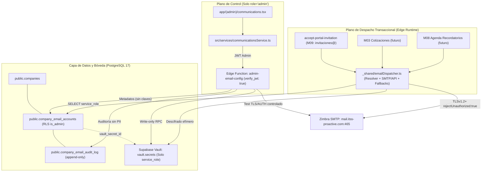
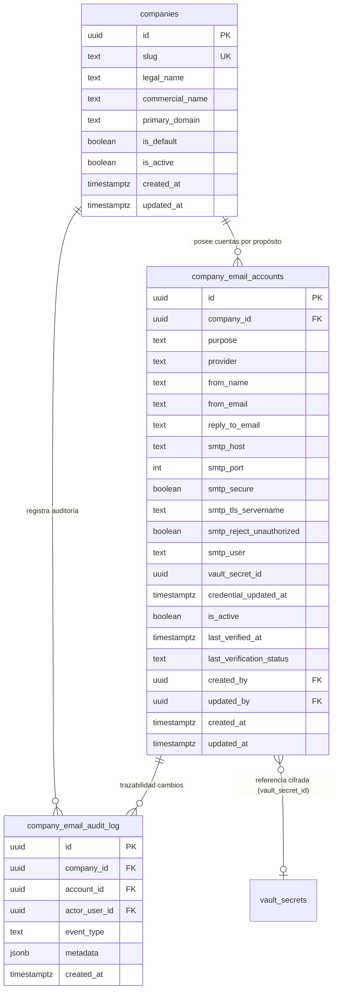
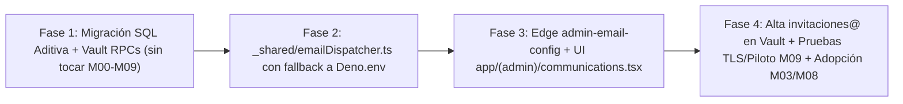

# ARQUITECTURA FUNCIONAL Y TÉCNICA — MÓDULO CENTRALIZADO DE COMUNICACIONES (MULTIEMPRESA Y MULTIPROPÓSITO)

**Proyecto:** Atelier Digital App (`AtelierDigitalApp`)  
**Fecha:** 23 de noviembre de 2026  
**Estado:** **DISEÑO Y ANÁLISIS APROBABLE** *(sin implementación ejecutada; cero cambios en BD, secretos, DNS, Auth SMTP ni Edge Functions; flags M09 intactos en `false`)*  
**Caso de Referencia Inicial:** Empresa `By Katherine Carroll` · M09 Invitaciones del Portal con remitente dedicado **`invitaciones@bykatherinecarroll.com`** (`mail.itss-proactive.com:465`, SSL/TLS implícito).

---

## 1. Propuesta de Arquitectura Integral

La arquitectura separa estrictamente dos planos para impedir que el frontend toque credenciales SMTP/API o sockets de red:

1. **Plano de Control (Administración):** Pantalla administrativa en `app/(admin)/` protegida por rol `admin` → Edge Function `admin-email-config` (`verify_jwt: true` + `public.is_admin()`) → metadatos en PostgreSQL + secretos **write-only** en **Supabase Vault**.
2. **Plano de Despacho (Ejecución Transaccional):** Biblioteca compartida server-side `supabase/functions/_shared/emailDispatcher.ts` consumida por las Edge Functions de negocio (`accept-portal-invitation` M09, y futuras M03/M08/`/contacto`). Resuelve la cuenta activa por `(company_id, purpose)` usando `service_role`, descifra el secreto exclusivamente en memoria del aislado Deno y despacha con TLS estricto.

---

## 2. Modelo de Datos y Relaciones

### Restricciones e Invariantes de Integridad (DDL Conceptual)

1. **`public.companies`:**
   - Semilla inicial idempotente: `slug = 'by-katherine-carroll'`, `commercial_name = 'Atelier de Autor · By Katherine Carroll'`, `primary_domain = 'bykatherinecarroll.com'`, `is_default = true`, `is_active = true`.
   - Índice único parcial `CREATE UNIQUE INDEX uq_companies_single_default ON public.companies (is_default) WHERE is_default = true;` para garantizar una empresa predeterminada durante la transición de módulos mono-empresa actuales (M00–M09).
2. **`public.company_email_accounts`:**
   - **Propósitos canónicos (`CHECK`):** `'portal_invitations'`, `'commercial_quotes'`, `'agenda_reminders'`, `'contact_support'`, `'billing_notifications'`, `'default_fallback'`.
   - **Proveedores (`CHECK`):** `'smtp'` (Zimbra/corporativo), `'resend'`, `'ses'`.
   - **Blindaje TLS en esquema:** `smtp_reject_unauthorized BOOLEAN NOT NULL DEFAULT true CHECK (smtp_reject_unauthorized = true)` — impide desactivar validación de certificados incluso desde SQL administrativo accidental.
   - **Coherencia SMTP (`CHECK`):** si `provider = 'smtp'`, exige `smtp_host`, `smtp_port IN (465, 587)`, `smtp_user`, `smtp_tls_servername` no nulos, y si `smtp_port = 465` exige `smtp_secure = true`.
   - **Formato de correos (`CHECK`):** validación estricta de `from_email` y `reply_to_email` (sin CRLF ni caracteres de control).
   - **Unicidad operativa:** `CREATE UNIQUE INDEX uq_cea_active_company_purpose ON public.company_email_accounts (company_id, purpose) WHERE is_active = true;` — permite múltiples cuentas inactivas o en rotación por empresa y propósito, pero **como máximo una activa** para evitar ambigüedad en tiempo de envío.
   - **Activación condicionada:** `CHECK (NOT is_active OR vault_secret_id IS NOT NULL)` — prohíbe activar una cuenta sin credencial cargada en Vault.
3. **`public.company_email_audit_log`:**
   - Append-only con trigger `BEFORE UPDATE OR DELETE` (reutilizando el patrón `prevent_activity_log_tampering` de M09).
   - `event_type IN ('company_created', 'account_created', 'account_updated', 'credential_rotated', 'account_activated', 'account_deactivated', 'connectivity_tested', 'test_email_sent')`.
   - `metadata JSONB` sanitizado (sin contraseñas, sin tokens, sin correos de clientas).
4. **Preservación de `public.atelier_settings`:** No se elimina ni rompe. Sigue gobernando preferencias regionales globales (`language`, `currency`, `date_format`); `contact_email` queda como parámetro institucional general hasta que una fase posterior decida enlazarlo.

---

## 3. Políticas RLS y Privilegios Mínimos

Reutilizando la función existente `public.is_admin()` definida en `supabase/migrations/20261013093000_admin_role_and_security.sql`:

| Tabla / Objeto | `PUBLIC` / `anon` | `authenticated` (`client` / `designer`) | `authenticated` (`is_admin()`) | `service_role` |
| :--- | :---: | :---: | :---: | :---: |
| `public.companies` | `REVOKE ALL` | Sin acceso | `SELECT` (escritura vía Edge o RLS `is_admin()`) | `ALL` |
| `public.company_email_accounts` | `REVOKE ALL` | Sin acceso | `SELECT` exclusivamente mediante RLS `is_admin()` *(sin columna secreta porque no existe en esta tabla)* | `ALL` |
| `public.company_email_audit_log` | `REVOKE ALL` | Sin acceso | `SELECT` solo `is_admin()`; **0 `INSERT/UPDATE/DELETE` directos** | `SELECT, INSERT` |
| RPCs internos `_comm_*` (Vault) | `REVOKE ALL` | `REVOKE ALL` | `REVOKE ALL` | `EXECUTE` exclusivo |

> **Defensa en profundidad:** Aunque `company_email_accounts` solo contiene metadatos (y `vault_secret_id` es un UUID opaco), toda escritura administrativa de cuentas y rotación de credenciales se canaliza por la Edge Function `admin-email-config` para garantizar validación de host/remitente, escritura atómica en Vault y auditoría obligatoria.

---

## 4. Gestión Write-Only de Credenciales e Integración con Supabase Vault

### A. Patrón de Bóveda Cifrada (Cero Texto Plano)
* **Extensión requerida:** `supabase_vault` (preinstalada en Supabase PostgreSQL 17; se valida con preflight `SELECT 1 FROM pg_extension WHERE extname = 'supabase_vault'`).
* **3 RPCs privados `SECURITY DEFINER` (`SET search_path = ''`, `EXECUTE` revocado a `PUBLIC`/`anon`/`authenticated`, concedido SOLO a `service_role`):**
  1. `public._comm_upsert_account_secret(p_account_id UUID, p_secret_name TEXT, p_secret_value TEXT)`:
     - Si la cuenta no tiene `vault_secret_id`, invoca `vault.create_secret(p_secret_value, p_secret_name, ...)` y persiste el UUID retornado + `credential_updated_at = now()`.
     - Si ya tiene `vault_secret_id`, invoca `vault.update_secret(v_secret_id, p_secret_value, ...)` y actualiza `credential_updated_at = now()`.
  2. `public._comm_resolve_account_for_dispatch(p_company_slug TEXT, p_purpose TEXT)`:
     - Busca la cuenta activa `(company, purpose)` o fallback `(company, 'default_fallback')`.
     - Lee `decrypted_secret` desde `vault.decrypted_secrets` **únicamente dentro de la llamada `service_role` del Edge Runtime** y nunca persiste ni imprime el valor.
  3. `public._comm_delete_account_secret(p_vault_secret_id UUID)`: limpieza controlada al revocar/eliminar una cuenta inactiva.

### B. Contrato Write-Only hacia el Frontend
* **Lectura (`list`):** Jamás retorna la contraseña ni la API key. Retorna únicamente metadatos + campos derivados:
  - `has_credential: boolean` (`vault_secret_id IS NOT NULL`)
  - `credential_updated_at: string | null`
* **Edición (`update`):** Si el administrador edita `from_name` o `reply_to_email` y deja el campo de contraseña vacío, **conserva intacto el secreto actual en Vault**. Solo rota el secreto si el administrador ingresa un nuevo valor explícitamente.
* **Contingencia si Vault no estuviera habilitado en un entorno:** Fallback de diseño mediante columna alternativa `env_secret_ref TEXT` apuntando a un nombre de secreto en Supabase Edge Secrets (ej. `SMTP_PASS_BKC_INVITACIONES`), sin jamás guardar contraseñas en tablas SQL.

---

## 5. Interfaz Administrativa Propuesta

* **Ubicación:** Nueva ruta dedicada `app/(admin)/communications.tsx` dentro del stack existente `app/(admin)/_layout.tsx`, con acceso directo desde:
  - `app/(admin)/index.tsx` (botón/tarjeta *"Comunicaciones y Correos"*).
  - `app/(admin)/settings.tsx` (enlace contextual junto a la Sección A *"Datos del Atelier"*).
* **Estructura funcional de la pantalla:**
  1. **Selector de Empresa** (`By Katherine Carroll`, extensible a futuras marcas/empresas) + acción *"Nueva Empresa"*.
  2. **Matriz de Cuentas por Propósito:** tarjetas por propósito (`Invitaciones Portal M09`, `Cotizaciones Comerciales M03`, `Recordatorios Agenda M08`, `Contacto y Habeas Data`, `Respaldo General`) mostrando remitente (`from_email`), servidor/proveedor, badge de estado (`ACTIVA` / `INACTIVA`), estado de credencial (`Configurada · rotada el ...` / `Sin credencial`) y resultado de última verificación.
  3. **Modal/Formulario de Edición Segura:**
     - Campos de metadatos: propósito, proveedor (`SMTP` / `Resend`), `from_name`, `from_email`, `reply_to_email`, `smtp_host`, `smtp_port` (`465` SSL implícito / `587` STARTTLS), `smtp_tls_servername`, `smtp_user`.
     - Campo de contraseña/API key estrictamente **write-only** (`secureTextEntry`, placeholder *"•••••••• (dejar vacío para conservar la clave actual)"*).
     - Indicador no editable: *"Validación de certificado TLS estricta: ACTIVA (obligatoria)"*.
     - Switch `is_active` deshabilitado mientras `!has_credential`.
  4. **Herramientas de Verificación (vía Edge `admin-email-config`):**
     - **Probar Conexión (Sin Enviar Correo):** ejecuta `transporter.verify()` (handshake TLS + `EHLO` + `AUTH`), registra resultado en `last_verified_at` / `company_email_audit_log` y no envía ningún mensaje.
     - **Enviar Correo de Prueba:** restringido explícitamente al correo del administrador autenticado (`actor.email`) con confirmación previa.
  5. **Sección Informativa Independiente — Correo de Autenticación (Supabase Auth / GoTrue):**
     - Aclara que los correos de registro (`signUp`) y recuperación de contraseña (`resetPasswordForEmail`) dependen del SMTP global del proyecto en Supabase Dashboard (cuenta única de plataforma) y no se sobrescriben desde esta matriz multiempresa.

---

## 6. Servicios Compartidos Propuestos

### A. Frontend (`src/`)
* **`src/types/communications.ts`:** Contratos `Company`, `EmailPurpose`, `EmailProvider`, `CompanyEmailAccountSummary` (sin secreto), `UpsertCompanyEmailAccountDTO` (con `credential?: string` opcional write-only), `EmailAccountTestResult`, `CompanyEmailAuditItem`.
* **`src/services/communicationsService.ts`:** Invoca exclusivamente la Edge Function `admin-email-config` con JWT del administrador (`list_companies`, `upsert_company`, `list_accounts`, `upsert_account`, `toggle_account`, `test_connection`, `send_test_email`, `list_audit_log`). Cero acceso directo a secretos y cero logging de `credential`.

### B. Backend Edge Compartido (`supabase/functions/`)
* **`supabase/functions/_shared/emailDispatcher.ts`:**
  - `resolveEmailChannel({ supabaseAdmin, companySlug, purpose, envFallback })`:
    1. Consulta `_comm_resolve_account_for_dispatch(companySlug, purpose)` (prioriza cuenta activa específica del propósito; si no existe, busca `default_fallback` activa de la misma empresa).
    2. Si no existe configuración activa en BD (durante migración progresiva), aplica fallback opcional controlado a variables de entorno (`SMTP_*`) manteniendo el candado `PORTAL_EMAIL_DISPATCH_ENABLED`.
  - `dispatchTransactionalEmail(channel, message)`: encapsula transporte `npm:nodemailer@10.6.1` (para `provider === 'smtp'`, manteniendo `rejectUnauthorized: true`, `minVersion: 'TLSv1.2'`, timeout `15_000 ms`, `transporter.close()` en `finally`, anti-CRLF, sanitización de logs sin PII/claves) y adaptador opcional HTTP `fetch` (para `provider === 'resend'`).
* **`supabase/functions/admin-email-config/index.ts`:** Edge Function con `verify_jwt: true` + verificación de `profiles.role === 'admin'`, validación de entradas, llamadas a Vault y `transporter.verify()`.

---

## 7. Integración Futura de M09 con `invitaciones@bykatherinecarroll.com`

### Diagnóstico de Adaptación Requerida en M09
Actualmente `supabase/functions/accept-portal-invitation/emailService.ts` fija en constantes:
* `CANONICAL_SMTP_HOST = 'mail.itss-proactive.com'`
* `CANONICAL_SMTP_PORT = 465`
* `AUTHORIZED_SMTP_SENDER = 'info@bykatherinecarroll.com'`

### Configuración Objetivo de M09 en el Nuevo Módulo
| Parámetro | Valor Objetivo para M09 |
| :--- | :--- |
| **Empresa (`companies.slug`)** | `by-katherine-carroll` |
| **Propósito (`purpose`)** | `portal_invitations` |
| **Proveedor (`provider`)** | `smtp` |
| **Remitente (`from_name` / `from_email`)** | `Atelier Katherine Carroll` / **`invitaciones@bykatherinecarroll.com`** |
| **Respuesta (`reply_to_email`)** | `info@bykatherinecarroll.com` *(las respuestas de clientas llegan al buzón atendido del atelier)* |
| **Host y TLS SNI (`smtp_host` / `smtp_tls_servername`)** | `mail.itss-proactive.com` (certificado Let's Encrypt válido con `rejectUnauthorized: true`, `TLSv1.2+`) |
| **Puerto / Seguro** | `465` / `smtp_secure = true` (SSL/TLS implícito) |
| **Usuario SMTP (`smtp_user`)** | `invitaciones@bykatherinecarroll.com` *(buzón dedicado en Zimbra para aislar la contraseña de `info@bykatherinecarroll.com`)* |
| **Credencial** | Almacenada cifrada en Supabase Vault (`vault_secret_id`) |
| **Doble Candado Fail-Closed** | Requiere `PORTAL_EMAIL_DISPATCH_ENABLED = 'true'` **Y** `company_email_accounts.is_active = true` |

* **Prerrequisitos externos (Zimbra / DNS) antes de activar `invitaciones@bykatherinecarroll.com`:**
  1. Crear el buzón dedicado `invitaciones@bykatherinecarroll.com` en el servidor Zimbra (`mail.itss-proactive.com`) con contraseña exclusiva, o bien autorizar el alias en `smtpd_sender_login_maps` (recomendado buzón dedicado por principio de mínimo privilegio).
  2. Publicar registro DNS `_dmarc.bykatherinecarroll.com` (`v=DMARC1; p=none; rua=mailto:info@bykatherinecarroll.com`) y validar firma DKIM de Zimbra para proteger entregabilidad en Gmail/iCloud/Outlook.
* **Preservación total de M09:** Las plantillas editoriales HTML/texto plano (`buildInvitationHtmlTemplate`, `buildInvitationTextTemplate`), `action === 'verify'`, `action === 'accept'`, `action === 'dispatch_email'`, validación `token_hash`, deduplicación en 3 capas y no invalidación ante fallo SMTP permanecen **100% intactos**. Solo cambia el origen de la configuración de transporte dentro de `emailService.ts`, que pasará a delegar la resolución a `_shared/emailDispatcher.ts`.

---

## 8. Compatibilidad con M03, M08, M09 y Módulos Transversales

| Módulo | Propósito (`purpose`) | Remitente Sugerido | Integración Futura (Sin Romper lo Existente) |
| :--- | :--- | :--- | :--- |
| **M09 — Portal de Clientas** | `portal_invitations` | `invitaciones@bykatherinecarroll.com` | `accept-portal-invitation` (`dispatch_email`) resuelve cuenta desde `_shared/emailDispatcher.ts` usando `company_slug = 'by-katherine-carroll'` (o `client.company_id` cuando exista multiempresa en clientes). |
| **M03 — Comercial / Cotizaciones** | `commercial_quotes` | `comercial@bykatherinecarroll.com` o `info@bykatherinecarroll.com` | Futura acción Edge para enviar cotizaciones A4 (`PrintableQuoteModal`) por correo con registro en bitácora comercial, sin tocar tablas ni cálculos actuales de M03. |
| **M08 — Agenda y Fittings** | `agenda_reminders` | `citas@bykatherinecarroll.com` o `info@bykatherinecarroll.com` | Futura Edge Function/cron para recordatorios de citas y envío de `.ics` respetando el enmascaramiento de privacidad `creationDisplay` ya certificado en M08. |
| **Contacto Público / Ley 1581** | `contact_support` | `info@bykatherinecarroll.com` | Conectar el formulario `app/contacto.tsx` a una Edge Function con rate-limit que despache consultas a la cuenta `contact_support`. |
| **Supabase Auth (M00)** | Global Plataforma | `info@bykatherinecarroll.com` | Independiente en Supabase Auth SMTP (GoTrue); documentado en modo solo lectura en la UI admin. |

---

## 9. Estrategia de Migración Progresiva (Cero Downtime)

1. **Fase 1 (Infraestructura BD aditiva):** Crear `companies`, `company_email_accounts`, `company_email_audit_log`, RLS `is_admin()`, triggers de inmutabilidad y RPCs privados de Vault. Sembrar `by-katherine-carroll`. **0 impacto en M00–M09 ni C15.**
2. **Fase 2 (Despachador compartido con retrocompatibilidad):** Crear `_shared/emailDispatcher.ts` y adaptar `accept-portal-invitation/emailService.ts` para resolver desde BD primero y conservar fallback a `Deno.env` si no hay cuenta activa en BD. **0 ruptura si aún no se carga la cuenta en UI.**
3. **Fase 3 (Plano de control administrativo):** Implementar `admin-email-config`, `communicationsService.ts` y `app/(admin)/communications.tsx`. Probar en local con mocks (0 envíos reales).
4. **Fase 4 (Transición controlada de M09 a `invitaciones@bykatherinecarroll.com`):** Aprovisionar buzón en Zimbra, cargar cuenta desde UI admin (write-only a Vault), ejecutar `test_connection` (sin envío), certificar envío piloto con `PORTAL_EMAIL_DISPATCH_ENABLED=true`, y posteriormente habilitar propósitos de M03 y M08 de forma independiente.

---

## 10. Inventario de Archivos Nuevos y Existentes (Plan Futuro)

### Archivos Nuevos (A Crear en Fase de Implementación)
1. `supabase/migrations/<timestamp>_communications_email_accounts.sql` — DDL de 3 tablas, semilla `by-katherine-carroll`, RLS `is_admin()`, triggers y RPCs privados de Vault.
2. `supabase/functions/_shared/emailDispatcher.ts` — Resolvedor `(company, purpose)`, transporte SMTP/API compartido, TLS estricto y sanitización de logs.
3. `supabase/functions/admin-email-config/index.ts` y `deno.json` — Edge Function administrativa (`verify_jwt: true`, CRUD, rotación Vault write-only, `test_connection`).
4. `src/types/communications.ts` — Contratos TypeScript de empresas, propósitos, cuentas y auditoría.
5. `src/services/communicationsService.ts` — Cliente frontend hacia `admin-email-config`.
6. `app/(admin)/communications.tsx` — Pantalla administrativa centralizada de comunicaciones.
7. `scratch/verify_communications_module.cjs` — Batería automatizada con mocks (Vault, TLS, write-only, multiempresa, fallback y cero fugas en logs).

### Archivos Existentes que Requerirían Cambios Acotados
1. `supabase/functions/accept-portal-invitation/emailService.ts` — Delegar resolución de cuenta `(by-katherine-carroll, portal_invitations)` a `_shared/emailDispatcher.ts` (habilitando `invitaciones@bykatherinecarroll.com` sin hardcodear remitente único), preservando plantillas y candado `PORTAL_EMAIL_DISPATCH_ENABLED`.
2. `supabase/functions/accept-portal-invitation/index.ts` — Pasar `supabaseAdmin` y `companySlug` al invocador de `dispatchPortalInvitationEmail()` dentro de `handleDispatchEmailAction` (cambio mínimo de ~5 líneas; `verify` y `accept` intactos).
3. `app/(admin)/index.tsx` y `app/(admin)/settings.tsx` — Añadir acceso de navegación hacia `/(admin)/communications`.
4. `app/_layout.tsx` — Verificar/registrar que la ruta `/(admin)/communications` herede la compuerta exclusiva `role === 'admin'`.
5. `scratch/verify_m09_e2_edge_function.cjs` — Añadir casos de resolución dinámica `invitaciones@bykatherinecarroll.com` y fallback.
6. `PROJECT_INDEX.md` y `ANTIGRAVITY_CONTINUITY.md` — Actualización documental al implementar.

*(Sin cambios en `src/services/settingsService.ts`, `src/types/settings.ts`, `app/(admin)/_layout.tsx`, ni en tablas M00–M09 existentes).*

---

## 11. Separación Estricta de Etapas y Compuertas de Autorización

| Etapa | Alcance | Estado Actual | Autorización Requerida |
| :--- | :--- | :---: | :--- |
| **Etapa 1 — Diseño y Arquitectura** | Definición funcional, ERD, RLS, Vault write-only, UI admin, estrategia M09 (`invitaciones@`) y mapa de archivos. | **COMPLETADA** | Aprobación del diseño por el usuario. |
| **Etapa 2 — Implementación Local** | Creación de migración SQL local, `_shared/emailDispatcher.ts`, `admin-email-config`, adaptación de `emailService.ts`, UI `app/(admin)/communications.tsx`, `tsc`/`eslint` y suites mockeadas en local. | **NO INICIADA** | Autorización explícita para codificar en repositorio local (cero cambios remotos). |
| **Etapa 3 — Despliegue y Certificación Remota** | 3A) Preflight `supabase_vault` + aplicar migración SQL; 3B) Desplegar `admin-email-config` y `accept-portal-invitation` v3 con flags en `false`; 3C) Crear buzón `invitaciones@bykatherinecarroll.com` en Zimbra + cargar credencial write-only en Vault + `test_connection` sin envío; 3D) Prueba piloto controlada con `PORTAL_EMAIL_DISPATCH_ENABLED=true`. | **NO INICIADA** | Autorización independiente por cada sub-compuerta (3A, 3B, 3C y 3D). |
