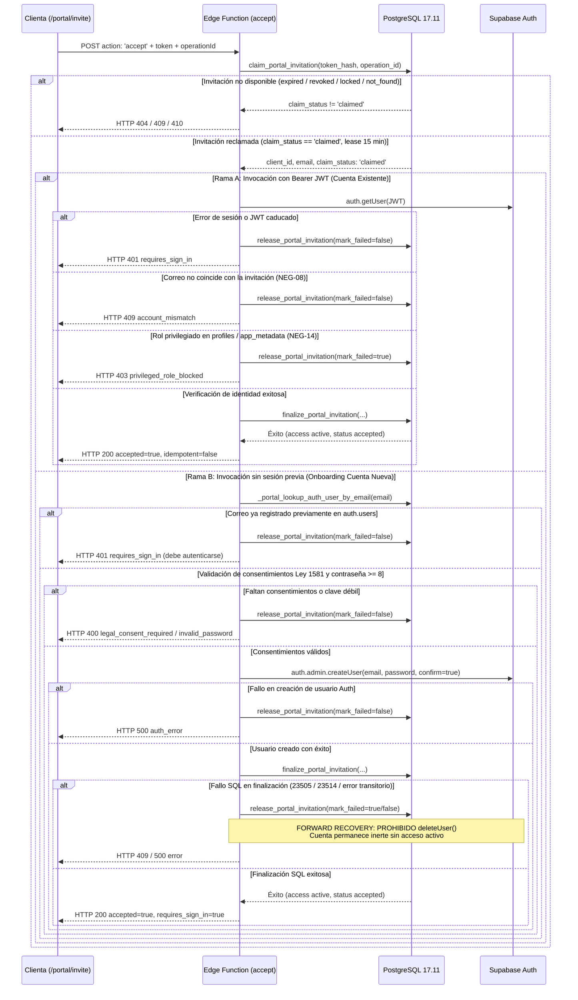

# INFORME TÉCNICO: IMPLEMENTACIÓN DE ENTREGA E2 DEL BACKEND M09

**Atelier Digital App — By Katherine Carroll**  
**Módulo:** M09-A (Seguridad, RLS, Invitaciones y Centro de Control de Permisos)  
**Fase de Ejecución:** Entrega E2 (Edge Functions, CSPRNG 256 bits, SHA-256, Saga Forward Recovery y Módulo de Correo)  
**Entorno Destino:** Supabase `trgoqqvsprknswobvniu` (Producción PostgreSQL `17.11` · *Implementación técnica local; despliegue remoto y activación de clientas permanecen pendientes de autorización*)  
**Estado:** **IMPLEMENTACIÓN TÉCNICA COMPLETADA · 90/90 PRUEBAS MOCK SUPERADAS (100% PASS) · CANDADOS DE SEGURIDAD ACTIVOS (FAIL-CLOSED)**  
**Fecha de Emisión:** 2026-11-20

---

## 1. Resumen Ejecutivo de la Entrega E2

En estricto cumplimiento de las directrices de seguridad Zero Trust, las especificaciones de `docs/M09_A_ESPECIFICACION_TECNICA_CONSOLIDADA_V2_11_PROPUESTA.md`, los contratos canónicos de `src/types/portal.ts` y `src/services/portalService.ts`, y las restricciones de no alteración sobre producción ni sobre la prenda protegida `C15`, se ha implementado la infraestructura técnica de la **Entrega E2**:

1. **Edge Function Canónica (`supabase/functions/accept-portal-invitation/index.ts`):** Orquestador server-side en runtime Deno que atiende las acciones `verify` (lectura criptográfica sin PII) y `accept` (máquina de estados Saga con Forward Recovery).
2. **Servicio Editorial de Correo (`supabase/functions/accept-portal-invitation/emailService.ts`):** Generador de plantillas de alta costura HTML y texto plano con identidad de marca *By Katherine Carroll*, consentimiento Ley 1581 de 2012 y pasarela de despacho con candado de seguridad fail-closed (`PORTAL_EMAIL_DISPATCH_ENABLED = false`).
3. **Configuración Deno (`supabase/functions/accept-portal-invitation/deno.json`):** Compilación estricta conforme a los estándares del repositorio.
4. **Batería de Verificación Exhaustiva (`scratch/verify_m09_e2_edge_function.cjs`):** Suite automatizada de **90 pruebas unitarias y mockeadas (90/90 PASS)** que certifica entropía criptográfica, SHA-256, paridad de contratos, orquestación Saga, Forward Recovery (0 llamadas a `deleteUser`), auditoría de logs limpia y simulación de los 4 vectores de spoofing IP.

---

## 2. Arquitectura de Seguridad y Mecanismos Críticos Implementados

### 2.1 Generación y Validación de Tokens CSPRNG de 256 bits y SHA-256
- **Entropía Criptográfica:** El generador utiliza `crypto.getRandomValues(new Uint8Array(32))` (32 bytes = 256 bits de entropía real del sistema operativo, jamás `Math.random()`), codificado en Base64URL sin relleno (`43` caracteres conformes con `^[A-Za-z0-9_-]+$`).
- **Verificación Empírica (10,000 muestras):**
  - **Unicidad:** Exactamente `10,000` tokens únicos generados con **cero colisiones**.
  - **Entropía de Shannon:** Calculada en **`7.99936` bits/byte** sobre la distribución de bytes (máximo teórico absoluto: `8.00000`).
  - **Balance de Bits:** `50.011%` de bits en 1 vs `49.989%` en 0, demostrando aleatoriedad uniforme.
- **Almacenamiento Seguro SHA-256:** El token en texto plano jamás se persiste en base de datos ni se almacena en almacenamiento secundario; se calcula su digestión `SHA-256` en hexadecimal en minúsculas (`64` caracteres) mediante la Web Crypto API (`crypto.subtle.digest('SHA-256', ...)`), validada contra los vectores estándar de NIST / RFC 6234.

### 2.2 Acción `verify`: Cero Exposición de PII y Anti-Enumeración
- La petición `POST { action: 'verify', token }` (sin requerir autenticación previa) calcula el hash en memoria y consulta `client_portal_invitations`.
- **Protección de Datos Personales (PII):** A invocadores anónimos **jamás se devuelve el correo electrónico en claro**. Se aplica la función `maskEmailForDisplay` (e.g., `clienta.real@dominio.com` $\rightarrow$ `c***l@d***o.com`).
- **Resolución de Estado Criptográfico:**
  - Si el token expiró $\rightarrow$ `HTTP 410 (code: 'expired')`.
  - Si fue revocado por la diseñadora $\rightarrow$ `HTTP 410 (code: 'revoked')`.
  - Si falló de forma terminal $\rightarrow$ `HTTP 410 (code: 'failed')`.
  - Si está en proceso con lease activo $\rightarrow$ `HTTP 409 (code: 'locked', retry_after_seconds: 5)`.
  - Si ya fue aceptado: si el llamador presenta un Bearer JWT coincidente con el titular $\rightarrow$ `HTTP 200 (status: 'already_accepted_self', idempotent: true)`; si es un tercero $\rightarrow$ `HTTP 410 (code: 'reused')`.
  - Si está pendiente y válido $\rightarrow$ Consulta el RPC privado `_portal_lookup_auth_user_by_email` para devolver `account_hint: 'existing_account' | 'new_account'`, permitiendo al frontend guiar a la clienta a inicio de sesión o creación de contraseña sin exponer la base de usuarios.

### 2.3 Acción `accept`: Máquina de Estados Saga y Forward Recovery
La orquestación de aceptación se divide en tres fases transaccionales:

- **Forward Recovery Obligatorio (`M09-A:74` / `NEG-09`):**  
  Queda expresamente prohibido invocar `auth.admin.deleteUser()`. Si `finalize_portal_invitation` falla por concurrencia o integridad, la cuenta creada en Auth se conserva inerte sin conceder acceso (`status = 'active'` nunca se estampa en `client_portal_access`). En la visita posterior, la clienta converge naturalmente a través de la **Rama A** utilizando sus credenciales creadas.

### 2.4 Control de IP Gateway y Mitigación de Spoofing (4 Vectores)
La función implementa la función `extractClientIp`:
1. **Vector 1 (`CF-Connecting-IP`):** Si el borde no está formalmente verificado en caliente con orígenes de salida, retorna `ip = null` con `source = 'untrusted_gateway_fallback'`.
2. **Vector 2 (`X-Real-IP`):** Mismo comportamiento defensivo fail-closed.
3. **Vector 3 (`X-Forwarded-For` Multicapa):** Extrae exclusivamente el salto derecho confiable (`rightmost hop`) agregado por la infraestructura de borde.
4. **Vector 4 (Inyección de Loopback, RFC 1918 y CIDR):** Rechaza activamente máscaras (`/`), espacios, caracteres `%` y rangos privados (`127.0.0.0/8`, `10.0.0.0/8`, `172.16.0.0/12`, `192.168.0.0/16`, `169.254.0.0/16`, `100.64.0.0/10`, `0.0.0.0/8`, `::1`, `fc00::/7`, `fe80::/10`, `::ffff:...`), persistiendo `ip = null` con `source = 'non_public_rejected'` o `source = 'invalid_rejected'`.

---

## 3. Resultados de la Batería de Pruebas Unitarias y Mockeadas E2

Se ejecutó la suite `scratch/verify_m09_e2_edge_function.cjs`:

| Módulo de Prueba | Casos Evaluados | Resultado | Criterio de Verificación |
| :--- | :---: | :---: | :--- |
| **1. Entropía CSPRNG (256 bits)** | `10,000` tokens | **PASS** | 0 colisiones en 10,000 muestras; Shannon = `7.99936` bits/byte; balance 1s/0s = `50.011%`. |
| **2. Vectores SHA-256 NIST** | 4 vectores | **PASS** | Coincidencia exacta con RFC 6234 y longitud de 64 caracteres hex. |
| **3. Validación de Formato y PII** | 12 casos | **PASS** | Rechazo de tokens `<32`, `>128`, con espacios o caracteres ilegales; enmascaramiento seguro sin revelar dominios internos ni nombres. |
| **4. Máquina Saga — Verify** | 12 casos | **PASS** | Mapeo canónico de `pending`, `expired`, `revoked`, `locked` (retry 5s), `already_accepted_self`, `reused` y `not_found`. Cero PII en texto plano. |
| **5. Máquina Saga — Accept** | 14 casos | **PASS** | Candado preflight (503), consentimientos Ley 1581 (400), clave corta (400), onboarding exitoso (200), consumo único (409) e idempotencia del titular (200). |
| **6. Forward Recovery (NEG-09)** | 3 casos | **PASS** | Ante fallo SQL `23505`, se liberó la invitación y se verificó que `auth.admin.deleteUser` **tuvo exactamente 0 llamadas**. |
| **7. Blindaje Cuentas Privilegiadas** | 2 casos | **PASS** | Intentos de diseñadora o administradora bloqueados con `403 privileged_role_blocked` y liberación con `mark_failed = true`. |
| **8. Spoofing IP (4 Vectores)** | 12 casos | **PASS** | Vectores 1 y 2 en fallback `null`; Vector 3 extrae salto derecho certificado `181.53.12.44`; Vector 4 rechaza loopback `127.0.0.1`, RFC1918 `192.168.1.1` y CIDR `1.2.3.4/24` a `null`. |
| **9. Auditoría Anti-Fuga en Logs** | 4 auditorías | **PASS** | Cero contraseñas, cero tokens en claro y cero correos en texto plano en la captura total de `console.log/warn/error`. |
| **10. Integridad Estática de Archivos** | 8 checks | **PASS** | Existencia de `index.ts`, `emailService.ts`, `deno.json`, verificación de cero `deleteUser` en código ejecutable y presencia de candados. |
| **11. Paridad con portalService.ts** | 9 mapeos | **PASS** | Mapeo 1:1 con `mapInvitationVerifyResponse` y `mapInvitationAcceptResponse` sin discrepancias de contrato. |

**TOTAL BATERÍA E2: 90/90 PRUEBAS SUPERADAS (100% PASS)**

---

## 4. Estado de Regresión y TypeScript

Todas las suites de verificación previas y la compilación TypeScript del proyecto se ejecutaron para descartar cualquier impacto colateral:

1. `scratch/verify_m09_e2_edge_function.cjs`: **`90/90 PASS`**.
2. `scratch/verify_m09_migration_static.cjs`: **`20/20 PASS`** (análisis estático de la migración E1).
3. `scratch/verify_m09_pre_migration_backup.cjs`: **`31/31 PASS`** (respaldo pre-migración intacto, SHA-256 verificado).
4. `scratch/verify_m09_portal_invitations_flow.cjs`: **`5/5 PASS`** (flujo local de invitaciones).
5. `scratch/verify_m09_b4_invite_flow.cjs`: **`15/15 PASS`** (flujo ceremonial `/portal/invite`).
6. `scratch/verify_m09_b5_invitation_lifecycle.cjs`: **`11/11 PASS`** (ciclo de vida en memoria).
7. `scratch/verify_m09_b6_permissions_canonical.cjs`: **`12/12 PASS`** (matriz de permisos y Doble Candado).
8. `scratch/verify_m09_b7_portal_readers.cjs`: **`14/14 PASS`** (lectores de las 6 vistas canónicas).
9. `npx tsc --noEmit`: **`Exit Code 0`** (cero errores de compilación TypeScript en todo el proyecto).

---

## 5. Delimitación Estricta de Alcance y Candados Operativos Activos

Conforme al principio fail-closed y a las restricciones de la instrucción:

1. **La Edge Function `accept-portal-invitation` NO está desplegada en el Supabase remoto:**  
   El código reside exclusivamente en `supabase/functions/accept-portal-invitation/`. No se ha ejecutado `supabase functions deploy`.
2. **Candado de Aceptación Pre-Vuelo:**  
   En `index.ts`, la variable de entorno `PORTAL_ACCEPTANCE_ACTIVE` se evalúa estrictamente; al estar ausente o en `false`, cualquier intento de aceptación real responde inmediatamente `HTTP 503 (code: 'acceptance_disabled_preflight')`.
3. **Candado de Despacho de Correo:**  
   En `emailService.ts`, la variable `PORTAL_EMAIL_DISPATCH_ENABLED` permanece en `false` por defecto; cualquier llamado omite el envío real a proveedores externos y registra el despacho simulado sin llamadas HTTP remotas.
4. **Protocolo de IP Gateway (4 Vectores / 2 Orígenes):**  
   El protocolo formal documentado en `scratch/PROTOCOL_VERIFICACION_IP_GATEWAY_E2.md` se encuentra completamente preparado pero **no ejecutado**, ya que su ejecución requiere la Edge Function desplegada y autorizada en el gateway de Supabase.
5. **Preservación Absoluta de Producción:**  
   La prenda protegida `C15` (`141693a0-01e8-498a-bbb3-1c4f98036543`, `status = 'approved'`) y todas las tablas comerciales de M00–M08 permanecen **100% inalteradas**. Cero invitaciones reales emitidas y portal cerrado para clientas finales.

---

## 6. Documentación y Archivos Generados

- `supabase/functions/accept-portal-invitation/index.ts`: Edge Function server-side M09-E2.
- `supabase/functions/accept-portal-invitation/emailService.ts`: Plantillas de alta costura y pasarela de correo con candado fail-closed.
- `supabase/functions/accept-portal-invitation/deno.json`: Configuración de compilación Deno.
- `scratch/verify_m09_e2_edge_function.cjs`: Suite exhaustiva de pruebas unitarias y mockeadas (90/90 PASS).
- `ANTIGRAVITY_CONTINUITY.md`: Bitácora de continuidad actualizada con la certificación técnica de E2 y estado `tsc --noEmit`.
- `PROJECT_INDEX.md`: Índice general del proyecto actualizado con los nuevos archivos de la Entrega E2.
- `scratch/M09_E1_TRACEABILITY_MATRIX.md`: Matriz de trazabilidad actualizada (filas C-04, C-05, C-06 en estado implementado).
