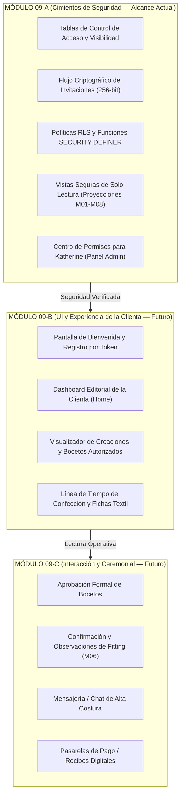
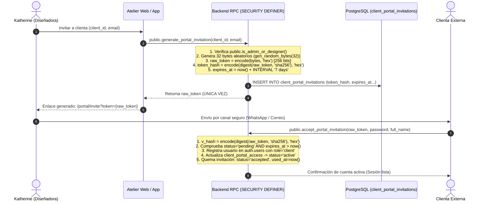
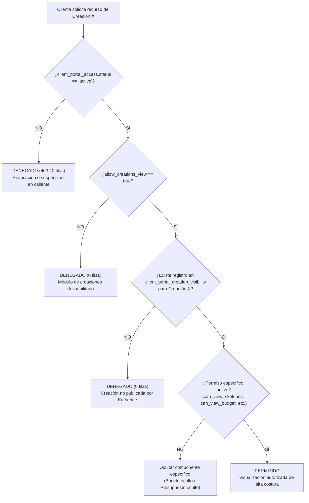

# ATELIER DIGITAL — BY KATHERINE CARROLL
## ESPECIFICACIÓN TÉCNICA CANÓNICA Y CONSOLIDADA
### MÓDULO 09-A: SEGURIDAD NUCLEAR, RLS, INVITACIONES CRIPTOGRÁFICAS Y PERMISOS DEL PORTAL DE CLIENTES

**Versión:** 2.0 — Consolidada y Auditada contra Esquemas Reales  
**Fecha de Emisión:** 17 de Noviembre de 2026  
**Estado:** Documento Oficial de Especificación (Pendiente de Aprobación para Implementación)  
**Autor:** Antigravity AI Architecture Team  
**Módulo Destino:** M09 — Portal de Clientes (Fase M09-A: Cimientos de Seguridad)  

---

## 1. MODELO RELACIONAL DEFINITIVO Y JUSTIFICACIÓN DE TABLAS

### 1.1 Corrección de Inconsistencias Detectadas en la Auditoría
Tras auditar las 12 migraciones históricas del proyecto (`20261013093000_admin_role_and_security.sql` a `20261116000000_atelier_agenda_m08.sql`), se resolvieron las siguientes discrepancias:
1. **Esquema de Roles Real:** El sistema no utiliza tablas intermedias `user_roles` ni `roles`. Utiliza la columna `role` en `public.profiles` con la restricción `CHECK (role IN ('admin', 'designer', 'client'))` protegida por el trigger inmutable `prevent_role_escalation()`. La función canónica existente es `public.is_admin_or_designer()`.
2. **Nombres Canónicos de Tablas M00–M08:**
   - Citas de agenda: `public.atelier_appointments` (M08).
   - Pruebas de fitting: `public.atelier_fitting_sessions` (M06).
   - Cotizaciones comerciales: `public.commercial_quotes` (M03).
   - Sesiones de medidas: `public.measurement_sessions` (M02).
3. **Principio de Menor Privilegio (Zero Trust):** Todos los interruptores de visibilidad y acción inician obligatoriamente con `DEFAULT false`. El acceso es denegado por defecto hasta que Katherine lo autorice expresamente.

### 1.2 DDL Canónico de las 4 Tablas

```sql
-- 1. CONTROL DE ACCESO GLOBAL AL PORTAL POR CLIENTA
CREATE TABLE IF NOT EXISTS public.client_portal_access (
    id UUID PRIMARY KEY DEFAULT gen_random_uuid(),
    client_id UUID NOT NULL UNIQUE REFERENCES public.clients(id) ON DELETE RESTRICT,
    auth_user_id UUID UNIQUE REFERENCES auth.users(id) ON DELETE SET NULL,
    status TEXT NOT NULL DEFAULT 'invited'
        CHECK (status IN ('invited', 'active', 'suspended', 'revoked')),
    allow_creations_view BOOLEAN NOT NULL DEFAULT false,
    allow_measurements_view BOOLEAN NOT NULL DEFAULT false,
    allow_quotations_view BOOLEAN NOT NULL DEFAULT false,
    allow_appointments_view BOOLEAN NOT NULL DEFAULT false,
    allow_fittings_view BOOLEAN NOT NULL DEFAULT false,
    created_by UUID NOT NULL REFERENCES auth.users(id) ON DELETE RESTRICT,
    updated_by UUID REFERENCES auth.users(id) ON DELETE RESTRICT,
    created_at TIMESTAMPTZ NOT NULL DEFAULT pg_catalog.now(),
    updated_at TIMESTAMPTZ NOT NULL DEFAULT pg_catalog.now()
);

-- 2. INVITACIONES CRIPTOGRÁFICAS DE UN SOLO USO (ZERO-KNOWLEDGE)
CREATE TABLE IF NOT EXISTS public.client_portal_invitations (
    id UUID PRIMARY KEY DEFAULT gen_random_uuid(),
    client_id UUID NOT NULL REFERENCES public.clients(id) ON DELETE RESTRICT,
    email TEXT NOT NULL CHECK (email ~* '^[A-Za-z0-9._%+-]+@[A-Za-z0-9.-]+\.[A-Za-z]{2,}$'),
    token_hash TEXT NOT NULL UNIQUE, -- SHA-256 digest del token crudo
    expires_at TIMESTAMPTZ NOT NULL,
    used_at TIMESTAMPTZ,
    status TEXT NOT NULL DEFAULT 'pending'
        CHECK (status IN ('pending', 'accepted', 'expired', 'revoked')),
    invited_by UUID NOT NULL REFERENCES auth.users(id) ON DELETE RESTRICT,
    created_at TIMESTAMPTZ NOT NULL DEFAULT pg_catalog.now()
);

-- 3. PERMISOS GRANULARES POR CREACIÓN (DOBLE CANDADO)
CREATE TABLE IF NOT EXISTS public.client_portal_creation_visibility (
    id UUID PRIMARY KEY DEFAULT gen_random_uuid(),
    portal_access_id UUID NOT NULL REFERENCES public.client_portal_access(id) ON DELETE CASCADE,
    creation_id UUID NOT NULL REFERENCES public.creations(id) ON DELETE CASCADE,
    can_view_timeline BOOLEAN NOT NULL DEFAULT false,
    can_view_sketches BOOLEAN NOT NULL DEFAULT false,
    can_view_fabrics BOOLEAN NOT NULL DEFAULT false,
    can_view_fittings BOOLEAN NOT NULL DEFAULT false,
    can_view_budget BOOLEAN NOT NULL DEFAULT false,
    granted_by UUID NOT NULL REFERENCES auth.users(id) ON DELETE RESTRICT,
    granted_at TIMESTAMPTZ NOT NULL DEFAULT pg_catalog.now(),
    updated_at TIMESTAMPTZ NOT NULL DEFAULT pg_catalog.now(),
    CONSTRAINT uq_portal_creation_visibility UNIQUE (portal_access_id, creation_id)
);

-- 4. BITÁCORA INMUTABLE DE ACTIVIDAD Y AUDITORÍA DEL PORTAL
CREATE TABLE IF NOT EXISTS public.client_portal_activity_log (
    id UUID PRIMARY KEY DEFAULT gen_random_uuid(),
    portal_access_id UUID NOT NULL REFERENCES public.client_portal_access(id) ON DELETE CASCADE,
    client_id UUID NOT NULL REFERENCES public.clients(id) ON DELETE CASCADE,
    auth_user_id UUID REFERENCES auth.users(id) ON DELETE SET NULL,
    event_type TEXT NOT NULL CHECK (event_type IN (
        'invitation_sent', 'invitation_revoked', 'invitation_accepted',
        'auth_login', 'auth_logout', 'access_suspended', 'access_restored',
        'view_creation', 'view_sketches', 'view_quotation', 'view_appointment',
        'permission_modified'
    )),
    metadata JSONB NOT NULL DEFAULT '{}'::jsonb,
    ip_address TEXT,
    user_agent TEXT,
    created_at TIMESTAMPTZ NOT NULL DEFAULT pg_catalog.now()
);
```

### 1.3 Justificación Arquitectónica
- `client_portal_access`: Desacopla la entidad física de clienta (`public.clients`) de la identidad de autenticación (`auth.users`), permitiendo revocar o suspender accesos sin comprometer los expedientes históricos.
- `client_portal_invitations`: Modelo de conocimiento cero (Zero-Knowledge). La base de datos almacena exclusivamente `token_hash` (SHA-256).
- `client_portal_creation_visibility`: Permite autorizar individualmente cada creación para evitar publicaciones prematuras de bocetos o fichas de taller.
- `client_portal_activity_log`: Auditoría inmutable de accesos para trazabilidad técnica y legal.

---

## 2. SEPARACIÓN ESTRICTA ENTRE M09-A Y ETAPAS POSTERIORES



*Regla de Alcance:* En M09-A **no se incluye** mensajería, aprobación de decisiones en UI, firma electrónica ni pasarelas de pago. Se limita con rigor a la seguridad de datos, autorización, invitaciones y vistas de lectura controladas.

---

## 3. FLUJO CRIPTOGRÁFICO DE INVITACIONES (256 BITS)



### Reglas de Inviolabilidad del Token
1. **Entropía:** 32 bytes criptográficos (`gen_random_bytes(32)`), equivalentes a 64 caracteres hexadecimales (256 bits). Imposible de colisionar o adivinar por fuerza bruta ($2^{256}$ combinaciones).
2. **Cero Almacenamiento Plano:** La base de datos solo almacena `token_hash = digest(raw_token, 'sha256')`.
3. **Expiración y Quemado Atómico:** TTL estricto de 7 días. La aceptación ocurre en una sola transacción (`BEGIN ... COMMIT`). Una vez aceptado, `used_at` se estampa, `status` pasa a `'accepted'` y no puede reutilizarse jamás (mitigación total de Replay Attack).

---

## 4. MATRIZ RLS COMPLETA POR ROL

| Entidad / Tabla | Operación | Rol `admin` / `designer` | Rol `client` (Autenticado Portal) | Rol `anon` (Público no autenticado) |
| :--- | :---: | :--- | :--- | :--- |
| `client_portal_access` | `SELECT` | Lectura total del directorio | Solo su propio registro (`auth_user_id = auth.uid()`) | `DENIED (403)` |
| `client_portal_access` | `INSERT / UPDATE / DELETE` | Control total exclusivo del atelier | `DENIED (403)` | `DENIED (403)` |
| `client_portal_invitations` | `SELECT / INSERT / UPDATE` | Creación, consulta y revocación | `DENIED (403)` (No accesible directamente) | `DENIED (403)` |
| `client_portal_creation_visibility` | `SELECT` | Lectura total de configuraciones | Solo creaciones autorizadas para su `portal_access_id` | `DENIED (403)` |
| `client_portal_creation_visibility` | `INSERT / UPDATE / DELETE` | Asignación exclusiva por Katherine | `DENIED (403)` | `DENIED (403)` |
| `client_portal_activity_log` | `SELECT` | Auditoría total del atelier | Solo lectura de su propia actividad | `DENIED (403)` |
| `client_portal_activity_log` | `INSERT` | Permitido | Solo inserción con su propio `portal_access_id` | `DENIED (403)` |
| `client_portal_activity_log` | `UPDATE / DELETE` | `DENIED (403)` (Tabla inmutable) | `DENIED (403)` (Tabla inmutable) | `DENIED (403)` |

---

## 5. DISEÑO ENDURECIDO DE FUNCIONES SECURITY DEFINER, GRANT Y REVOKE

Para evitar ataques de secuestro de ruta de búsqueda (*Search Path Hijacking*), **todas** las funciones `SECURITY DEFINER` se compilan con `SET search_path = ''` y llamadas totalmente cualificadas.

```sql
-- 1. Helper canónico: Obtener client_id de la clienta autenticada
CREATE OR REPLACE FUNCTION public.get_portal_client_id()
RETURNS UUID
LANGUAGE sql
STABLE
SECURITY DEFINER
SET search_path = ''
AS $$
    SELECT cpa.client_id
    FROM public.client_portal_access cpa
    WHERE cpa.auth_user_id = auth.uid()
      AND cpa.status = 'active'
    LIMIT 1;
$$;

-- 2. Helper canónico: Obtener portal_access_id de la clienta autenticada
CREATE OR REPLACE FUNCTION public.get_portal_access_id()
RETURNS UUID
LANGUAGE sql
STABLE
SECURITY DEFINER
SET search_path = ''
AS $$
    SELECT cpa.id
    FROM public.client_portal_access cpa
    WHERE cpa.auth_user_id = auth.uid()
      AND cpa.status = 'active'
    LIMIT 1;
$$;

-- 3. Blindaje de Permisos GRANT / REVOKE
REVOKE ALL ON FUNCTION public.get_portal_client_id() FROM PUBLIC, anon;
GRANT EXECUTE ON FUNCTION public.get_portal_client_id() TO authenticated, service_role, postgres;

REVOKE ALL ON FUNCTION public.get_portal_access_id() FROM PUBLIC, anon;
GRANT EXECUTE ON FUNCTION public.get_portal_access_id() TO authenticated, service_role, postgres;

REVOKE ALL ON TABLE public.client_portal_access, public.client_portal_invitations,
                     public.client_portal_creation_visibility, public.client_portal_activity_log
FROM PUBLIC, anon;

GRANT SELECT, INSERT, UPDATE, DELETE ON TABLE public.client_portal_access,
                                              public.client_portal_invitations,
                                              public.client_portal_creation_visibility,
                                              public.client_portal_activity_log
TO authenticated;

GRANT ALL ON TABLE public.client_portal_access, public.client_portal_invitations,
                   public.client_portal_creation_visibility, public.client_portal_activity_log
TO service_role, postgres;
```

---

## 6. PRECEDENCIA DE PERMISOS GLOBALES Y POR CREACIÓN (DOBLE CANDADO)

El acceso a cualquier información en el Portal sigue una evaluación jerárquica obligatoria de dos niveles (*Two-Tier Enforcement*):



---

## 7. PROYECCIONES SEGURAS VERIFICADAS CONTRA ESQUEMAS REALES M01–M08 (ZERO LEAKAGE)

#### 7.1 Perfil de Clienta (`v_portal_client_profile` sobre `public.clients`)
- **Columnas Reales Expuestas:** `id`, `full_name`, `email`, `phone`, `city`, `style_preferences`, `photo_url`, `status`.
- **Columnas Excluidas / Filtradas:** `internal_notes` (notas confidenciales del taller), `created_by` (ID de usuario interno).
- **Filtro RLS en Vista:** `WHERE id = public.get_portal_client_id()`.

#### 7.2 Creaciones Autorizadas (`v_portal_creations` sobre `public.creations`)
- **Columnas Reales Expuestas:** `id`, `name`, `description`, `creation_type`, `status`, `occasion`, `garment_type`, `target_date`, `created_at`.
- **Columnas Excluidas / Filtradas:** `notes` (notas técnicas de confección), `session_id`, `active_pattern_execution_id`, `created_by`.
- **Filtro RLS en Vista:** JOIN con `public.client_portal_creation_visibility` donde `portal_access_id = public.get_portal_access_id()` y `allow_creations_view = true`.

#### 7.3 Citas de Agenda (`v_portal_appointments` sobre `public.atelier_appointments`)
- **Columnas Reales Expuestas:** `id`, `appointment_type`, `status`, `starts_at`, `ends_at`, `location_space`, `preparation_notes`, `client_visibility`.
- **Columnas Excluidas / Filtradas:** `assigned_staff` (costurera asignada), `outcome_notes` (dictamen interno de prueba), `supplier_id`, `created_by_name`, `cancellation_reason` interno.
- **Filtro RLS en Vista:** `WHERE client_id = public.get_portal_client_id() AND client_visibility = 'client_visible' AND status != 'cancelled'`.

#### 7.4 Pruebas de Fitting (`v_portal_fitting_sessions` sobre `public.atelier_fitting_sessions`)
- **Columnas Reales Expuestas:** `id`, `creation_id`, `session_number`, `round_type`, `title`, `status`, `scheduled_at`, `conducted_at`, `location_note`.
- **Columnas Excluidas / Filtradas:** `garment_state_note`, `footwear_heel_cm`, `pattern_execution_id`, `project_id`.
- **Filtro RLS en Vista:** La creación asociada debe tener `can_view_fittings = true` en `client_portal_creation_visibility`.

#### 7.5 Cotizaciones Aprobadas (`v_portal_commercial_quotes` sobre `public.commercial_quotes`)
- **Columnas Reales Expuestas:** `id`, `creation_id`, `quote_number`, `currency`, `total_amount`, `payment_schedule`, `valid_until`, `status`, `approved_at`.
- **Columnas Excluidas / Filtradas:** `subtotal_fabrics`, `subtotal_labor`, `margin_percentage`, costos unitarios de insumos en `commercial_quote_items`.
- **Filtro RLS en Vista:** `allow_quotations_view = true` en `client_portal_access` Y `can_view_budget = true` en `client_portal_creation_visibility`.

#### 7.6 Medidas Anatómicas (`v_portal_measurement_sessions` sobre `public.measurement_sessions`)
- **Columnas Reales Expuestas:** `id`, `session_date`, `status`, `unit_system`, `version_number`.
- **Columnas Excluidas / Filtradas:** `notes`, `taken_by`.
- **Filtro RLS en Vista:** `allow_measurements_view = true` AND `status IN ('completed', 'verified')`.

---

## 8. PROTECCIÓN DE SUPABASE STORAGE

1. **Estrategia Primaria: URLs Firmadas de Corta Duración (Signed URLs):**
   - El cliente nunca interactúa directamente con los buckets de almacenamiento ni lista carpetas.
   - Para visualizar un boceto o fotografía, el frontend invoca la función RPC segura:
     `public.get_portal_media_signed_url(p_creation_id UUID, p_asset_path TEXT)`
   - La función valida que la clienta tenga acceso activo y que la creación tenga `can_view_sketches = true`.
   - Genera una URL firmada de solo lectura con vigencia máxima de 15 minutos (900 segundos).
2. **Políticas de Storage RLS (Capa de Respaldo):**
   - Bucket `client-photos`: Solo lectura para el usuario dueño de la fotografía (`(storage.foldername(name))[1] = public.get_portal_client_id()::text`).
   - Operaciones `INSERT`, `UPDATE` y `DELETE` en Storage: **Estrictamente denegadas** para el rol `client`.

---

## 9. BATERÍA DE PRUEBAS NEGATIVAS DE AISLAMIENTO Y SEGURIDAD

| ID | Escenario de Prueba Negativa | Entrada / Acción | Resultado Esperado | Veredicto |
| :---: | :--- | :--- | :--- | :---: |
| **NEG-01** | **Aislamiento Multi-inquilino (Cross-Tenant)** | Clienta A autenticada intenta consultar creaciones o citas de Clienta B pasando `client_id` ajeno en RPC o vistas. | Retorna 0 filas. RLS filtra estrictamente sin excepción y sin filtrar información. | Obligatorio |
| **NEG-02** | **Escalamiento Horizontal de Permisos** | Clienta A envía mutación directa: `UPDATE client_portal_access SET allow_measurements_view = true`. | Rechazo inmediato (Error 42501 `insufficient_privilege`). Cero registros alterados. | Obligatorio |
| **NEG-03** | **Escalamiento Vertical de Rol** | Clienta A envía mutación: `UPDATE profiles SET role = 'designer' WHERE id = auth.uid()`. | Bloqueo por trigger `prevent_role_escalation()` con excepción: `'Operación denegada'`. | Obligatorio |
| **NEG-04** | **Reutilización de Invitación (Replay Attack)** | Atacante intenta invocar `accept_portal_invitation` con un token ya aceptado o con fecha vencida (> 7 días). | Excepción de rechazo genérica: `'Invitación inválida o expirada'`. | Obligatorio |
| **NEG-05** | **Revocación en Caliente (Hot Revocation)** | Katherine actualiza `client_portal_access.status = 'suspended'`. Clienta realiza consulta en el siguiente milisegundo. | Denegación inmediata (0 filas retornadas en todas las vistas protegidas). | Obligatorio |
| **NEG-06** | **Fuga de Información (Information Leakage)** | Auditoría sobre `v_portal_creations` y `v_portal_client_profile`. | Se comprueba ausencia total de `internal_notes`, `margin_percentage` y costos de confección. | Obligatorio |

---

## 10. MIGRACIÓN CRONOLÓGICA Y PLAN DE IMPLEMENTACIÓN

### 10.1 Nombre y Secuencia de Migración
- Última migración existente en repositorio: `20261116000000_atelier_agenda_m08.sql`.
- **Nueva migración oficial M09-A:**
  `supabase/migrations/20261118000000_client_portal_m09.sql`
- **Estructura Atómica:** Empaquetada dentro de una sola transacción `BEGIN ... COMMIT`.

### 10.2 Plan de Fases de Implementación Técnica
1. **Fase A (M09-A — Cimientos y Seguridad):**
   - Creación del archivo de migración `20261118000000_client_portal_m09.sql`.
   - Definición de tipos TypeScript en `src/types/clientPortal.ts`.
   - Creación de servicio base en `src/services/clientPortalService.ts`.
   - Ejecución y validación de la suite negativa en `scratch/verify_m09_stage1_security.cjs`.
   - Validación estática (`tsc --noEmit` y `eslint`).
2. **Fase B (M09-B — Centro de Control de Katherine):**
   - UI en panel de diseñadora para enviar invitaciones, generar enlaces y gestionar interruptores de visibilidad por clienta y creación.
3. **Fase C (M09-C — Portal Web/Móvil de Clienta):**
   - Flujo de bienvenida `/portal/invite`, autenticación y navegación en `app/(client)/`.
