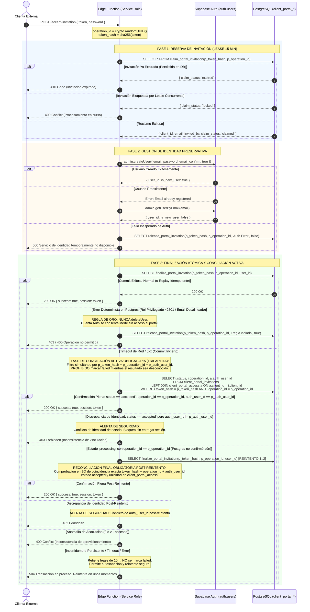

# ATELIER DIGITAL — BY KATHERINE CARROLL
## ESPECIFICACIÓN TÉCNICA CANÓNICA Y CONSOLIDADA (VERSIÓN 2.10 — CIERRE DEFINITIVO DE SEGURIDAD Y PREFLIGHT)
### MÓDULO 09-A: SEGURIDAD NUCLEAR, RLS, INVITACIONES CRIPTOGRÁFICAS Y PERMISOS DEL PORTAL DE CLIENTES

**Versión:** 2.10 (Canónica Definitiva — Cierre Exhaustivo: search_path Seguro en Helper, Índices Totales sin indpred/indexprs, y gen_random_uuid Validado por Esquema, Firma y Retorno)  
**Fecha de Emisión:** 18 de Noviembre de 2026  
**Estado:** Documento Canónico Consolidado — Pendiente de Aprobación y Autorización Expresa de Migración por Katherine Carroll  
**Autor:** Antigravity AI Architecture Team  
**Módulo Destino:** M09 — Portal de Clientes (Fase M09-A: Seguridad, RLS, Aprovisionamiento y Permisos)  

---

## 1. COMPARACIÓN ANTES / DESPUÉS DE LOS DEFECTOS RESIDUALES Y RESOLUCIÓN DE BLOQUEOS (v2.9 -> v2.10)

| N.º | Defecto Residual / Inconsistencia Identificada | Estado Previo (v2.9) | Corrección Arquitectónica Definitiva (v2.10 Canónica Definitiva) |
| :---: | :--- | :--- | :--- |
| **1** | **Validación Canónica de `search_path` en Helper `public.is_admin_or_designer()`** | Se evaluaba mediante `LIKE '%search_path=%'` o con funciones permisivas de normalización (`trim`) que eliminaban comillas y espacios indiscriminadamente, permitiendo que identificadores espurios entrecomillados con espacios como `" pg_catalog "` fuesen aceptados erróneamente. | **Validación Rigurosa de Configuración Canónica sin `trim`:** Se inspecciona `proconfig` mediante comparación canónica exacta contra la lista cerrada de representaciones admitidas (`substr(cfg, 13) IN ('', '""', 'pg_catalog')`), eliminando toda función de recorte permisivo. Exige que `search_path` sea estrictamente vacío (`''`, `""`) o exclusivamente `'pg_catalog'`, y rechaza terminantemente identificadores con espacios (`" pg_catalog "`), `pg_temp`, `public`, `$user` y cualquier otro esquema adicional. Se auditan además su propietario confiable (`postgres`/`supabase_admin`), firma (0 args), retorno `bool`, `SECURITY DEFINER` y ACL efectiva. |
| **2** | **Controles de Índices en Preflight: Índices Parciales y Basados en Expresiones** | Los 5 controles de índices validaban `indisvalid`, `indisready`, `indislive` y `ix.indkey[0] = attnum`, pero omitían evaluar `indpred` e `indexprs`, permitiendo que índices parciales (`WHERE ...`) o basados en expresiones fuesen aceptados erróneamente como índices de cobertura foránea. | **Exclusión Estricta de Índices Parciales y Basados en Expresiones:** Se incorporan en los 5 controles las condiciones `ix.indpred IS NULL` (garantizando que el índice sea total sobre todas las filas) e `ix.indexprs IS NULL` (garantizando que indexa directamente la columna relacional pura y no una expresión), preservando las verificaciones de operatividad y primera posición de clave sin `INCLUDE`. |
| **3** | **Validación de la Función Criptográfica `gen_random_uuid()`** | Se comprobaba únicamente la existencia por nombre (`proname = 'gen_random_uuid'`), sin verificar el esquema donde reside, su firma de argumentos ni su tipo de retorno. | **Validación Formal por Esquema, Firma y Retorno:** Se audita en `pg_proc` y `pg_namespace` que `gen_random_uuid()` resida en un esquema confiable del sistema (`pg_catalog`, `public`, `extensions`), acepte exactamente 0 argumentos (`pronargs = 0`) y retorne inequívocamente el tipo `uuid` (`prorettype = 'uuid'::regtype::oid`). |

---

## 2. ARQUITECTURA SAGA NO DESTRUCTIVA Y PROTOCOLO DE CONCILIACIÓN ACTIVA

### 2.1 Diagrama de Secuencia con Conciliación Parametrizada Tripartita



### 2.2 Rutina Defensiva de Conciliación Activa en Edge Function (TypeScript / PostgREST)

La rutina post-timeout / commit incierto implementa una verificación escalonada y a prueba de fallos antes de emitir cualquier sesión o tomar decisiones transaccionales:

```typescript
/**
 * Rutina Defensiva de Conciliación Activa Post-Timeout (Fase 3 de la Saga)
 * Ejecutada cuando finalize_portal_invitation experimenta timeout de red o error 5xx incierto.
 */
async function reconcilePortalInvitationSaga(
  supabaseAdmin: any,
  p_token_hash: string,
  p_operation_id: string,
  p_auth_user_id: string,
  sessionToken: string
): Promise<Response> {
  // 1. Manejo explícito de error en la consulta de reconciliación
  const { data: invitationRow, error: recError } = await supabaseAdmin
    .from('client_portal_invitations')
    .select('status, operation_id, client_id')
    .eq('token_hash', p_token_hash)
    .eq('operation_id', p_operation_id)
    .maybeSingle();

  if (recError) {
    console.error('[SAGA_RECONCILIATION_ERROR] Fallo al consultar estado de invitación:', recError);
    // Error transitorio en la propia conciliación: NO se libera a failed ni se entrega sesión.
    // Retiene lease de 15m y solicita reintento al cliente.
    return new Response(JSON.stringify({ 
      error: 'Transacción en proceso de verificación. Reintente en unos momentos.' 
    }), { status: 504, headers: { 'Retry-After': '5' } });
  }

  // 2. Ausencia de registro para la terna token_hash + operation_id
  if (!invitationRow) {
    console.warn('[SAGA_RECONCILIATION_NOT_FOUND] No se encontró invitación activa para la operación indicada.');
    return new Response(JSON.stringify({ 
      error: 'Invitación u operación no identificada en el sistema.' 
    }), { status: 404 });
  }

  // 3. Caso: status === 'accepted' (Postgres completó el commit atómico)
  if (invitationRow.status === 'accepted') {
    // Consultar el registro de acceso formal asociado al client_id
    const { data: accessRows, error: accessError } = await supabaseAdmin
      .from('client_portal_access')
      .select('auth_user_id, status')
      .eq('client_id', invitationRow.client_id);

    if (accessError) {
      console.error('[SAGA_ACCESS_CHECK_ERROR] Error verificando acceso de clienta:', accessError);
      return new Response(JSON.stringify({ 
        error: 'Error interno de verificación de acceso. Inicie sesión directamente.' 
      }), { status: 500 });
    }

    // 4. Manejo explícito de ausencia de registro de acceso
    if (!accessRows || accessRows.length === 0) {
      console.error('[SAGA_IDENTITY_ANOMALY] Invitación en accepted pero sin registro en client_portal_access.');
      return new Response(JSON.stringify({ 
        error: 'Inconsistencia de aprovisionamiento detectada. Contacte al Atelier.' 
      }), { status: 409 });
    }

    // 5. Manejo explícito de relaciones múltiples (anomalía de cardinalidad)
    if (accessRows.length > 1) {
      console.error('[SAGA_MULTIPLE_ACCESS_ANOMALY] Múltiples registros en client_portal_access para el mismo cliente:', accessRows.length);
      return new Response(JSON.stringify({ 
        error: 'Anomalía de integridad multi-acceso detectada. Operación suspendida por seguridad.' 
      }), { status: 409 });
    }

    // 6. Verificación estricta de estado 'active' en client_portal_access
    if (accessRows[0].status !== 'active') {
      console.error(`[SAGA_ACCESS_STATUS_INACTIVE] Estado de acceso no es active: ${accessRows[0].status}`);
      return new Response(JSON.stringify({ 
        error: 'El acceso al portal no se encuentra en estado activo. Contacte al Atelier.' 
      }), { status: 403 });
    }

    // 7. Verificación estricta de coincidencia de identidad (auth_user_id)
    const registeredAuthUserId = accessRows[0].auth_user_id;
    if (registeredAuthUserId !== p_auth_user_id) {
      console.error(`[SAGA_IDENTITY_MISMATCH] Divergencia crítica: esperado ${p_auth_user_id}, registrado ${registeredAuthUserId}`);
      // Alerta de seguridad: NO entregar sesión.
      return new Response(JSON.stringify({ 
        error: 'Conflicto de identidad de cuenta detectado. Acceso denegado.' 
      }), { status: 403 });
    }

    // CONFIRMACIÓN POSITIVA PLENA: Commit confirmado en Postgres, acceso único 'active' e identidad validada
    return new Response(JSON.stringify({ 
      success: true, 
      session: sessionToken 
    }), { status: 200 });
  }

  // 8. Caso: status === 'processing' con el mismo operation_id (Postgres no confirmó o hubo timeout inicial)
  if (invitationRow.status === 'processing') {
    // Reintentar finalize_portal_invitation de forma segura e idempotente
    const { error: retryError } = await supabaseAdmin.rpc('finalize_portal_invitation', {
      p_token_hash,
      p_operation_id,
      p_auth_user_id
    });

    // Si el reintento falla con error determinista de negocio (ej. 42501 rol admin, 23514 email mismatch):
    if (retryError && (retryError.code === '42501' || retryError.code === '23514')) {
      await supabaseAdmin.rpc('release_portal_invitation', {
        p_token_hash,
        p_operation_id,
        p_reason: retryError.message,
        p_mark_failed: true
      });
      return new Response(JSON.stringify({ error: 'Operación denegada por reglas de seguridad.' }), { status: 403 });
    }

    // OBLIGATORIO: Reconciliación final activa post-reintento en Base de Datos.
    // NUNCA asumir éxito ni entregar sesión basándose únicamente en la llamada RPC.
    const { data: postRetryRow, error: postRetryError } = await supabaseAdmin
      .from('client_portal_invitations')
      .select('status, operation_id, client_id')
      .eq('token_hash', p_token_hash)
      .eq('operation_id', p_operation_id)
      .maybeSingle();

    if (postRetryError) {
      console.error('[SAGA_POST_RETRY_ERROR] Error verificando estado post-reintento:', postRetryError);
      return new Response(JSON.stringify({ 
        error: 'Incertidumbre en la verificación final. El lease se mantiene activo. Reintente en unos momentos.' 
      }), { status: 504, headers: { 'Retry-After': '5' } });
    }

    if (!postRetryRow) {
      console.error('[SAGA_POST_RETRY_NOT_FOUND] Registro de invitación no encontrado tras reintento.');
      return new Response(JSON.stringify({ error: 'Invitación no encontrada tras proceso de finalización.' }), { status: 404 });
    }

    if (postRetryRow.status !== 'accepted') {
      console.warn(`[SAGA_POST_RETRY_INCOMPLETE] Estado post-reintento no es accepted: ${postRetryRow.status}`);
      // Si sigue en processing o estado no terminal: retiene lease de 15m. NUNCA marcar failed.
      return new Response(JSON.stringify({ 
        error: 'La finalización continúa en proceso. Por favor reintente o consulte al Atelier.' 
      }), { status: 504 });
    }

    // Consultar el registro de acceso formal asociado al client_id para validar unicidad, estado 'active' e identidad
    const { data: postAccessRows, error: postAccessError } = await supabaseAdmin
      .from('client_portal_access')
      .select('auth_user_id, status')
      .eq('client_id', postRetryRow.client_id);

    if (postAccessError) {
      console.error('[SAGA_POST_ACCESS_ERROR] Error consultando client_portal_access post-reintento:', postAccessError);
      return new Response(JSON.stringify({ 
        error: 'Error interno verificando la vinculación de acceso. Inicie sesión directamente.' 
      }), { status: 500 });
    }

    if (!postAccessRows || postAccessRows.length === 0) {
      console.error('[SAGA_POST_ACCESS_EMPTY] Invitación post-reintento en accepted pero sin registro en client_portal_access.');
      return new Response(JSON.stringify({ 
        error: 'Inconsistencia de aprovisionamiento detectada tras reintento. Contacte al Atelier.' 
      }), { status: 409 });
    }

    if (postAccessRows.length > 1) {
      console.error('[SAGA_POST_ACCESS_MULTIPLE] Múltiples registros en client_portal_access para el cliente:', postAccessRows.length);
      return new Response(JSON.stringify({ 
        error: 'Anomalía de integridad multi-acceso detectada tras reintento. Operación suspendida.' 
      }), { status: 409 });
    }

    // Validación obligatoria de estado 'active' post-reintento
    if (postAccessRows[0].status !== 'active') {
      console.error(`[SAGA_POST_ACCESS_STATUS_INACTIVE] Estado de acceso post-reintento no es active: ${postAccessRows[0].status}`);
      return new Response(JSON.stringify({ 
        error: 'El acceso al portal no se encuentra en estado activo tras finalización. Contacte al Atelier.' 
      }), { status: 403 });
    }

    // Verificación estricta de identidad coincidente (auth_user_id)
    if (postAccessRows[0].auth_user_id !== p_auth_user_id) {
      console.error(`[SAGA_POST_ACCESS_MISMATCH] Divergencia crítica post-reintento: esperado ${p_auth_user_id}, registrado ${postAccessRows[0].auth_user_id}`);
      return new Response(JSON.stringify({ 
        error: 'Conflicto de identidad de cuenta detectado. Acceso denegado.' 
      }), { status: 403 });
    }

    // CONFIRMACIÓN POSITIVA PLENA POST-REINTENTO: Estado accepted verificado, vinculación única, status 'active' y coincidencia estricta de auth_user_id
    return new Response(JSON.stringify({ 
      success: true, 
      session: sessionToken 
    }), { status: 200 });
  }

  // 8. Estados terminales previos ('failed', 'expired', 'revoked')
  return new Response(JSON.stringify({ 
    error: `La invitación se encuentra en estado terminal: ${invitationRow.status}.` 
  }), { status: 410 });
}
```

#### Consulta SQL Canónica Equivalente
```sql
SELECT i.status, i.operation_id, a.auth_user_id
FROM public.client_portal_invitations i
LEFT JOIN public.client_portal_access a ON a.client_id = i.client_id
WHERE i.token_hash = p_token_hash 
  AND i.operation_id = p_operation_id;
```

### 2.3 Matriz Completa y Consistente de Transiciones de Estado

```
                 ┌────────────────────────────────────────────────────────┐
                 │                       [pending]                        │
                 │                 (lease_until IS NULL)                  │
                 └──────────────┬─────────────────────────▲───────────────┘
                                │ claim (claimed)         │ release(failed=false)
                                ▼                         │
                 ┌────────────────────────────────────────┴───────────────┐
                 │                      [processing]                      │
                 │                (lease_until NOT NULL)                  │
                 └───────┬───────────────────┬────────────────────┬───────┘
                         │ finalize          │ release(true)      │ timeout (autosanación)
                         ▼                   ▼                    ▼
             ┌───────────────────────┐ ┌───────────┐ ┌────────────────────────┐
             │      [accepted]       │ │ [failed]  │ │      [processing]      │
             │ (lease_until IS NULL) │ │(lease IS N│ │ (lease renovado 15min) │
             └───────────────────────┘ └───────────┘ └────────────────────────┘
```

| Estado Inicial | Función / Evento | Estado Resultante | Invariante de `lease_until` | Reglas de Consistencia |
| :--- | :--- | :--- | :---: | :--- |
| `pending` | `claim_portal_invitation` | `processing` | **`NOT NULL`** (`now() + 15 min`) | Requiere token válido, `expires_at > now()`, `operation_id` asignado. |
| `processing` | `claim_portal_invitation` | `processing` | **`NOT NULL`** (`now() + 15 min`) | Autosanación: se permite re-reclamo solo si lease expiró (`lease_until <= now()`). |
| `processing` | `finalize_portal_invitation` | `accepted` | **`NULL`** | Estado terminal definitivo. Terna validada, rol verificado en fuentes confiables. |
| `processing` | `release_portal_invitation(false)` | `pending` | **`NULL`** | Transitorio: error recuperable de red; token liberado para nuevo intento. |
| `processing` | `release_portal_invitation(true)` | `failed` | **`NULL`** | Estado terminal: violación de negocio; token invalidado permanentemente. |
| `pending`/`processing` | Detección de TTL en `claim` | `expired` | **`NULL`** | Estado terminal: `expires_at <= now()`. Persistido en DB sin rollback. |
| `pending`/`processing` | Acción de Katherine | `revoked` | **`NULL`** | Estado terminal: revocación manual por administradora/diseñadora. |

---

## 3. ESQUEMA DE PRIVILEGIOS MÍNIMOS, ROL TÉCNICO Y VISTAS

```sql
-- Creación e inicialización segura del rol técnico propietario de vistas
DO $$
BEGIN
    IF NOT EXISTS (SELECT 1 FROM pg_catalog.pg_roles WHERE rolname = 'atelier_portal_reader') THEN
        CREATE ROLE atelier_portal_reader WITH NOLOGIN NOSUPERUSER NOCREATEDB NOCREATEROLE;
    END IF;
    -- Garantizar membresía para que postgres pueda transferir propiedad sin errores de autorización
    GRANT atelier_portal_reader TO postgres;
END;
$$;

-- Concesión de uso del esquema público
GRANT USAGE ON SCHEMA public TO atelier_portal_reader;

-- Concesión de ejecución sobre funciones de autorización requeridas por las vistas
GRANT EXECUTE ON FUNCTION public.has_portal_permission(TEXT, TEXT, UUID) TO atelier_portal_reader;
GRANT EXECUTE ON FUNCTION public.get_portal_access_id() TO atelier_portal_reader;
GRANT EXECUTE ON FUNCTION public.get_portal_client_id() TO atelier_portal_reader;

-- Concesión de lectura estrictamente a nivel de columnas sobre tablas base M00-M08
GRANT SELECT (id, full_name, email, phone, city, style_preferences, photo_url, status)
    ON public.clients TO atelier_portal_reader;

GRANT SELECT (id, client_id, name, description, creation_type, status, occasion, garment_type, target_date, created_at)
    ON public.creations TO atelier_portal_reader;

GRANT SELECT (id, client_id, appointment_type, status, starts_at, ends_at, location_space, preparation_notes, client_visibility)
    ON public.atelier_appointments TO atelier_portal_reader;

GRANT SELECT (id, creation_id, session_number, round_type, title, status, scheduled_at, conducted_at, location_note)
    ON public.atelier_fitting_sessions TO atelier_portal_reader;

GRANT SELECT (id, creation_id, quote_number, currency, total_price, payment_instructions, valid_until, status, accepted_at)
    ON public.commercial_quotes TO atelier_portal_reader;

GRANT SELECT (id, client_id, session_date, status, unit_system, version_number)
    ON public.measurement_sessions TO atelier_portal_reader;

-- Concesión de lectura a nivel de columnas sobre tablas base M09-A
GRANT SELECT (id, client_id, auth_user_id, status)
    ON public.client_portal_access TO atelier_portal_reader;

GRANT SELECT (id, portal_access_id, creation_id, resource, action, is_granted)
    ON public.client_portal_permissions TO atelier_portal_reader;
```

---

## 4. DDL COMPLETO, TOTALMENTE CUALIFICADO Y CORREGIDO (v2.10)

```sql
-- ==============================================================================
-- ATELIER DIGITAL — MÓDULO 09-A: ESPECIFICACIÓN DDL CANÓNICA DEFINITIVA v2.10
-- ==============================================================================

BEGIN;

-- ------------------------------------------------------------------------------
-- 1. TABLA: ACCESO Y ESTADO GLOBAL DEL PORTAL (client_portal_access)
-- ------------------------------------------------------------------------------
CREATE TABLE IF NOT EXISTS public.client_portal_access (
    id UUID PRIMARY KEY DEFAULT gen_random_uuid(),
    client_id UUID NOT NULL UNIQUE REFERENCES public.clients(id) ON DELETE RESTRICT,
    auth_user_id UUID UNIQUE REFERENCES auth.users(id) ON DELETE SET NULL,
    status TEXT NOT NULL DEFAULT 'invited'
        CHECK (status IN ('invited', 'active', 'suspended', 'revoked')),
    created_by UUID NOT NULL REFERENCES auth.users(id) ON DELETE RESTRICT,
    updated_by UUID REFERENCES auth.users(id) ON DELETE RESTRICT,
    created_at TIMESTAMPTZ NOT NULL DEFAULT pg_catalog.now(),
    updated_at TIMESTAMPTZ NOT NULL DEFAULT pg_catalog.now()
);

CREATE INDEX IF NOT EXISTS idx_cpa_client_id ON public.client_portal_access(client_id);
CREATE INDEX IF NOT EXISTS idx_cpa_auth_user_id ON public.client_portal_access(auth_user_id);
CREATE INDEX IF NOT EXISTS idx_cpa_status ON public.client_portal_access(status);

-- ------------------------------------------------------------------------------
-- 2. TABLA: INVITACIONES CRIPTOGRÁFICAS (client_portal_invitations)
-- ------------------------------------------------------------------------------
CREATE TABLE IF NOT EXISTS public.client_portal_invitations (
    id UUID PRIMARY KEY DEFAULT gen_random_uuid(),
    client_id UUID NOT NULL REFERENCES public.clients(id) ON DELETE RESTRICT,
    email TEXT NOT NULL CHECK (email ~* '^[A-Za-z0-9._%+-]+@[A-Za-z0-9.-]+\.[A-Za-z]{2,}$'),
    token_hash TEXT NOT NULL UNIQUE,
    operation_id UUID,               -- Identificador unívoco de la operación Saga
    expires_at TIMESTAMPTZ NOT NULL,
    lease_until TIMESTAMPTZ,         -- Control de concurrencia y autosanación
    used_at TIMESTAMPTZ,
    status TEXT NOT NULL DEFAULT 'pending'
        CHECK (status IN ('pending', 'processing', 'accepted', 'failed', 'expired', 'revoked')),
    failure_reason TEXT,
    invited_by UUID NOT NULL REFERENCES auth.users(id) ON DELETE RESTRICT,
    created_at TIMESTAMPTZ NOT NULL DEFAULT pg_catalog.now(),
    CONSTRAINT chk_cpi_lease_state_consistency
        CHECK (
            (status = 'pending' AND lease_until IS NULL)
            OR (status = 'processing' AND lease_until IS NOT NULL)
            OR (status IN ('accepted', 'failed', 'expired', 'revoked') AND lease_until IS NULL)
        )
);

CREATE INDEX IF NOT EXISTS idx_cpi_token_hash ON public.client_portal_invitations(token_hash);
CREATE INDEX IF NOT EXISTS idx_cpi_lookup ON public.client_portal_invitations(status, expires_at);
CREATE INDEX IF NOT EXISTS idx_cpi_operation ON public.client_portal_invitations(operation_id);

-- Incorporación segura, idempotente y validación lógica profunda de la restricción en tablas existentes
DO $$
DECLARE
    v_c_oid OID;
    v_c_validated BOOLEAN;
    v_c_def_norm TEXT;
    v_needs_recreate BOOLEAN := false;
BEGIN
    IF EXISTS (
        SELECT 1 FROM information_schema.tables 
        WHERE table_schema = 'public' AND table_name = 'client_portal_invitations'
    ) THEN
        -- 1. Saneamiento previo idempotente de filas existentes
        UPDATE public.client_portal_invitations
        SET lease_until = NULL
        WHERE (status = 'pending' AND lease_until IS NOT NULL)
           OR (status IN ('accepted', 'failed', 'expired', 'revoked') AND lease_until IS NOT NULL);

        UPDATE public.client_portal_invitations
        SET lease_until = pg_catalog.now() + INTERVAL '15 minutes'
        WHERE status = 'processing' AND lease_until IS NULL;

        -- 2. Inspección rigurosa en pg_constraint: existencia, convalidated y definición canónica normalizada
        SELECT c.oid, c.convalidated,
               lower(regexp_replace(
                   regexp_replace(pg_get_constraintdef(c.oid), '::(text|character varying)', '', 'g'),
                   '\s+', ' ', 'g'
               ))
        INTO v_c_oid, v_c_validated, v_c_def_norm
        FROM pg_constraint c
        WHERE c.conrelid = 'public.client_portal_invitations'::regclass
          AND c.conname = 'chk_cpi_lease_state_consistency';

        IF v_c_oid IS NOT NULL THEN
            -- Comparación exacta contra las representaciones canónicas de PostgreSQL (ANY ARRAY e IN)
            IF v_c_def_norm = 'check (((status = ''pending'') and (lease_until is null)) or ((status = ''processing'') and (lease_until is not null)) or ((status = any (array[''accepted'', ''failed'', ''expired'', ''revoked''])) and (lease_until is null)))'
               OR v_c_def_norm = 'check (((status = ''pending'') and (lease_until is null)) or ((status = ''processing'') and (lease_until is not null)) or ((status in (''accepted'', ''failed'', ''expired'', ''revoked'')) and (lease_until is null)))' THEN
                -- Definición canónica confirmada: si no estaba validada, ejecutar validación formal
                IF NOT v_c_validated THEN
                    ALTER TABLE public.client_portal_invitations
                        VALIDATE CONSTRAINT chk_cpi_lease_state_consistency;
                END IF;
            ELSE
                -- Definición no canónica, obsoleta o divergente: remover para recreación formal
                ALTER TABLE public.client_portal_invitations
                    DROP CONSTRAINT chk_cpi_lease_state_consistency;
                v_needs_recreate := true;
            END IF;
        ELSE
            v_needs_recreate := true;
        END IF;

        -- 3. Incorporación formal con NOT VALID y validación inmediata si fue removida o no existía
        IF v_needs_recreate THEN
            ALTER TABLE public.client_portal_invitations
                ADD CONSTRAINT chk_cpi_lease_state_consistency
                CHECK (
                    (status = 'pending' AND lease_until IS NULL)
                    OR (status = 'processing' AND lease_until IS NOT NULL)
                    OR (status IN ('accepted', 'failed', 'expired', 'revoked') AND lease_until IS NULL)
                ) NOT VALID;

            ALTER TABLE public.client_portal_invitations
                VALIDATE CONSTRAINT chk_cpi_lease_state_consistency;
        END IF;
    END IF;
END;
$$;

-- ------------------------------------------------------------------------------
-- 3. TABLA: MATRIZ EXTENSIBLE DE PERMISOS (client_portal_permissions)
-- ------------------------------------------------------------------------------
CREATE TABLE IF NOT EXISTS public.client_portal_permissions (
    id UUID PRIMARY KEY DEFAULT gen_random_uuid(),
    portal_access_id UUID NOT NULL REFERENCES public.client_portal_access(id) ON DELETE CASCADE,
    creation_id UUID NULL REFERENCES public.creations(id) ON DELETE CASCADE,
    resource TEXT NOT NULL CHECK (resource IN (
        'creations', 'sketches', 'fabrics', 'fittings', 
        'quotations', 'measurements', 'appointments', 'messaging', '3d_viewer'
    )),
    action TEXT NOT NULL CHECK (action IN ('view', 'approve', 'observe', 'download')),
    is_granted BOOLEAN NOT NULL DEFAULT false,
    granted_by UUID NOT NULL REFERENCES auth.users(id) ON DELETE RESTRICT,
    granted_at TIMESTAMPTZ NOT NULL DEFAULT pg_catalog.now(),
    updated_at TIMESTAMPTZ NOT NULL DEFAULT pg_catalog.now()
);

CREATE UNIQUE INDEX IF NOT EXISTS uq_portal_permissions_canonical_idx
    ON public.client_portal_permissions (
        portal_access_id, 
        COALESCE(creation_id, '00000000-0000-0000-0000-000000000000'::uuid), 
        resource, 
        action
    );

CREATE INDEX IF NOT EXISTS idx_portal_perm_eval
    ON public.client_portal_permissions(portal_access_id, resource, action, is_granted);

-- Trigger de Integridad Sentido 1: Creación -> Clienta con Bloqueo FOR SHARE
CREATE OR REPLACE FUNCTION public.validate_portal_permission_creation()
RETURNS TRIGGER
LANGUAGE plpgsql
SET search_path = ''
AS $$
DECLARE
    v_access_client_id UUID;
    v_creation_client_id UUID;
BEGIN
    IF NEW.creation_id IS NOT NULL THEN
        -- Bloqueo FOR SHARE para serializar frente a mutaciones concurrentes
        SELECT client_id INTO v_access_client_id
        FROM public.client_portal_access
        WHERE id = NEW.portal_access_id
        FOR SHARE;

        IF v_access_client_id IS NULL THEN
            RAISE EXCEPTION 'portal_access_id % no existe o no tiene cliente asignado.', NEW.portal_access_id
                USING ERRCODE = '23503';
        END IF;

        SELECT client_id INTO v_creation_client_id
        FROM public.creations
        WHERE id = NEW.creation_id
        FOR SHARE;

        IF v_creation_client_id IS NULL THEN
            RAISE EXCEPTION 'creation_id % no existe.', NEW.creation_id
                USING ERRCODE = '23503';
        END IF;

        IF v_access_client_id IS DISTINCT FROM v_creation_client_id THEN
            RAISE EXCEPTION 'Violación de integridad: la creación % (cliente %) no coincide con el cliente % de portal_access_id %.',
                NEW.creation_id, v_creation_client_id, v_access_client_id, NEW.portal_access_id
                USING ERRCODE = '23514';
        END IF;
    END IF;
    RETURN NEW;
END;
$$;

DROP TRIGGER IF EXISTS trg_validate_portal_permission_creation ON public.client_portal_permissions;
CREATE TRIGGER trg_validate_portal_permission_creation
    BEFORE INSERT OR UPDATE ON public.client_portal_permissions
    FOR EACH ROW
    EXECUTE FUNCTION public.validate_portal_permission_creation();

-- Trigger de Integridad Sentido 2: Bloquear reasignación de client_id en creations con Bloqueo FOR UPDATE
CREATE OR REPLACE FUNCTION public.protect_creation_client_reassignment()
RETURNS TRIGGER
LANGUAGE plpgsql
SET search_path = ''
AS $$
BEGIN
    IF NEW.client_id IS DISTINCT FROM OLD.client_id THEN
        -- Bloqueo FOR UPDATE para serializar frente a inserciones concurrentes de permisos
        IF EXISTS (
            SELECT 1 FROM public.client_portal_permissions
            WHERE creation_id = OLD.id
            FOR UPDATE
        ) THEN
            RAISE EXCEPTION 'Operación denegada: no se puede reasignar el cliente de la creación % porque posee permisos de portal activos. Revoque primero dichos permisos.',
                OLD.id
                USING ERRCODE = '23514';
        END IF;
    END IF;
    RETURN NEW;
END;
$$;

DROP TRIGGER IF EXISTS trg_protect_creation_client_reassignment ON public.creations;
CREATE TRIGGER trg_protect_creation_client_reassignment
    BEFORE UPDATE OF client_id ON public.creations
    FOR EACH ROW
    EXECUTE FUNCTION public.protect_creation_client_reassignment();

-- ------------------------------------------------------------------------------
-- 4. TABLA: AUDITORÍA FORENSE INMUTABLE (client_portal_activity_log)
-- ------------------------------------------------------------------------------
CREATE TABLE IF NOT EXISTS public.client_portal_activity_log (
    id UUID PRIMARY KEY DEFAULT gen_random_uuid(),
    portal_access_id UUID NULL REFERENCES public.client_portal_access(id) ON DELETE SET NULL,
    client_id UUID NOT NULL REFERENCES public.clients(id) ON DELETE RESTRICT,
    auth_user_id UUID REFERENCES auth.users(id) ON DELETE SET NULL,
    category TEXT NOT NULL CHECK (category IN ('business', 'telemetry')),
    origin TEXT NOT NULL CHECK (origin IN ('system', 'client')),
    event_type TEXT NOT NULL,
    metadata JSONB NOT NULL DEFAULT '{}'::jsonb,
    ip_address TEXT,
    user_agent TEXT,
    created_at TIMESTAMPTZ NOT NULL DEFAULT pg_catalog.now()
);

CREATE INDEX IF NOT EXISTS idx_cpal_client_time ON public.client_portal_activity_log(client_id, created_at DESC);
CREATE INDEX IF NOT EXISTS idx_cpal_category ON public.client_portal_activity_log(category, event_type);

-- Trigger de inmutabilidad estricta
CREATE OR REPLACE FUNCTION public.prevent_activity_log_tampering()
RETURNS TRIGGER
LANGUAGE plpgsql
SET search_path = ''
AS $$
BEGIN
    RAISE EXCEPTION 'Operación denegada: la bitácora de actividad del portal es inmutable y permanente.'
        USING ERRCODE = '42501';
END;
$$;

DROP TRIGGER IF EXISTS trg_protect_activity_log ON public.client_portal_activity_log;
CREATE TRIGGER trg_protect_activity_log
    BEFORE UPDATE OR DELETE ON public.client_portal_activity_log
    FOR EACH ROW
    EXECUTE FUNCTION public.prevent_activity_log_tampering();

-- ------------------------------------------------------------------------------
-- 5. HELPERS DE SEGURIDAD Y TELEMETRÍA
-- ------------------------------------------------------------------------------

CREATE OR REPLACE FUNCTION public.get_portal_access_id()
RETURNS UUID
LANGUAGE sql
STABLE
SECURITY DEFINER
SET search_path = ''
AS $$
    SELECT id FROM public.client_portal_access
    WHERE auth_user_id = auth.uid() AND status = 'active'
    LIMIT 1;
$$;

CREATE OR REPLACE FUNCTION public.get_portal_client_id()
RETURNS UUID
LANGUAGE sql
STABLE
SECURITY DEFINER
SET search_path = ''
AS $$
    SELECT client_id FROM public.client_portal_access
    WHERE auth_user_id = auth.uid() AND status = 'active'
    LIMIT 1;
$$;

CREATE OR REPLACE FUNCTION public.has_portal_permission(
    p_resource TEXT,
    p_action TEXT,
    p_creation_id UUID DEFAULT NULL
)
RETURNS BOOLEAN
LANGUAGE plpgsql
STABLE
SECURITY DEFINER
SET search_path = ''
AS $$
DECLARE
    v_access_id UUID;
    v_specific_granted BOOLEAN;
    v_global_granted BOOLEAN;
BEGIN
    SELECT id INTO v_access_id
    FROM public.client_portal_access
    WHERE auth_user_id = auth.uid() AND status = 'active';

    IF v_access_id IS NULL THEN
        RETURN FALSE;
    END IF;

    -- 1. Evaluación de permiso específico por creación
    IF p_creation_id IS NOT NULL THEN
        SELECT is_granted INTO v_specific_granted
        FROM public.client_portal_permissions
        WHERE portal_access_id = v_access_id
          AND creation_id = p_creation_id
          AND resource = p_resource
          AND action = p_action;

        IF v_specific_granted IS NOT NULL THEN
            RETURN v_specific_granted;
        END IF;
    END IF;

    -- 2. Fallback a permiso global de clienta (creation_id IS NULL)
    SELECT is_granted INTO v_global_granted
    FROM public.client_portal_permissions
    WHERE portal_access_id = v_access_id
      AND creation_id IS NULL
      AND resource = p_resource
      AND action = p_action;

    RETURN COALESCE(v_global_granted, FALSE);
END;
$$;

CREATE OR REPLACE FUNCTION public.log_portal_event(
    p_event_type TEXT,
    p_metadata JSONB DEFAULT '{}'::jsonb
)
RETURNS VOID
LANGUAGE plpgsql
SECURITY DEFINER
SET search_path = ''
AS $$
DECLARE
    v_access_id UUID;
    v_client_id UUID;
    v_ip TEXT;
    v_ua TEXT;
BEGIN
    IF p_event_type NOT IN (
        'view_portal_home', 'view_creation', 'view_sketches', 
        'view_quotation', 'view_appointment', 'view_measurements', 
        'view_fittings', 'auth_logout'
    ) THEN
        RAISE EXCEPTION 'Operación denegada: evento de telemetría no autorizado.'
            USING ERRCODE = '42501';
    END IF;

    IF pg_catalog.pg_column_size(p_metadata) > 2048 THEN
        RAISE EXCEPTION 'Operación denegada: metadata excede el límite permitido de 2 KB.'
            USING ERRCODE = '22023';
    END IF;

    SELECT id, client_id INTO v_access_id, v_client_id
    FROM public.client_portal_access
    WHERE auth_user_id = auth.uid() AND status = 'active';

    IF v_access_id IS NULL THEN
        RAISE EXCEPTION 'Operación denegada: no existe sesión activa de portal.'
            USING ERRCODE = '42501';
    END IF;

    BEGIN
        v_ip := pg_catalog.current_setting('request.headers', true)::json->>'x-forwarded-for';
        v_ua := pg_catalog.current_setting('request.headers', true)::json->>'user-agent';
    EXCEPTION WHEN OTHERS THEN
        v_ip := 'unknown'; v_ua := 'unknown';
    END;

    INSERT INTO public.client_portal_activity_log (
        portal_access_id, client_id, auth_user_id,
        category, origin, event_type, metadata, ip_address, user_agent, created_at
    ) VALUES (
        v_access_id, v_client_id, auth.uid(),
        'telemetry', 'client', p_event_type, p_metadata, v_ip, v_ua, pg_catalog.now()
    );
END;
$$;

-- ------------------------------------------------------------------------------
-- 6. RPCs TRANSACCIONALES SAGA: RESERVA, LIBERACIÓN Y FINALIZACIÓN
-- ------------------------------------------------------------------------------

-- Paso 1: Reserva de invitación con persistencia real de caducidad e inclusión de 'expired'
CREATE OR REPLACE FUNCTION public.claim_portal_invitation(
    p_token_hash TEXT,
    p_operation_id UUID
)
RETURNS TABLE (
    client_id UUID, 
    email TEXT, 
    invited_by UUID, 
    claim_status TEXT
)
LANGUAGE plpgsql
SECURITY DEFINER
SET search_path = ''
AS $$
DECLARE
    v_rec RECORD;
BEGIN
    IF p_operation_id IS NULL THEN
        RAISE EXCEPTION 'p_operation_id es obligatorio para registrar la reserva de invitación.'
            USING ERRCODE = '23514';
    END IF;

    SELECT i.id, i.client_id, i.email, i.status, i.expires_at, i.lease_until, i.invited_by
    INTO v_rec
    FROM public.client_portal_invitations i
    WHERE i.token_hash = p_token_hash
    FOR UPDATE;

    IF NOT FOUND THEN
        RETURN QUERY SELECT NULL::UUID, NULL::TEXT, NULL::UUID, 'not_found'::TEXT;
        RETURN;
    END IF;

    -- 1. Inclusión de 'expired' entre los estados terminales: no re-ejecutar updates si ya expiró
    IF v_rec.status IN ('accepted', 'revoked', 'failed', 'expired') THEN
        RETURN QUERY SELECT NULL::UUID, NULL::TEXT, NULL::UUID, v_rec.status;
        RETURN;
    END IF;

    -- 2. Persistencia REAL de la caducidad sin rollback accidental
    IF v_rec.expires_at <= pg_catalog.now() THEN
        UPDATE public.client_portal_invitations
        SET status = 'expired', lease_until = NULL
        WHERE token_hash = p_token_hash;

        RETURN QUERY SELECT NULL::UUID, NULL::TEXT, NULL::UUID, 'expired'::TEXT;
        RETURN;
    END IF;

    -- 3. Concurrencia activa: lease vigente no vencido
    IF v_rec.status = 'processing' AND v_rec.lease_until > pg_catalog.now() THEN
        RETURN QUERY SELECT NULL::UUID, NULL::TEXT, NULL::UUID, 'locked'::TEXT;
        RETURN;
    END IF;

    -- 4. Concesión de lease por 15 minutos en estado processing (lease NOT NULL)
    UPDATE public.client_portal_invitations
    SET status = 'processing',
        operation_id = p_operation_id,
        lease_until = pg_catalog.now() + INTERVAL '15 minutes'
    WHERE token_hash = p_token_hash;

    RETURN QUERY SELECT v_rec.client_id, v_rec.email, v_rec.invited_by, 'claimed'::TEXT;
END;
$$;

-- Paso de Compensación: Liberación segura con validación obligatoria de operation_id y lease_until NULL
CREATE OR REPLACE FUNCTION public.release_portal_invitation(
    p_token_hash TEXT,
    p_operation_id UUID,
    p_reason TEXT,
    p_mark_failed BOOLEAN DEFAULT false
)
RETURNS VOID
LANGUAGE plpgsql
SECURITY DEFINER
SET search_path = ''
AS $$
DECLARE
    v_updated_rows INT;
BEGIN
    IF p_operation_id IS NULL THEN
        RAISE EXCEPTION 'p_operation_id es obligatorio para liberar una invitación en proceso.'
            USING ERRCODE = '23514';
    END IF;

    UPDATE public.client_portal_invitations
    SET status = CASE WHEN p_mark_failed THEN 'failed' ELSE 'pending' END,
        lease_until = NULL, -- Forzado a NULL en pending o failed
        failure_reason = p_reason
    WHERE token_hash = p_token_hash 
      AND status = 'processing'
      AND operation_id = p_operation_id;

    GET DIAGNOSTICS v_updated_rows = ROW_COUNT;

    IF v_updated_rows = 0 THEN
        RAISE WARNING 'release_portal_invitation no encontró registros en processing con la operación indicada.';
    END IF;
END;
$$;

-- Paso 2: Finalización atómica con comprobación real de fila en profiles, preservación de roles nulos y lease_until NULL
CREATE OR REPLACE FUNCTION public.finalize_portal_invitation(
    p_token_hash TEXT,
    p_operation_id UUID,
    p_auth_user_id UUID
)
RETURNS VOID
LANGUAGE plpgsql
SECURITY DEFINER
SET search_path = ''
AS $$
DECLARE
    v_client_id UUID;
    v_invited_by UUID;
    v_invitation_email TEXT;
    v_access_id UUID;
    v_existing_role TEXT;
    v_profile_exists BOOLEAN := false;
BEGIN
    IF p_operation_id IS NULL OR p_auth_user_id IS NULL THEN
        RAISE EXCEPTION 'p_operation_id y p_auth_user_id son parámetros obligatorios.'
            USING ERRCODE = '23514';
    END IF;

    -- 1. Idempotencia Exacta: Comprobar si ya fue aceptada por la misma terna exacta
    IF EXISTS (
        SELECT 1 FROM public.client_portal_invitations i
        JOIN public.client_portal_access a ON a.client_id = i.client_id
        WHERE i.token_hash = p_token_hash 
          AND i.status = 'accepted'
          AND i.operation_id = p_operation_id
          AND a.auth_user_id = p_auth_user_id
    ) THEN
        RETURN;
    END IF;

    -- Si ya fue aceptada por una operación o usuario diferente, denegar por conflicto
    IF EXISTS (
        SELECT 1 FROM public.client_portal_invitations
        WHERE token_hash = p_token_hash AND status = 'accepted'
    ) THEN
        RAISE EXCEPTION 'Conflicto de idempotencia: esta invitación ya fue aceptada por otra operación o usuario.'
            USING ERRCODE = '23505';
    END IF;

    -- 2. Validar que la invitación esté reservada por esta operación exacta
    SELECT client_id, invited_by, email INTO v_client_id, v_invited_by, v_invitation_email
    FROM public.client_portal_invitations
    WHERE token_hash = p_token_hash 
      AND status = 'processing'
      AND operation_id = p_operation_id
    FOR UPDATE;

    IF NOT FOUND THEN
        RAISE EXCEPTION 'Transacción inválida: invitación no reservada por la operación indicada.'
            USING ERRCODE = '23514';
    END IF;

    -- 3. Blindaje Nuclear con comprobación real de existencia de fila en profiles
    SELECT true, role INTO v_profile_exists, v_existing_role
    FROM public.profiles
    WHERE id = p_auth_user_id
    FOR UPDATE;

    v_profile_exists := COALESCE(v_profile_exists, false);

    IF v_profile_exists AND v_existing_role IN ('admin', 'designer', 'superadmin') THEN
        RAISE EXCEPTION 'Violación de seguridad nuclear: no se permite asociar acceso de clienta a una cuenta con privilegios en profiles.'
            USING ERRCODE = '42501';
    END IF;

    -- Comprobación complementaria en app_metadata inmutable de Auth (Fuente Confiable)
    IF EXISTS (
        SELECT 1 FROM auth.users
        WHERE id = p_auth_user_id 
          AND (raw_app_meta_data->>'role' IN ('admin', 'designer', 'superadmin'))
    ) THEN
        RAISE EXCEPTION 'Violación de seguridad nuclear: rol privilegiado detectado en app_metadata de la cuenta.'
            USING ERRCODE = '42501';
    END IF;

    -- 4. Validación anti-suplantación: correo de Auth debe coincidir con la invitación
    IF NOT EXISTS (
        SELECT 1 FROM auth.users
        WHERE id = p_auth_user_id 
          AND pg_catalog.lower(email) = pg_catalog.lower(v_invitation_email)
    ) THEN
        RAISE EXCEPTION 'Fraude de identidad: el correo del usuario autenticado no coincide con el destinatario de la invitación.'
            USING ERRCODE = '23514';
    END IF;

    -- 5. Preservación estricta de la fila en profiles (incluso si role es NULL) y resolución de concurrencia
    IF v_profile_exists THEN
        -- La fila existe: se preserva cualquier rol existente (incluyendo NULL o roles custom), solo actualiza timestamp
        UPDATE public.profiles
        SET updated_at = pg_catalog.now()
        WHERE id = p_auth_user_id;
    ELSE
        -- La fila no existía: se inserta como 'client', resolviendo colisiones concurrentes con ON CONFLICT
        INSERT INTO public.profiles (id, email, role, created_at, updated_at)
        VALUES (p_auth_user_id, v_invitation_email, 'client', pg_catalog.now(), pg_catalog.now())
        ON CONFLICT (id) DO UPDATE SET
            updated_at = pg_catalog.now();
    END IF;

    -- 6. Vinculación atómica en client_portal_access con atribución a Katherine
    INSERT INTO public.client_portal_access (
        client_id, auth_user_id, status, created_by, updated_by
    ) VALUES (
        v_client_id, p_auth_user_id, 'active', v_invited_by, v_invited_by
    )
    ON CONFLICT (client_id) DO UPDATE SET
        auth_user_id = EXCLUDED.auth_user_id,
        status = 'active',
        updated_by = v_invited_by,
        updated_at = pg_catalog.now()
    RETURNING id INTO v_access_id;

    -- 7. Quemado definitivo: estado accepted con lease_until forzosamente NULL
    UPDATE public.client_portal_invitations
    SET status = 'accepted',
        used_at = pg_catalog.now(),
        lease_until = NULL
    WHERE token_hash = p_token_hash;

    -- 8. Registro forense de auditoría de negocio
    INSERT INTO public.client_portal_activity_log (
        portal_access_id, client_id, auth_user_id,
        category, origin, event_type, metadata, created_at
    ) VALUES (
        v_access_id, v_client_id, p_auth_user_id,
        'business', 'system', 'invitation_accepted',
        jsonb_build_object('token_hash', p_token_hash, 'operation_id', p_operation_id),
        pg_catalog.now()
    );
END;
$$;

-- ------------------------------------------------------------------------------
-- 7. VISTAS PROTEGIDAS CON AISLAMIENTO BIDIRECCIONAL
-- ------------------------------------------------------------------------------

-- 1. Vista de Perfil Seguro
CREATE OR REPLACE VIEW public.v_portal_client_profile
WITH (security_barrier = true, security_invoker = false) AS
SELECT 
    c.id, c.full_name, c.email, c.phone, c.city, 
    c.style_preferences, c.photo_url, c.status
FROM public.clients c
JOIN public.client_portal_access a ON c.id = a.client_id
WHERE a.auth_user_id = auth.uid() AND a.status = 'active';

-- 2. Vista de Creaciones Autorizadas (Aislamiento Bidireccional)
CREATE OR REPLACE VIEW public.v_portal_creations
WITH (security_barrier = true, security_invoker = false) AS
SELECT 
    cr.id, cr.name, cr.description, cr.creation_type, 
    cr.status, cr.occasion, cr.garment_type, cr.target_date, cr.created_at,
    public.has_portal_permission('sketches', 'view', cr.id) AS can_view_sketches,
    public.has_portal_permission('sketches', 'approve', cr.id) AS can_approve_sketches,
    public.has_portal_permission('fabrics', 'view', cr.id) AS can_view_fabrics,
    public.has_portal_permission('fittings', 'view', cr.id) AS can_view_fittings,
    public.has_portal_permission('quotations', 'view', cr.id) AS can_view_budget,
    public.has_portal_permission('messaging', 'observe', cr.id) AS can_send_observations
FROM public.creations cr
JOIN public.client_portal_access a ON cr.client_id = a.client_id
WHERE a.auth_user_id = auth.uid()
  AND a.status = 'active'
  AND public.has_portal_permission('creations', 'view', cr.id);

-- 3. Vista de Citas de Agenda (M08)
CREATE OR REPLACE VIEW public.v_portal_appointments
WITH (security_barrier = true, security_invoker = false) AS
SELECT 
    ap.id, ap.appointment_type, ap.status, ap.starts_at, ap.ends_at,
    ap.location_space, ap.preparation_notes
FROM public.atelier_appointments ap
JOIN public.client_portal_access a ON ap.client_id = a.client_id
WHERE a.auth_user_id = auth.uid()
  AND a.status = 'active'
  AND public.has_portal_permission('appointments', 'view', NULL)
  AND ap.client_visibility = 'client_visible'
  AND ap.status NOT IN ('cancelled');

-- 4. Vista de Sesiones de Fitting (M06)
CREATE OR REPLACE VIEW public.v_portal_fitting_sessions
WITH (security_barrier = true, security_invoker = false) AS
SELECT 
    fs.id, fs.creation_id, fs.session_number, fs.round_type,
    fs.title, fs.status, fs.scheduled_at, fs.conducted_at, fs.location_note
FROM public.atelier_fitting_sessions fs
JOIN public.creations cr ON fs.creation_id = cr.id
JOIN public.client_portal_access a ON cr.client_id = a.client_id
WHERE a.auth_user_id = auth.uid()
  AND a.status = 'active'
  AND public.has_portal_permission('fittings', 'view', fs.creation_id);

-- 5. Vista de Cotizaciones Comerciales Aprobadas (M03)
CREATE OR REPLACE VIEW public.v_portal_commercial_quotes
WITH (security_barrier = true, security_invoker = false) AS
SELECT 
    cq.id, cq.creation_id, cq.quote_number, cq.currency,
    cq.total_price AS total_amount,
    cq.payment_instructions AS payment_schedule,
    cq.valid_until,
    cq.status,
    cq.accepted_at AS approved_at
FROM public.commercial_quotes cq
JOIN public.creations cr ON cq.creation_id = cr.id
JOIN public.client_portal_access a ON cr.client_id = a.client_id
WHERE a.auth_user_id = auth.uid()
  AND a.status = 'active'
  AND public.has_portal_permission('quotations', 'view', cq.creation_id);

-- 6. Vista de Sesiones de Medidas (M02)
CREATE OR REPLACE VIEW public.v_portal_measurement_sessions
WITH (security_barrier = true, security_invoker = false) AS
SELECT 
    ms.id, ms.session_date, ms.status, ms.unit_system, ms.version_number
FROM public.measurement_sessions ms
JOIN public.client_portal_access a ON ms.client_id = a.client_id
WHERE a.auth_user_id = auth.uid()
  AND a.status = 'active'
  AND public.has_portal_permission('measurements', 'view', NULL)
  AND ms.status IN ('completed', 'verified');

-- Asignación de propiedad al rol técnico con privilegios delegados
ALTER VIEW public.v_portal_client_profile OWNER TO atelier_portal_reader;
ALTER VIEW public.v_portal_creations OWNER TO atelier_portal_reader;
ALTER VIEW public.v_portal_appointments OWNER TO atelier_portal_reader;
ALTER VIEW public.v_portal_fitting_sessions OWNER TO atelier_portal_reader;
ALTER VIEW public.v_portal_commercial_quotes OWNER TO atelier_portal_reader;
ALTER VIEW public.v_portal_measurement_sessions OWNER TO atelier_portal_reader;

-- ------------------------------------------------------------------------------
-- 8. ACLs EXPLICITAS Y ROW LEVEL SECURITY SIMÉTRICO
-- ------------------------------------------------------------------------------

-- ACLs de Funciones de Backend (Service Role y Postgres exclusivamente)
REVOKE ALL ON FUNCTION public.claim_portal_invitation(TEXT, UUID) FROM PUBLIC, anon, authenticated;
GRANT EXECUTE ON FUNCTION public.claim_portal_invitation(TEXT, UUID) TO service_role, postgres;

REVOKE ALL ON FUNCTION public.release_portal_invitation(TEXT, UUID, TEXT, BOOLEAN) FROM PUBLIC, anon, authenticated;
GRANT EXECUTE ON FUNCTION public.release_portal_invitation(TEXT, UUID, TEXT, BOOLEAN) TO service_role, postgres;

REVOKE ALL ON FUNCTION public.finalize_portal_invitation(TEXT, UUID, UUID) FROM PUBLIC, anon, authenticated;
GRANT EXECUTE ON FUNCTION public.finalize_portal_invitation(TEXT, UUID, UUID) TO service_role, postgres;

-- ACLs de Helpers de Autorización y Telemetría
REVOKE ALL ON FUNCTION public.get_portal_access_id() FROM PUBLIC, anon;
GRANT EXECUTE ON FUNCTION public.get_portal_access_id() TO authenticated, service_role, postgres;

REVOKE ALL ON FUNCTION public.get_portal_client_id() FROM PUBLIC, anon;
GRANT EXECUTE ON FUNCTION public.get_portal_client_id() TO authenticated, service_role, postgres;

REVOKE ALL ON FUNCTION public.has_portal_permission(TEXT, TEXT, UUID) FROM PUBLIC, anon;
GRANT EXECUTE ON FUNCTION public.has_portal_permission(TEXT, TEXT, UUID) TO authenticated, service_role, postgres;

REVOKE ALL ON FUNCTION public.log_portal_event(TEXT, JSONB) FROM PUBLIC, anon;
GRANT EXECUTE ON FUNCTION public.log_portal_event(TEXT, JSONB) TO authenticated, service_role, postgres;

-- Habilitar Row Level Security en las 4 tablas
ALTER TABLE public.client_portal_access ENABLE ROW LEVEL SECURITY;
ALTER TABLE public.client_portal_invitations ENABLE ROW LEVEL SECURITY;
ALTER TABLE public.client_portal_permissions ENABLE ROW LEVEL SECURITY;
ALTER TABLE public.client_portal_activity_log ENABLE ROW LEVEL SECURITY;

-- Revocación de privilegios públicos a PUBLIC y anon
REVOKE ALL ON TABLE public.client_portal_access, public.client_portal_invitations,
                     public.client_portal_permissions, public.client_portal_activity_log
FROM PUBLIC, anon;

REVOKE ALL ON public.v_portal_client_profile, public.v_portal_creations,
             public.v_portal_appointments, public.v_portal_fitting_sessions,
             public.v_portal_commercial_quotes, public.v_portal_measurement_sessions
FROM PUBLIC, anon;

-- Concesiones acotadas a authenticated
GRANT SELECT, INSERT, UPDATE, DELETE ON TABLE public.client_portal_access,
                                              public.client_portal_invitations,
                                              public.client_portal_permissions
TO authenticated;

GRANT SELECT, INSERT ON TABLE public.client_portal_activity_log TO authenticated;

GRANT SELECT ON public.v_portal_client_profile, public.v_portal_creations,
                public.v_portal_appointments, public.v_portal_fitting_sessions,
                public.v_portal_commercial_quotes, public.v_portal_measurement_sessions
TO authenticated;

-- Concesiones acotadas a service_role y postgres (CERO GRANT ALL GLOBAL)
GRANT SELECT, INSERT, UPDATE, DELETE ON TABLE public.client_portal_access,
                                              public.client_portal_invitations,
                                              public.client_portal_permissions,
                                              public.client_portal_activity_log
TO service_role, postgres;

GRANT SELECT ON public.v_portal_client_profile, public.v_portal_creations,
                public.v_portal_appointments, public.v_portal_fitting_sessions,
                public.v_portal_commercial_quotes, public.v_portal_measurement_sessions
TO service_role, postgres;

-- ------------------------------------------------------------------------------
-- 9. POLÍTICAS ROW LEVEL SECURITY (RLS)
-- ------------------------------------------------------------------------------

-- Tabla 1: client_portal_access
DROP POLICY IF EXISTS "cpa_admin_all" ON public.client_portal_access;
CREATE POLICY "cpa_admin_all" ON public.client_portal_access
    FOR ALL TO authenticated
    USING (public.is_admin_or_designer())
    WITH CHECK (public.is_admin_or_designer());

DROP POLICY IF EXISTS "cpa_client_select" ON public.client_portal_access;
CREATE POLICY "cpa_client_select" ON public.client_portal_access
    FOR SELECT TO authenticated
    USING (auth_user_id = auth.uid());

-- Tabla 2: client_portal_invitations
DROP POLICY IF EXISTS "cpi_admin_all" ON public.client_portal_invitations;
CREATE POLICY "cpi_admin_all" ON public.client_portal_invitations
    FOR ALL TO authenticated
    USING (public.is_admin_or_designer())
    WITH CHECK (public.is_admin_or_designer());

-- Tabla 3: client_portal_permissions
DROP POLICY IF EXISTS "cpp_admin_all" ON public.client_portal_permissions;
CREATE POLICY "cpp_admin_all" ON public.client_portal_permissions
    FOR ALL TO authenticated
    USING (public.is_admin_or_designer())
    WITH CHECK (public.is_admin_or_designer());

DROP POLICY IF EXISTS "cpp_client_select" ON public.client_portal_permissions;
CREATE POLICY "cpp_client_select" ON public.client_portal_permissions
    FOR SELECT TO authenticated
    USING (portal_access_id = public.get_portal_access_id());

-- Tabla 4: client_portal_activity_log
-- Administradora: lectura total de negocio y telemetría
DROP POLICY IF EXISTS "cpal_admin_select" ON public.client_portal_activity_log;
CREATE POLICY "cpal_admin_select" ON public.client_portal_activity_log
    FOR SELECT TO authenticated
    USING (public.is_admin_or_designer());

-- Clienta: lectura ESTRICTAMENTE limitada a sus propios eventos de telemetría
DROP POLICY IF EXISTS "cpal_client_select" ON public.client_portal_activity_log;
CREATE POLICY "cpal_client_select" ON public.client_portal_activity_log
    FOR SELECT TO authenticated
    USING (
        portal_access_id = public.get_portal_access_id()
        AND category = 'telemetry'
    );

-- Clienta: inserción ESTRICTAMENTE limitada a telemetría
DROP POLICY IF EXISTS "cpal_client_insert_telemetry" ON public.client_portal_activity_log;
CREATE POLICY "cpal_client_insert_telemetry" ON public.client_portal_activity_log
    FOR INSERT TO authenticated
    WITH CHECK (
        category = 'telemetry'
        AND origin = 'client'
        AND client_id = public.get_portal_client_id()
        AND auth_user_id = auth.uid()
    );

COMMIT;
```

---

## 5. SCRIPT DE PREFLIGHT DEL ESQUEMA EXISTENTE Y DECLARACIÓN DE LÍMITES TÉCNICOS (SOLO LECTURA)

### 5.1 Alcance Real, Evidencia Documental de C15 y Declaración de Límites Técnicos

El script de preflight tiene como propósito exclusivo verificar en modo estrictamente de solo lectura que el catálogo y las estructuras relacionales de PostgreSQL cumplan con la totalidad de precondiciones necesarias para el despliegue seguro de M09-A.

#### Evidencia Documental del Invariante C15 (`status = 'approved'`)
Se constata que la verificación de la creación C15 (`141693a0-01e8-498a-bbb3-1c4f98036543`) con `status = 'approved'` **NO constituye un requisito nuevo ni una aserción arbitraria**, sino un invariante histórico y contractual preexistente, acreditado documentalmente en:
1. **`ANTIGRAVITY_CONTINUITY.md`** (líneas 44, 220, 234, 348, 374, 661, 678, 736, 1245, 1253, 1295): *"Creación protegida C15 (`141693a0-01e8-498a-bbb3-1c4f98036543`) preservada permanentemente en estado `approved`"*.
2. **Suite de Aceptación E2E M08** (`scratch/verify_m08_e2e_acceptance.cjs`, línea 624): `step(ledger, 'C15_PRESERVED', c15, c15?.status === 'approved');`.
3. **Suite de Aceptación Remota M06** (`scratch/verify_m06_remote_acceptance.cjs`, línea 1135): `assert(!c15Check.error && c15Check.data.status === 'approved' && c15Check.data.notes === null);`.
4. **Ciclo de Taller M04 / M03** (`scratch/test_m04_functional_cycle.js` y `scratch/last_test_run_ledger.json`): comprobación de permanencia de C15 como `"Chaqueta Sastre de Prueba C15"` en estado `approved`.

#### Lo que el Preflight de Catálogo SÍ Verifica:
1. **Tablas Base y Tipos Únicos Estrictos de las 6 Vistas:** Comprobación estricta de presencia y tipos de datos únicos exactos definidos en las migraciones reales M00–M08 (`udt_name = 'uuid'`, `udt_name = 'text'`, `udt_name = 'date'`, `udt_name = 'timestamptz'`, `udt_name = 'int4'`, `udt_name = 'numeric'`), eliminando toda cláusula laxa o ambigua (`IN (...)`) en todas las columnas proyectadas por las 6 vistas protegidas en `clients`, `creations`, `atelier_appointments`, `atelier_fitting_sessions`, `commercial_quotes`, `measurement_sessions` y `profiles`.
2. **Resolución Canónica de Nombres en M03 (`commercial_quotes`):** Se audita la tabla física real de M03 (`20261108000000_commercial_cycle_module_03.sql`) que contiene `total_price` (`numeric`), `payment_instructions` (`text`) y `accepted_at` (`timestamptz`). La vista `v_portal_commercial_quotes` proyecta estas columnas con sus alias (`total_amount`, `payment_schedule`, `approved_at`), el `GRANT SELECT` se concede sobre las columnas reales, y el preflight valida los tipos únicos físicos reales sin alterar M03.
3. **Definición Exacta de las 5 Claves Foráneas (FKs) Validadas y Monocolumna:** Inspección formal en `pg_constraint`, `pg_class`, `pg_namespace` y `pg_attribute` exigiendo que cada FK sea estrictamente de una sola columna (`array_length(c.conkey, 1) = 1 AND array_length(c.confkey, 1) = 1`), que esté formalmente validada (`c.convalidated = true`) y verifique la relación exacta entre tablas y columnas:
   - `public.creations(client_id)` -> `public.clients(id)`
   - `public.atelier_appointments(client_id)` -> `public.clients(id)`
   - `public.atelier_fitting_sessions(creation_id)` -> `public.creations(id)`
   - `public.commercial_quotes(creation_id)` -> `public.creations(id)`
   - `public.measurement_sessions(client_id)` -> `public.clients(id)`
4. **Índices Válidos, Listos, Activos, Totales y No Basados en Expresiones (Sin Confundir con INCLUDE):** Verificación en `pg_index` de que el índice esté plenamente operativo (`ix.indisvalid = true AND ix.indisready = true AND ix.indislive = true`), que cubra la totalidad de filas sin filtros (`ix.indpred IS NULL`), que no dependa de expresiones (`ix.indexprs IS NULL`), que la columna relacional clave sea el primer atributo indexado (`ix.indkey[0] = att.attnum`), y que pertenezca formalmente a las columnas clave de indexación (`ix.indnkeyatts >= 1`), descartando índices parciales, basados en expresiones o con columnas no indexables agregadas como carga secundaria (`INCLUDE`).
5. **Helper Fundamental `public.is_admin_or_designer()`:** Verificación de propietario confiable (`pg_get_userbyid(p.proowner) IN ('postgres', 'supabase_admin')`), firma exacta (0 argumentos, `pronargs = 0`), tipo de retorno `boolean` (`prorettype = 'bool'::regtype::oid`), propiedad `SECURITY DEFINER` (`prosecdef = true`), configuración obligatoria de `search_path` genuinamente seguro en `proconfig` mediante **comparación canónica exacta contra representaciones estrictamente admitidas (`''`, `""`, `'pg_catalog'`), sin normalizaciones permisivas con `trim`** (que eliminan indiscriminadamente comillas y espacios, permitiendo que atacantes inyecten esquemas espurios entrecomillados con espacios como `" pg_catalog "`), rechazando terminantemente identificadores con espacios, `pg_temp`, `public`, `$user` y cualquier esquema adicional, y privilegios de ejecución efectivos (`has_function_privilege`) para `authenticated`, `service_role` y `postgres`.

##### Matriz de Evaluación Canónica y Casos Negativos de `search_path` en `is_admin_or_designer()`:

| Directiva en `proconfig` | Extracción `substr(cfg, 13)` | Evaluación en `('', '""', 'pg_catalog')` | Veredicto Preflight | Justificación Técnica de Seguridad |
| :--- | :--- | :---: | :---: | :--- |
| `search_path=` | `''` | **VÁLIDO** | **ACEPTADO (`true`)** | Representación canónica de ruta vacía (`SET search_path = ''`). Aislamiento absoluto. |
| `search_path=""` | `'""'` | **VÁLIDO** | **ACEPTADO (`true`)** | Representación canónica de ruta vacía entrecomillada (`SET search_path = ""`). |
| `search_path=pg_catalog` | `'pg_catalog'` | **VÁLIDO** | **ACEPTADO (`true`)** | Catálogo del sistema nativo exclusivo de PostgreSQL. Inmutable y seguro. |
| `search_path=" pg_catalog "` | `'" pg_catalog "'` | **INVÁLIDO** | **RECHAZADO (`false`)** | **Caso Negativo Crítico:** Identificador con espacios entrecomillado. Antes admitido erróneamente por `trim`; ahora bloqueado deterministamente. |
| `search_path=' pg_catalog '` | `'' pg_catalog ''` | **INVÁLIDO** | **RECHAZADO (`false`)** | Identificador con espacios rodeado de comillas simples literales. |
| `search_path= pg_catalog ` | `' pg_catalog '` | **INVÁLIDO** | **RECHAZADO (`false`)** | Identificador con espacios sin entrecomillar. |
| `search_path=pg_temp` | `'pg_temp'` | **INVÁLIDO** | **RECHAZADO (`false`)** | Esquema temporal mutable; vector de inyección de objetos temporales en funciones `SECURITY DEFINER`. |
| `search_path=public` | `'public'` | **INVÁLIDO** | **RECHAZADO (`false`)** | Esquema público mutable compartido; secuestro de funciones y operadores en `SECURITY DEFINER`. |
| `search_path="$user", public` | `'"$user", public'` | **INVÁLIDO** | **RECHAZADO (`false`)** | Configuración insegura por defecto en PostgreSQL; secuestro por esquemas homónimos de usuario. |
| `search_path=pg_catalog, pg_temp` | `'pg_catalog, pg_temp'` | **INVÁLIDO** | **RECHAZADO (`false`)** | Lista compuesta que introduce el esquema temporal mutable. |
| `search_path=pg_catalog, public` | `'pg_catalog, public'` | **INVÁLIDO** | **RECHAZADO (`false`)** | Lista compuesta que introduce el esquema público mutable. |
| `search_path=public, pg_catalog` | `'public, pg_catalog'` | **INVÁLIDO** | **RECHAZADO (`false`)** | Prioridad de resolución en esquema público mutable. |
| `search_path=extensions` | `'extensions'` | **INVÁLIDO** | **RECHAZADO (`false`)** | Esquema adicional de extensiones no autorizado en el helper base. |
| `search_path=myschema` | `'myschema'` | **INVÁLIDO** | **RECHAZADO (`false`)** | Esquema arbitrario no confiable. |
| `ARRAY['statement_timeout=5000']` | N/A | **INVÁLIDO** | **RECHAZADO (`false`)** | Omisión total de la directiva `search_path` en `proconfig`. |
| `NULL` (`proconfig IS NULL`) | N/A | **INVÁLIDO** | **RECHAZADO (`false`)** | Función creada sin ninguna directiva `SET` (hereda `search_path` del invocador). |
6. **Roles de Sistema:** Presencia de `postgres`, `authenticated`, `anon` y `service_role` en `pg_roles`.
7. **Generadores Criptográficos:** Disponibilidad de `gen_random_uuid()` verificada formalmente en `pg_proc` y `pg_namespace`, exigiendo residencia en esquemas confiables (`pg_catalog`, `public`, `extensions`), firma exacta de 0 argumentos (`pronargs = 0`) y tipo de retorno `uuid` (`prorettype = 'uuid'::regtype::oid`).
8. **Ausencia de Colisiones:** No coexistencia de tablas base que colisionen con los nombres reservados de las 6 vistas `v_portal_*`.
9. **Invariante C15:** Preservación de la prenda protegida mediante `PERFORM ... IF NOT FOUND THEN`, exigiendo existencia, estado `approved` y vinculación a un cliente válido.
10. **Principio de Falla Segura:** Si cualquier condición previa no se cumple de forma íntegra, el preflight falla inmediatamente con `RAISE EXCEPTION` y código SQL estandarizado, impidiendo el despliegue con precondiciones incompletas.

#### Límites Técnicos Reales (Lo que NO Puede Verificarse Estáticamente por SQL):
> [!NOTE]
> 1. **Latencia y Cortes de Red Dinámicos:** Los timeouts (> 10s) y reintentos HTTP entre clientes externos, Edge Functions y GoTrue escapan a la inspección estática del catálogo.
> 2. **Cuotas y Rate Limiting de GoTrue:** Las políticas de límite de peticiones de Supabase Auth solo operan en tiempo de ejecución.
> 3. **Políticas de Caché en CDN y Navegadores:** Las cabeceras `Cache-Control: private, no-store` en Storage dependen de la semántica del cliente HTTP.
> 4. **Renderizado de Interfaz Frontend:** La presentación visual y navegación en el Portal de Clientas requiere pruebas E2E en cliente.

---

### 5.2 Script SQL de Preflight de Catálogo y Precondiciones (Solo Lectura)

```sql
-- ==============================================================================
-- SCRIPT DE PREFLIGHT DE ESQUEMA EXISTENTE (AUDITORÍA DE PRECONDICIONES M00-M08)
-- Modo: SOLO LECTURA (Cero escrituras en catálogo)
-- ==============================================================================
DO $$
DECLARE
    v_missing TEXT := '';
    v_func_secdef BOOLEAN;
    v_func_returns_bool BOOLEAN;
    v_func_nargs INT;
    v_func_safe_path BOOLEAN;
    v_func_owner TEXT;
BEGIN
    RAISE NOTICE '>>> INICIANDO PREFLIGHT DE ESQUEMA EXISTENTE PARA M09-A (SOLO LECTURA)...';

    -- ==============================================================================
    -- 1. AUDITORÍA DE TABLA public.clients Y TIPOS ÚNICOS DE v_portal_client_profile
    -- ==============================================================================
    IF NOT EXISTS (SELECT 1 FROM information_schema.tables WHERE table_schema = 'public' AND table_name = 'clients') THEN
        RAISE EXCEPTION 'Preflight fallido: Tabla public.clients no existe.' USING ERRCODE = '42P01';
    END IF;

    -- Verificar presencia de todas las columnas proyectadas por v_portal_client_profile
    SELECT string_agg(col, ', ') INTO v_missing
    FROM (
        SELECT unnest(ARRAY['id', 'full_name', 'email', 'phone', 'city', 'style_preferences', 'photo_url', 'status']) AS col
        EXCEPT
        SELECT column_name FROM information_schema.columns WHERE table_schema = 'public' AND table_name = 'clients'
    ) m;
    IF v_missing IS NOT NULL AND v_missing <> '' THEN
        RAISE EXCEPTION 'Preflight fallido: Columnas faltantes en public.clients: %', v_missing USING ERRCODE = '42703';
    END IF;

    -- Verificar tipos exactos y únicos de datos según esquema real M01
    IF NOT EXISTS (SELECT 1 FROM information_schema.columns WHERE table_schema = 'public' AND table_name = 'clients' AND column_name = 'id' AND udt_name = 'uuid') THEN
        RAISE EXCEPTION 'Preflight fallido: public.clients.id debe ser de tipo UUID.' USING ERRCODE = '42804';
    END IF;
    IF NOT EXISTS (SELECT 1 FROM information_schema.columns WHERE table_schema = 'public' AND table_name = 'clients' AND column_name = 'full_name' AND udt_name = 'text') THEN
        RAISE EXCEPTION 'Preflight fallido: public.clients.full_name debe ser de tipo TEXT.' USING ERRCODE = '42804';
    END IF;
    IF NOT EXISTS (SELECT 1 FROM information_schema.columns WHERE table_schema = 'public' AND table_name = 'clients' AND column_name = 'email' AND udt_name = 'text') THEN
        RAISE EXCEPTION 'Preflight fallido: public.clients.email debe ser de tipo TEXT.' USING ERRCODE = '42804';
    END IF;
    IF NOT EXISTS (SELECT 1 FROM information_schema.columns WHERE table_schema = 'public' AND table_name = 'clients' AND column_name = 'phone' AND udt_name = 'text') THEN
        RAISE EXCEPTION 'Preflight fallido: public.clients.phone debe ser de tipo TEXT.' USING ERRCODE = '42804';
    END IF;
    IF NOT EXISTS (SELECT 1 FROM information_schema.columns WHERE table_schema = 'public' AND table_name = 'clients' AND column_name = 'city' AND udt_name = 'text') THEN
        RAISE EXCEPTION 'Preflight fallido: public.clients.city debe ser de tipo TEXT.' USING ERRCODE = '42804';
    END IF;
    IF NOT EXISTS (SELECT 1 FROM information_schema.columns WHERE table_schema = 'public' AND table_name = 'clients' AND column_name = 'style_preferences' AND udt_name = 'text') THEN
        RAISE EXCEPTION 'Preflight fallido: public.clients.style_preferences debe ser de tipo TEXT.' USING ERRCODE = '42804';
    END IF;
    IF NOT EXISTS (SELECT 1 FROM information_schema.columns WHERE table_schema = 'public' AND table_name = 'clients' AND column_name = 'photo_url' AND udt_name = 'text') THEN
        RAISE EXCEPTION 'Preflight fallido: public.clients.photo_url debe ser de tipo TEXT.' USING ERRCODE = '42804';
    END IF;
    IF NOT EXISTS (SELECT 1 FROM information_schema.columns WHERE table_schema = 'public' AND table_name = 'clients' AND column_name = 'status' AND udt_name = 'text') THEN
        RAISE EXCEPTION 'Preflight fallido: public.clients.status debe ser de tipo TEXT.' USING ERRCODE = '42804';
    END IF;

    -- ==============================================================================
    -- 2. AUDITORÍA DE TABLA public.creations Y TIPOS ÚNICOS DE v_portal_creations
    -- ==============================================================================
    IF NOT EXISTS (SELECT 1 FROM information_schema.tables WHERE table_schema = 'public' AND table_name = 'creations') THEN
        RAISE EXCEPTION 'Preflight fallido: Tabla public.creations no existe.' USING ERRCODE = '42P01';
    END IF;

    -- Verificar presencia de todas las columnas proyectadas por v_portal_creations
    SELECT string_agg(col, ', ') INTO v_missing
    FROM (
        SELECT unnest(ARRAY['id', 'client_id', 'name', 'description', 'creation_type', 'status', 'occasion', 'garment_type', 'target_date', 'created_at']) AS col
        EXCEPT
        SELECT column_name FROM information_schema.columns WHERE table_schema = 'public' AND table_name = 'creations'
    ) m;
    IF v_missing IS NOT NULL AND v_missing <> '' THEN
        RAISE EXCEPTION 'Preflight fallido: Columnas faltantes en public.creations: %', v_missing USING ERRCODE = '42703';
    END IF;

    -- Verificar tipos exactos y únicos de datos según esquema real M01
    IF NOT EXISTS (SELECT 1 FROM information_schema.columns WHERE table_schema = 'public' AND table_name = 'creations' AND column_name = 'id' AND udt_name = 'uuid') THEN
        RAISE EXCEPTION 'Preflight fallido: public.creations.id debe ser de tipo UUID.' USING ERRCODE = '42804';
    END IF;
    IF NOT EXISTS (SELECT 1 FROM information_schema.columns WHERE table_schema = 'public' AND table_name = 'creations' AND column_name = 'client_id' AND udt_name = 'uuid') THEN
        RAISE EXCEPTION 'Preflight fallido: public.creations.client_id debe ser de tipo UUID.' USING ERRCODE = '42804';
    END IF;
    IF NOT EXISTS (SELECT 1 FROM information_schema.columns WHERE table_schema = 'public' AND table_name = 'creations' AND column_name = 'name' AND udt_name = 'text') THEN
        RAISE EXCEPTION 'Preflight fallido: public.creations.name debe ser de tipo TEXT.' USING ERRCODE = '42804';
    END IF;
    IF NOT EXISTS (SELECT 1 FROM information_schema.columns WHERE table_schema = 'public' AND table_name = 'creations' AND column_name = 'description' AND udt_name = 'text') THEN
        RAISE EXCEPTION 'Preflight fallido: public.creations.description debe ser de tipo TEXT.' USING ERRCODE = '42804';
    END IF;
    IF NOT EXISTS (SELECT 1 FROM information_schema.columns WHERE table_schema = 'public' AND table_name = 'creations' AND column_name = 'creation_type' AND udt_name = 'text') THEN
        RAISE EXCEPTION 'Preflight fallido: public.creations.creation_type debe ser de tipo TEXT.' USING ERRCODE = '42804';
    END IF;
    IF NOT EXISTS (SELECT 1 FROM information_schema.columns WHERE table_schema = 'public' AND table_name = 'creations' AND column_name = 'status' AND udt_name = 'text') THEN
        RAISE EXCEPTION 'Preflight fallido: public.creations.status debe ser de tipo TEXT.' USING ERRCODE = '42804';
    END IF;
    IF NOT EXISTS (SELECT 1 FROM information_schema.columns WHERE table_schema = 'public' AND table_name = 'creations' AND column_name = 'occasion' AND udt_name = 'text') THEN
        RAISE EXCEPTION 'Preflight fallido: public.creations.occasion debe ser de tipo TEXT.' USING ERRCODE = '42804';
    END IF;
    IF NOT EXISTS (SELECT 1 FROM information_schema.columns WHERE table_schema = 'public' AND table_name = 'creations' AND column_name = 'garment_type' AND udt_name = 'text') THEN
        RAISE EXCEPTION 'Preflight fallido: public.creations.garment_type debe ser de tipo TEXT.' USING ERRCODE = '42804';
    END IF;
    IF NOT EXISTS (SELECT 1 FROM information_schema.columns WHERE table_schema = 'public' AND table_name = 'creations' AND column_name = 'target_date' AND udt_name = 'date') THEN
        RAISE EXCEPTION 'Preflight fallido: public.creations.target_date debe ser de tipo DATE.' USING ERRCODE = '42804';
    END IF;
    IF NOT EXISTS (SELECT 1 FROM information_schema.columns WHERE table_schema = 'public' AND table_name = 'creations' AND column_name = 'created_at' AND udt_name = 'timestamptz') THEN
        RAISE EXCEPTION 'Preflight fallido: public.creations.created_at debe ser de tipo TIMESTAMPTZ.' USING ERRCODE = '42804';
    END IF;

    -- FK 1: Definición exacta, monocolumna y convalidated: public.creations(client_id) -> public.clients(id)
    IF NOT EXISTS (
        SELECT 1 
        FROM pg_constraint c
        JOIN pg_class cl_src ON c.conrelid = cl_src.oid
        JOIN pg_namespace ns_src ON cl_src.relnamespace = ns_src.oid
        JOIN pg_attribute att_src ON att_src.attrelid = cl_src.oid AND att_src.attnum = c.conkey[1]
        JOIN pg_class cl_dst ON c.confrelid = cl_dst.oid
        JOIN pg_namespace ns_dst ON cl_dst.relnamespace = ns_dst.oid
        JOIN pg_attribute att_dst ON att_dst.attrelid = cl_dst.oid AND att_dst.attnum = c.confkey[1]
        WHERE c.contype = 'f'
          AND c.convalidated = true
          AND array_length(c.conkey, 1) = 1
          AND array_length(c.confkey, 1) = 1
          AND ns_src.nspname = 'public' AND cl_src.relname = 'creations' AND att_src.attname = 'client_id'
          AND ns_dst.nspname = 'public' AND cl_dst.relname = 'clients' AND att_dst.attname = 'id'
    ) THEN
        RAISE EXCEPTION 'Preflight fallido: Clave foránea monocolumna y validada public.creations(client_id) -> public.clients(id) no existe o no cumple definición exacta.' USING ERRCODE = '42704';
    END IF;

    -- Índice 1: Índice total, no basado en expresiones, válido, listo y activo con client_id como primer atributo clave (no INCLUDE)
    IF NOT EXISTS (
        SELECT 1 FROM pg_index ix
        JOIN pg_class c ON ix.indrelid = c.oid
        JOIN pg_namespace n ON c.relnamespace = n.oid
        JOIN pg_attribute a ON a.attrelid = c.oid AND a.attnum = ix.indkey[0]
        WHERE n.nspname = 'public' AND c.relname = 'creations' AND a.attname = 'client_id' 
          AND ix.indnkeyatts >= 1
          AND ix.indisvalid = true
          AND ix.indisready = true
          AND ix.indislive = true
          AND ix.indpred IS NULL
          AND ix.indexprs IS NULL
    ) THEN
        RAISE EXCEPTION 'Preflight fallido: Índice sobre public.creations(client_id) no encontrado, no válido/listo/activo, parcial (indpred) o basado en expresiones (indexprs).' USING ERRCODE = '42704';
    END IF;

    -- ==============================================================================
    -- 3. AUDITORÍA DE TABLAS DEPENDIENTES M08, M06, M03, M02
    -- ==============================================================================

    -- 3.1 public.atelier_appointments (M08) y tipos únicos de v_portal_appointments
    IF NOT EXISTS (SELECT 1 FROM information_schema.tables WHERE table_schema = 'public' AND table_name = 'atelier_appointments') THEN
        RAISE EXCEPTION 'Preflight fallido: Tabla public.atelier_appointments (M08) no existe.' USING ERRCODE = '42P01';
    END IF;

    SELECT string_agg(col, ', ') INTO v_missing
    FROM (
        SELECT unnest(ARRAY['id', 'client_id', 'appointment_type', 'status', 'starts_at', 'ends_at', 'location_space', 'preparation_notes', 'client_visibility']) AS col
        EXCEPT
        SELECT column_name FROM information_schema.columns WHERE table_schema = 'public' AND table_name = 'atelier_appointments'
    ) m;
    IF v_missing IS NOT NULL AND v_missing <> '' THEN
        RAISE EXCEPTION 'Preflight fallido: Columnas faltantes en public.atelier_appointments: %', v_missing USING ERRCODE = '42703';
    END IF;

    -- Tipos exactos y únicos de columnas de public.atelier_appointments
    IF NOT EXISTS (SELECT 1 FROM information_schema.columns WHERE table_schema = 'public' AND table_name = 'atelier_appointments' AND column_name = 'id' AND udt_name = 'uuid') THEN
        RAISE EXCEPTION 'Preflight fallido: public.atelier_appointments.id debe ser de tipo UUID.' USING ERRCODE = '42804';
    END IF;
    IF NOT EXISTS (SELECT 1 FROM information_schema.columns WHERE table_schema = 'public' AND table_name = 'atelier_appointments' AND column_name = 'client_id' AND udt_name = 'uuid') THEN
        RAISE EXCEPTION 'Preflight fallido: public.atelier_appointments.client_id debe ser de tipo UUID.' USING ERRCODE = '42804';
    END IF;
    IF NOT EXISTS (SELECT 1 FROM information_schema.columns WHERE table_schema = 'public' AND table_name = 'atelier_appointments' AND column_name = 'appointment_type' AND udt_name = 'text') THEN
        RAISE EXCEPTION 'Preflight fallido: public.atelier_appointments.appointment_type debe ser de tipo TEXT.' USING ERRCODE = '42804';
    END IF;
    IF NOT EXISTS (SELECT 1 FROM information_schema.columns WHERE table_schema = 'public' AND table_name = 'atelier_appointments' AND column_name = 'status' AND udt_name = 'text') THEN
        RAISE EXCEPTION 'Preflight fallido: public.atelier_appointments.status debe ser de tipo TEXT.' USING ERRCODE = '42804';
    END IF;
    IF NOT EXISTS (SELECT 1 FROM information_schema.columns WHERE table_schema = 'public' AND table_name = 'atelier_appointments' AND column_name = 'starts_at' AND udt_name = 'timestamptz') THEN
        RAISE EXCEPTION 'Preflight fallido: public.atelier_appointments.starts_at debe ser de tipo TIMESTAMPTZ.' USING ERRCODE = '42804';
    END IF;
    IF NOT EXISTS (SELECT 1 FROM information_schema.columns WHERE table_schema = 'public' AND table_name = 'atelier_appointments' AND column_name = 'ends_at' AND udt_name = 'timestamptz') THEN
        RAISE EXCEPTION 'Preflight fallido: public.atelier_appointments.ends_at debe ser de tipo TIMESTAMPTZ.' USING ERRCODE = '42804';
    END IF;
    IF NOT EXISTS (SELECT 1 FROM information_schema.columns WHERE table_schema = 'public' AND table_name = 'atelier_appointments' AND column_name = 'location_space' AND udt_name = 'text') THEN
        RAISE EXCEPTION 'Preflight fallido: public.atelier_appointments.location_space debe ser de tipo TEXT.' USING ERRCODE = '42804';
    END IF;
    IF NOT EXISTS (SELECT 1 FROM information_schema.columns WHERE table_schema = 'public' AND table_name = 'atelier_appointments' AND column_name = 'preparation_notes' AND udt_name = 'text') THEN
        RAISE EXCEPTION 'Preflight fallido: public.atelier_appointments.preparation_notes debe ser de tipo TEXT.' USING ERRCODE = '42804';
    END IF;
    IF NOT EXISTS (SELECT 1 FROM information_schema.columns WHERE table_schema = 'public' AND table_name = 'atelier_appointments' AND column_name = 'client_visibility' AND udt_name = 'text') THEN
        RAISE EXCEPTION 'Preflight fallido: public.atelier_appointments.client_visibility debe ser de tipo TEXT.' USING ERRCODE = '42804';
    END IF;

    -- FK 2: Definición exacta, monocolumna y convalidated: public.atelier_appointments(client_id) -> public.clients(id)
    IF NOT EXISTS (
        SELECT 1 
        FROM pg_constraint c
        JOIN pg_class cl_src ON c.conrelid = cl_src.oid
        JOIN pg_namespace ns_src ON cl_src.relnamespace = ns_src.oid
        JOIN pg_attribute att_src ON att_src.attrelid = cl_src.oid AND att_src.attnum = c.conkey[1]
        JOIN pg_class cl_dst ON c.confrelid = cl_dst.oid
        JOIN pg_namespace ns_dst ON cl_dst.relnamespace = ns_dst.oid
        JOIN pg_attribute att_dst ON att_dst.attrelid = cl_dst.oid AND att_dst.attnum = c.confkey[1]
        WHERE c.contype = 'f'
          AND c.convalidated = true
          AND array_length(c.conkey, 1) = 1
          AND array_length(c.confkey, 1) = 1
          AND ns_src.nspname = 'public' AND cl_src.relname = 'atelier_appointments' AND att_src.attname = 'client_id'
          AND ns_dst.nspname = 'public' AND cl_dst.relname = 'clients' AND att_dst.attname = 'id'
    ) THEN
        RAISE EXCEPTION 'Preflight fallido: Clave foránea monocolumna y validada public.atelier_appointments(client_id) -> public.clients(id) no existe o no cumple definición exacta.' USING ERRCODE = '42704';
    END IF;

    -- Índice 2: Índice total, no basado en expresiones, válido, listo y activo con client_id como primer atributo clave (no INCLUDE)
    IF NOT EXISTS (
        SELECT 1 FROM pg_index ix
        JOIN pg_class c ON ix.indrelid = c.oid
        JOIN pg_namespace n ON c.relnamespace = n.oid
        JOIN pg_attribute a ON a.attrelid = c.oid AND a.attnum = ix.indkey[0]
        WHERE n.nspname = 'public' AND c.relname = 'atelier_appointments' AND a.attname = 'client_id' 
          AND ix.indnkeyatts >= 1
          AND ix.indisvalid = true
          AND ix.indisready = true
          AND ix.indislive = true
          AND ix.indpred IS NULL
          AND ix.indexprs IS NULL
    ) THEN
        RAISE EXCEPTION 'Preflight fallido: Índice sobre public.atelier_appointments(client_id) no encontrado, no válido/listo/activo, parcial (indpred) o basado en expresiones (indexprs).' USING ERRCODE = '42704';
    END IF;

    -- 3.2 public.atelier_fitting_sessions (M06) y tipos únicos de v_portal_fitting_sessions
    IF NOT EXISTS (SELECT 1 FROM information_schema.tables WHERE table_schema = 'public' AND table_name = 'atelier_fitting_sessions') THEN
        RAISE EXCEPTION 'Preflight fallido: Tabla public.atelier_fitting_sessions (M06) no existe.' USING ERRCODE = '42P01';
    END IF;

    SELECT string_agg(col, ', ') INTO v_missing
    FROM (
        SELECT unnest(ARRAY['id', 'creation_id', 'session_number', 'round_type', 'title', 'status', 'scheduled_at', 'conducted_at', 'location_note']) AS col
        EXCEPT
        SELECT column_name FROM information_schema.columns WHERE table_schema = 'public' AND table_name = 'atelier_fitting_sessions'
    ) m;
    IF v_missing IS NOT NULL AND v_missing <> '' THEN
        RAISE EXCEPTION 'Preflight fallido: Columnas faltantes en public.atelier_fitting_sessions: %', v_missing USING ERRCODE = '42703';
    END IF;

    -- Tipos exactos y únicos de columnas de public.atelier_fitting_sessions
    IF NOT EXISTS (SELECT 1 FROM information_schema.columns WHERE table_schema = 'public' AND table_name = 'atelier_fitting_sessions' AND column_name = 'id' AND udt_name = 'uuid') THEN
        RAISE EXCEPTION 'Preflight fallido: public.atelier_fitting_sessions.id debe ser de tipo UUID.' USING ERRCODE = '42804';
    END IF;
    IF NOT EXISTS (SELECT 1 FROM information_schema.columns WHERE table_schema = 'public' AND table_name = 'atelier_fitting_sessions' AND column_name = 'creation_id' AND udt_name = 'uuid') THEN
        RAISE EXCEPTION 'Preflight fallido: public.atelier_fitting_sessions.creation_id debe ser de tipo UUID.' USING ERRCODE = '42804';
    END IF;
    IF NOT EXISTS (SELECT 1 FROM information_schema.columns WHERE table_schema = 'public' AND table_name = 'atelier_fitting_sessions' AND column_name = 'session_number' AND udt_name = 'int4') THEN
        RAISE EXCEPTION 'Preflight fallido: public.atelier_fitting_sessions.session_number debe ser de tipo INTEGER/INT4.' USING ERRCODE = '42804';
    END IF;
    IF NOT EXISTS (SELECT 1 FROM information_schema.columns WHERE table_schema = 'public' AND table_name = 'atelier_fitting_sessions' AND column_name = 'round_type' AND udt_name = 'text') THEN
        RAISE EXCEPTION 'Preflight fallido: public.atelier_fitting_sessions.round_type debe ser de tipo TEXT.' USING ERRCODE = '42804';
    END IF;
    IF NOT EXISTS (SELECT 1 FROM information_schema.columns WHERE table_schema = 'public' AND table_name = 'atelier_fitting_sessions' AND column_name = 'title' AND udt_name = 'text') THEN
        RAISE EXCEPTION 'Preflight fallido: public.atelier_fitting_sessions.title debe ser de tipo TEXT.' USING ERRCODE = '42804';
    END IF;
    IF NOT EXISTS (SELECT 1 FROM information_schema.columns WHERE table_schema = 'public' AND table_name = 'atelier_fitting_sessions' AND column_name = 'status' AND udt_name = 'text') THEN
        RAISE EXCEPTION 'Preflight fallido: public.atelier_fitting_sessions.status debe ser de tipo TEXT.' USING ERRCODE = '42804';
    END IF;
    IF NOT EXISTS (SELECT 1 FROM information_schema.columns WHERE table_schema = 'public' AND table_name = 'atelier_fitting_sessions' AND column_name = 'scheduled_at' AND udt_name = 'timestamptz') THEN
        RAISE EXCEPTION 'Preflight fallido: public.atelier_fitting_sessions.scheduled_at debe ser de tipo TIMESTAMPTZ.' USING ERRCODE = '42804';
    END IF;
    IF NOT EXISTS (SELECT 1 FROM information_schema.columns WHERE table_schema = 'public' AND table_name = 'atelier_fitting_sessions' AND column_name = 'conducted_at' AND udt_name = 'timestamptz') THEN
        RAISE EXCEPTION 'Preflight fallido: public.atelier_fitting_sessions.conducted_at debe ser de tipo TIMESTAMPTZ.' USING ERRCODE = '42804';
    END IF;
    IF NOT EXISTS (SELECT 1 FROM information_schema.columns WHERE table_schema = 'public' AND table_name = 'atelier_fitting_sessions' AND column_name = 'location_note' AND udt_name = 'text') THEN
        RAISE EXCEPTION 'Preflight fallido: public.atelier_fitting_sessions.location_note debe ser de tipo TEXT.' USING ERRCODE = '42804';
    END IF;

    -- FK 3: Definición exacta, monocolumna y convalidated: public.atelier_fitting_sessions(creation_id) -> public.creations(id)
    IF NOT EXISTS (
        SELECT 1 
        FROM pg_constraint c
        JOIN pg_class cl_src ON c.conrelid = cl_src.oid
        JOIN pg_namespace ns_src ON cl_src.relnamespace = ns_src.oid
        JOIN pg_attribute att_src ON att_src.attrelid = cl_src.oid AND att_src.attnum = c.conkey[1]
        JOIN pg_class cl_dst ON c.confrelid = cl_dst.oid
        JOIN pg_namespace ns_dst ON cl_dst.relnamespace = ns_dst.oid
        JOIN pg_attribute att_dst ON att_dst.attrelid = cl_dst.oid AND att_dst.attnum = c.confkey[1]
        WHERE c.contype = 'f'
          AND c.convalidated = true
          AND array_length(c.conkey, 1) = 1
          AND array_length(c.confkey, 1) = 1
          AND ns_src.nspname = 'public' AND cl_src.relname = 'atelier_fitting_sessions' AND att_src.attname = 'creation_id'
          AND ns_dst.nspname = 'public' AND cl_dst.relname = 'creations' AND att_dst.attname = 'id'
    ) THEN
        RAISE EXCEPTION 'Preflight fallido: Clave foránea monocolumna y validada public.atelier_fitting_sessions(creation_id) -> public.creations(id) no existe o no cumple definición exacta.' USING ERRCODE = '42704';
    END IF;

    -- Índice 3: Índice total, no basado en expresiones, válido, listo y activo con creation_id como primer atributo clave (no INCLUDE)
    IF NOT EXISTS (
        SELECT 1 FROM pg_index ix
        JOIN pg_class c ON ix.indrelid = c.oid
        JOIN pg_namespace n ON c.relnamespace = n.oid
        JOIN pg_attribute a ON a.attrelid = c.oid AND a.attnum = ix.indkey[0]
        WHERE n.nspname = 'public' AND c.relname = 'atelier_fitting_sessions' AND a.attname = 'creation_id' 
          AND ix.indnkeyatts >= 1
          AND ix.indisvalid = true
          AND ix.indisready = true
          AND ix.indislive = true
          AND ix.indpred IS NULL
          AND ix.indexprs IS NULL
    ) THEN
        RAISE EXCEPTION 'Preflight fallido: Índice sobre public.atelier_fitting_sessions(creation_id) no encontrado, no válido/listo/activo, parcial (indpred) o basado en expresiones (indexprs).' USING ERRCODE = '42704';
    END IF;

    -- 3.3 public.commercial_quotes (M03) y tipos únicos de v_portal_commercial_quotes
    IF NOT EXISTS (SELECT 1 FROM information_schema.tables WHERE table_schema = 'public' AND table_name = 'commercial_quotes') THEN
        RAISE EXCEPTION 'Preflight fallido: Tabla public.commercial_quotes (M03) no existe.' USING ERRCODE = '42P01';
    END IF;

    -- Verificar presencia de columnas físicas reales en public.commercial_quotes (M03)
    SELECT string_agg(col, ', ') INTO v_missing
    FROM (
        SELECT unnest(ARRAY['id', 'creation_id', 'quote_number', 'currency', 'total_price', 'payment_instructions', 'valid_until', 'status', 'accepted_at']) AS col
        EXCEPT
        SELECT column_name FROM information_schema.columns WHERE table_schema = 'public' AND table_name = 'commercial_quotes'
    ) m;
    IF v_missing IS NOT NULL AND v_missing <> '' THEN
        RAISE EXCEPTION 'Preflight fallido: Columnas físicas faltantes en public.commercial_quotes (M03): %', v_missing USING ERRCODE = '42703';
    END IF;

    -- Tipos exactos y únicos de columnas físicas de public.commercial_quotes (M03)
    IF NOT EXISTS (SELECT 1 FROM information_schema.columns WHERE table_schema = 'public' AND table_name = 'commercial_quotes' AND column_name = 'id' AND udt_name = 'uuid') THEN
        RAISE EXCEPTION 'Preflight fallido: public.commercial_quotes.id debe ser de tipo UUID.' USING ERRCODE = '42804';
    END IF;
    IF NOT EXISTS (SELECT 1 FROM information_schema.columns WHERE table_schema = 'public' AND table_name = 'commercial_quotes' AND column_name = 'creation_id' AND udt_name = 'uuid') THEN
        RAISE EXCEPTION 'Preflight fallido: public.commercial_quotes.creation_id debe ser de tipo UUID.' USING ERRCODE = '42804';
    END IF;
    IF NOT EXISTS (SELECT 1 FROM information_schema.columns WHERE table_schema = 'public' AND table_name = 'commercial_quotes' AND column_name = 'quote_number' AND udt_name = 'text') THEN
        RAISE EXCEPTION 'Preflight fallido: public.commercial_quotes.quote_number debe ser de tipo TEXT.' USING ERRCODE = '42804';
    END IF;
    IF NOT EXISTS (SELECT 1 FROM information_schema.columns WHERE table_schema = 'public' AND table_name = 'commercial_quotes' AND column_name = 'currency' AND udt_name = 'text') THEN
        RAISE EXCEPTION 'Preflight fallido: public.commercial_quotes.currency debe ser de tipo TEXT.' USING ERRCODE = '42804';
    END IF;
    IF NOT EXISTS (SELECT 1 FROM information_schema.columns WHERE table_schema = 'public' AND table_name = 'commercial_quotes' AND column_name = 'total_price' AND udt_name = 'numeric') THEN
        RAISE EXCEPTION 'Preflight fallido: public.commercial_quotes.total_price debe ser de tipo NUMERIC.' USING ERRCODE = '42804';
    END IF;
    IF NOT EXISTS (SELECT 1 FROM information_schema.columns WHERE table_schema = 'public' AND table_name = 'commercial_quotes' AND column_name = 'payment_instructions' AND udt_name = 'text') THEN
        RAISE EXCEPTION 'Preflight fallido: public.commercial_quotes.payment_instructions debe ser de tipo TEXT.' USING ERRCODE = '42804';
    END IF;
    IF NOT EXISTS (SELECT 1 FROM information_schema.columns WHERE table_schema = 'public' AND table_name = 'commercial_quotes' AND column_name = 'valid_until' AND udt_name = 'date') THEN
        RAISE EXCEPTION 'Preflight fallido: public.commercial_quotes.valid_until debe ser de tipo DATE.' USING ERRCODE = '42804';
    END IF;
    IF NOT EXISTS (SELECT 1 FROM information_schema.columns WHERE table_schema = 'public' AND table_name = 'commercial_quotes' AND column_name = 'status' AND udt_name = 'text') THEN
        RAISE EXCEPTION 'Preflight fallido: public.commercial_quotes.status debe ser de tipo TEXT.' USING ERRCODE = '42804';
    END IF;
    IF NOT EXISTS (SELECT 1 FROM information_schema.columns WHERE table_schema = 'public' AND table_name = 'commercial_quotes' AND column_name = 'accepted_at' AND udt_name = 'timestamptz') THEN
        RAISE EXCEPTION 'Preflight fallido: public.commercial_quotes.accepted_at debe ser de tipo TIMESTAMPTZ.' USING ERRCODE = '42804';
    END IF;

    -- FK 4: Definición exacta, monocolumna y convalidated: public.commercial_quotes(creation_id) -> public.creations(id)
    IF NOT EXISTS (
        SELECT 1 
        FROM pg_constraint c
        JOIN pg_class cl_src ON c.conrelid = cl_src.oid
        JOIN pg_namespace ns_src ON cl_src.relnamespace = ns_src.oid
        JOIN pg_attribute att_src ON att_src.attrelid = cl_src.oid AND att_src.attnum = c.conkey[1]
        JOIN pg_class cl_dst ON c.confrelid = cl_dst.oid
        JOIN pg_namespace ns_dst ON cl_dst.relnamespace = ns_dst.oid
        JOIN pg_attribute att_dst ON att_dst.attrelid = cl_dst.oid AND att_dst.attnum = c.confkey[1]
        WHERE c.contype = 'f'
          AND c.convalidated = true
          AND array_length(c.conkey, 1) = 1
          AND array_length(c.confkey, 1) = 1
          AND ns_src.nspname = 'public' AND cl_src.relname = 'commercial_quotes' AND att_src.attname = 'creation_id'
          AND ns_dst.nspname = 'public' AND cl_dst.relname = 'creations' AND att_dst.attname = 'id'
    ) THEN
        RAISE EXCEPTION 'Preflight fallido: Clave foránea monocolumna y validada public.commercial_quotes(creation_id) -> public.creations(id) no existe o no cumple definición exacta.' USING ERRCODE = '42704';
    END IF;

    -- Índice 4: Índice total, no basado en expresiones, válido, listo y activo con creation_id como primer atributo clave (no INCLUDE)
    IF NOT EXISTS (
        SELECT 1 FROM pg_index ix
        JOIN pg_class c ON ix.indrelid = c.oid
        JOIN pg_namespace n ON c.relnamespace = n.oid
        JOIN pg_attribute a ON a.attrelid = c.oid AND a.attnum = ix.indkey[0]
        WHERE n.nspname = 'public' AND c.relname = 'commercial_quotes' AND a.attname = 'creation_id' 
          AND ix.indnkeyatts >= 1
          AND ix.indisvalid = true
          AND ix.indisready = true
          AND ix.indislive = true
          AND ix.indpred IS NULL
          AND ix.indexprs IS NULL
    ) THEN
        RAISE EXCEPTION 'Preflight fallido: Índice sobre public.commercial_quotes(creation_id) no encontrado, no válido/listo/activo, parcial (indpred) o basado en expresiones (indexprs).' USING ERRCODE = '42704';
    END IF;

    -- 3.4 public.measurement_sessions (M02) y tipos únicos de v_portal_measurement_sessions
    IF NOT EXISTS (SELECT 1 FROM information_schema.tables WHERE table_schema = 'public' AND table_name = 'measurement_sessions') THEN
        RAISE EXCEPTION 'Preflight fallido: Tabla public.measurement_sessions (M02) no existe.' USING ERRCODE = '42P01';
    END IF;

    SELECT string_agg(col, ', ') INTO v_missing
    FROM (
        SELECT unnest(ARRAY['id', 'client_id', 'session_date', 'status', 'unit_system', 'version_number']) AS col
        EXCEPT
        SELECT column_name FROM information_schema.columns WHERE table_schema = 'public' AND table_name = 'measurement_sessions'
    ) m;
    IF v_missing IS NOT NULL AND v_missing <> '' THEN
        RAISE EXCEPTION 'Preflight fallido: Columnas faltantes en public.measurement_sessions: %', v_missing USING ERRCODE = '42703';
    END IF;

    -- Tipos exactos y únicos de columnas de public.measurement_sessions
    IF NOT EXISTS (SELECT 1 FROM information_schema.columns WHERE table_schema = 'public' AND table_name = 'measurement_sessions' AND column_name = 'id' AND udt_name = 'uuid') THEN
        RAISE EXCEPTION 'Preflight fallido: public.measurement_sessions.id debe ser de tipo UUID.' USING ERRCODE = '42804';
    END IF;
    IF NOT EXISTS (SELECT 1 FROM information_schema.columns WHERE table_schema = 'public' AND table_name = 'measurement_sessions' AND column_name = 'client_id' AND udt_name = 'uuid') THEN
        RAISE EXCEPTION 'Preflight fallido: public.measurement_sessions.client_id debe ser de tipo UUID.' USING ERRCODE = '42804';
    END IF;
    IF NOT EXISTS (SELECT 1 FROM information_schema.columns WHERE table_schema = 'public' AND table_name = 'measurement_sessions' AND column_name = 'session_date' AND udt_name = 'date') THEN
        RAISE EXCEPTION 'Preflight fallido: public.measurement_sessions.session_date debe ser de tipo DATE.' USING ERRCODE = '42804';
    END IF;
    IF NOT EXISTS (SELECT 1 FROM information_schema.columns WHERE table_schema = 'public' AND table_name = 'measurement_sessions' AND column_name = 'status' AND udt_name = 'text') THEN
        RAISE EXCEPTION 'Preflight fallido: public.measurement_sessions.status debe ser de tipo TEXT.' USING ERRCODE = '42804';
    END IF;
    IF NOT EXISTS (SELECT 1 FROM information_schema.columns WHERE table_schema = 'public' AND table_name = 'measurement_sessions' AND column_name = 'unit_system' AND udt_name = 'text') THEN
        RAISE EXCEPTION 'Preflight fallido: public.measurement_sessions.unit_system debe ser de tipo TEXT.' USING ERRCODE = '42804';
    END IF;
    IF NOT EXISTS (SELECT 1 FROM information_schema.columns WHERE table_schema = 'public' AND table_name = 'measurement_sessions' AND column_name = 'version_number' AND udt_name = 'int4') THEN
        RAISE EXCEPTION 'Preflight fallido: public.measurement_sessions.version_number debe ser de tipo INTEGER/INT4.' USING ERRCODE = '42804';
    END IF;

    -- FK 5: Definición exacta, monocolumna y convalidated: public.measurement_sessions(client_id) -> public.clients(id)
    IF NOT EXISTS (
        SELECT 1 
        FROM pg_constraint c
        JOIN pg_class cl_src ON c.conrelid = cl_src.oid
        JOIN pg_namespace ns_src ON cl_src.relnamespace = ns_src.oid
        JOIN pg_attribute att_src ON att_src.attrelid = cl_src.oid AND att_src.attnum = c.conkey[1]
        JOIN pg_class cl_dst ON c.confrelid = cl_dst.oid
        JOIN pg_namespace ns_dst ON cl_dst.relnamespace = ns_dst.oid
        JOIN pg_attribute att_dst ON att_dst.attrelid = cl_dst.oid AND att_dst.attnum = c.confkey[1]
        WHERE c.contype = 'f'
          AND c.convalidated = true
          AND array_length(c.conkey, 1) = 1
          AND array_length(c.confkey, 1) = 1
          AND ns_src.nspname = 'public' AND cl_src.relname = 'measurement_sessions' AND att_src.attname = 'client_id'
          AND ns_dst.nspname = 'public' AND cl_dst.relname = 'clients' AND att_dst.attname = 'id'
    ) THEN
        RAISE EXCEPTION 'Preflight fallido: Clave foránea monocolumna y validada public.measurement_sessions(client_id) -> public.clients(id) no existe o no cumple definición exacta.' USING ERRCODE = '42704';
    END IF;

    -- Índice 5: Índice total, no basado en expresiones, válido, listo y activo con client_id como primer atributo clave (no INCLUDE)
    IF NOT EXISTS (
        SELECT 1 FROM pg_index ix
        JOIN pg_class c ON ix.indrelid = c.oid
        JOIN pg_namespace n ON c.relnamespace = n.oid
        JOIN pg_attribute a ON a.attrelid = c.oid AND a.attnum = ix.indkey[0]
        WHERE n.nspname = 'public' AND c.relname = 'measurement_sessions' AND a.attname = 'client_id' 
          AND ix.indnkeyatts >= 1
          AND ix.indisvalid = true
          AND ix.indisready = true
          AND ix.indislive = true
          AND ix.indpred IS NULL
          AND ix.indexprs IS NULL
    ) THEN
        RAISE EXCEPTION 'Preflight fallido: Índice sobre public.measurement_sessions(client_id) no encontrado, no válido/listo/activo, parcial (indpred) o basado en expresiones (indexprs).' USING ERRCODE = '42704';
    END IF;

    -- ==============================================================================
    -- 4. AUDITORÍA DE public.profiles Y ESTRUCTURA DE AUTENTICACIÓN
    -- ==============================================================================
    IF NOT EXISTS (SELECT 1 FROM information_schema.tables WHERE table_schema = 'public' AND table_name = 'profiles') THEN
        RAISE EXCEPTION 'Preflight fallido: Tabla public.profiles no existe.' USING ERRCODE = '42P01';
    END IF;

    IF NOT EXISTS (SELECT 1 FROM information_schema.columns WHERE table_schema = 'public' AND table_name = 'profiles' AND column_name = 'id' AND udt_name = 'uuid') THEN
        RAISE EXCEPTION 'Preflight fallido: public.profiles.id debe ser de tipo UUID.' USING ERRCODE = '42804';
    END IF;

    IF NOT EXISTS (SELECT 1 FROM information_schema.columns WHERE table_schema = 'public' AND table_name = 'profiles' AND column_name = 'role' AND udt_name = 'text') THEN
        RAISE EXCEPTION 'Preflight fallido: public.profiles.role debe ser de tipo TEXT.' USING ERRCODE = '42804';
    END IF;

    -- ==============================================================================
    -- 5. AUDITORÍA DE HELPER FUNDAMENTAL public.is_admin_or_designer()
    --    (Firma exacta 0 args, Retorno boolean, SECURITY DEFINER, search_path seguro, Propietario confiable y ACL efectiva)
    -- ==============================================================================
    SELECT p.prosecdef, (p.prorettype = 'bool'::regtype::oid), p.pronargs,
           (
               p.proconfig IS NOT NULL 
               -- 1. Exigir la presencia de al menos una directiva search_path en proconfig
               AND EXISTS (
                   SELECT 1 
                   FROM unnest(p.proconfig) cfg 
                   WHERE split_part(cfg, '=', 1) = 'search_path'
               )
               -- 2. Comparación canónica estricta: exigir que TODAS las directivas search_path
               --    coincidan de manera exacta con las representaciones canónicas admitidas:
               --    '' (vacío), '""' (vacío entrecomillado) o 'pg_catalog'.
               --    Sin normalización permisiva mediante trim (que eliminaba indiscriminadamente comillas o espacios
               --    y admitía identificadores maliciosos con espacios como '" pg_catalog "').
               --    Rechaza terminantemente identificadores con espacios, 'pg_temp', 'public', '$user' y esquemas adicionales.
               AND NOT EXISTS (
                   SELECT 1 
                   FROM unnest(p.proconfig) cfg 
                   WHERE split_part(cfg, '=', 1) = 'search_path'
                     AND substr(cfg, 13) NOT IN ('', '""', 'pg_catalog')
               )
           ),
           pg_get_userbyid(p.proowner)
    INTO v_func_secdef, v_func_returns_bool, v_func_nargs, v_func_safe_path, v_func_owner
    FROM pg_proc p
    JOIN pg_namespace n ON p.pronamespace = n.oid
    WHERE n.nspname = 'public' AND p.proname = 'is_admin_or_designer';

    IF NOT FOUND THEN
        RAISE EXCEPTION 'Preflight fallido: Función helper public.is_admin_or_designer() no existe.' USING ERRCODE = '42883';
    END IF;

    IF v_func_owner NOT IN ('postgres', 'supabase_admin') THEN
        RAISE EXCEPTION 'Preflight fallido: public.is_admin_or_designer() debe pertenecer a un rol de administración confiable (postgres o supabase_admin; encontrado: %).', v_func_owner USING ERRCODE = '42501';
    END IF;

    IF v_func_nargs <> 0 THEN
        RAISE EXCEPTION 'Preflight fallido: public.is_admin_or_designer() debe aceptar exactamente 0 argumentos (encontrados: %).', v_func_nargs USING ERRCODE = '42P13';
    END IF;

    IF NOT v_func_returns_bool THEN
        RAISE EXCEPTION 'Preflight fallido: public.is_admin_or_designer() debe retornar tipo boolean.' USING ERRCODE = '42804';
    END IF;

    IF NOT v_func_secdef THEN
        RAISE EXCEPTION 'Preflight fallido: public.is_admin_or_designer() debe estar declarada con SECURITY DEFINER.' USING ERRCODE = '42809';
    END IF;

    IF NOT v_func_safe_path THEN
        RAISE EXCEPTION 'Preflight fallido: public.is_admin_or_designer() debe tener search_path configurado exactamente vacío (SET search_path = '''') o exclusivamente pg_catalog (rechazando pg_temp, public, $user, identificadores con espacios y cualquier otro esquema).' USING ERRCODE = '42P17';
    END IF;

    -- Privilegios de ejecución (ACL efectiva)
    IF NOT has_function_privilege('authenticated', 'public.is_admin_or_designer()', 'EXECUTE') THEN
        RAISE EXCEPTION 'Preflight fallido: Rol authenticated no posee privilegio EXECUTE sobre public.is_admin_or_designer().' USING ERRCODE = '42501';
    END IF;

    IF NOT has_function_privilege('service_role', 'public.is_admin_or_designer()', 'EXECUTE') THEN
        RAISE EXCEPTION 'Preflight fallido: Rol service_role no posee privilegio EXECUTE sobre public.is_admin_or_designer().' USING ERRCODE = '42501';
    END IF;

    IF NOT has_function_privilege('postgres', 'public.is_admin_or_designer()', 'EXECUTE') THEN
        RAISE EXCEPTION 'Preflight fallido: Rol postgres no posee privilegio EXECUTE sobre public.is_admin_or_designer().' USING ERRCODE = '42501';
    END IF;

    -- ==============================================================================
    -- 6. AUDITAR ROLES INDISPENSABLES DE POSTGRESQL Y SUPABASE
    -- ==============================================================================
    SELECT string_agg(r, ', ') INTO v_missing
    FROM (
        SELECT unnest(ARRAY['postgres', 'authenticated', 'anon', 'service_role']) AS r
        EXCEPT
        SELECT rolname FROM pg_roles
    ) rm;
    IF v_missing IS NOT NULL AND v_missing <> '' THEN
        RAISE EXCEPTION 'Preflight fallido: Roles de sistema faltantes en pg_roles: %', v_missing USING ERRCODE = '42704';
    END IF;

    -- ==============================================================================
    -- 7. AUDITAR DISPONIBILIDAD Y FIRMA DE GENERADORES CRIPTOGRÁFICOS
    -- ==============================================================================
    IF NOT EXISTS (
        SELECT 1 
        FROM pg_proc p
        JOIN pg_namespace n ON p.pronamespace = n.oid
        WHERE n.nspname IN ('pg_catalog', 'public', 'extensions')
          AND p.proname = 'gen_random_uuid'
          AND p.pronargs = 0
          AND p.prorettype = 'uuid'::regtype::oid
    ) THEN
        RAISE EXCEPTION 'Preflight fallido: Función criptográfica gen_random_uuid() no disponible con firma válida (0 args) y retorno UUID en esquemas confiables (pg_catalog, public, extensions).' USING ERRCODE = '42883';
    END IF;

    -- ==============================================================================
    -- 8. AUDITAR AUSENCIA DE COLISIONES EN NOMBRES DE VISTAS PROTEGIDAS
    -- ==============================================================================
    IF EXISTS (
        SELECT 1 FROM information_schema.tables 
        WHERE table_schema = 'public' 
          AND table_type = 'BASE TABLE'
          AND table_name IN ('v_portal_client_profile', 'v_portal_creations', 'v_portal_appointments', 
                             'v_portal_fitting_sessions', 'v_portal_commercial_quotes', 'v_portal_measurement_sessions')
    ) THEN
        RAISE EXCEPTION 'Preflight fallido: Conflicto de nomenclatura. Existen tablas base con los nombres reservados de las vistas v_portal_*.' USING ERRCODE = '42P07';
    END IF;

    -- ==============================================================================
    -- 9. AUDITAR INTEGRIDAD Y PRESERVACIÓN DE LA CREACIÓN PROTEGIDA C15 MEDIANTE FOUND
    -- ==============================================================================
    PERFORM 1
    FROM public.creations cr
    JOIN public.clients cl ON cr.client_id = cl.id
    WHERE cr.id = '141693a0-01e8-498a-bbb3-1c4f98036543'
      AND cr.status = 'approved';

    IF NOT FOUND THEN
        RAISE EXCEPTION 'Preflight fallido: Creación protegida C15 (141693a0-01e8-498a-bbb3-1c4f98036543) no encontrada, no aprobada o sin cliente vinculado en public.clients.'
            USING ERRCODE = 'P0002';
    END IF;

    RAISE NOTICE '>>> PREFLIGHT EXITOSO: Precondiciones de catálogo, tipos únicos estrictos de vistas, 5 claves foráneas monocolumna y validadas, 5 índices totales/listos/activos sin indpred/indexprs ni INCLUDE, ACL y search_path seguro de helper, gen_random_uuid validado y prenda C15 verificadas.';
END;
$$;
```

---

## 6. MATRIZ DE PRUEBAS NEGATIVAS: ESPECIFICACIÓN Y ESTADO DE VALIDACIÓN REAL

> [!IMPORTANT]
> **Acreditación Formal de Estado de Pruebas:**  
> - **Total Pruebas Diseñadas y Especificadas a Nivel Arquitectónico:** **23 / 23** (100%).
> - **Total Pruebas Ejecutadas Remotamente en Supabase en Esta Fase:** **0 / 23** (0%). *(Cero escrituras ni ejecuciones en la nube de producción).*
> - **Total Pruebas Pendientes de Ejecución Automatizada:** **23 / 23** (100%), programadas para ejecutarse con la suite `scratch/verify_m09_security_acceptance.cjs` post-migración.

| ID | Vector de Ataque / Escenario Diseñado | Procedimiento y Entrada | Resultado Esperado | Criterio de Aserción | Estado Formal |
| :---: | :--- | :--- | :--- | :--- | :---: |
| **NEG-01 a NEG-18** | **Suite Base de Seguridad, Aislamiento RLS y Roles** | Aislamiento tenant, telemetría, inmutabilidad, deny-overrides, RPC directas, cross-tenant, identidad, rol admin, locks concurrentes. | Errores controlados `42501`, `23514`, `23505`, `55P03`, `22023`. | Aserciones unitarias específicas documentadas en la Sección 6. | **PENDIENTE POST-MIGRACIÓN** |
| **NEG-19** | **Persistencia Real de Caducidad (Defecto 1)** | Reclamar token vencido y verificar con consulta posterior que `status = 'expired'` y `lease_until IS NULL` se persistieron en disco sin rollback. | `SELECT status, lease_until FROM client_portal_invitations WHERE token_hash = p_token_hash` | `status = 'expired'` y `lease_until IS NULL` confirmados en disco | `assert.strictEqual(row.status, 'expired')` | **PENDIENTE POST-MIGRACIÓN** |
| **NEG-20** | **Preservación de Fila y Roles Nulos (Defecto 2)** | Finalizar invitación para un usuario Auth que ya tenía perfil con `role` nulo o custom en `public.profiles`. | Invocar `finalize_portal_invitation` con usuario preexistente en `profiles` con `role IS NULL` | Perfil conserva su valor original intacto sin mutar a `'client'` y sin colisión `23505` | `assert.strictEqual(profile.role, originalRole)` | **PENDIENTE POST-MIGRACIÓN** |
| **NEG-21** | **Consistencia CHECK de Lease y Validación Canónica (Bloqueo 1)** | Comprobar en `pg_constraint` que `convalidated = true` y que la definición normalizada coincide exactamente con la fórmula lógica canónica, forzando luego estados incompatibles. | `SELECT convalidated, pg_get_constraintdef(oid) FROM pg_constraint WHERE conname = 'chk_cpi_lease_state_consistency'` + intento de UPDATE inconsistente | Restricción validada en catálogo (`convalidated = true`) y coincide con definición canónica; error `23514` ante violación | `assert.strictEqual(row.convalidated, true) && assert.strictEqual(err.code, '23514')` | **PENDIENTE POST-MIGRACIÓN** |
| **NEG-22** | **Conciliación Defensiva Completa de Saga y Reconciliación Post-Finalize (Inconsistencia 1)** | Simular corte de red post-commit y reintento de `finalize_portal_invitation`; evaluar rutina de conciliación activa post-reintento comprobando en BD coincidencia simultánea de `token_hash`, `operation_id` y `auth_user_id`, estado `accepted`, y asociación activa única en `client_portal_access` (`status === 'active'`). Validar compensación con `p_mark_failed: true`. Denegar sesión con 504 ante incertidumbre o error, 403 ante divergencia/inactividad y 409 ante anomalía de cardinalidad. | Ejecución de `reconcilePortalInvitationSaga` con respuestas simuladas de PostgREST y Auth | Sesión 200 OK otorgada únicamente si se confirma la terna y vinculación activa en BD tras el reintento; 403 Forbidden ante divergencia o estado inactivo; 504 ante incertidumbre | `assert.strictEqual(res.status, 200) && assert.strictEqual(divergenceRes.status, 403)` | **PENDIENTE POST-MIGRACIÓN** |
| **NEG-23** | **Preflight Profundo de Tipos Únicos, 5 FKs Validadas, Índices Totales sin indpred/indexprs, Helper con search_path Seguro y gen_random_uuid Validado** | Ejecutar script SQL de preflight en solo lectura; verificar tipos únicos estrictos de todas las columnas proyectadas por las 6 vistas según esquema real M00–M08, definición de las 5 FK monocolumna y validadas (`convalidated = true`), índices válidos/listos/activos totales sin filtros (`indpred IS NULL`) ni expresiones (`indexprs IS NULL`) con clave en primera posición sin INCLUDE, firma (0 args), retorno boolean, SECURITY DEFINER, search_path seguro por comparación canónica exacta sin normalizaciones permisivas con trim (estrictamente vacío '' o exclusivamente pg_catalog, rechazando identificadores con espacios " pg_catalog ", pg_temp, public, $user y cualquier otro esquema), propietario confiable (`postgres`/`supabase_admin`) y ACL efectiva de `is_admin_or_designer()`, gen_random_uuid en esquemas del sistema (0 args, retorno uuid), y prenda C15 mediante `FOUND`. | Ejecución del bloque anónimo de preflight en modo solo lectura | Notificación de compatibilidad completa con 0 excepciones, tipos únicos, FKs validadas, índices totales y creación C15 verificada en `approved` mediante `FOUND` | `assert.match(output, /PREFLIGHT EXITOSO/)` | **PENDIENTE POST-MIGRACIÓN** |

---

## 7. MATRIZ DE RIESGOS RESIDUALES Y SUPUESTOS TÉCNICOS

| ID | Riesgo Residual Identificado | Severidad | Probabilidad | Control Compensatorio Implementado | Método de Verificación en Práctica |
| :---: | :--- | :---: | :---: | :--- | :--- |
| **R-01** | **Latencia Extrema de Red en Auth GoTrue (> 10s)** | Media | Baja | Timeout acotado en Edge Function que ejecuta `release_portal_invitation` sin borrar usuarios de Auth. | Simulación de retardo artificial con proxy HTTP en pruebas locales. |
| **R-02** | **Headers Ausentes en PostgREST (`x-forwarded-for`)** | Baja | Baja | Bloque `BEGIN ... EXCEPTION` en `log_portal_event` asigna defensivamente `'unknown'` sin interrumpir el registro. | Inspección de columnas `ip_address` y `user_agent` en logs. |
| **R-03** | **Provisión Idempotente del Rol `atelier_portal_reader`** | Media | Muy Baja | Bloque condicional `DO $$ BEGIN IF NOT EXISTS...` y asignación de membresía a `postgres`. | Auditoría de catálogo `pg_roles` tras aplicación de migración. |
| **R-04** | **Reutilización de URLs Firmadas de Storage** | Baja | Media | URLs temporales con TTL estricto de 900s (15 min) y cabeceras `Cache-Control: private, no-store`. | Verificación de expiración efectiva a los 15 minutos en navegador. |
| **R-05** | **Concurrencia en Liberación de Leases Huérfanos** | Baja | Baja | `release_portal_invitation` filtra estrictamente por `operation_id = p_operation_id`; leases abandonados se autosanan a los 15m. | Prueba con dos workers simultáneos liberando leases cruzados. |
| **R-06** | **Desalineación de Correo entre Auth y Clients** | Media | Baja | `finalize_portal_invitation` valida igualdad estricta con `auth.users.email`; rechaza discrepancias con error `23514`. | Intento de vinculación con cuenta de correo alterada (NEG-08). |
| **R-07** | **Lectura Indebida de Eventos de Negocio en Bitácora** | Media | Baja | Endurecimiento RLS: `cpal_client_select` restringe la lectura a `category = 'telemetry'`. | Verificación con consulta SELECT directa desde usuario `client` autenticado. |

---

## 8. DECLARACIÓN FORMAL DE NO MODIFICACIÓN

Se declara bajo fe técnica que:
- **Cero archivos modificados en código de producción** (`src/`, `app/`).
- **Cero cambios en dependencias** (`package.json`, `bun.lock`).
- **Cero sentencias DDL/DML ejecutadas en la base de datos remota de Supabase.**
- Los módulos M00 a M08 y la creación C15 permanecen rigurosamente inalterados.
- **La especificación técnica canónica v2.10 definitiva queda formalmente consolidada, con todos los controles de índices totales, search_path seguro y gen_random_uuid plenamente resueltos y a la espera de revisión documental final y autorización expresa de Katherine Carroll para su futura aplicación.**
