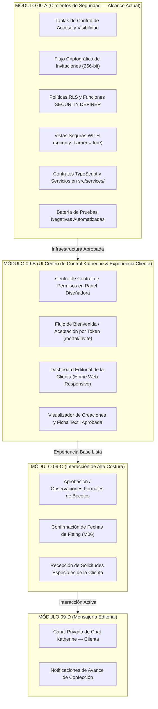
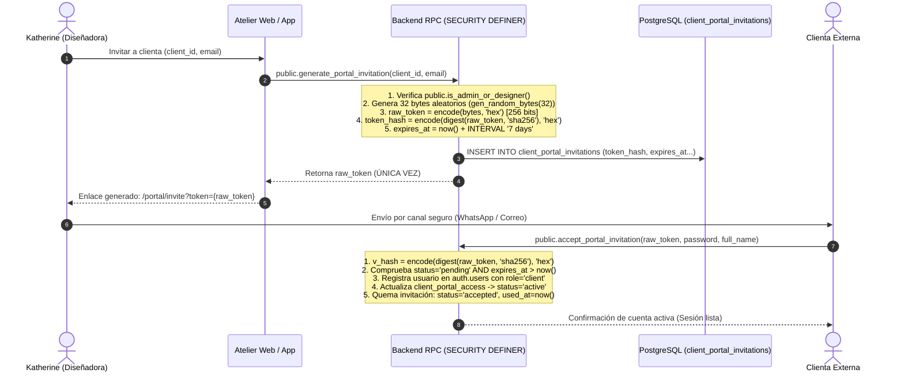
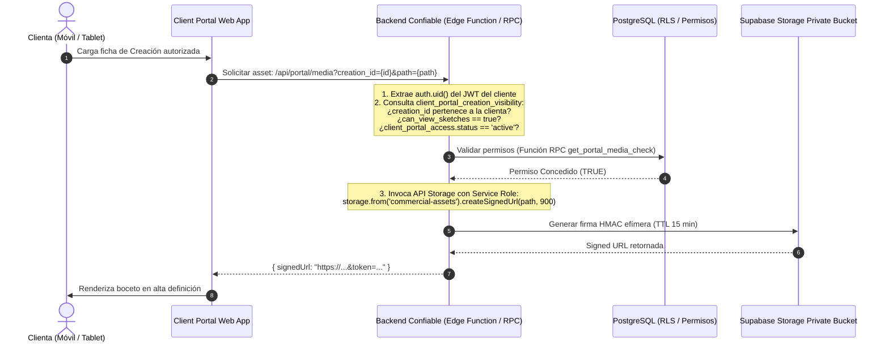

# ATELIER DIGITAL — BY KATHERINE CARROLL
## ESPECIFICACIÓN TÉCNICA CANÓNICA Y CONSOLIDADA (VERSIÓN 2.1)
### MÓDULO 09-A: SEGURIDAD NUCLEAR, RLS, INVITACIONES CRIPTOGRÁFICAS Y PERMISOS DEL PORTAL DE CLIENTES

**Versión:** 2.1 — Revisión Final Consolidada y Endurecida  
**Fecha de Emisión:** 17 de Noviembre de 2026  
**Estado:** Documento Oficial de Especificación (Listo para Aprobación de Implementación)  
**Autor:** Antigravity AI Architecture Team  
**Módulo Destino:** M09 — Portal de Clientes (Fase M09-A: Cimientos de Seguridad y Acceso)  

---

## 1. TABLA DE CORRECCIONES DE VERSIÓN (v2.0 ➔ v2.1) Y JUSTIFICACIÓN TÉCNICA

| Componente | Hallazgo en v2.0 | Corrección Implementada en v2.1 | Justificación Técnica y de Negocio |
| :--- | :--- | :--- | :--- |
| **Pasarelas de Pago** | Se mencionaban "pasarelas de pago" en fases posteriores. | **Eliminación total.** No se contemplan pasarelas de pago ni cobros en línea dentro del portal. | El modelo de alta costura de Katherine Carroll gestiona pagos administrativamente en M07 (transferencias bancarias y anticipos directos). El portal solo expone resúmenes de cotización aprobada. |
| **Extensibilidad de Permisos** | Faltaban interruptores para mensajería y decisiones en las tablas base. | Se agregan columnas `allow_messaging`, `allow_design_approval`, `can_approve_sketches` y `can_send_observations` (`DEFAULT false`). | Evita migraciones de esquema disruptivas (`ALTER TABLE`) en fases interactivas M09-C y M09-D. Todo nace bloqueado por defecto. |
| **Integridad de Bitácora** | `portal_access_id` y `client_id` tenían `ON DELETE CASCADE`. | Se cambia a `ON DELETE SET NULL` para `portal_access_id` y `ON DELETE RESTRICT` para `client_id`. | Si se revoca o desvincula un acceso al portal, el registro forense de auditoría histórica no se borra; permanece intacto. |
| **Generación de Signed URLs** | Se sugería generación de URLs firmadas en SQL puro. | Se define formalmente mediante **Backend Confiable (Edge Function / Service Role)**. | PostgreSQL estándar no firma tokens HMAC de Supabase Storage. Un servicio seguro valida la autorización y genera la URL efímera (TTL: 15 min). |
| **Seguridad de Vistas** | Vistas creadas de forma estándar. | Todas las vistas `v_portal_*` se declaran con `WITH (security_barrier = true)`. | Impide ataques de inferencia por canal lateral (*side-channel attacks*) donde el optimizador de PostgreSQL evalúa funciones de usuario antes del WHERE. |
| **Separación de Alcance** | Ambigüedad entre la lógica de permisos y la interfaz gráfica. | **Desacoplamiento estricto:** M09-A es backend/RLS/servicios; M09-B es la UI del Centro de Control para Katherine. | Permite validar y auditar matemáticamente la seguridad antes de renderizar una sola pantalla en el cliente. |
| **Experiencia de Usuario** | Mención genérica a portal web. | Se especifica experiencia **Web Responsive optimizada para móvil (390×844) y tableta (768×1024)**. | Garantiza una experiencia digital exclusiva, elegante y fluida en los dispositivos que usan las clientas de alta costura. |

---

## 2. MODELO RELACIONAL EXTENSIBLE DEFINITIVO (DDL v2.1)

```sql
-- ==============================================================================
-- 1. CONTROL DE ACCESO GLOBAL AL PORTAL POR CLIENTA (M09-A)
-- ==============================================================================
CREATE TABLE IF NOT EXISTS public.client_portal_access (
    id UUID PRIMARY KEY DEFAULT gen_random_uuid(),
    client_id UUID NOT NULL UNIQUE REFERENCES public.clients(id) ON DELETE RESTRICT,
    auth_user_id UUID UNIQUE REFERENCES auth.users(id) ON DELETE SET NULL,
    status TEXT NOT NULL DEFAULT 'invited'
        CHECK (status IN ('invited', 'active', 'suspended', 'revoked')),
    
    -- Módulos de visualización (M09-A/B)
    allow_creations_view BOOLEAN NOT NULL DEFAULT false,
    allow_measurements_view BOOLEAN NOT NULL DEFAULT false,
    allow_quotations_view BOOLEAN NOT NULL DEFAULT false,
    allow_appointments_view BOOLEAN NOT NULL DEFAULT false,
    allow_fittings_view BOOLEAN NOT NULL DEFAULT false,

    -- Extensibilidad para fases interactivas (M09-C / M09-D)
    allow_design_approval BOOLEAN NOT NULL DEFAULT false,
    allow_messaging BOOLEAN NOT NULL DEFAULT false,

    created_by UUID NOT NULL REFERENCES auth.users(id) ON DELETE RESTRICT,
    updated_by UUID REFERENCES auth.users(id) ON DELETE RESTRICT,
    created_at TIMESTAMPTZ NOT NULL DEFAULT pg_catalog.now(),
    updated_at TIMESTAMPTZ NOT NULL DEFAULT pg_catalog.now()
);

-- ==============================================================================
-- 2. INVITACIONES CRIPTOGRÁFICAS DE UN SOLO USO (ZERO-KNOWLEDGE)
-- ==============================================================================
CREATE TABLE IF NOT EXISTS public.client_portal_invitations (
    id UUID PRIMARY KEY DEFAULT gen_random_uuid(),
    client_id UUID NOT NULL REFERENCES public.clients(id) ON DELETE RESTRICT,
    email TEXT NOT NULL CHECK (email ~* '^[A-Za-z0-9._%+-]+@[A-Za-z0-9.-]+\.[A-Za-z]{2,}$'),
    token_hash TEXT NOT NULL UNIQUE, -- SHA-256 digest del token crudo de 256 bits
    expires_at TIMESTAMPTZ NOT NULL,
    used_at TIMESTAMPTZ,
    status TEXT NOT NULL DEFAULT 'pending'
        CHECK (status IN ('pending', 'accepted', 'expired', 'revoked')),
    invited_by UUID NOT NULL REFERENCES auth.users(id) ON DELETE RESTRICT,
    created_at TIMESTAMPTZ NOT NULL DEFAULT pg_catalog.now()
);

-- ==============================================================================
-- 3. PERMISOS GRANULARES POR CREACIÓN (DOBLE CANDADO)
-- ==============================================================================
CREATE TABLE IF NOT EXISTS public.client_portal_creation_visibility (
    id UUID PRIMARY KEY DEFAULT gen_random_uuid(),
    portal_access_id UUID NOT NULL REFERENCES public.client_portal_access(id) ON DELETE CASCADE,
    creation_id UUID NOT NULL REFERENCES public.creations(id) ON DELETE CASCADE,
    
    -- Visibilidad de taller
    can_view_timeline BOOLEAN NOT NULL DEFAULT false,
    can_view_sketches BOOLEAN NOT NULL DEFAULT false,
    can_view_fabrics BOOLEAN NOT NULL DEFAULT false,
    can_view_fittings BOOLEAN NOT NULL DEFAULT false,
    can_view_budget BOOLEAN NOT NULL DEFAULT false,

    -- Extensibilidad para interacción colaborativa futura (M09-C)
    can_approve_sketches BOOLEAN NOT NULL DEFAULT false,
    can_send_observations BOOLEAN NOT NULL DEFAULT false,

    granted_by UUID NOT NULL REFERENCES auth.users(id) ON DELETE RESTRICT,
    granted_at TIMESTAMPTZ NOT NULL DEFAULT pg_catalog.now(),
    updated_at TIMESTAMPTZ NOT NULL DEFAULT pg_catalog.now(),
    CONSTRAINT uq_portal_creation_visibility UNIQUE (portal_access_id, creation_id)
);

-- ==============================================================================
-- 4. BITÁCORA INMUTABLE DE ACTIVIDAD Y AUDITORÍA HISTÓRICA (NO CASCADE)
-- ==============================================================================
CREATE TABLE IF NOT EXISTS public.client_portal_activity_log (
    id UUID PRIMARY KEY DEFAULT gen_random_uuid(),
    portal_access_id UUID NULL REFERENCES public.client_portal_access(id) ON DELETE SET NULL,
    client_id UUID NOT NULL REFERENCES public.clients(id) ON DELETE RESTRICT,
    auth_user_id UUID REFERENCES auth.users(id) ON DELETE SET NULL,
    event_type TEXT NOT NULL CHECK (event_type IN (
        'invitation_sent', 'invitation_revoked', 'invitation_accepted',
        'auth_login', 'auth_logout', 'access_suspended', 'access_restored',
        'view_creation', 'view_sketches', 'view_quotation', 'view_appointment',
        'permission_modified', 'observation_sent', 'sketch_approved'
    )),
    metadata JSONB NOT NULL DEFAULT '{}'::jsonb,
    ip_address TEXT,
    user_agent TEXT,
    created_at TIMESTAMPTZ NOT NULL DEFAULT pg_catalog.now()
);

-- Trigger de inmutabilidad: prohíbe terminantemente UPDATE y DELETE en la bitácora
CREATE OR REPLACE FUNCTION public.prevent_activity_log_tampering()
RETURNS TRIGGER
LANGUAGE plpgsql
SET search_path = ''
AS $$
BEGIN
    RAISE EXCEPTION 'Operación denegada: la bitácora de actividad es inmutable y no admite modificaciones ni eliminaciones.'
        USING ERRCODE = '42501';
END;
$$;

DROP TRIGGER IF EXISTS trg_protect_activity_log ON public.client_portal_activity_log;
CREATE TRIGGER trg_protect_activity_log
    BEFORE UPDATE OR DELETE ON public.client_portal_activity_log
    FOR EACH ROW
    EXECUTE FUNCTION public.prevent_activity_log_tampering();
```

---

## 3. SEPARACIÓN ESTRICTA DE ETAPAS (ROADMAP DE ALTA COSTURA)



*Nota Expresa de Negocio:* Las operaciones de cobro en línea o pasarelas de pago quedan **descartadas del alcance del portal**. Los pagos continúan bajo la gestión contable y manual de M07.

---

## 4. FLUJO CRIPTOGRÁFICO DE INVITACIONES (256 BITS)



---

## 5. GENERACIÓN CONFIABLE DE URLS FIRMADAS (SUPABASE STORAGE)

Debido a que PostgreSQL estándar no puede generar firmas criptográficas HMAC compatibles con AWS S3/Supabase Storage sin extensiones no portables, el mecanismo de visualización de multimedia privada se delega a un **Backend Confiable**:



---

## 6. ENDURECIMIENTO DE VISTAS CON `security_barrier = true`

Todas las vistas de proyección segura implementan el parámetro `WITH (security_barrier = true)`. Esto instruye al optimizador de PostgreSQL a resolver obligatoriamente el filtrado de RLS y la función de seguridad **antes** de evaluar cualquier función o predicado enviado por el cliente, cerrando de raíz vectores de inferencia y exfiltración de memoria.

```sql
-- 1. Vista de Perfil Seguro
CREATE OR REPLACE VIEW public.v_portal_client_profile
WITH (security_barrier = true) AS
SELECT 
    c.id,
    c.full_name,
    c.email,
    c.phone,
    c.city,
    c.style_preferences,
    c.photo_url,
    c.status
FROM public.clients c
WHERE c.id = public.get_portal_client_id();

-- 2. Vista de Creaciones Autorizadas
CREATE OR REPLACE VIEW public.v_portal_creations
WITH (security_barrier = true) AS
SELECT 
    cr.id,
    cr.name,
    cr.description,
    cr.creation_type,
    cr.status,
    cr.occasion,
    cr.garment_type,
    cr.target_date,
    cr.created_at,
    v.can_view_timeline,
    v.can_view_sketches,
    v.can_view_fabrics,
    v.can_view_fittings,
    v.can_view_budget,
    v.can_approve_sketches,
    v.can_send_observations
FROM public.creations cr
JOIN public.client_portal_creation_visibility v ON cr.id = v.creation_id
JOIN public.client_portal_access a ON v.portal_access_id = a.id
WHERE a.auth_user_id = auth.uid()
  AND a.status = 'active'
  AND a.allow_creations_view = true;

-- 3. Vista de Citas de Agenda (M08)
CREATE OR REPLACE VIEW public.v_portal_appointments
WITH (security_barrier = true) AS
SELECT 
    ap.id,
    ap.appointment_type,
    ap.status,
    ap.starts_at,
    ap.ends_at,
    ap.location_space,
    ap.preparation_notes
FROM public.atelier_appointments ap
JOIN public.client_portal_access a ON ap.client_id = a.client_id
WHERE a.auth_user_id = auth.uid()
  AND a.status = 'active'
  AND a.allow_appointments_view = true
  AND ap.client_visibility = 'client_visible'
  AND ap.status NOT IN ('cancelled');

-- 4. Vista de Pruebas de Fitting (M06)
CREATE OR REPLACE VIEW public.v_portal_fitting_sessions
WITH (security_barrier = true) AS
SELECT 
    fs.id,
    fs.creation_id,
    fs.session_number,
    fs.round_type,
    fs.title,
    fs.status,
    fs.scheduled_at,
    fs.conducted_at,
    fs.location_note
FROM public.atelier_fitting_sessions fs
JOIN public.client_portal_creation_visibility v ON fs.creation_id = v.creation_id
JOIN public.client_portal_access a ON v.portal_access_id = a.id
WHERE a.auth_user_id = auth.uid()
  AND a.status = 'active'
  AND a.allow_fittings_view = true
  AND v.can_view_fittings = true;

-- 5. Vista de Cotizaciones Comerciales Aprobadas (M03)
CREATE OR REPLACE VIEW public.v_portal_commercial_quotes
WITH (security_barrier = true) AS
SELECT 
    cq.id,
    cq.creation_id,
    cq.quote_number,
    cq.currency,
    cq.total_amount,
    cq.payment_schedule,
    cq.valid_until,
    cq.status,
    cq.approved_at
FROM public.commercial_quotes cq
JOIN public.client_portal_creation_visibility v ON cq.creation_id = v.creation_id
JOIN public.client_portal_access a ON v.portal_access_id = a.id
WHERE a.auth_user_id = auth.uid()
  AND a.status = 'active'
  AND a.allow_quotations_view = true
  AND v.can_view_budget = true;

-- 6. Vista de Sesiones de Medidas (M02)
CREATE OR REPLACE VIEW public.v_portal_measurement_sessions
WITH (security_barrier = true) AS
SELECT 
    ms.id,
    ms.session_date,
    ms.status,
    ms.unit_system,
    ms.version_number
FROM public.measurement_sessions ms
JOIN public.client_portal_access a ON ms.client_id = a.client_id
WHERE a.auth_user_id = auth.uid()
  AND a.status = 'active'
  AND a.allow_measurements_view = true
  AND ms.status IN ('completed', 'verified');
```

---

## 7. MATRIZ RLS COMPLETA POR ROL

| Entidad / Tabla | Operación | Rol `admin` / `designer` | Rol `client` (Portal Activo) | Rol `anon` (Público) |
| :--- | :---: | :--- | :--- | :--- |
| `client_portal_access` | `SELECT` | Lectura total del directorio | Solo su propio registro (`auth_user_id = auth.uid()`) | `DENIED (403)` |
| `client_portal_access` | `INSERT / UPDATE / DELETE` | Control exclusivo de Katherine | `DENIED (403)` | `DENIED (403)` |
| `client_portal_invitations` | `SELECT / INSERT / UPDATE` | Creación, consulta y revocación | `DENIED (403)` | `DENIED (403)` |
| `client_portal_creation_visibility` | `SELECT` | Lectura total de directivas | Solo creaciones autorizadas para su `portal_access_id` | `DENIED (403)` |
| `client_portal_creation_visibility` | `INSERT / UPDATE / DELETE` | Asignación exclusiva por Katherine | `DENIED (403)` | `DENIED (403)` |
| `client_portal_activity_log` | `SELECT` | Auditoría total del atelier | Solo lectura de sus propios eventos | `DENIED (403)` |
| `client_portal_activity_log` | `INSERT` | Permitido | Solo inserción con su propio `portal_access_id` | `DENIED (403)` |
| `client_portal_activity_log` | `UPDATE / DELETE` | `DENIED (403)` (Inmutable) | `DENIED (403)` (Inmutable) | `DENIED (403)` |

---

## 8. BATERÍA DE PRUEBAS NEGATIVAS DE AISLAMIENTO

Se implementará en `scratch/verify_m09_stage1_security.cjs`:

1. **NEG-01 (Cross-Tenant Read):** Clienta A intenta consultar citas o creaciones de Clienta B pasando `client_id` ajeno. ➔ **Resultado: 0 filas.**
2. **NEG-02 (Escalamiento Horizontal):** Clienta A envía `UPDATE client_portal_access SET allow_measurements_view = true`. ➔ **Resultado: Error 42501.**
3. **NEG-03 (Escalamiento Vertical):** Clienta A envía `UPDATE profiles SET role = 'designer' WHERE id = auth.uid()`. ➔ **Resultado: Bloqueado por trigger.**
4. **NEG-04 (Replay Attack Invitación):** Invocación de `accept_portal_invitation` con token vencido (> 7 días) o usado. ➔ **Resultado: Excepción segura.**
5. **NEG-05 (Revocación en Caliente):** Katherine conmuta `status = 'suspended'`. Siguiente consulta de la clienta retorna 0 filas de inmediato.
6. **NEG-06 (Integridad de Bitácora):** Intento de `DELETE FROM client_portal_activity_log` o borrado de `client_portal_access`. ➔ **Resultado: El historial se preserva intacto con `portal_access_id = NULL`.**

---

## 9. PLAN DE EJECUCIÓN CRONOLÓGICO Y CONTROL DE CAMBIOS

1. **Migración oficial:** `supabase/migrations/20261118000000_client_portal_m09.sql`.
2. **Contratos tipados:** `src/types/clientPortal.ts`.
3. **Servicio puro:** `src/services/clientPortalService.ts`.
4. **Validación:** `cmd /c npx tsc --noEmit` y `cmd /c npx eslint`.
5. **Suite de pruebas:** `scratch/verify_m09_stage1_security.cjs`.

---

## 10. DECLARACIÓN FORMAL DE NO MODIFICACIÓN

Se confirma expresamente que:
- **No se realizaron mutaciones en código fuente de producción** (`src/`, `app/`).
- **No se modificaron dependencias** (`package.json`, `bun.lock`).
- **No se ejecutaron migraciones, sentencias DDL ni mutaciones en la base de datos de Supabase.**
- **M00–M08 y la creación protegida C15 (`141693a0-01e8-498a-bbb3-1c4f98036543`) permanecen 100% intactos.**
- **M09-A permanece en estado: ESPECIFICACIÓN TÉCNICA 2.1 CONSOLIDADA (PENDIENTE DE IMPLEMENTACIÓN).**
