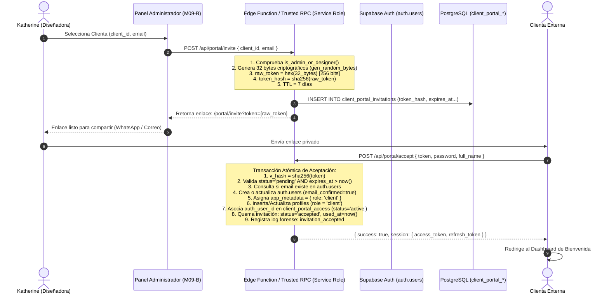
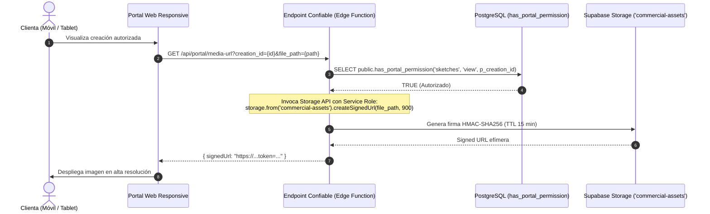

# ATELIER DIGITAL — BY KATHERINE CARROLL
## ESPECIFICACIÓN TÉCNICA CANÓNICA Y CONSOLIDADA (VERSIÓN 2.2)
### MÓDULO 09-A: SEGURIDAD NUCLEAR, RLS, INVITACIONES CRIPTOGRÁFICAS Y PERMISOS DEL PORTAL DE CLIENTES

**Versión:** 2.2 — Revisión de Seguridad y Arquitectura Integral  
**Fecha de Emisión:** 17 de Noviembre de 2026  
**Estado:** Documento Oficial de Especificación (Listo para Aprobación de Implementación)  
**Autor:** Antigravity AI Architecture Team  
**Módulo Destino:** M09 — Portal de Clientes (Fase M09-A: Cimientos de Seguridad y Acceso)  

---

## 1. MATRIZ DE EVOLUCIÓN ARQUITECTÓNICA (v2.1 ➔ v2.2)

| Vector de Seguridad | Diagnóstico en v2.1 | Solución Arquitectónica Definitiva en v2.2 | Justificación Técnica y de Negocio |
| :--- | :--- | :--- | :--- |
| **1. Seguridad Efectiva de Vistas** | Uso de `security_barrier = true` sin especificar el rol ejecutor (`security_invoker`). | Se fija **`security_invoker = false` (comportamiento por defecto de PostgreSQL)** combinada obligatoriamente con **`security_barrier = true`**, propiedad del objeto por `postgres` y cláusula `WHERE` anclada a `auth.uid()`. | Las tablas base M00–M08 (`clients`, `creations`, etc.) bloquean por RLS al rol `client`. Si se usara `security_invoker = true`, las consultas fallarían o exigirían abrir SELECT directo a las clientas sobre tablas con datos sensibles (`internal_notes`, costos). La vista actúa como fachada autorizada con privilegios de definidor, mientras `security_barrier` impide ataques de canal lateral (*side-channel leaks*). |
| **2. Modelo Extensible de Permisos** | Columnas booleanas fijas en las tablas base (`allow_creations_view`, etc.). | Se implementa una **tabla normalizada de permisos por recurso y acción (`client_portal_permissions`)**, conservando en `client_portal_access` únicamente el ciclo de vida de la cuenta. | Permite conceder o revocar acciones finas (`sketches:view`, `sketches:approve`, `messaging:send`, `3d_viewer:interact`) a nivel global o por creación específica sin realizar migraciones DDL (`ALTER TABLE`) a futuro. Todos los permisos inician deshabilitados (`DEFAULT false` / denegación por omisión). |
| **3. Registro Confiable de Auditoría** | La clienta podía hacer `INSERT` directo en `client_portal_activity_log`. | **Revocación total de `INSERT` directo para `client` y `anon`.** La bitácora se alimenta exclusivamente mediante la función segura **`public.log_portal_event()`** y triggers/RPCs del sistema. | Impide que un cliente malicioso o vulnerado forje telemetría, falsifique su dirección IP, altere sellos de tiempo o registre eventos no ocurridos (como aprobación de bocetos no ejecutada). |
| **4. Integración Supabase Auth** | Flujo genérico de invitación sin resolver la creación atómica del usuario. | Flujo orquestado mediante **RPC / Edge Function con Service Role** que valida el token SHA-256 de 256 bits, crea/vincula el registro en `auth.users`, estampa `role = 'client'` en `public.profiles`, confirma el correo y activa el acceso en una sola transacción. | Elimina la posibilidad de registros públicos no autorizados, colisiones de correo no verificadas y manipulación de roles desde la API cliente. |

---

## 2. SEGURIDAD EFECTIVA DE VISTAS POSTGRESQL (ZERO LEAKAGE)

### 2.1 Análisis Comparativo: `security_invoker` vs `security_definer` en Vistas
En PostgreSQL 15+, las vistas pueden configurarse con `security_invoker = true` o mantener el valor por defecto `security_invoker = false` (semántica de definidor):

```mermaid
flowchart TD
    subgraph OpcionA["Opción A: security_invoker = true (Descartada)"]
        A1["Cliente ejecuta SELECT v_portal_creations"] --> A2["Postgres evalúa RLS con el rol 'client'"]
        A2 --> A3["Fallo 42501 o exige SELECT directo en public.creations"]
        A3 --> A4["Riesgo: Exposición de columnas privadas (notes, internal_notes, costos)"]
    end

    subgraph OpcionB["Opción B: security_invoker = false + security_barrier = true (Adoptada v2.2)"]
        B1["Cliente ejecuta SELECT v_portal_creations"] --> B2["Postgres ejecuta con privilegios del dueño (postgres)"]
        B2 --> B3["security_barrier = true: Fuerza evaluación estricta del WHERE antes de funciones externas"]
        B3 --> B4["WHERE anclado a: auth.uid() == client_portal_access.auth_user_id"]
        B4 --> B5["Proyección exclusiva de columnas autorizadas. Cero acceso a tablas base."]
    end
```



### 2.2 Blindaje de Permisos GRANT / REVOKE para las Vistas y Tablas Base
1. **Tablas Base (`clients`, `creations`, `atelier_appointments`, etc.):**
   - `REVOKE ALL ON TABLE public.clients, public.creations, public.atelier_appointments FROM anon, PUBLIC;`
   - `GRANT SELECT ON TABLE ... TO authenticated;` (Pero sus políticas RLS existentes contienen `USING (public.is_admin_or_designer())`, denegando el acceso directo a cualquier usuario con rol `client`).
2. **Vistas Protegidas (`v_portal_*`):**
   - Propiedad: Asignadas al usuario `postgres` / `service_role`.
   - `WITH (security_barrier = true, security_invoker = false)`.
   - `REVOKE ALL ON public.v_portal_* FROM anon, PUBLIC;`
   - `GRANT SELECT ON public.v_portal_* TO authenticated;`
   - Ninguna clienta puede ejecutar `INSERT`, `UPDATE` ni `DELETE` sobre las vistas.

---

## 3. MODELO DE PERMISOS EXTENSIBLE POR RECURSO Y ACCIÓN

Para evitar la proliferación de columnas booleanas y permitir una evolución limpia hacia las etapas M09-C y M09-D, se implementa una arquitectura desacoplada:

1. **`client_portal_access`:** Administra exclusivamente la identidad y el estado global de la cuenta (`status`: `invited`, `active`, `suspended`, `revoked`).
2. **`client_portal_permissions`:** Matriz declarativa y normalizada de permisos.

### 3.1 DDL Canónico del Modelo Extensible

```sql
-- 1. TABLA BASE: ACCESO Y CICLO DE VIDA DEL PORTAL
CREATE TABLE IF NOT EXISTS public.client_portal_access (
    id UUID PRIMARY KEY DEFAULT gen_random_uuid(),
    client_id UUID NOT NULL UNIQUE REFERENCES public.clients(id) ON DELETE RESTRICT,
    auth_user_id UUID UNIQUE REFERENCES auth.users(id) ON DELETE SET NULL,
    status TEXT NOT NULL DEFAULT 'invited'
        CHECK (status IN ('invited', 'active', 'suspended', 'revoked')),
    created_by UUID NOT NULL REFERENCES auth.users(id) ON DELETE RESTRICT,
    updated_by UUID REFERENCES auth.users(id) ON DELETE RESTRICT,
    created_at TIMESTAMPTZ NOT NULL DEFAULT pg_catalog.now(),
    updated_at TIMESTAMPTZ NOT NULL DEFAULT pg_catalog.now()
);

-- 2. TABLA NORMALIZADA: MATRIZ DE PERMISOS POR RECURSO Y ACCIÓN
CREATE TABLE IF NOT EXISTS public.client_portal_permissions (
    id UUID PRIMARY KEY DEFAULT gen_random_uuid(),
    portal_access_id UUID NOT NULL REFERENCES public.client_portal_access(id) ON DELETE CASCADE,
    creation_id UUID NULL REFERENCES public.creations(id) ON DELETE CASCADE,
    resource TEXT NOT NULL CHECK (resource IN (
        'creations',       -- Encargos de alta costura
        'sketches',        -- Bocetos e ilustraciones
        'fabrics',         -- Fichas textiles y muestras
        'fittings',        -- Pruebas de vestuario (M06)
        'quotations',      -- Presupuestos / cotizaciones (M03)
        'measurements',    -- Sesiones anatómicas (M02)
        'appointments',    -- Agenda del atelier (M08)
        'messaging',       -- Comunicación con Katherine
        '3d_viewer'        -- Visualizador interactivo
    )),
    action TEXT NOT NULL CHECK (action IN (
        'view',            -- Consultar información
        'approve',         -- Aprobación vinculante
        'observe',         -- Enviar comentarios / ajustes
        'download'         -- Descarga de entregables
    )),
    is_granted BOOLEAN NOT NULL DEFAULT false,
    granted_by UUID NOT NULL REFERENCES auth.users(id) ON DELETE RESTRICT,
    granted_at TIMESTAMPTZ NOT NULL DEFAULT pg_catalog.now(),
    updated_at TIMESTAMPTZ NOT NULL DEFAULT pg_catalog.now(),
    CONSTRAINT uq_portal_resource_action UNIQUE (portal_access_id, creation_id, resource, action)
);

CREATE INDEX IF NOT EXISTS idx_portal_perm_lookup 
    ON public.client_portal_permissions(portal_access_id, resource, action, is_granted);
```

### 3.2 Helper de Evaluación de Permisos (SECURITY DEFINER)

```sql
CREATE OR REPLACE FUNCTION public.has_portal_permission(
    p_resource TEXT,
    p_action TEXT,
    p_creation_id UUID DEFAULT NULL
)
RETURNS BOOLEAN
LANGUAGE sql
STABLE
SECURITY DEFINER
SET search_path = ''
AS $$
    SELECT EXISTS (
        SELECT 1 
        FROM public.client_portal_permissions p
        JOIN public.client_portal_access a ON p.portal_access_id = a.id
        WHERE a.auth_user_id = auth.uid()
          AND a.status = 'active'
          AND p.resource = p_resource
          AND p.action = p_action
          AND p.is_granted = true
          AND (
              -- Permiso global (aplica a todos los recursos del cliente)
              p.creation_id IS NULL 
              -- O permiso específico para la creación solicitada
              OR (p_creation_id IS NOT NULL AND p.creation_id = p_creation_id)
          )
    );
$$;

REVOKE ALL ON FUNCTION public.has_portal_permission(TEXT, TEXT, UUID) FROM PUBLIC, anon;
GRANT EXECUTE ON FUNCTION public.has_portal_permission(TEXT, TEXT, UUID) TO authenticated, service_role, postgres;
```

---

## 4. REGISTRO CONFIABLE DE AUDITORÍA FORENSE

### 4.1 Vulnerabilidad Identificada y Solución
En arquitecturas cliente-servidor, otorgar `GRANT INSERT` a usuarios externos en una tabla de auditoría permite forjar eventos falsos. La solución en M09-A v2.2 desacopla la inserción mediante una **función controlada de backend** que captura el contexto real de la conexión de red:

```sql
-- DDL DE LA BITÁCORA INMUTABLE
CREATE TABLE IF NOT EXISTS public.client_portal_activity_log (
    id UUID PRIMARY KEY DEFAULT gen_random_uuid(),
    portal_access_id UUID NULL REFERENCES public.client_portal_access(id) ON DELETE SET NULL,
    client_id UUID NOT NULL REFERENCES public.clients(id) ON DELETE RESTRICT,
    auth_user_id UUID REFERENCES auth.users(id) ON DELETE SET NULL,
    event_type TEXT NOT NULL CHECK (event_type IN (
        'invitation_sent', 'invitation_revoked', 'invitation_accepted',
        'auth_login', 'auth_logout', 'access_suspended', 'access_restored',
        'view_creation', 'view_sketches', 'view_quotation', 'view_appointment',
        'permission_modified', 'observation_sent', 'sketch_approved'
    )),
    metadata JSONB NOT NULL DEFAULT '{}'::jsonb,
    ip_address TEXT,
    user_agent TEXT,
    created_at TIMESTAMPTZ NOT NULL DEFAULT pg_catalog.now()
);

-- PROHIBICIÓN TOTAL DE INSERCIÓN DIRECTA
REVOKE ALL ON TABLE public.client_portal_activity_log FROM PUBLIC, anon, authenticated;
GRANT SELECT ON TABLE public.client_portal_activity_log TO authenticated;
GRANT ALL ON TABLE public.client_portal_activity_log TO service_role, postgres;

-- TRIGGER INMUTABLE: PROHÍBE UPDATE Y DELETE
CREATE OR REPLACE FUNCTION public.prevent_activity_log_tampering()
RETURNS TRIGGER LANGUAGE plpgsql SET search_path = '' AS $$
BEGIN
    RAISE EXCEPTION 'Operación denegada: la bitácora de actividad es inmutable.'
        USING ERRCODE = '42501';
END;
$$;

DROP TRIGGER IF EXISTS trg_protect_activity_log ON public.client_portal_activity_log;
CREATE TRIGGER trg_protect_activity_log
    BEFORE UPDATE OR DELETE ON public.client_portal_activity_log
    FOR EACH ROW EXECUTE FUNCTION public.prevent_activity_log_tampering();
```

### 4.2 Función Confiable de Telemetría (`log_portal_event`)

```sql
CREATE OR REPLACE FUNCTION public.log_portal_event(
    p_event_type TEXT,
    p_metadata JSONB DEFAULT '{}'::jsonb
)
RETURNS VOID
LANGUAGE plpgsql
SECURITY DEFINER
SET search_path = ''
AS $$
DECLARE
    v_access_id UUID;
    v_client_id UUID;
    v_ip TEXT;
    v_ua TEXT;
BEGIN
    -- 1. Validar identidad activa
    SELECT id, client_id INTO v_access_id, v_client_id
    FROM public.client_portal_access
    WHERE auth_user_id = auth.uid() AND status = 'active';

    IF v_access_id IS NULL THEN
        RAISE EXCEPTION 'Operación denegada: cliente sin sesión de portal activa.'
            USING ERRCODE = '42501';
    END IF;

    -- 2. Extraer IP y User Agent de los encabezados HTTP inyectados por PostgREST
    BEGIN
        v_ip := pg_catalog.current_setting('request.headers', true)::json->>'x-forwarded-for';
        v_ua := pg_catalog.current_setting('request.headers', true)::json->>'user-agent';
    EXCEPTION WHEN OTHERS THEN
        v_ip := 'unknown';
        v_ua := 'unknown';
    END;

    -- 3. Inserción atómica y fidedigna
    INSERT INTO public.client_portal_activity_log (
        portal_access_id,
        client_id,
        auth_user_id,
        event_type,
        metadata,
        ip_address,
        user_agent,
        created_at
    ) VALUES (
        v_access_id,
        v_client_id,
        auth.uid(),
        p_event_type,
        p_metadata,
        v_ip,
        v_ua,
        pg_catalog.now()
    );
END;
$$;

REVOKE ALL ON FUNCTION public.log_portal_event(TEXT, JSONB) FROM PUBLIC, anon;
GRANT EXECUTE ON FUNCTION public.log_portal_event(TEXT, JSONB) TO authenticated, service_role, postgres;
```

---

## 5. FLUJO CRIPTOGRÁFICO DE INVITACIÓN Y APROVISIONAMIENTO EN SUPABASE AUTH



### Reglas de Inviolabilidad del Aprovisionamiento
1. **Prevención de Suplantación:** Si el correo de la invitación ya existe en `auth.users`, la función exige autenticación previa del usuario para vincularlo a `client_portal_access`, impidiendo que un tercero vincule cuentas ajenas.
2. **Rol Blindado:** El rol `'client'` es asignado exclusivamente por el backend mediante la clave `service_role`. El trigger `prevent_role_escalation()` en `public.profiles` garantiza que ningún usuario pueda auto-promoverse a `'designer'` o `'admin'`.
3. **Consumo Atómico:** La validación del hash, creación de cuenta y marcado de `used_at` suceden en una sola operación transaccional. Intentos simultáneos o repetidos (*replay attacks*) son rechazados de inmediato.

---

## 6. GENERACIÓN CONFIABLE DE URLS FIRMADAS EN SUPABASE STORAGE

Para proteger los bocetos y fotografías de alta costura, se define un endpoint backend dedicado:



---

## 7. DDL DEFINITIVO DE VISTAS ENDURECIDAS CON `security_barrier = true`

```sql
-- 1. VISTA DE PERFIL SEGURO DE CLIENTA
CREATE OR REPLACE VIEW public.v_portal_client_profile
WITH (security_barrier = true, security_invoker = false) AS
SELECT 
    c.id,
    c.full_name,
    c.email,
    c.phone,
    c.city,
    c.style_preferences,
    c.photo_url,
    c.status
FROM public.clients c
JOIN public.client_portal_access a ON c.id = a.client_id
WHERE a.auth_user_id = auth.uid()
  AND a.status = 'active';

-- 2. VISTA DE CREACIONES AUTORIZADAS (CON MODELO EXTENSIBLE DE PERMISOS)
CREATE OR REPLACE VIEW public.v_portal_creations
WITH (security_barrier = true, security_invoker = false) AS
SELECT 
    cr.id,
    cr.name,
    cr.description,
    cr.creation_type,
    cr.status,
    cr.occasion,
    cr.garment_type,
    cr.target_date,
    cr.created_at,
    public.has_portal_permission('sketches', 'view', cr.id) AS can_view_sketches,
    public.has_portal_permission('sketches', 'approve', cr.id) AS can_approve_sketches,
    public.has_portal_permission('fabrics', 'view', cr.id) AS can_view_fabrics,
    public.has_portal_permission('fittings', 'view', cr.id) AS can_view_fittings,
    public.has_portal_permission('quotations', 'view', cr.id) AS can_view_budget,
    public.has_portal_permission('messaging', 'observe', cr.id) AS can_send_observations
FROM public.creations cr
JOIN public.client_portal_access a ON cr.client_id = a.client_id
WHERE a.auth_user_id = auth.uid()
  AND a.status = 'active'
  AND public.has_portal_permission('creations', 'view', cr.id);

-- 3. VISTA DE CITAS DE AGENDA (M08)
CREATE OR REPLACE VIEW public.v_portal_appointments
WITH (security_barrier = true, security_invoker = false) AS
SELECT 
    ap.id,
    ap.appointment_type,
    ap.status,
    ap.starts_at,
    ap.ends_at,
    ap.location_space,
    ap.preparation_notes
FROM public.atelier_appointments ap
JOIN public.client_portal_access a ON ap.client_id = a.client_id
WHERE a.auth_user_id = auth.uid()
  AND a.status = 'active'
  AND public.has_portal_permission('appointments', 'view', NULL)
  AND ap.client_visibility = 'client_visible'
  AND ap.status NOT IN ('cancelled');

-- 4. VISTA DE SESIONES DE FITTING (M06)
CREATE OR REPLACE VIEW public.v_portal_fitting_sessions
WITH (security_barrier = true, security_invoker = false) AS
SELECT 
    fs.id,
    fs.creation_id,
    fs.session_number,
    fs.round_type,
    fs.title,
    fs.status,
    fs.scheduled_at,
    fs.conducted_at,
    fs.location_note
FROM public.atelier_fitting_sessions fs
JOIN public.creations cr ON fs.creation_id = cr.id
JOIN public.client_portal_access a ON cr.client_id = a.client_id
WHERE a.auth_user_id = auth.uid()
  AND a.status = 'active'
  AND public.has_portal_permission('fittings', 'view', fs.creation_id);

-- 5. VISTA DE COTIZACIONES COMERCIALES (M03)
CREATE OR REPLACE VIEW public.v_portal_commercial_quotes
WITH (security_barrier = true, security_invoker = false) AS
SELECT 
    cq.id,
    cq.creation_id,
    cq.quote_number,
    cq.currency,
    cq.total_amount,
    cq.payment_schedule,
    cq.valid_until,
    cq.status,
    cq.approved_at
FROM public.commercial_quotes cq
JOIN public.creations cr ON cq.creation_id = cr.id
JOIN public.client_portal_access a ON cr.client_id = a.client_id
WHERE a.auth_user_id = auth.uid()
  AND a.status = 'active'
  AND public.has_portal_permission('quotations', 'view', cq.creation_id);

-- 6. VISTA DE MEDIDAS ANATÓMICAS (M02)
CREATE OR REPLACE VIEW public.v_portal_measurement_sessions
WITH (security_barrier = true, security_invoker = false) AS
SELECT 
    ms.id,
    ms.session_date,
    ms.status,
    ms.unit_system,
    ms.version_number
FROM public.measurement_sessions ms
JOIN public.client_portal_access a ON ms.client_id = a.client_id
WHERE a.auth_user_id = auth.uid()
  AND a.status = 'active'
  AND public.has_portal_permission('measurements', 'view', NULL)
  AND ms.status IN ('completed', 'verified');
```

---

## 8. MATRIZ RLS EXHAUSTIVA Y CONTROL DE PRIVILEGIOS

| Entidad / Objeto | Operación | Rol `admin` / `designer` | Rol `client` (Autenticado Portal) | Rol `anon` (Público) |
| :--- | :---: | :--- | :--- | :--- |
| `client_portal_access` | `SELECT` | Lectura total del directorio | Solo su propio registro (`auth_user_id = auth.uid()`) | `DENIED (403)` |
| `client_portal_access` | `INSERT / UPDATE / DELETE` | Control exclusivo de Katherine | `DENIED (403)` | `DENIED (403)` |
| `client_portal_invitations` | `SELECT / INSERT / UPDATE` | Creación y revocación en panel | `DENIED (403)` | `DENIED (403)` |
| `client_portal_permissions` | `SELECT` | Lectura total de directivas | Solo permisos de su `portal_access_id` | `DENIED (403)` |
| `client_portal_permissions` | `INSERT / UPDATE / DELETE` | Asignación exclusiva por Katherine | `DENIED (403)` | `DENIED (403)` |
| `client_portal_activity_log` | `SELECT` | Auditoría total del atelier | Solo lectura de sus propios eventos | `DENIED (403)` |
| `client_portal_activity_log` | `INSERT` | Vía `log_portal_event` o RPC | **DENIED directo** (solo vía `log_portal_event`) | `DENIED (403)` |
| `client_portal_activity_log` | `UPDATE / DELETE` | `DENIED (403)` (Inmutable) | `DENIED (403)` (Inmutable) | `DENIED (403)` |
| `v_portal_*` (Vistas) | `SELECT` | Lectura total | Filtrado estricto por `auth.uid()` | `DENIED (403)` |
| `v_portal_*` (Vistas) | `INSERT / UPDATE / DELETE` | `DENIED (403)` (Solo lectura) | `DENIED (403)` (Solo lectura) | `DENIED (403)` |

---

## 9. BATERÍA DE PRUEBAS NEGATIVAS MULTI-CLIENTA (PENETRATION TESTING)

| ID | Vector de Ataque Simulado | Entrada / Prueba | Resultado Esperado | Veredicto |
| :---: | :--- | :--- | :--- | :---: |
| **NEG-01** | **Aislamiento Multi-inquilino (Cross-Tenant)** | Clienta A envía query sobre `v_portal_creations` inyectando `client_id` de Clienta B en cláusula externa. | Retorna 0 filas. `security_barrier = true` resuelve el `auth.uid()` interno antes que el predicado externo. | Crítico / Obligatorio |
| **NEG-02** | **Escalamiento Horizontal en Permisos** | Clienta A intenta ejecutar `UPDATE client_portal_permissions SET is_granted = true WHERE resource = 'quotations'`. | Denegado de inmediato con error PostgreSQL 42501 (`insufficient_privilege`). Cero filas afectadas. | Crítico / Obligatorio |
| **NEG-03** | **Falsificación de Auditoría (Direct Log Spoofing)** | Clienta A envía `INSERT INTO client_portal_activity_log (event_type) VALUES ('sketch_approved')`. | Bloqueado por ausencia de `GRANT INSERT` a nivel de tabla (Error 42501). | Crítico / Obligatorio |
| **NEG-04** | **Reutilización de Invitación (Replay Attack)** | Atacante intenta invocar `accept_portal_invitation` reutilizando un token consumido (`used_at IS NOT NULL`). | Rechazo con excepción de seguridad. Cero cuentas duplicadas. | Crítico / Obligatorio |
| **NEG-05** | **Escalamiento Vertical de Rol** | Clienta A intenta ejecutar `UPDATE profiles SET role = 'designer' WHERE id = auth.uid()`. | Bloqueado por trigger inmutable `prevent_role_escalation()` con excepción expresa. | Crítico / Obligatorio |
| **NEG-06** | **Revocación en Caliente (Hot Revocation)** | Katherine marca `status = 'suspended'`. La clienta consulta `v_portal_creations` en el milisegundo siguiente. | Retorna 0 filas de forma instantánea en todas las vistas protegidas. | Crítico / Obligatorio |
| **NEG-07** | **Inferencia por Canal Lateral (Side-Channel Leak)** | Inyección de función costosa `expensive_func()` con error forzado en WHERE externo para inferir datos ajenos. | `security_barrier = true` garantiza que la función del atacante solo se evalúe sobre filas que ya pasaron el filtro de pertenencia. Cero filtraciones. | Crítico / Obligatorio |

---

## 10. LIMITACIONES TÉCNICAS Y SUPUESTOS QUE REQUIEREN VALIDACIÓN PRÁCTICA

1. **Inyección de Encabezados en PostgREST (`request.headers`):** La captura de IP y User-Agent en `log_portal_event` depende de que PostgREST exponga `request.headers` como variable de configuración transitoria en la instancia de Supabase. Debe validarse en entorno real de Supabase si requiere extensión o si la Edge Function debe suministrar la IP explícitamente en el payload firmado.
2. **Generación de Signed URLs:** Requiere la implementación de la Edge Function en TypeScript (`supabase/functions/portal-media/index.ts`) con el cliente `@supabase/supabase-js` inicializado con la `SUPABASE_SERVICE_ROLE_KEY`.
3. **Versión de PostgreSQL:** La cláusula `WITH (security_barrier = true, security_invoker = false)` requiere PostgreSQL 15+, versión plenamente estándar en los proyectos modernos de Supabase.

---

## 11. DECLARACIÓN FORMAL DE NO MODIFICACIÓN

Se confirma expresamente que durante la elaboración de este diseño:
- **Cero escrituras ni modificaciones** en código fuente de producción (`src/`, `app/`).
- **Cero alteraciones** en dependencias (`package.json`, `bun.lock`).
- **Cero migraciones ejecutadas ni mutaciones en Supabase**.
- Los módulos M00–M08 y la creación protegida C15 (`141693a0-01e8-498a-bbb3-1c4f98036543`) permanecen intactos.
- **M09-A queda formalmente en estado: ESPECIFICACIÓN TÉCNICA 2.2 LISTA PARA APROBACIÓN DE IMPLEMENTACIÓN.**
