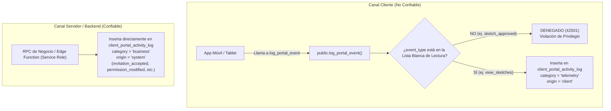
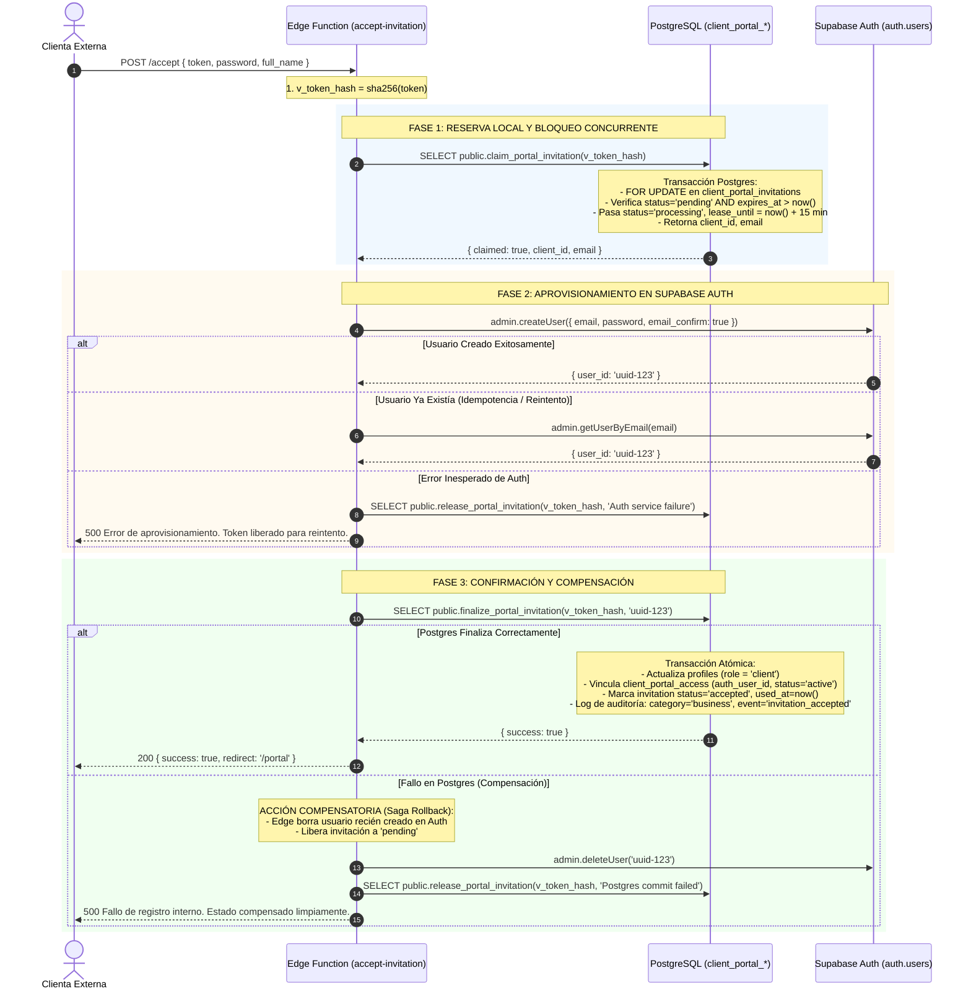

# ATELIER DIGITAL — BY KATHERINE CARROLL
## ESPECIFICACIÓN TÉCNICA CANÓNICA Y CONSOLIDADA (VERSIÓN 2.3)
### MÓDULO 09-A: SEGURIDAD NUCLEAR, RLS, INVITACIONES CRIPTOGRÁFICAS Y PERMISOS DEL PORTAL DE CLIENTES

**Versión:** 2.3 — Revisión de Seguridad Nuclear, Auditoría Confiable y Aprovisionamiento Idempotente  
**Fecha de Emisión:** 17 de Noviembre de 2026  
**Estado:** Documento Oficial de Especificación (Listo para Aprobación de Implementación)  
**Autor:** Antigravity AI Architecture Team  
**Módulo Destino:** M09 — Portal de Clientes (Fase M09-A: Cimientos de Seguridad y Acceso)  

---

## 1. MATRIZ DE RESOLUCIÓN DE HALLAZGOS (VERSIÓN 2.2 ➔ 2.3)

| Hallazgo en v2.2 | Riesgo Técnico / Vulnerabilidad | Solución Canónica Implementada en v2.3 |
| :--- | :--- | :--- |
| **1. Falsificación en `log_portal_event`** | La función permitía a la clienta pasar cualquier `event_type` (ej. `'sketch_approved'`), permitiendo simular aprobaciones legales o alterar la telemetría. | **Separación estricta:** Los eventos de negocio (`sketch_approved`, `invitation_accepted`, `permission_modified`, `access_suspended`) son emitidos **exclusivamente por procedimientos internos/RPCs**. La función `log_portal_event` aplica una lista blanca estricta limitada a telemetría de visualización (`view_creation`, etc.). |
| **2. Falsa Atomicidad en Supabase Auth** | No es posible hacer rollback de una API REST externa (`auth.admin.createUser`) dentro de un `BEGIN...COMMIT` de PostgreSQL, dejando usuarios huérfanos o tokens quemados ante caídas. | **Patrón de Aprovisionamiento en 2 Fases con Compensación:** Máquina de estados en invitaciones (`pending` ➔ `processing` con lease de 15 min ➔ `accepted`/`failed`), idempotencia por hash y compensación (`deleteUser` si falla el enlace en Postgres). |
| **3. Unicidad de Permisos Globales y Precedencia** | En SQL estándar, `UNIQUE (portal_access_id, creation_id, resource, action)` permite múltiples nulos en `creation_id`. No había regla clara ante conflicto global vs específico. | Se implementa **`UNIQUE NULLS NOT DISTINCT`** (Postgres 15+) o índice con `COALESCE` para unicidad estricta. **Precedencia explícita Deny-Overrides:** Lo específico prima sobre lo global; si hay conflicto o ausencia, prevalece la **DENEGACIÓN (Zero Trust)**. |
| **4. DDL Ejecutable Completo** | Faltaban sentencias DDL explícitas de habilitación RLS, políticas completas y permisos de objetos. | Se entrega el **DDL ejecutable 100% completo**, totalmente cualificado (`SET search_path = ''`), con cada política RLS, GRANT y REVOKE. |
| **5. Coherencia Relacional M00–M08** | Verificación de claves foráneas contra tablas satélites y maestros del atelier. | Confirmación de claves foráneas con `ON DELETE RESTRICT` para maestros (`clients`, `creations`) y `ON DELETE SET NULL` para vínculos blandos, garantizando integridad referencial e inviolabilidad de C15. |

---

## 2. SEPARACIÓN ESTRICTA: EVENTOS DE NEGOCIO VS TELEMETRÍA DE LECTURA



### Reglas de Auditoría:
1. **Eventos de Negocio (Críticos / Legales):** Solo pueden ser registrados por funciones `SECURITY DEFINER` internas del atelier o por la Service Role Key.
2. **Eventos de Telemetría (Lectura de UI):** La clienta solo puede emitir: `'view_portal_home'`, `'view_creation'`, `'view_sketches'`, `'view_quotation'`, `'view_appointment'`, `'view_measurements'`, `'view_fittings'`.
3. Cualquier intento de enviar un evento fuera de la lista blanca emite `SQLSTATE 42501`.

---

## 3. APROVISIONAMIENTO IDEMPOTENTE Y RECUPERABLE EN SUPABASE AUTH

Dado que `auth.users` reside fuera del motor relacional de transacciones de Postgres (gestionado por GoTrue), se implementa un **patrón Saga de 2 Fases con Compensación**:



---

## 4. MODELO DE PERMISOS: UNICIDAD Y PRECEDENCIA EXPLICITA (DENY-OVERRIDES)

### 4.1 Resolución de Unicidad con `creation_id NULL`
Para evitar registros duplicados cuando `creation_id` es nulo (permisos globales), se implementa un índice único con `COALESCE`:

```sql
CREATE UNIQUE INDEX IF NOT EXISTS uq_portal_permissions_canonical_idx
    ON public.client_portal_permissions (
        portal_access_id, 
        COALESCE(creation_id, '00000000-0000-0000-0000-000000000000'::uuid), 
        resource, 
        action
    );
```

### 4.2 Matriz de Decisión y Precedencia (Deny by Default + Specific Overrides Global)

| Estado Cuenta Global | Permiso Específico Creación (`creation_id = X`) | Permiso Global (`creation_id IS NULL`) | Decisión Final |
| :---: | :---: | :---: | :---: |
| `status != 'active'` | Cualquiera | Cualquiera | **DENEGADO (403)** |
| `status = 'active'` | `is_granted = false` | `is_granted = true` | **DENEGADO (Lo específico prima sobre lo global)** |
| `status = 'active'` | `is_granted = true` | `is_granted = false` | **CONCEDIDO (Excepción específica autorizada)** |
| `status = 'active'` | No existe registro específico | `is_granted = true` | **CONCEDIDO (Hereda permiso global)** |
| `status = 'active'` | No existe registro específico | `is_granted = false` | **DENEGADO** |
| `status = 'active'` | No existe registro específico | No existe registro global | **DENEGADO (Zero Trust / Denegación por Omisión)** |

---

## 5. DDL EJECUTABLE COMPLETO: TABLAS, ÍNDICES, FUNCIONES Y RLS

```sql
-- ==============================================================================
-- ATELIER DIGITAL — MÓDULO 09-A: ESPECIFICACIÓN DDL CANÓNICA v2.3
-- ==============================================================================

BEGIN;

-- ------------------------------------------------------------------------------
-- 1. TABLA: ACCESO Y ESTADO GLOBAL DEL PORTAL (client_portal_access)
-- ------------------------------------------------------------------------------
CREATE TABLE IF NOT EXISTS public.client_portal_access (
    id UUID PRIMARY KEY DEFAULT gen_random_uuid(),
    client_id UUID NOT NULL UNIQUE REFERENCES public.clients(id) ON DELETE RESTRICT,
    auth_user_id UUID UNIQUE REFERENCES auth.users(id) ON DELETE SET NULL,
    status TEXT NOT NULL DEFAULT 'invited'
        CHECK (status IN ('invited', 'active', 'suspended', 'revoked')),
    created_by UUID NOT NULL REFERENCES auth.users(id) ON DELETE RESTRICT,
    updated_by UUID REFERENCES auth.users(id) ON DELETE RESTRICT,
    created_at TIMESTAMPTZ NOT NULL DEFAULT pg_catalog.now(),
    updated_at TIMESTAMPTZ NOT NULL DEFAULT pg_catalog.now()
);

CREATE INDEX IF NOT EXISTS idx_cpa_client_id ON public.client_portal_access(client_id);
CREATE INDEX IF NOT EXISTS idx_cpa_auth_user_id ON public.client_portal_access(auth_user_id);
CREATE INDEX IF NOT EXISTS idx_cpa_status ON public.client_portal_access(status);

-- ------------------------------------------------------------------------------
-- 2. TABLA: INVITACIONES CRIPTOGRÁFICAS RECUPERABLES (client_portal_invitations)
-- ------------------------------------------------------------------------------
CREATE TABLE IF NOT EXISTS public.client_portal_invitations (
    id UUID PRIMARY KEY DEFAULT gen_random_uuid(),
    client_id UUID NOT NULL REFERENCES public.clients(id) ON DELETE RESTRICT,
    email TEXT NOT NULL CHECK (email ~* '^[A-Za-z0-9._%+-]+@[A-Za-z0-9.-]+\.[A-Za-z]{2,}$'),
    token_hash TEXT NOT NULL UNIQUE, -- SHA-256 digest del token crudo
    expires_at TIMESTAMPTZ NOT NULL,
    lease_until TIMESTAMPTZ,         -- Control de concurrencia y recuperación en 2 fases
    used_at TIMESTAMPTZ,
    status TEXT NOT NULL DEFAULT 'pending'
        CHECK (status IN ('pending', 'processing', 'accepted', 'expired', 'revoked')),
    failure_reason TEXT,
    invited_by UUID NOT NULL REFERENCES auth.users(id) ON DELETE RESTRICT,
    created_at TIMESTAMPTZ NOT NULL DEFAULT pg_catalog.now()
);

CREATE INDEX IF NOT EXISTS idx_cpi_token_hash ON public.client_portal_invitations(token_hash);
CREATE INDEX IF NOT EXISTS idx_cpi_lookup ON public.client_portal_invitations(status, expires_at);

-- ------------------------------------------------------------------------------
-- 3. TABLA: MATRIZ EXTENSIBLE DE PERMISOS (client_portal_permissions)
-- ------------------------------------------------------------------------------
CREATE TABLE IF NOT EXISTS public.client_portal_permissions (
    id UUID PRIMARY KEY DEFAULT gen_random_uuid(),
    portal_access_id UUID NOT NULL REFERENCES public.client_portal_access(id) ON DELETE CASCADE,
    creation_id UUID NULL REFERENCES public.creations(id) ON DELETE CASCADE,
    resource TEXT NOT NULL CHECK (resource IN (
        'creations', 'sketches', 'fabrics', 'fittings', 
        'quotations', 'measurements', 'appointments', 'messaging', '3d_viewer'
    )),
    action TEXT NOT NULL CHECK (action IN ('view', 'approve', 'observe', 'download')),
    is_granted BOOLEAN NOT NULL DEFAULT false,
    granted_by UUID NOT NULL REFERENCES auth.users(id) ON DELETE RESTRICT,
    granted_at TIMESTAMPTZ NOT NULL DEFAULT pg_catalog.now(),
    updated_at TIMESTAMPTZ NOT NULL DEFAULT pg_catalog.now()
);

CREATE UNIQUE INDEX IF NOT EXISTS uq_portal_permissions_canonical_idx
    ON public.client_portal_permissions (
        portal_access_id, 
        COALESCE(creation_id, '00000000-0000-0000-0000-000000000000'::uuid), 
        resource, 
        action
    );

CREATE INDEX IF NOT EXISTS idx_portal_perm_eval
    ON public.client_portal_permissions(portal_access_id, resource, action, is_granted);

-- ------------------------------------------------------------------------------
-- 4. TABLA: AUDITORÍA FORENSE INMUTABLE (client_portal_activity_log)
-- ------------------------------------------------------------------------------
CREATE TABLE IF NOT EXISTS public.client_portal_activity_log (
    id UUID PRIMARY KEY DEFAULT gen_random_uuid(),
    portal_access_id UUID NULL REFERENCES public.client_portal_access(id) ON DELETE SET NULL,
    client_id UUID NOT NULL REFERENCES public.clients(id) ON DELETE RESTRICT,
    auth_user_id UUID REFERENCES auth.users(id) ON DELETE SET NULL,
    category TEXT NOT NULL CHECK (category IN ('business', 'telemetry')),
    origin TEXT NOT NULL CHECK (origin IN ('system', 'client')),
    event_type TEXT NOT NULL,
    metadata JSONB NOT NULL DEFAULT '{}'::jsonb,
    ip_address TEXT,
    user_agent TEXT,
    created_at TIMESTAMPTZ NOT NULL DEFAULT pg_catalog.now()
);

CREATE INDEX IF NOT EXISTS idx_cpal_client_time ON public.client_portal_activity_log(client_id, created_at DESC);
CREATE INDEX IF NOT EXISTS idx_cpal_category ON public.client_portal_activity_log(category, event_type);

-- Trigger de inmutabilidad estricta
CREATE OR REPLACE FUNCTION public.prevent_activity_log_tampering()
RETURNS TRIGGER LANGUAGE plpgsql SET search_path = '' AS $$
BEGIN
    RAISE EXCEPTION 'Operación denegada: la bitácora de actividad es inmutable y permanente.'
        USING ERRCODE = '42501';
END;
$$;

DROP TRIGGER IF EXISTS trg_protect_activity_log ON public.client_portal_activity_log;
CREATE TRIGGER trg_protect_activity_log
    BEFORE UPDATE OR DELETE ON public.client_portal_activity_log
    FOR EACH ROW EXECUTE FUNCTION public.prevent_activity_log_tampering();

-- ------------------------------------------------------------------------------
-- 5. HELPERS DE SEGURIDAD Y EVALUADOR DE PERMISOS
-- ------------------------------------------------------------------------------

-- Helper canónico: Obtener portal_access_id activo
CREATE OR REPLACE FUNCTION public.get_portal_access_id()
RETURNS UUID LANGUAGE sql STABLE SECURITY DEFINER SET search_path = '' AS $$
    SELECT id FROM public.client_portal_access
    WHERE auth_user_id = auth.uid() AND status = 'active'
    LIMIT 1;
$$;

-- Helper canónico: Obtener client_id activo
CREATE OR REPLACE FUNCTION public.get_portal_client_id()
RETURNS UUID LANGUAGE sql STABLE SECURITY DEFINER SET search_path = '' AS $$
    SELECT client_id FROM public.client_portal_access
    WHERE auth_user_id = auth.uid() AND status = 'active'
    LIMIT 1;
$$;

-- Evaluador jerárquico con Deny-Overrides
CREATE OR REPLACE FUNCTION public.has_portal_permission(
    p_resource TEXT,
    p_action TEXT,
    p_creation_id UUID DEFAULT NULL
)
RETURNS BOOLEAN
LANGUAGE plpgsql
STABLE
SECURITY DEFINER
SET search_path = ''
AS $$
DECLARE
    v_access_id UUID;
    v_specific_granted BOOLEAN;
    v_global_granted BOOLEAN;
BEGIN
    -- 1. Validar que la clienta tenga acceso activo al portal
    SELECT id INTO v_access_id
    FROM public.client_portal_access
    WHERE auth_user_id = auth.uid() AND status = 'active';

    IF v_access_id IS NULL THEN
        RETURN FALSE;
    END IF;

    -- 2. Si se consulta una creación específica, evaluar primero el permiso específico
    IF p_creation_id IS NOT NULL THEN
        SELECT is_granted INTO v_specific_granted
        FROM public.client_portal_permissions
        WHERE portal_access_id = v_access_id
          AND creation_id = p_creation_id
          AND resource = p_resource
          AND action = p_action;

        -- Regla Deny-Overrides: lo específico prima estrictamente (sea true o false)
        IF v_specific_granted IS NOT NULL THEN
            RETURN v_specific_granted;
        END IF;
    END IF;

    -- 3. Si no hay regla específica, consultar la regla global (creation_id IS NULL)
    SELECT is_granted INTO v_global_granted
    FROM public.client_portal_permissions
    WHERE portal_access_id = v_access_id
      AND creation_id IS NULL
      AND resource = p_resource
      AND action = p_action;

    -- 4. Si existe regla global, se aplica; si no existe, prevalece la DENEGACIÓN por omisión
    RETURN COALESCE(v_global_granted, FALSE);
END;
$$;

-- Telemetría de lectura segura desde cliente
CREATE OR REPLACE FUNCTION public.log_portal_event(
    p_event_type TEXT,
    p_metadata JSONB DEFAULT '{}'::jsonb
)
RETURNS VOID
LANGUAGE plpgsql
SECURITY DEFINER
SET search_path = ''
AS $$
DECLARE
    v_access_id UUID;
    v_client_id UUID;
    v_ip TEXT;
    v_ua TEXT;
BEGIN
    -- Lista blanca obligatoria de eventos de telemetría de lectura
    IF p_event_type NOT IN (
        'view_portal_home', 'view_creation', 'view_sketches', 
        'view_quotation', 'view_appointment', 'view_measurements', 
        'view_fittings', 'auth_logout'
    ) THEN
        RAISE EXCEPTION 'Operación denegada: evento de telemetría no autorizado.'
            USING ERRCODE = '42501';
    END IF;

    SELECT id, client_id INTO v_access_id, v_client_id
    FROM public.client_portal_access
    WHERE auth_user_id = auth.uid() AND status = 'active';

    IF v_access_id IS NULL THEN
        RAISE EXCEPTION 'Operación denegada: sin sesión de portal activa.'
            USING ERRCODE = '42501';
    END IF;

    BEGIN
        v_ip := pg_catalog.current_setting('request.headers', true)::json->>'x-forwarded-for';
        v_ua := pg_catalog.current_setting('request.headers', true)::json->>'user-agent';
    EXCEPTION WHEN OTHERS THEN
        v_ip := 'unknown'; v_ua := 'unknown';
    END;

    INSERT INTO public.client_portal_activity_log (
        portal_access_id, client_id, auth_user_id,
        category, origin, event_type, metadata, ip_address, user_agent, created_at
    ) VALUES (
        v_access_id, v_client_id, auth.uid(),
        'telemetry', 'client', p_event_type, p_metadata, v_ip, v_ua, pg_catalog.now()
    );
END;
$$;

-- ------------------------------------------------------------------------------
-- 6. RPCs TRANSACCIONALES DE INVITACIÓN (PATRÓN EN 2 FASES)
-- ------------------------------------------------------------------------------

-- Paso 1: Reserva local (Claim con FOR UPDATE)
CREATE OR REPLACE FUNCTION public.claim_portal_invitation(p_token_hash TEXT)
RETURNS TABLE (client_id UUID, email TEXT)
LANGUAGE plpgsql
SECURITY DEFINER
SET search_path = ''
AS $$
DECLARE
    v_rec RECORD;
BEGIN
    SELECT i.id, i.client_id, i.email, i.status, i.expires_at, i.lease_until
    INTO v_rec
    FROM public.client_portal_invitations i
    WHERE i.token_hash = p_token_hash
    FOR UPDATE;

    IF NOT FOUND THEN
        RAISE EXCEPTION 'Invitación inválida o inexistente.' USING ERRCODE = 'P0002';
    END IF;

    IF v_rec.expires_at <= pg_catalog.now() OR v_rec.status IN ('accepted', 'revoked') THEN
        RAISE EXCEPTION 'Invitación vencida o ya utilizada.' USING ERRCODE = '23514';
    END IF;

    -- Si está en processing pero el lease expiró (> 15 min), permitir recuperación
    IF v_rec.status = 'processing' AND v_rec.lease_until > pg_catalog.now() THEN
        RAISE EXCEPTION 'Invitación en proceso de confirmación concurrente. Reintente en breve.' USING ERRCODE = '55P03';
    END IF;

    UPDATE public.client_portal_invitations
    SET status = 'processing',
        lease_until = pg_catalog.now() + INTERVAL '15 minutes'
    WHERE token_hash = p_token_hash;

    RETURN QUERY SELECT v_rec.client_id, v_rec.email;
END;
$$;

-- Paso de Compensación: Liberar invitación si falla el aprovisionamiento
CREATE OR REPLACE FUNCTION public.release_portal_invitation(p_token_hash TEXT, p_reason TEXT)
RETURNS VOID
LANGUAGE plpgsql
SECURITY DEFINER
SET search_path = ''
AS $$
BEGIN
    UPDATE public.client_portal_invitations
    SET status = 'pending',
        lease_until = NULL,
        failure_reason = p_reason
    WHERE token_hash = p_token_hash AND status = 'processing';
END;
$$;

-- Paso 2: Finalización atómica en Postgres
CREATE OR REPLACE FUNCTION public.finalize_portal_invitation(
    p_token_hash TEXT,
    p_auth_user_id UUID
)
RETURNS VOID
LANGUAGE plpgsql
SECURITY DEFINER
SET search_path = ''
AS $$
DECLARE
    v_client_id UUID;
    v_access_id UUID;
BEGIN
    -- 1. Validar invitación en estado processing
    SELECT client_id INTO v_client_id
    FROM public.client_portal_invitations
    WHERE token_hash = p_token_hash AND status = 'processing'
    FOR UPDATE;

    IF NOT FOUND THEN
        RAISE EXCEPTION 'Transacción inválida: invitación no reservada previamente.'
            USING ERRCODE = '23514';
    END IF;

    -- 2. Asegurar rol 'client' en profiles
    UPDATE public.profiles
    SET role = 'client', updated_at = pg_catalog.now()
    WHERE id = p_auth_user_id;

    -- 3. Crear o activar el registro en client_portal_access
    INSERT INTO public.client_portal_access (
        client_id, auth_user_id, status, created_by
    ) VALUES (
        v_client_id, p_auth_user_id, 'active', p_auth_user_id
    )
    ON CONFLICT (client_id) DO UPDATE SET
        auth_user_id = EXCLUDED.auth_user_id,
        status = 'active',
        updated_at = pg_catalog.now()
    RETURNING id INTO v_access_id;

    -- 4. Quemar la invitación definitivamente
    UPDATE public.client_portal_invitations
    SET status = 'accepted',
        used_at = pg_catalog.now(),
        lease_until = NULL
    WHERE token_hash = p_token_hash;

    -- 5. Registrar evento forense de negocio inmutable
    INSERT INTO public.client_portal_activity_log (
        portal_access_id, client_id, auth_user_id,
        category, origin, event_type, metadata, created_at
    ) VALUES (
        v_access_id, v_client_id, p_auth_user_id,
        'business', 'system', 'invitation_accepted',
        jsonb_build_object('token_hash', p_token_hash), pg_catalog.now()
    );
END;
$$;

-- ------------------------------------------------------------------------------
-- 7. VISTAS PROTEGIDAS CON security_barrier = true Y security_invoker = false
-- ------------------------------------------------------------------------------

-- Vista de Perfil Seguro
CREATE OR REPLACE VIEW public.v_portal_client_profile
WITH (security_barrier = true, security_invoker = false) AS
SELECT 
    c.id, c.full_name, c.email, c.phone, c.city, 
    c.style_preferences, c.photo_url, c.status
FROM public.clients c
JOIN public.client_portal_access a ON c.id = a.client_id
WHERE a.auth_user_id = auth.uid() AND a.status = 'active';

-- Vista de Creaciones Autorizadas
CREATE OR REPLACE VIEW public.v_portal_creations
WITH (security_barrier = true, security_invoker = false) AS
SELECT 
    cr.id, cr.name, cr.description, cr.creation_type, 
    cr.status, cr.occasion, cr.garment_type, cr.target_date, cr.created_at,
    public.has_portal_permission('sketches', 'view', cr.id) AS can_view_sketches,
    public.has_portal_permission('sketches', 'approve', cr.id) AS can_approve_sketches,
    public.has_portal_permission('fabrics', 'view', cr.id) AS can_view_fabrics,
    public.has_portal_permission('fittings', 'view', cr.id) AS can_view_fittings,
    public.has_portal_permission('quotations', 'view', cr.id) AS can_view_budget,
    public.has_portal_permission('messaging', 'observe', cr.id) AS can_send_observations
FROM public.creations cr
JOIN public.client_portal_access a ON cr.client_id = a.client_id
WHERE a.auth_user_id = auth.uid()
  AND a.status = 'active'
  AND public.has_portal_permission('creations', 'view', cr.id);

-- Vista de Citas de Agenda (M08)
CREATE OR REPLACE VIEW public.v_portal_appointments
WITH (security_barrier = true, security_invoker = false) AS
SELECT 
    ap.id, ap.appointment_type, ap.status, ap.starts_at, ap.ends_at,
    ap.location_space, ap.preparation_notes
FROM public.atelier_appointments ap
JOIN public.client_portal_access a ON ap.client_id = a.client_id
WHERE a.auth_user_id = auth.uid()
  AND a.status = 'active'
  AND public.has_portal_permission('appointments', 'view', NULL)
  AND ap.client_visibility = 'client_visible'
  AND ap.status NOT IN ('cancelled');

-- Vista de Pruebas de Fitting (M06)
CREATE OR REPLACE VIEW public.v_portal_fitting_sessions
WITH (security_barrier = true, security_invoker = false) AS
SELECT 
    fs.id, fs.creation_id, fs.session_number, fs.round_type,
    fs.title, fs.status, fs.scheduled_at, fs.conducted_at, fs.location_note
FROM public.atelier_fitting_sessions fs
JOIN public.creations cr ON fs.creation_id = cr.id
JOIN public.client_portal_access a ON cr.client_id = a.client_id
WHERE a.auth_user_id = auth.uid()
  AND a.status = 'active'
  AND public.has_portal_permission('fittings', 'view', fs.creation_id);

-- Vista de Cotizaciones Comerciales Aprobadas (M03)
CREATE OR REPLACE VIEW public.v_portal_commercial_quotes
WITH (security_barrier = true, security_invoker = false) AS
SELECT 
    cq.id, cq.creation_id, cq.quote_number, cq.currency,
    cq.total_amount, cq.payment_schedule, cq.valid_until, cq.status, cq.approved_at
FROM public.commercial_quotes cq
JOIN public.creations cr ON cq.creation_id = cr.id
JOIN public.client_portal_access a ON cr.client_id = a.client_id
WHERE a.auth_user_id = auth.uid()
  AND a.status = 'active'
  AND public.has_portal_permission('quotations', 'view', cq.creation_id);

-- Vista de Sesiones de Medidas (M02)
CREATE OR REPLACE VIEW public.v_portal_measurement_sessions
WITH (security_barrier = true, security_invoker = false) AS
SELECT 
    ms.id, ms.session_date, ms.status, ms.unit_system, ms.version_number
FROM public.measurement_sessions ms
JOIN public.client_portal_access a ON ms.client_id = a.client_id
WHERE a.auth_user_id = auth.uid()
  AND a.status = 'active'
  AND public.has_portal_permission('measurements', 'view', NULL)
  AND ms.status IN ('completed', 'verified');

-- ------------------------------------------------------------------------------
-- 8. POLÍTICAS ROW LEVEL SECURITY (RLS) Y PRIVILEGIOS
-- ------------------------------------------------------------------------------

-- Habilitar RLS en las 4 tablas
ALTER TABLE public.client_portal_access ENABLE ROW LEVEL SECURITY;
ALTER TABLE public.client_portal_invitations ENABLE ROW LEVEL SECURITY;
ALTER TABLE public.client_portal_permissions ENABLE ROW LEVEL SECURITY;
ALTER TABLE public.client_portal_activity_log ENABLE ROW LEVEL SECURITY;

-- Revocación de privilegios públicos y anónimos
REVOKE ALL ON TABLE public.client_portal_access, public.client_portal_invitations,
                     public.client_portal_permissions, public.client_portal_activity_log
FROM PUBLIC, anon;

REVOKE ALL ON public.v_portal_client_profile, public.v_portal_creations,
                     public.v_portal_appointments, public.v_portal_fitting_sessions,
                     public.v_portal_commercial_quotes, public.v_portal_measurement_sessions
FROM PUBLIC, anon;

-- Concesión controlada a authenticated
GRANT SELECT, INSERT, UPDATE, DELETE ON TABLE public.client_portal_access,
                                              public.client_portal_invitations,
                                              public.client_portal_permissions
TO authenticated;

-- En bitácora: Solo SELECT a authenticated (INSERT directo PROHIBIDO)
GRANT SELECT ON TABLE public.client_portal_activity_log TO authenticated;

-- Vistas: Solo SELECT a authenticated
GRANT SELECT ON public.v_portal_client_profile, public.v_portal_creations,
                public.v_portal_appointments, public.v_portal_fitting_sessions,
                public.v_portal_commercial_quotes, public.v_portal_measurement_sessions
TO authenticated;

-- Acceso total para service_role y postgres
GRANT ALL ON ALL TABLES IN SCHEMA public TO service_role, postgres;

-- ------------------------------------------------------------------------------
-- POLÍTICAS RLS ESPECÍFICAS
-- ------------------------------------------------------------------------------

-- 1. client_portal_access
DROP POLICY IF EXISTS "cpa_admin_all" ON public.client_portal_access;
CREATE POLICY "cpa_admin_all" ON public.client_portal_access
    FOR ALL TO authenticated
    USING (public.is_admin_or_designer())
    WITH CHECK (public.is_admin_or_designer());

DROP POLICY IF EXISTS "cpa_client_select" ON public.client_portal_access;
CREATE POLICY "cpa_client_select" ON public.client_portal_access
    FOR SELECT TO authenticated
    USING (auth_user_id = auth.uid());

-- 2. client_portal_invitations
DROP POLICY IF EXISTS "cpi_admin_all" ON public.client_portal_invitations;
CREATE POLICY "cpi_admin_all" ON public.client_portal_invitations
    FOR ALL TO authenticated
    USING (public.is_admin_or_designer())
    WITH CHECK (public.is_admin_or_designer());

-- 3. client_portal_permissions
DROP POLICY IF EXISTS "cpp_admin_all" ON public.client_portal_permissions;
CREATE POLICY "cpp_admin_all" ON public.client_portal_permissions
    FOR ALL TO authenticated
    USING (public.is_admin_or_designer())
    WITH CHECK (public.is_admin_or_designer());

DROP POLICY IF EXISTS "cpp_client_select" ON public.client_portal_permissions;
CREATE POLICY "cpp_client_select" ON public.client_portal_permissions
    FOR SELECT TO authenticated
    USING (portal_access_id = public.get_portal_access_id());

-- 4. client_portal_activity_log
DROP POLICY IF EXISTS "cpal_admin_select" ON public.client_portal_activity_log;
CREATE POLICY "cpal_admin_select" ON public.client_portal_activity_log
    FOR SELECT TO authenticated
    USING (public.is_admin_or_designer());

DROP POLICY IF EXISTS "cpal_client_select" ON public.client_portal_activity_log;
CREATE POLICY "cpal_client_select" ON public.client_portal_activity_log
    FOR SELECT TO authenticated
    USING (portal_access_id = public.get_portal_access_id());

COMMIT;
```

---

## 6. BATERÍA EXHAUSTIVA DE 11 PRUEBAS NEGATIVAS MULTI-CLIENTA

| ID | Vector de Ataque Simulado | Entrada / Acción | Resultado Esperado | Severidad |
| :---: | :--- | :--- | :--- | :---: |
| **NEG-01** | **Aislamiento Multi-inquilino (Cross-Tenant)** | Clienta A envía query sobre `v_portal_creations` inyectando `client_id` de Clienta B en WHERE externo. | Retorna 0 filas. `security_barrier = true` resuelve el `auth.uid()` interno antes que el predicado externo. | Crítica |
| **NEG-02** | **Escalamiento Horizontal en Permisos** | Clienta A intenta ejecutar `UPDATE client_portal_permissions SET is_granted = true WHERE resource = 'quotations'`. | Denegado de inmediato con error PostgreSQL 42501 (`insufficient_privilege`). Cero filas afectadas. | Crítica |
| **NEG-03** | **Falsificación de Eventos de Negocio vía Telemetría** | Clienta A llama `public.log_portal_event('sketch_approved')`. | Bloqueado con error 42501: `'Operación denegada: evento de telemetría no autorizado'`. | Alta |
| **NEG-04** | **Manipulación Directa de Bitácora** | Clienta A envía `INSERT INTO client_portal_activity_log` o `DELETE FROM client_portal_activity_log`. | Bloqueado por ausencia de `GRANT INSERT` y trigger de inmutabilidad (Error 42501). | Crítica |
| **NEG-05** | **Precedencia Deny-Overrides** | Se asigna permiso global `quotations:view = true` pero se asigna denegación específica en Creación X `quotations:view = false`. Clienta consulta Creación X. | Retorna `can_view_budget = false`. La regla específica denegatoria prevalece sobre la concesión global. | Alta |
| **NEG-06** | **Reutilización de Invitación (Replay Attack)** | Atacante intenta invocar `claim_portal_invitation` con un token que ya tiene `status = 'accepted'`. | Rechazo transaccional con excepción: `'Invitación vencida o ya utilizada'`. | Crítica |
| **NEG-07** | **Inyección de Tokens Vencidos (Expired TTL)** | Invocación de `claim_portal_invitation` con token con `expires_at < now()`. | Rechazo transaccional: `'Invitación vencida o ya utilizada'`. | Alta |
| **NEG-08** | **Concurrencia en Aceptación (Race Condition)** | Dos solicitudes simultáneas intentan aceptar el mismo token. | `FOR UPDATE` en `claim_portal_invitation` serializa las llamadas; la segunda es bloqueada por lease activo (`55P03`). | Alta |
| **NEG-09** | **Escalamiento Vertical de Rol** | Clienta A intenta ejecutar `UPDATE profiles SET role = 'designer' WHERE id = auth.uid()`. | Bloqueado por trigger inmutable `prevent_role_escalation()`. | Crítica |
| **NEG-10** | **Revocación en Caliente (Hot Revocation)** | Katherine conmuta `status = 'suspended'`. Siguiente consulta de la clienta a cualquier vista `v_portal_*`. | Retorna 0 filas de forma instantánea. | Crítica |
| **NEG-11** | **Inferencia por Canal Lateral (Side-Channel Leak)** | Inyección de función costosa `expensive_func()` con error condicional en WHERE para inferir existencia de creaciones ajenas. | `security_barrier = true` garantiza que la función externa solo se evalúe sobre filas que ya pasaron el filtro de pertenencia. | Crítica |

---

## 7. RIESGOS RESIDUALES Y SUPUESTOS TÉCNICOS

1. **Latencia y Timeouts de Red en Aprovisionamiento Auth:**
   - *Riesgo:* Si la llamada HTTP a `supabase.auth.admin.createUser` se demora más de 10 segundos debido a saturación de GoTrue.
   - *Mitigación:* La función Edge Function implementa un timeout estricto de 8 segundos y ejecuta la llamada de compensación `release_portal_invitation()`, liberando el token para un reintento limpio.
2. **Exposición de Encabezados HTTP en Supabase:**
   - *Supuesto:* `current_setting('request.headers', true)` requiere que el API Gateway exponga encabezados. Si la configuración de Supabase omite `request.headers`, la función `log_portal_event` recurre de forma segura a `'unknown'` sin romper la transacción.
3. **Caché de URLs Firmadas en CDN:**
   - *Riesgo:* Si una URL firmada de Storage se comparte fuera del portal durante su ventana de 15 minutos.
   - *Mitigación:* El TTL se fija en 900 segundos (15 minutos) y las cabeceras `Cache-Control` del bucket se configuran en `private, no-cache, no-store`.

---

## 8. DECLARACIÓN FORMAL DE NO MODIFICACIÓN

Se confirma expresamente que:
- **Cero escrituras ni modificaciones** en código fuente de producción (`src/`, `app/`).
- **Cero alteraciones** en dependencias (`package.json`, `bun.lock`).
- **Cero migraciones ejecutadas ni tablas creadas en la base de datos de Supabase.**
- Los módulos M00–M08 y la creación protegida C15 (`141693a0-01e8-498a-bbb3-1c4f98036543`) permanecen 100% intactos.
- **M09-A queda formalmente en estado: ESPECIFICACIÓN TÉCNICA 2.3 LISTA PARA APROBACIÓN DE IMPLEMENTACIÓN.**
