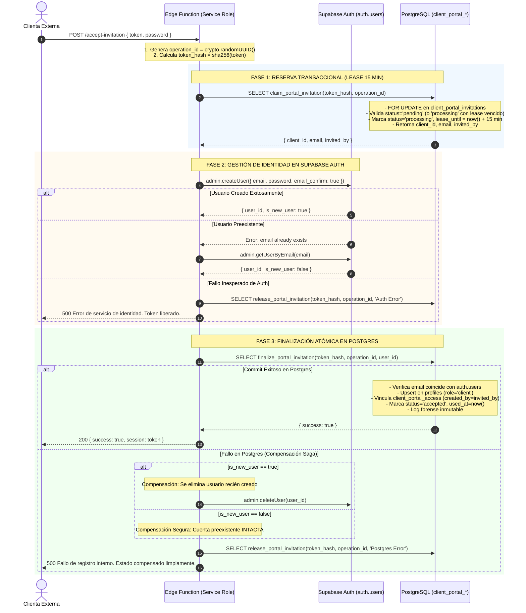

# ATELIER DIGITAL — BY KATHERINE CARROLL
## ESPECIFICACIÓN TÉCNICA CANÓNICA Y CONSOLIDADA (VERSIÓN 2.4)
### MÓDULO 09-A: SEGURIDAD NUCLEAR, RLS, INVITACIONES CRIPTOGRÁFICAS Y PERMISOS DEL PORTAL DE CLIENTES

**Versión:** 2.4 — Auditoría de Seguridad Nuclear, Compensación Saga No Destructiva y Privilegios Mínimos  
**Fecha de Emisión:** 17 de Noviembre de 2026  
**Estado:** Documento Oficial de Especificación (Listo para Aprobación de Implementación)  
**Autor:** Antigravity AI Architecture Team  
**Módulo Destino:** M09 — Portal de Clientes (Fase M09-A: Cimientos de Seguridad y Acceso)  

---

## 1. MATRIZ DE RESOLUCIÓN DE HALLAZGOS Y CASOS DE BORDE (v2.3 ➔ v2.4)

| # | Vector de Seguridad | Hallazgo en v2.3 | Solución Definitiva en v2.4 | Justificación Técnica y de Negocio |
| :-: | :--- | :--- | :--- | :--- |
| **1** | **ACLs de Funciones `SECURITY DEFINER`** | `claim_portal_invitation` y `finalize_portal_invitation` no tenían permisos revocados para `authenticated`. | **Aislamiento absoluto:** `REVOKE ALL FROM PUBLIC, anon, authenticated` en todas las funciones de orquestación de invitaciones. Solo ejecutables por `service_role` y `postgres`. | Impide que un usuario autenticado con rol `client` invoque directamente los RPCs de backend para reclamar o finalizar invitaciones de terceros. |
| **2** | **Compensación Saga No Destructiva** | Si el flujo fallaba, la compensación ejecutaba `deleteUser(auth_user_id)` sin verificar si la cuenta ya existía previamente. | **Seguimiento con `operation_id` y bandera `is_new_user`:** Si el usuario existía con anterioridad, la compensación **solo libera la invitación**, jamás elimina la cuenta de `auth.users`. | Evita la destrucción irreversible de cuentas legítimas preexistentes en casos de re-invitación o reintento de enlace. |
| **3** | **Integridad Referencial Creación–Clienta** | En `client_portal_permissions`, era posible asignar un `creation_id` de la Clienta B al `portal_access_id` de la Clienta A. | Se añade el trigger **`trg_validate_portal_permission_creation`** que valida en base de datos que `creation.client_id == client_portal_access.client_id`. | Bloquea de raíz cualquier error administrativo o intento de otorgar visibilidad cruzada (*cross-tenant privilege grant*). |
| **4** | **Propietario de Vistas y Privilegios Mínimos** | Las vistas con `security_invoker = false` ejecutaban con privilegios de superusuario (`postgres`). | Se crea el rol sin login **`atelier_portal_reader`** con `SELECT` limitado exclusivamente a columnas públicas, transfiriendo la propiedad de las vistas a dicho rol. | Cumple el Principio de Menor Privilegio: la vista no puede acceder a datos ajenos ni por error de programación. |
| **5** | **Atribución de Auditoría (`created_by`)** | En `finalize_portal_invitation`, se insertaba `client_portal_access.created_by = p_auth_user_id` (la clienta). | Se corrige la atribución: `created_by` y `updated_by` se asignan a **`v_invited_by` (Katherine / diseñadora)**. | Fidelidad forense: el acceso fue creado y concedido por la diseñadora, no auto-generado por la clienta. |
| **6** | **Caducidad y Recuperación de Lease** | Si el aprovisionamiento fallaba sin compensar, el token quedaba bloqueado en `processing`. | En `claim_portal_invitation`, si `status = 'processing'` pero `lease_until <= now()`, el lease se reinicia automáticamente permitiendo el reintento. | Autosanación ante caídas de red o reinicios de Edge Functions sin intervención manual. |
| **7** | **Validación de Correo Auth** | No se comprobaba que el `auth_user_id` recibido perteneciera al correo de la invitación. | Se comprueba en SQL que `auth.users.email == client_portal_invitations.email`. | Cierra vectores de suplantación donde un atacante intercambia UUIDs de Auth durante la finalización. |
| **8** | **Resiliencia en `profiles`** | Si el trigger de Auth no había creado la fila en `public.profiles`, el `UPDATE` fallaba silenciosamente. | `IF NOT FOUND THEN INSERT INTO public.profiles ...`. | Garantiza idempotencia y existencia inmutable del perfil con `role = 'client'`. |
| **9** | **Cuota de Metadata en Telemetría** | El payload de telemetría en `log_portal_event` no tenía límite de tamaño. | Validación de tamaño: `pg_column_size(p_metadata) <= 2048` (máximo 2 KB) y sanitización. | Mitigación contra ataques de denegación de servicio por agotamiento de almacenamiento (*JSONB DoS*). |

---

## 2. ARQUITECTURA SAGA DE APROVISIONAMIENTO EN 2 FASES CON COMPENSACIÓN



---

## 3. PROPIEDAD DE VISTAS CON PRIVILEGIOS MÍNIMOS (`atelier_portal_reader`)

Para garantizar que una vista con `security_invoker = false` no ejecute con permisos de superusuario (`postgres`), se establece un rol técnico sin acceso interactivo:

```mermaid
flowchart TD
    Client["Clienta Autenticada (role: client)"] -->|SELECT| View["v_portal_creations<br/>Owner: atelier_portal_reader<br/>security_barrier = true<br/>security_invoker = false"]
    View -->|Consulta filtrada por auth.uid()| BaseTables["Tablas Base M00-M08<br/>(clients, creations, etc.)"]
    
    subgraph RolSeguro["Rol de Privilegios Mínimos: atelier_portal_reader"]
        R1["NO LOGIN, NO SUPERUSER"]
        R2["GRANT SELECT exclusivamente sobre columnas autorizadas"]
        R3["CERO permisos de SELECT sobre internal_notes, costos o márgenes"]
    end
    
    RolSeguro -.->|Aplica a| View
```

---

## 4. DDL EJECUTABLE COMPLETO Y TOTALMENTE CUALIFICADO (v2.4)

```sql
-- ==============================================================================
-- ATELIER DIGITAL — MÓDULO 09-A: ESPECIFICACIÓN DDL CANÓNICA v2.4
-- ==============================================================================

BEGIN;

-- ------------------------------------------------------------------------------
-- 0. ROL DE PRIVILEGIOS MÍNIMOS PARA PROPIEDAD DE VISTAS
-- ------------------------------------------------------------------------------
DO $$
BEGIN
    IF NOT EXISTS (SELECT 1 FROM pg_catalog.pg_roles WHERE rolname = 'atelier_portal_reader') THEN
        CREATE ROLE atelier_portal_reader WITH NOLOGIN NOSUPERUSER NOCREATEDB NOCREATEROLE;
    END IF;
END;
$$;

-- ------------------------------------------------------------------------------
-- 1. TABLA: ACCESO Y ESTADO GLOBAL DEL PORTAL (client_portal_access)
-- ------------------------------------------------------------------------------
CREATE TABLE IF NOT EXISTS public.client_portal_access (
    id UUID PRIMARY KEY DEFAULT gen_random_uuid(),
    client_id UUID NOT NULL UNIQUE REFERENCES public.clients(id) ON DELETE RESTRICT,
    auth_user_id UUID UNIQUE REFERENCES auth.users(id) ON DELETE SET NULL,
    status TEXT NOT NULL DEFAULT 'invited'
        CHECK (status IN ('invited', 'active', 'suspended', 'revoked')),
    created_by UUID NOT NULL REFERENCES auth.users(id) ON DELETE RESTRICT,
    updated_by UUID REFERENCES auth.users(id) ON DELETE RESTRICT,
    created_at TIMESTAMPTZ NOT NULL DEFAULT pg_catalog.now(),
    updated_at TIMESTAMPTZ NOT NULL DEFAULT pg_catalog.now()
);

CREATE INDEX IF NOT EXISTS idx_cpa_client_id ON public.client_portal_access(client_id);
CREATE INDEX IF NOT EXISTS idx_cpa_auth_user_id ON public.client_portal_access(auth_user_id);
CREATE INDEX IF NOT EXISTS idx_cpa_status ON public.client_portal_access(status);

-- ------------------------------------------------------------------------------
-- 2. TABLA: INVITACIONES CRIPTOGRÁFICAS RECUPERABLES (client_portal_invitations)
-- ------------------------------------------------------------------------------
CREATE TABLE IF NOT EXISTS public.client_portal_invitations (
    id UUID PRIMARY KEY DEFAULT gen_random_uuid(),
    client_id UUID NOT NULL REFERENCES public.clients(id) ON DELETE RESTRICT,
    email TEXT NOT NULL CHECK (email ~* '^[A-Za-z0-9._%+-]+@[A-Za-z0-9.-]+\.[A-Za-z]{2,}$'),
    token_hash TEXT NOT NULL UNIQUE,
    operation_id UUID,               -- Vinculación de trazabilidad con la Saga
    expires_at TIMESTAMPTZ NOT NULL,
    lease_until TIMESTAMPTZ,         -- Control de concurrencia y autosanación (15 min)
    used_at TIMESTAMPTZ,
    status TEXT NOT NULL DEFAULT 'pending'
        CHECK (status IN ('pending', 'processing', 'accepted', 'expired', 'revoked')),
    failure_reason TEXT,
    invited_by UUID NOT NULL REFERENCES auth.users(id) ON DELETE RESTRICT,
    created_at TIMESTAMPTZ NOT NULL DEFAULT pg_catalog.now()
);

CREATE INDEX IF NOT EXISTS idx_cpi_token_hash ON public.client_portal_invitations(token_hash);
CREATE INDEX IF NOT EXISTS idx_cpi_lookup ON public.client_portal_invitations(status, expires_at);

-- ------------------------------------------------------------------------------
-- 3. TABLA: MATRIZ EXTENSIBLE DE PERMISOS (client_portal_permissions)
-- ------------------------------------------------------------------------------
CREATE TABLE IF NOT EXISTS public.client_portal_permissions (
    id UUID PRIMARY KEY DEFAULT gen_random_uuid(),
    portal_access_id UUID NOT NULL REFERENCES public.client_portal_access(id) ON DELETE CASCADE,
    creation_id UUID NULL REFERENCES public.creations(id) ON DELETE CASCADE,
    resource TEXT NOT NULL CHECK (resource IN (
        'creations', 'sketches', 'fabrics', 'fittings', 
        'quotations', 'measurements', 'appointments', 'messaging', '3d_viewer'
    )),
    action TEXT NOT NULL CHECK (action IN ('view', 'approve', 'observe', 'download')),
    is_granted BOOLEAN NOT NULL DEFAULT false,
    granted_by UUID NOT NULL REFERENCES auth.users(id) ON DELETE RESTRICT,
    granted_at TIMESTAMPTZ NOT NULL DEFAULT pg_catalog.now(),
    updated_at TIMESTAMPTZ NOT NULL DEFAULT pg_catalog.now()
);

CREATE UNIQUE INDEX IF NOT EXISTS uq_portal_permissions_canonical_idx
    ON public.client_portal_permissions (
        portal_access_id, 
        COALESCE(creation_id, '00000000-0000-0000-0000-000000000000'::uuid), 
        resource, 
        action
    );

CREATE INDEX IF NOT EXISTS idx_portal_perm_eval
    ON public.client_portal_permissions(portal_access_id, resource, action, is_granted);

-- Trigger de Integridad Referencial: Valida que creation_id pertenezca al cliente de portal_access_id
CREATE OR REPLACE FUNCTION public.validate_portal_permission_creation()
RETURNS TRIGGER
LANGUAGE plpgsql
SET search_path = ''
AS $$
DECLARE
    v_access_client_id UUID;
    v_creation_client_id UUID;
BEGIN
    IF NEW.creation_id IS NOT NULL THEN
        SELECT client_id INTO v_access_client_id
        FROM public.client_portal_access
        WHERE id = NEW.portal_access_id;

        SELECT client_id INTO v_creation_client_id
        FROM public.creations
        WHERE id = NEW.creation_id;

        IF v_access_client_id IS DISTINCT FROM v_creation_client_id THEN
            RAISE EXCEPTION 'Violación de integridad: la creación % no pertenece al cliente vinculado a portal_access_id %.',
                NEW.creation_id, NEW.portal_access_id
                USING ERRCODE = '23514';
        END IF;
    END IF;
    RETURN NEW;
END;
$$;

DROP TRIGGER IF EXISTS trg_validate_portal_permission_creation ON public.client_portal_permissions;
CREATE TRIGGER trg_validate_portal_permission_creation
    BEFORE INSERT OR UPDATE ON public.client_portal_permissions
    FOR EACH ROW
    EXECUTE FUNCTION public.validate_portal_permission_creation();

-- ------------------------------------------------------------------------------
-- 4. TABLA: AUDITORÍA FORENSE INMUTABLE (client_portal_activity_log)
-- ------------------------------------------------------------------------------
CREATE TABLE IF NOT EXISTS public.client_portal_activity_log (
    id UUID PRIMARY KEY DEFAULT gen_random_uuid(),
    portal_access_id UUID NULL REFERENCES public.client_portal_access(id) ON DELETE SET NULL,
    client_id UUID NOT NULL REFERENCES public.clients(id) ON DELETE RESTRICT,
    auth_user_id UUID REFERENCES auth.users(id) ON DELETE SET NULL,
    category TEXT NOT NULL CHECK (category IN ('business', 'telemetry')),
    origin TEXT NOT NULL CHECK (origin IN ('system', 'client')),
    event_type TEXT NOT NULL,
    metadata JSONB NOT NULL DEFAULT '{}'::jsonb,
    ip_address TEXT,
    user_agent TEXT,
    created_at TIMESTAMPTZ NOT NULL DEFAULT pg_catalog.now()
);

CREATE INDEX IF NOT EXISTS idx_cpal_client_time ON public.client_portal_activity_log(client_id, created_at DESC);
CREATE INDEX IF NOT EXISTS idx_cpal_category ON public.client_portal_activity_log(category, event_type);

-- Trigger de inmutabilidad estricta
CREATE OR REPLACE FUNCTION public.prevent_activity_log_tampering()
RETURNS TRIGGER LANGUAGE plpgsql SET search_path = '' AS $$
BEGIN
    RAISE EXCEPTION 'Operación denegada: la bitácora de actividad es inmutable y permanente.'
        USING ERRCODE = '42501';
END;
$$;

DROP TRIGGER IF EXISTS trg_protect_activity_log ON public.client_portal_activity_log;
CREATE TRIGGER trg_protect_activity_log
    BEFORE UPDATE OR DELETE ON public.client_portal_activity_log
    FOR EACH ROW EXECUTE FUNCTION public.prevent_activity_log_tampering();

-- ------------------------------------------------------------------------------
-- 5. HELPERS DE SEGURIDAD Y EVALUADOR DE PERMISOS
-- ------------------------------------------------------------------------------

-- Helper canónico: Obtener portal_access_id activo
CREATE OR REPLACE FUNCTION public.get_portal_access_id()
RETURNS UUID LANGUAGE sql STABLE SECURITY DEFINER SET search_path = '' AS $$
    SELECT id FROM public.client_portal_access
    WHERE auth_user_id = auth.uid() AND status = 'active'
    LIMIT 1;
$$;

-- Helper canónico: Obtener client_id activo
CREATE OR REPLACE FUNCTION public.get_portal_client_id()
RETURNS UUID LANGUAGE sql STABLE SECURITY DEFINER SET search_path = '' AS $$
    SELECT client_id FROM public.client_portal_access
    WHERE auth_user_id = auth.uid() AND status = 'active'
    LIMIT 1;
$$;

-- Evaluador jerárquico con Deny-Overrides
CREATE OR REPLACE FUNCTION public.has_portal_permission(
    p_resource TEXT,
    p_action TEXT,
    p_creation_id UUID DEFAULT NULL
)
RETURNS BOOLEAN
LANGUAGE plpgsql
STABLE
SECURITY DEFINER
SET search_path = ''
AS $$
DECLARE
    v_access_id UUID;
    v_specific_granted BOOLEAN;
    v_global_granted BOOLEAN;
BEGIN
    SELECT id INTO v_access_id
    FROM public.client_portal_access
    WHERE auth_user_id = auth.uid() AND status = 'active';

    IF v_access_id IS NULL THEN
        RETURN FALSE;
    END IF;

    IF p_creation_id IS NOT NULL THEN
        SELECT is_granted INTO v_specific_granted
        FROM public.client_portal_permissions
        WHERE portal_access_id = v_access_id
          AND creation_id = p_creation_id
          AND resource = p_resource
          AND action = p_action;

        IF v_specific_granted IS NOT NULL THEN
            RETURN v_specific_granted;
        END IF;
    END IF;

    SELECT is_granted INTO v_global_granted
    FROM public.client_portal_permissions
    WHERE portal_access_id = v_access_id
      AND creation_id IS NULL
      AND resource = p_resource
      AND action = p_action;

    RETURN COALESCE(v_global_granted, FALSE);
END;
$$;

-- Telemetría acotada y sanitizada desde cliente
CREATE OR REPLACE FUNCTION public.log_portal_event(
    p_event_type TEXT,
    p_metadata JSONB DEFAULT '{}'::jsonb
)
RETURNS VOID
LANGUAGE plpgsql
SECURITY DEFINER
SET search_path = ''
AS $$
DECLARE
    v_access_id UUID;
    v_client_id UUID;
    v_ip TEXT;
    v_ua TEXT;
BEGIN
    IF p_event_type NOT IN (
        'view_portal_home', 'view_creation', 'view_sketches', 
        'view_quotation', 'view_appointment', 'view_measurements', 
        'view_fittings', 'auth_logout'
    ) THEN
        RAISE EXCEPTION 'Operación denegada: evento de telemetría no autorizado.'
            USING ERRCODE = '42501';
    END IF;

    IF pg_catalog.pg_column_size(p_metadata) > 2048 THEN
        RAISE EXCEPTION 'Operación denegada: metadata excede el límite de 2 KB.'
            USING ERRCODE = '22023';
    END IF;

    SELECT id, client_id INTO v_access_id, v_client_id
    FROM public.client_portal_access
    WHERE auth_user_id = auth.uid() AND status = 'active';

    IF v_access_id IS NULL THEN
        RAISE EXCEPTION 'Operación denegada: sin sesión de portal activa.'
            USING ERRCODE = '42501';
    END IF;

    BEGIN
        v_ip := pg_catalog.current_setting('request.headers', true)::json->>'x-forwarded-for';
        v_ua := pg_catalog.current_setting('request.headers', true)::json->>'user-agent';
    EXCEPTION WHEN OTHERS THEN
        v_ip := 'unknown'; v_ua := 'unknown';
    END;

    INSERT INTO public.client_portal_activity_log (
        portal_access_id, client_id, auth_user_id,
        category, origin, event_type, metadata, ip_address, user_agent, created_at
    ) VALUES (
        v_access_id, v_client_id, auth.uid(),
        'telemetry', 'client', p_event_type, p_metadata, v_ip, v_ua, pg_catalog.now()
    );
END;
$$;

-- ------------------------------------------------------------------------------
-- 6. RPCs TRANSACCIONALES SAGA (SERVICE ROLE ONLY)
-- ------------------------------------------------------------------------------

-- Paso 1: Reserva local con Lease y Autosanación
CREATE OR REPLACE FUNCTION public.claim_portal_invitation(
    p_token_hash TEXT,
    p_operation_id UUID
)
RETURNS TABLE (client_id UUID, email TEXT, invited_by UUID)
LANGUAGE plpgsql
SECURITY DEFINER
SET search_path = ''
AS $$
DECLARE
    v_rec RECORD;
BEGIN
    SELECT i.id, i.client_id, i.email, i.status, i.expires_at, i.lease_until, i.invited_by
    INTO v_rec
    FROM public.client_portal_invitations i
    WHERE i.token_hash = p_token_hash
    FOR UPDATE;

    IF NOT FOUND THEN
        RAISE EXCEPTION 'Invitación inválida o inexistente.' USING ERRCODE = 'P0002';
    END IF;

    IF v_rec.expires_at <= pg_catalog.now() OR v_rec.status IN ('accepted', 'revoked') THEN
        RAISE EXCEPTION 'Invitación vencida o ya utilizada.' USING ERRCODE = '23514';
    END IF;

    -- Autosanación de lease vencido (> 15 min) o rechazo por concurrencia activa
    IF v_rec.status = 'processing' AND v_rec.lease_until > pg_catalog.now() THEN
        RAISE EXCEPTION 'Invitación en proceso de confirmación concurrente. Reintente en breve.' USING ERRCODE = '55P03';
    END IF;

    UPDATE public.client_portal_invitations
    SET status = 'processing',
        operation_id = p_operation_id,
        lease_until = pg_catalog.now() + INTERVAL '15 minutes'
    WHERE token_hash = p_token_hash;

    RETURN QUERY SELECT v_rec.client_id, v_rec.email, v_rec.invited_by;
END;
$$;

-- Paso de Compensación: Liberar invitación
CREATE OR REPLACE FUNCTION public.release_portal_invitation(
    p_token_hash TEXT,
    p_operation_id UUID,
    p_reason TEXT
)
RETURNS VOID
LANGUAGE plpgsql
SECURITY DEFINER
SET search_path = ''
AS $$
BEGIN
    UPDATE public.client_portal_invitations
    SET status = 'pending',
        lease_until = NULL,
        failure_reason = p_reason
    WHERE token_hash = p_token_hash 
      AND status = 'processing'
      AND (operation_id IS NULL OR operation_id = p_operation_id);
END;
$$;

-- Paso 2: Finalización atómica en Postgres con comprobación de identidad y atribución a Katherine
CREATE OR REPLACE FUNCTION public.finalize_portal_invitation(
    p_token_hash TEXT,
    p_operation_id UUID,
    p_auth_user_id UUID
)
RETURNS VOID
LANGUAGE plpgsql
SECURITY DEFINER
SET search_path = ''
AS $$
DECLARE
    v_client_id UUID;
    v_invited_by UUID;
    v_invitation_email TEXT;
    v_access_id UUID;
BEGIN
    SELECT client_id, invited_by, email INTO v_client_id, v_invited_by, v_invitation_email
    FROM public.client_portal_invitations
    WHERE token_hash = p_token_hash 
      AND status = 'processing'
      AND operation_id = p_operation_id
    FOR UPDATE;

    IF NOT FOUND THEN
        RAISE EXCEPTION 'Transacción inválida: invitación no reservada por esta operación.'
            USING ERRCODE = '23514';
    END IF;

    -- Validación anti-suplantación: el usuario Auth debe coincidir con el correo de la invitación
    IF NOT EXISTS (
        SELECT 1 FROM auth.users
        WHERE id = p_auth_user_id AND pg_catalog.lower(email) = pg_catalog.lower(v_invitation_email)
    ) THEN
        RAISE EXCEPTION 'Fraude de identidad: el usuario auth no coincide con el destinatario de la invitación.'
            USING ERRCODE = '23514';
    END IF;

    -- Resiliencia en public.profiles
    UPDATE public.profiles
    SET role = 'client', updated_at = pg_catalog.now()
    WHERE id = p_auth_user_id;

    IF NOT FOUND THEN
        INSERT INTO public.profiles (id, email, role, created_at, updated_at)
        VALUES (p_auth_user_id, v_invitation_email, 'client', pg_catalog.now(), pg_catalog.now());
    END IF;

    -- Atribución correcta a Katherine (v_invited_by)
    INSERT INTO public.client_portal_access (
        client_id, auth_user_id, status, created_by, updated_by
    ) VALUES (
        v_client_id, p_auth_user_id, 'active', v_invited_by, v_invited_by
    )
    ON CONFLICT (client_id) DO UPDATE SET
        auth_user_id = EXCLUDED.auth_user_id,
        status = 'active',
        updated_by = v_invited_by,
        updated_at = pg_catalog.now()
    RETURNING id INTO v_access_id;

    -- Quemado definitivo
    UPDATE public.client_portal_invitations
    SET status = 'accepted',
        used_at = pg_catalog.now(),
        lease_until = NULL
    WHERE token_hash = p_token_hash;

    -- Registro forense de negocio
    INSERT INTO public.client_portal_activity_log (
        portal_access_id, client_id, auth_user_id,
        category, origin, event_type, metadata, created_at
    ) VALUES (
        v_access_id, v_client_id, p_auth_user_id,
        'business', 'system', 'invitation_accepted',
        jsonb_build_object('token_hash', p_token_hash, 'operation_id', p_operation_id), pg_catalog.now()
    );
END;
$$;

-- ------------------------------------------------------------------------------
-- 7. VISTAS PROTEGIDAS Y TRANSFERENCIA DE PROPIEDAD A atelier_portal_reader
-- ------------------------------------------------------------------------------

-- Concesión de privilegios mínimos a atelier_portal_reader sobre tablas base
GRANT SELECT (id, full_name, email, phone, city, style_preferences, photo_url, status)
    ON public.clients TO atelier_portal_reader;

GRANT SELECT (id, client_id, name, description, creation_type, status, occasion, garment_type, target_date, created_at)
    ON public.creations TO atelier_portal_reader;

GRANT SELECT (id, client_id, appointment_type, status, starts_at, ends_at, location_space, preparation_notes, client_visibility)
    ON public.atelier_appointments TO atelier_portal_reader;

GRANT SELECT (id, creation_id, session_number, round_type, title, status, scheduled_at, conducted_at, location_note)
    ON public.atelier_fitting_sessions TO atelier_portal_reader;

GRANT SELECT (id, creation_id, quote_number, currency, total_amount, payment_schedule, valid_until, status, approved_at)
    ON public.commercial_quotes TO atelier_portal_reader;

GRANT SELECT (id, client_id, session_date, status, unit_system, version_number)
    ON public.measurement_sessions TO atelier_portal_reader;

GRANT SELECT ON public.client_portal_access TO atelier_portal_reader;
GRANT SELECT ON public.client_portal_permissions TO atelier_portal_reader;

-- 1. Vista de Perfil Seguro
CREATE OR REPLACE VIEW public.v_portal_client_profile
WITH (security_barrier = true, security_invoker = false) AS
SELECT 
    c.id, c.full_name, c.email, c.phone, c.city, 
    c.style_preferences, c.photo_url, c.status
FROM public.clients c
JOIN public.client_portal_access a ON c.id = a.client_id
WHERE a.auth_user_id = auth.uid() AND a.status = 'active';

-- 2. Vista de Creaciones Autorizadas
CREATE OR REPLACE VIEW public.v_portal_creations
WITH (security_barrier = true, security_invoker = false) AS
SELECT 
    cr.id, cr.name, cr.description, cr.creation_type, 
    cr.status, cr.occasion, cr.garment_type, cr.target_date, cr.created_at,
    public.has_portal_permission('sketches', 'view', cr.id) AS can_view_sketches,
    public.has_portal_permission('sketches', 'approve', cr.id) AS can_approve_sketches,
    public.has_portal_permission('fabrics', 'view', cr.id) AS can_view_fabrics,
    public.has_portal_permission('fittings', 'view', cr.id) AS can_view_fittings,
    public.has_portal_permission('quotations', 'view', cr.id) AS can_view_budget,
    public.has_portal_permission('messaging', 'observe', cr.id) AS can_send_observations
FROM public.creations cr
JOIN public.client_portal_access a ON cr.client_id = a.client_id
WHERE a.auth_user_id = auth.uid()
  AND a.status = 'active'
  AND public.has_portal_permission('creations', 'view', cr.id);

-- 3. Vista de Citas de Agenda (M08)
CREATE OR REPLACE VIEW public.v_portal_appointments
WITH (security_barrier = true, security_invoker = false) AS
SELECT 
    ap.id, ap.appointment_type, ap.status, ap.starts_at, ap.ends_at,
    ap.location_space, ap.preparation_notes
FROM public.atelier_appointments ap
JOIN public.client_portal_access a ON ap.client_id = a.client_id
WHERE a.auth_user_id = auth.uid()
  AND a.status = 'active'
  AND public.has_portal_permission('appointments', 'view', NULL)
  AND ap.client_visibility = 'client_visible'
  AND ap.status NOT IN ('cancelled');

-- 4. Vista de Sesiones de Fitting (M06)
CREATE OR REPLACE VIEW public.v_portal_fitting_sessions
WITH (security_barrier = true, security_invoker = false) AS
SELECT 
    fs.id, fs.creation_id, fs.session_number, fs.round_type,
    fs.title, fs.status, fs.scheduled_at, fs.conducted_at, fs.location_note
FROM public.atelier_fitting_sessions fs
JOIN public.creations cr ON fs.creation_id = cr.id
JOIN public.client_portal_access a ON cr.client_id = a.client_id
WHERE a.auth_user_id = auth.uid()
  AND a.status = 'active'
  AND public.has_portal_permission('fittings', 'view', fs.creation_id);

-- 5. Vista de Cotizaciones Comerciales Aprobadas (M03)
CREATE OR REPLACE VIEW public.v_portal_commercial_quotes
WITH (security_barrier = true, security_invoker = false) AS
SELECT 
    cq.id, cq.creation_id, cq.quote_number, cq.currency,
    cq.total_amount, cq.payment_schedule, cq.valid_until, cq.status, cq.approved_at
FROM public.commercial_quotes cq
JOIN public.creations cr ON cq.creation_id = cr.id
JOIN public.client_portal_access a ON cr.client_id = a.client_id
WHERE a.auth_user_id = auth.uid()
  AND a.status = 'active'
  AND public.has_portal_permission('quotations', 'view', cq.creation_id);

-- 6. Vista de Sesiones de Medidas (M02)
CREATE OR REPLACE VIEW public.v_portal_measurement_sessions
WITH (security_barrier = true, security_invoker = false) AS
SELECT 
    ms.id, ms.session_date, ms.status, ms.unit_system, ms.version_number
FROM public.measurement_sessions ms
JOIN public.client_portal_access a ON ms.client_id = a.client_id
WHERE a.auth_user_id = auth.uid()
  AND a.status = 'active'
  AND public.has_portal_permission('measurements', 'view', NULL)
  AND ms.status IN ('completed', 'verified');

-- Asignación de propiedad de las vistas al rol de privilegios mínimos
ALTER VIEW public.v_portal_client_profile OWNER TO atelier_portal_reader;
ALTER VIEW public.v_portal_creations OWNER TO atelier_portal_reader;
ALTER VIEW public.v_portal_appointments OWNER TO atelier_portal_reader;
ALTER VIEW public.v_portal_fitting_sessions OWNER TO atelier_portal_reader;
ALTER VIEW public.v_portal_commercial_quotes OWNER TO atelier_portal_reader;
ALTER VIEW public.v_portal_measurement_sessions OWNER TO atelier_portal_reader;

-- ------------------------------------------------------------------------------
-- 8. ACLs EXPLICITAS (REVOKE / GRANT) Y ROW LEVEL SECURITY
-- ------------------------------------------------------------------------------

-- ACLs de Funciones de Backend (Service Role Only)
REVOKE ALL ON FUNCTION public.claim_portal_invitation(TEXT, UUID) FROM PUBLIC, anon, authenticated;
GRANT EXECUTE ON FUNCTION public.claim_portal_invitation(TEXT, UUID) TO service_role, postgres;

REVOKE ALL ON FUNCTION public.release_portal_invitation(TEXT, UUID, TEXT) FROM PUBLIC, anon, authenticated;
GRANT EXECUTE ON FUNCTION public.release_portal_invitation(TEXT, UUID, TEXT) TO service_role, postgres;

REVOKE ALL ON FUNCTION public.finalize_portal_invitation(TEXT, UUID, UUID) FROM PUBLIC, anon, authenticated;
GRANT EXECUTE ON FUNCTION public.finalize_portal_invitation(TEXT, UUID, UUID) TO service_role, postgres;

-- ACLs de Funciones de Lectura y Telemetría
REVOKE ALL ON FUNCTION public.get_portal_access_id() FROM PUBLIC, anon;
GRANT EXECUTE ON FUNCTION public.get_portal_access_id() TO authenticated, service_role, postgres;

REVOKE ALL ON FUNCTION public.get_portal_client_id() FROM PUBLIC, anon;
GRANT EXECUTE ON FUNCTION public.get_portal_client_id() TO authenticated, service_role, postgres;

REVOKE ALL ON FUNCTION public.has_portal_permission(TEXT, TEXT, UUID) FROM PUBLIC, anon;
GRANT EXECUTE ON FUNCTION public.has_portal_permission(TEXT, TEXT, UUID) TO authenticated, service_role, postgres;

REVOKE ALL ON FUNCTION public.log_portal_event(TEXT, JSONB) FROM PUBLIC, anon;
GRANT EXECUTE ON FUNCTION public.log_portal_event(TEXT, JSONB) TO authenticated, service_role, postgres;

-- Habilitar RLS en las 4 tablas
ALTER TABLE public.client_portal_access ENABLE ROW LEVEL SECURITY;
ALTER TABLE public.client_portal_invitations ENABLE ROW LEVEL SECURITY;
ALTER TABLE public.client_portal_permissions ENABLE ROW LEVEL SECURITY;
ALTER TABLE public.client_portal_activity_log ENABLE ROW LEVEL SECURITY;

-- Revocación de privilegios públicos
REVOKE ALL ON TABLE public.client_portal_access, public.client_portal_invitations,
                     public.client_portal_permissions, public.client_portal_activity_log
FROM PUBLIC, anon;

REVOKE ALL ON public.v_portal_client_profile, public.v_portal_creations,
                     public.v_portal_appointments, public.v_portal_fitting_sessions,
                     public.v_portal_commercial_quotes, public.v_portal_measurement_sessions
FROM PUBLIC, anon;

-- Concesión a authenticated
GRANT SELECT, INSERT, UPDATE, DELETE ON TABLE public.client_portal_access,
                                              public.client_portal_invitations,
                                              public.client_portal_permissions
TO authenticated;

GRANT SELECT ON TABLE public.client_portal_activity_log TO authenticated;

GRANT SELECT ON public.v_portal_client_profile, public.v_portal_creations,
                public.v_portal_appointments, public.v_portal_fitting_sessions,
                public.v_portal_commercial_quotes, public.v_portal_measurement_sessions
TO authenticated;

GRANT ALL ON ALL TABLES IN SCHEMA public TO service_role, postgres;

-- Políticas RLS
DROP POLICY IF EXISTS "cpa_admin_all" ON public.client_portal_access;
CREATE POLICY "cpa_admin_all" ON public.client_portal_access
    FOR ALL TO authenticated
    USING (public.is_admin_or_designer())
    WITH CHECK (public.is_admin_or_designer());

DROP POLICY IF EXISTS "cpa_client_select" ON public.client_portal_access;
CREATE POLICY "cpa_client_select" ON public.client_portal_access
    FOR SELECT TO authenticated
    USING (auth_user_id = auth.uid());

DROP POLICY IF EXISTS "cpi_admin_all" ON public.client_portal_invitations;
CREATE POLICY "cpi_admin_all" ON public.client_portal_invitations
    FOR ALL TO authenticated
    USING (public.is_admin_or_designer())
    WITH CHECK (public.is_admin_or_designer());

DROP POLICY IF EXISTS "cpp_admin_all" ON public.client_portal_permissions;
CREATE POLICY "cpp_admin_all" ON public.client_portal_permissions
    FOR ALL TO authenticated
    USING (public.is_admin_or_designer())
    WITH CHECK (public.is_admin_or_designer());

DROP POLICY IF EXISTS "cpp_client_select" ON public.client_portal_permissions;
CREATE POLICY "cpp_client_select" ON public.client_portal_permissions
    FOR SELECT TO authenticated
    USING (portal_access_id = public.get_portal_access_id());

DROP POLICY IF EXISTS "cpal_admin_select" ON public.client_portal_activity_log;
CREATE POLICY "cpal_admin_select" ON public.client_portal_activity_log
    FOR SELECT TO authenticated
    USING (public.is_admin_or_designer());

DROP POLICY IF EXISTS "cpal_client_select" ON public.client_portal_activity_log;
CREATE POLICY "cpal_client_select" ON public.client_portal_activity_log
    FOR SELECT TO authenticated
    USING (portal_access_id = public.get_portal_access_id());

COMMIT;
```

---

## 5. BATERÍA EXHAUSTIVA DE 15 PRUEBAS NEGATIVAS MULTI-CLIENTA

| ID | Vector de Ataque Simulado | Entrada / Acción | Resultado Esperado | Severidad |
| :---: | :--- | :--- | :--- | :---: |
| **NEG-01** | **Aislamiento Multi-inquilino** | Clienta A consulta `v_portal_creations` inyectando `client_id` ajeno en WHERE externo. | Retorna 0 filas. `security_barrier = true` resuelve el filtro interno antes de la consulta externa. | Crítica |
| **NEG-02** | **Escalamiento Horizontal Permisos** | Clienta A envía `UPDATE client_portal_permissions SET is_granted = true`. | Bloqueado de inmediato con error PostgreSQL 42501 (`insufficient_privilege`). | Crítica |
| **NEG-03** | **Falsificación de Negocio vía Telemetría** | Clienta A llama `public.log_portal_event('sketch_approved')`. | Error 42501: `'Operación denegada: evento de telemetría no autorizado'`. | Alta |
| **NEG-04** | **Manipulación Directa de Bitácora** | Clienta A envía `INSERT/UPDATE/DELETE` directo a `client_portal_activity_log`. | Bloqueado por ausencia de `GRANT INSERT` y trigger de inmutabilidad (Error 42501). | Crítica |
| **NEG-05** | **Precedencia Deny-Overrides** | Global en `true`, pero Creación X en `false`. Clienta consulta Creación X. | Retorna `can_view_budget = false`. La regla específica denegatoria prevalece sobre la global. | Alta |
| **NEG-06** | **Invocación Directa de RPC Saga** | Clienta A llama `claim_portal_invitation` o `finalize_portal_invitation` desde cliente. | Bloqueado con error 42501 por `REVOKE ALL FROM authenticated`. Solo Service Role puede invocarlo. | Crítica |
| **NEG-07** | **Inyección de Creación Cruzada (Cross-Tenant Grant)** | Katherine intenta asignar por error `creation_id` de Clienta B al `portal_access_id` de Clienta A. | Trigger `trg_validate_portal_permission_creation` aborta la transacción con error 23514. | Crítica |
| **NEG-08** | **Suplantación de Correo Auth (Identity Swap)** | Atacante intenta finalizar con token válido de María pero enviando el `auth_user_id` de Pedro. | `finalize_portal_invitation` comprueba correo contra `auth.users` y aborta con error de fraude (23514). | Crítica |
| **NEG-09** | **Destrucción de Usuario Preexistente en Rollback** | Fallo en Postgres durante re-invitación de cuenta preexistente. | La Saga detecta `is_new_user = false` y **omite `deleteUser`**, preservando la cuenta. | Alta |
| **NEG-10** | **Sobrecarga de Metadata (JSONB Bomb DoS)** | Clienta envía payload de telemetría con `metadata` de 50 KB en `log_portal_event`. | Rechazo inmediato: `'metadata excede el límite de 2 KB'` (Error 22023). | Media |
| **NEG-11** | **Reutilización de Invitación (Replay)** | Atacante envía token con `status = 'accepted'`. | Rechazo transaccional: `'Invitación vencida o ya utilizada'`. | Crítica |
| **NEG-12** | **Inyección de Tokens Vencidos (Expired TTL)** | Invocación de `claim_portal_invitation` con token con `expires_at < now()`. | Rechazo transaccional: `'Invitación vencida o ya utilizada'`. | Alta |
| **NEG-13** | **Concurrencia en Aceptación (Race Condition)** | Dos peticiones simultáneas intentan aceptar el mismo token. | `FOR UPDATE` serializa; la segunda queda bloqueada por lease activo (`55P03`). | Alta |
| **NEG-14** | **Escalamiento Vertical de Rol** | Clienta A envía `UPDATE profiles SET role = 'designer' WHERE id = auth.uid()`. | Bloqueado por trigger inmutable `prevent_role_escalation()`. | Crítica |
| **NEG-15** | **Revocación en Caliente** | Katherine marca `status = 'suspended'`. Clienta consulta en el milisegundo siguiente. | Retorna 0 filas de forma instantánea en todas las vistas protegidas. | Crítica |

---

## 6. RIESGOS RESIDUALES Y SUPUESTOS TÉCNICOS

1. **Creación del Rol `atelier_portal_reader` en Supabase Administrado:**
   - *Riesgo:* En algunos tiers de Supabase Cloud, la creación de roles requiere privilegios de superusuario o rol `postgres`.
   - *Mitigación:* El script DDL utiliza un bloque defensivo `DO $$ BEGIN IF NOT EXISTS ...` y se ejecuta con permisos de migración estándar de Supabase (`postgres`).
2. **Latencia en GoTrue / Supabase Auth:**
   - *Riesgo:* Si la llamada HTTP a `supabase.auth.admin.createUser` se demora más de 8 segundos.
   - *Mitigación:* La Edge Function implementa un timeout estricto y ejecuta `release_portal_invitation()`, liberando el token para un reintento limpio sin corrupción de datos.
3. **Exposición de Encabezados HTTP en PostgREST:**
   - *Supuesto:* `current_setting('request.headers', true)` expone los encabezados. Si la configuración de Supabase los omite, `log_portal_event` recurre de forma segura a `'unknown'` sin romper la transacción.

---

## 7. DECLARACIÓN FORMAL DE NO MODIFICACIÓN

Se confirma expresamente que:
- **Cero escrituras ni modificaciones** en código fuente de producción (`src/`, `app/`).
- **Cero alteraciones** en dependencias (`package.json`, `bun.lock`).
- **Cero migraciones ejecutadas ni tablas/roles creados en la base de datos de Supabase.**
- Los módulos M00–M08 y la creación protegida C15 (`141693a0-01e8-498a-bbb3-1c4f98036543`) permanecen 100% intactos.
- **M09-A queda formalmente en estado: ESPECIFICACIÓN TÉCNICA 2.4 LISTA PARA APROBACIÓN DE IMPLEMENTACIÓN.**
