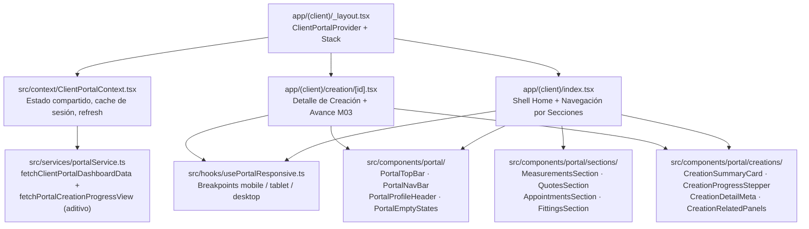

# Plan Técnico de Implementación — Bloque P1 de M09 (Portal del Cliente)

> **Fecha:** 2026-11-25  
> **Módulo:** M09 — Portal del Cliente (Atelier Digital · By Katherine Carroll)  
> **Bloque:** P1 — Arquitectura de Navegación, Pantalla de Detalle de Creación, Seguimiento de Confección M03 y Base Responsive  
> **Estado:** Propuesta técnica lista para revisión y aprobación (sin cambios aplicados en código, migraciones ni producción).

---

## 1. Diagnóstico Base (Estado Actual Verificado en Código)

1. **Monolito en `app/(client)/index.tsx` (2,375 líneas):**
   - `app/(client)/index.tsx` concentra en un solo archivo la obtención de datos, utilidades de formato, barra superior, tarjeta de perfil/permisos, y las 5 secciones verticales apiladas (`Creaciones`, `Medidas`, `Cotizaciones`, `Agenda`, `Fittings`).
   - Las tarjetas de creación (`L782-L825`) son estáticas (`<View>`): no navegan a un detalle de prenda ni muestran progreso de taller.
   - No existe uso de `useWindowDimensions`; utiliza un contenedor único `maxWidth: 860` (`L1558-L1564`).
2. **Navegación y `NavigationGate`:**
   - `app/(client)/_layout.tsx` es un `<Stack>` de 14 líneas sin estado compartido entre pantallas del portal.
   - En `app/_layout.tsx` (`L33-L61`, `L214-L216`), `inClientGroup` se evalúa como `currentGroup === '(client)' || isClientPortalExperience`, mientras `inDesignerGroup` evalúa `currentGroup === 'creations' || pathname === '/creations'`.
   - **Hallazgo crítico de enrutamiento:** cualquier subruta ubicada en `app/(client)/...` hereda `inClientGroup === true` automáticamente, pero debe **evitar el segmento `/creations`** para no colisionar con la ruta de diseñadora `app/(designer)/creations.tsx` (`/creations`) ni con la ruta editorial pública `/creacion`.
3. **Fuente real de avances M03 (`public.atelier_projects`):**
   - Definida en `supabase/migrations/20261108000000_commercial_cycle_module_03.sql` (`L225-L250`) con índice existente `idx_atelier_projects_creation_id` (`L397`).
   - Soporta las **8 etapas canónicas** de taller (`planning`, `cutting`/`pattern_cut`, `assembly`/`basting`, `first_fitting`, `adjustments`/`fitting_adjustments`, `second_fitting`, `finishing`/`hand_finishing`, `delivered`/`final_delivery`) más `cancelled`, junto con `estimated_delivery_date` y `actual_delivery_date`.
   - Contiene columnas estrictamente internas (`assigned_tailor`, `priority`, `notes`, `quote_id`) que **no deben exponerse** a clientas.
4. **Telemetría ya preparada sin cambios SQL:**
   - `supabase/migrations/20261118000000_client_portal_m09.sql` (`L1343-L1347`) y `src/types/portal.ts` (`L422-L431`) **ya incluyen `'view_creation'`** en la lista blanca de `public.log_portal_event`.
5. **Dossier de diseñadora (`DossierPortalTab.tsx`):**
   - `src/components/clients/dossier/DossierPortalTab.tsx` (2,239 líneas) tampoco utiliza `useWindowDimensions` y emplea múltiples filas horizontales rígidas (`flexDirection: 'row'`) que se comprimen en anchos móviles `< 768 px`.

---

## 2. Arquitectura Modular Sugerida

Principio rector: **reutilizar el núcleo productivo existente (`portalService.ts`, `types/portal.ts`, vistas `v_portal_*`, `AuthContext`) y descomponer `app/(client)/index.tsx` de forma incremental**, sin reescribir lógica aprobada y sin tocar los archivos del prototipo RAM (`src/components/clientPortal/`, `app/client-portal-experience.tsx`, `app/designer-client-portal.tsx`, bloqueados en producción por H-08).



### Separación limpia frente al prototipo RAM
- Se crea la carpeta productiva `src/components/portal/` (distinta de `src/components/clientPortal/`, reservada al prototipo local en RAM y sus pruebas de regresión).
- `ClientPortalContext.tsx` encapsula el ciclo de vida de `fetchClientPortalDashboardData()` para todo el grupo `(client)`:
  - Al navegar de Home (`/(client)`) a Detalle (`/(client)/creation/[id]`), la pantalla abre de inmediato sin recargar innecesariamente las 6–7 vistas.
  - Al abrir un deep-link directo (`/creation/<uuid>`) o refrescar el navegador, el contexto hidrata automáticamente desde Supabase y resuelve de forma fail-closed.

---

## 3. Rutas Expo Router y Compatibilidad con `NavigationGate` / Vercel

| Ruta física | URL efectiva | Rol permitido | Propósito |
| :--- | :--- | :--- | :--- |
| `app/(client)/_layout.tsx` | Grupo `(client)` | `client` | Envolver en `ClientPortalProvider` + `<Stack>` sin header nativo, con transición limpia web/móvil. |
| `app/(client)/index.tsx` | `/` (grupo cliente) | `client` | Inicio del portal con navegación por secciones autorizadas (Inicio / Creaciones / Medidas / Cotizaciones / Agenda / Pruebas). |
| `app/(client)/creation/[id].tsx` | `/creation/[id]` | `client` | Vista dedicada de una creación autorizada: ficha editorial, stepper de confección M03, citas/fittings/cotizaciones vinculadas a esa prenda si tienen permiso, y slots preparados para P2 (bocetos/telas) y P4 (aprobaciones/observaciones). |

### Verificación de no colisión
- **Contra `inDesignerGroup` (`app/_layout.tsx`, L33–L45):** `/creation/[id]` usa singular en inglés (`creation`), distinto de `/creations` (diseñadora) y `/creacion` (página pública editorial).
- **Contra `NavigationGate` (`app/_layout.tsx`, L61, L153–L162, L214–L216):**
  - `segments[0] === '(client)'` ⇒ `inClientGroup === true`.
  - Sin sesión: redirige automáticamente a `/(auth)/login`.
  - Con rol `designer` o `admin`: redirige a `/(designer)` o `/(admin)`.
  - Con rol `client`: permite navegar libremente entre `/(client)` y `/(client)/creation/[id]` **sin modificar `app/_layout.tsx`**.
- **Contra `vercel.json`:** el rewrite SPA global `"/((?!_expo/|assets/|favicon\\.ico|metadata\\.json).*)" -> "/index.html"` y los encabezados H-04 ya cubren `/creation/*` **sin modificar `vercel.json`**.

---

## 4. Componentes Reutilizables y Utilidades

1. **Hooks y Contexto**
   - `src/hooks/usePortalResponsive.ts`: envuelve `useWindowDimensions()` y entrega `{ width, breakpoint: 'mobile' | 'tablet' | 'desktop', isMobile, isTablet, isDesktop, contentMaxWidth, gridColumns, horizontalPadding }`.
   - `src/context/ClientPortalContext.tsx`: gestiona `dashboard`, `loading`, `refreshing`, `uiError`, `reload()`, `getCreationById(id)`, `getProgressByCreationId(id)` y helper `logTelemetryOnce(event, key, metadata)` para evitar duplicados por re-render.
2. **Navegación y Contenedor Editorial (`src/components/portal/`)**
   - `PortalTopBar.tsx`: barra superior responsive (en escritorio/tablet muestra marca + subtítulo + acciones en línea; en móvil compacta acciones sin desbordamiento horizontal y soporta botón `"← Volver al dossier"` en subrutas).
   - `PortalSectionNav.tsx`: barra de secciones dinámicas que **solo renderiza pestañas para los módulos realmente autorizados** en `projection` (`Resumen`, `Creaciones`, `Medidas`, `Cotizaciones`, `Agenda`, `Pruebas`). Si una clienta solo tiene `creations:view` (como Valentina hoy), evita pestañas vacías/restringidas y muestra una experiencia sobria y curada.
   - `PortalProfileCard.tsx` y `PortalStatusCards.tsx`: tarjeta de bienvenida/perfil + estados `invited`, `suspended`/`revoked`, `unauthorized`, `demo`, `error`, y estado vacío Zero Trust extraídos de `app/(client)/index.tsx`.
3. **Módulo de Creaciones y Avance M03 (`src/components/portal/creations/`)**
   - `CreationSummaryCard.tsx`: tarjeta interactiva (`TouchableOpacity`) para la cuadrícula del inicio. Muestra tipo, nombre, estado editorial, ocasión, fecha objetivo, **mini-indicador de etapa M03** (cuando exista proyecto activo) y CTA claro `"Ver detalle →"` que navega a `/(client)/creation/${creation.id}`.
   - `CreationProgressStepper.tsx`: componente visual reutilizable de las **8 etapas canónicas M03** (con normalización de alias legacy de `atelier_projects.current_stage` → etapa canónica 1..8), porcentaje de progreso editorial, fecha estimada/real de entrega, y **estado elegante pre-taller** cuando una creación (ej. `Vestido de Gala` en `status = 'draft'`) aún no tiene orden activa en `atelier_projects`.
   - `CreationDetailView.tsx` (cabecera + bloques contextuales):
     - Ficha editorial completa de la creación (descripción, ocasión, tipo de prenda, fecha objetivo, fecha de inicio).
     - Bloque de seguimiento y avance de confección (`CreationProgressStepper`).
     - Bloques contextuales **filtrados estrictamente por permiso de esa creación** (`creation.id`):
       - **Pruebas de calce de esta prenda** (solo si `can_view_fittings === true`, reutilizando `v_portal_fitting_sessions`).
       - **Cotización formal de esta prenda** (solo si `can_view_budget === true`, reutilizando `v_portal_commercial_quotes`).
     - **Slots extensibles (sin activar lógica fuera de alcance)** para P2 (Bocetos / Telas cuando `can_view_sketches` o `can_view_fabrics`) y P4 (Observaciones / Aprobaciones cuando `can_send_observations` o `can_approve_sketches`), mostrando solo un aviso discreto cuando el permiso esté encendido y **nada** cuando esté apagado (Zero Trust).
4. **Secciones Extraídas (`src/components/portal/sections/`)**
   - Extracción directa y sin cambios de negocio de los bloques existentes en `app/(client)/index.tsx`: `MeasurementsSection.tsx`, `QuotesSection.tsx`, `AppointmentsSection.tsx`, `FittingsSection.tsx`, más `src/utils/portalFormatters.ts` (formateadores ya existentes de fechas, moneda, estados y tipos).

---

## 5. Flujo de Navegación Completo

```mermaid
flowchart LR
    Login["/(auth)/login"] -->|role = client| Home["/(client)\nInicio del Portal"]
    Home -->|Filtro por pestaña\n(solo módulos autorizados)| HomeSec["/(client)?section=...\nCreaciones / Medidas / etc."]
    Home -->|Tap en CreationSummaryCard| Detail["/(client)/creation/[id]\nDetalle + Avance M03"]
    Detail -->|Botón Volver / Back| Home
    DeepLink["URL directa\n/creation/<uuid>"] -->|Sin sesión| Login
    DeepLink -->|Con sesión client| Gate{"¿Existe en\nv_portal_creations?"}
    Gate -->|Sí| Detail
    Gate -->|No / Revocado / Ajeno| NotFound["Vista Fail-Closed\n'Prenda no disponible'\n+ Volver al inicio"]
```

- **Telemetría controlada:**
  - Al cargar `/(client)` por primera vez en la sesión: mantiene `logPortalTelemetryEvent('view_portal_home', { ... })` exactamente igual que hoy.
  - Al abrir `/(client)/creation/[id]` con una creación validada: emite **una sola vez por visita** `logPortalTelemetryEvent('view_creation', { creation_id: creation.id, source: 'creation_detail' })` (evento ya permitido por la lista blanca SQL de `log_portal_event`, `< 150 bytes`, sin PII).
  - Si el `[id]` no es UUID válido o no figura en `v_portal_creations`, no emite telemetría con datos arbitrarios y muestra una pantalla neutra fail-closed (sin diferenciar entre "no existe" y "pertenece a otra clienta" para evitar oráculo de enumeración).

---

## 6. Fuente de Datos de Avances M03 (`atelier_projects` vs `creations`)

### Estrategia Recomendada: Vista Aditiva `public.v_portal_creation_progress` (7ª vista `SECURITY BARRIER`)

En lugar de alterar `public.v_portal_creations` (que ya está certificada y activa en Producción para Valentina), se recomienda **una migración SQL aditiva pequeña y autocontenida** que agregue una vista dedicada sobre `public.atelier_projects`, siguiendo **exactamente** el patrón de seguridad **M09-A v2.10 + P3.2** (`20261125120000_m09_fix_rls_policies_without_portal_owns_creation.sql`):

| Dimensión | Diseño exacto |
| :--- | :--- |
| **Tabla fuente M03** | `public.atelier_projects` (1 fila activa por creación en confección; ya indexada por `idx_atelier_projects_creation_id`). |
| **Columnas permitidas (whitelist `atelier_portal_reader`)** | `id`, `creation_id`, `project_number`, `current_stage`, `estimated_delivery_date`, `actual_delivery_date`, `updated_at` (**7 columnas**). |
| **Columnas EXCLUIDAS (nunca otorgadas)** | `assigned_tailor`, `priority`, `notes`, `quote_id`, `created_at` (protege personal interno, urgencias, notas privadas de taller y referencias comerciales no autorizadas). |
| **Propiedad y barrera** | `CREATE OR REPLACE VIEW public.v_portal_creation_progress WITH (security_barrier = true, security_invoker = false)` + `ALTER VIEW ... OWNER TO atelier_portal_reader`. |
| **Filtro de la vista** | `JOIN public.creations cr ON ap.creation_id = cr.id JOIN public.client_portal_access a ON cr.client_id = a.client_id WHERE a.auth_user_id = auth.uid() AND a.status = 'active' AND ap.current_stage <> 'cancelled' AND public.has_portal_permission('creations', 'view', ap.creation_id)`. |
| **Política RLS en `atelier_projects`** | `apr_atelier_projects_select` `FOR SELECT TO atelier_portal_reader` usando **`EXISTS (SELECT 1 FROM public.creations c WHERE c.id = atelier_projects.creation_id AND c.client_id = public.get_portal_client_id()) AND atelier_projects.current_stage <> 'cancelled' AND public.has_portal_permission('creations', 'view', atelier_projects.creation_id)`** — **cero llamadas a `portal_owns_creation(uuid)`** (cumplimiento estricto P3.2). |
| **ACLs** | `REVOKE ALL ON public.v_portal_creation_progress FROM PUBLIC, anon;` · `GRANT SELECT ON public.v_portal_creation_progress TO authenticated;` · `REVOKE CREATE ON SCHEMA public FROM atelier_portal_reader` tras el `ALTER VIEW OWNER TO`. |
| **Resolución de etapa en cliente** | Mapeo determinista de `current_stage` (normalizando alias `pattern_cut→cutting`, `basting→assembly`, `fitting_adjustments→adjustments`, `hand_finishing→finishing`, `final_delivery→delivered`) a las 8 etapas editoriales del stepper. |
| **Fallback elegante sin proyecto M03** | Si `v_portal_creation_progress` retorna 0 filas para una creación (ej. **`Vestido de Gala`** de Valentina en `status = 'draft'`) o si la vista aún no ha sido desplegada en un entorno (`PGRST205`), `fetchPortalCreationProgressView` degrada silenciosamente a `[]` y `CreationProgressStepper` muestra el estado editorial basado en `creations.status` (`Borrador / Diseño Inicial → En Curaduría de Atelier`) sin romper el dashboard. |

> **Nota sobre `commercial_events` (bitácora M03):** Queda **intencionalmente fuera de P1** porque `commercial_events` contiene notas manuales internas del taller y carece de una columna `client_visibility`. En P1 el seguimiento se alimenta exclusivamente de `atelier_projects` (etapa operativa + fechas estimada/real de entrega) y `creations.status`.

---

## 7. Diseño Responsive (Móvil / Tablet / Escritorio)

Sistema unificado de breakpoints mediante `src/hooks/usePortalResponsive.ts` (`useWindowDimensions`, 100 % nativo React Native Web/iOS/Android):

| Breakpoint | Ancho | `app/(client)/` (Portal Clienta) | `DossierPortalTab.tsx` (Diseñadora) |
| :--- | :--- | :--- | :--- |
| **Móvil** | `< 768 px` | `paddingHorizontal: 14`, 1 columna (`gridColumns = 1`), `PortalTopBar` apilado compacto, `PortalSectionNav` en chips horizontales con `ScrollView horizontal`, `CreationProgressStepper` en **timeline vertical** (etapas legibles sin solapamiento), detalle de creación en flujo vertical único. | Cabecera de acceso e invitaciones pasa a `flexDirection: 'column'`, botones de acción con `flexWrap: 'wrap'` y ancho completo cuando corresponda, matriz de switches por creación en tarjetas apiladas sin recorte horizontal. |
| **Tablet** | `768–1023 px` | `paddingHorizontal: 20`, `maxWidth: 920`, cuadrícula de creaciones en **2 columnas** (`flexWrap: 'wrap'`), stepper compacto en 2 filas de 4 o timeline horizontal adaptable, detalle de creación con cabecera de 2 columnas y bloques secundarios ordenados. | Controles de estado e invitación en fila con `flexWrap`, tarjetas de permisos por creación en grilla de 2 columnas cómodas, bitácora forense legible sin truncamiento. |
| **Escritorio** | `≥ 1024 px` | `paddingHorizontal: 28`, `maxWidth: 1120`, barra superior horizontal con navegación editorial clara, cuadrícula de creaciones de **2–3 columnas** (1 tarjeta destacada cuando solo hay 1 prenda autorizada, como Valentina), detalle de creación en **layout 2 columnas** (columna principal 65 %: descripción + stepper horizontal de 8 pasos + slots P2/P4; barra lateral 35 %: ficha técnica, fechas clave, entregas y accesos rápidos a citas/fittings/cotización de esa prenda). | Layout amplio de 2 paneles cuando el espacio del dossier lo permite, manteniendo el máximo visual limpio y consistencia con el sistema editorial (`colors.ts` / `typography.ts`). |

---

## 8. Controles de Seguridad y Preservación de Producción

1. **Zero Trust intacto (cero ampliación de permisos en frontend):**
   - `fetchClientPortalDashboardData` conserva su intersección estricta contra `client_portal_permissions` (`src/services/portalService.ts`, `L3605-L3619`).
   - `v_portal_creation_progress` requiere simultáneamente `a.auth_user_id = auth.uid()`, `a.status = 'active'` y `has_portal_permission('creations', 'view', ap.creation_id)`.
2. **Aislamiento multi-clienta y cierre de oráculos (P3.2 / C-01 / C-03):**
   - `portal_owns_creation(uuid)` permanece revocada para `PUBLIC`, `anon` y `authenticated`; la nueva política RLS `apr_atelier_projects_select` usa el patrón `EXISTS + get_portal_client_id()`.
   - En `app/(client)/creation/[id].tsx`, cualquier UUID no autorizado o inexistente devuelve el mismo estado neutro *"Creación no disponible en tu dossier"* (sin exponer metadata ni diferenciar error 403 vs 404).
   - Validación defensiva de formato UUID antes de consultar o registrar telemetría.
3. **Preservación de Valentina Viñas Carroll (`Vestido de Gala`):**
   - No se modifica ninguna de las 6 vistas existentes (`v_portal_creations`, etc.), ni permisos, ni consentimientos Ley 1581, ni tablas de acceso, ni controles de invitación (`PORTAL_ACCEPTANCE_ACTIVE`, `PORTAL_EMAIL_DISPATCH_ENABLED`, `portal_invitations`).
   - Con su permiso único vigente (`creations:view` sobre `90215c93-666b-45e7-9b52-08a35f4d5e5b`, `status = 'draft'`), Valentina verá su `Vestido de Gala` en una tarjeta destacada responsive y podrá abrir `/creation/90215c93-666b-45e7-9b52-08a35f4d5e5b` viendo su ficha editorial y el indicador pre-taller elegante sin que aparezcan secciones no autorizadas.
4. **Restricciones globales respetadas:**
   - H-04 (headers Vercel) y H-08 (bloqueo de prototipos RAM en producción) intactos.
   - Sin activación de M03/M08 ni cambios en `PORTAL_IP_GATEWAY_CERTIFIED`.

---

## 9. Dependencias

- **Nuevas dependencias npm / Expo:** **Ninguna (`0`)**. Todo se construye con APIs ya instaladas (`expo-router`, `react-native` `useWindowDimensions`, `@supabase/supabase-js`, y el sistema visual existente `src/theme/colors.ts` y `src/theme/typography.ts`).
- **Dependencia backend opcional y desacoplada:** la migración SQL aditiva de `v_portal_creation_progress` puede desplegarse antes o después del frontend, porque `fetchPortalCreationProgressView` maneja `PGRST205` con degradación segura (`[]`). Para ver las 8 etapas reales de taller en Producción, deberá aplicarse la migración con autorización expresa en la fase de despliegue correspondiente.

---

## 10. Listado Exacto de Archivos a Crear y Modificar

### Archivos a CREAR (en ejecución aprobada de P1)
1. **Backend SQL aditivo (1 archivo):**
   - `supabase/migrations/<timestamp>_m09_p1_v_portal_creation_progress.sql` — Vista `SECURITY BARRIER` `v_portal_creation_progress`, `GRANT SELECT (7 columnas)` a `atelier_portal_reader`, política RLS `apr_atelier_projects_select` (patrón P3.2) y ACLs de mínimo privilegio.
2. **Estado, responsive y utilidades (3 archivos):**
   - `src/hooks/usePortalResponsive.ts`
   - `src/context/ClientPortalContext.tsx`
   - `src/utils/portalFormatters.ts` (incluye mapeo y normalización de las 8 etapas M03 + formateadores extraídos de `app/(client)/index.tsx`)
3. **Componentes modulares del Portal de Clienta (8 archivos bajo `src/components/portal/`):**
   - `src/components/portal/PortalTopBar.tsx`
   - `src/components/portal/PortalSectionNav.tsx`
   - `src/components/portal/PortalProfileCard.tsx`
   - `src/components/portal/PortalStatusCards.tsx`
   - `src/components/portal/creations/CreationSummaryCard.tsx`
   - `src/components/portal/creations/CreationProgressStepper.tsx`
   - `src/components/portal/creations/CreationDetailView.tsx`
   - `src/components/portal/sections/` (`MeasurementsSection.tsx`, `QuotesSection.tsx`, `AppointmentsSection.tsx`, `FittingsSection.tsx`)
4. **Nueva ruta de detalle (1 archivo):**
   - `app/(client)/creation/[id].tsx`

### Archivos a MODIFICAR (6 archivos existentes)
1. `src/types/portal.ts` — Agregar `creationProgress: 'v_portal_creation_progress'` en `PORTAL_CANONICAL_VIEWS`, tipo `PortalCreationProgressView`, tipo normalizado `PortalM03Stage`, y campo opcional `creationProgress: PortalCreationProgressView[]` en `ClientPortalDashboardData`.
2. `src/services/portalService.ts` — Agregar `fetchPortalCreationProgressView(options)` (aditivo, degradación segura ante `PGRST205`) e integrarlo en `fetchClientPortalDashboardData` condicionado a `shouldReadCreations` con intersección estricta por `projection.byCreationId[row.creation_id]?.canViewCreation === true`.
3. `app/(client)/_layout.tsx` — Envolver el `<Stack>` con `ClientPortalProvider` y declarar explícitamente las pantallas `index` y `creation/[id]`.
4. `app/(client)/index.tsx` — Refactorizar para consumir `ClientPortalContext`, `usePortalResponsive`, `PortalTopBar`, `PortalSectionNav` y los componentes modulares, reduciendo el archivo de ~2,375 líneas a ~250–350 líneas limpias.
5. `src/components/clients/dossier/DossierPortalTab.tsx` — Integrar `usePortalResponsive` en cabeceras, botones de invitación y tarjetas de permisos granulares para eliminar desbordamientos en móvil (`< 768 px`) y optimizar tablet/escritorio, sin alterar ninguna lógica de negocio ni invocación RPC/Edge.
6. `ANTIGRAVITY_CONTINUITY.md` y `PROJECT_INDEX.md` — Actualizar únicamente al concluir la implementación autorizada.

### Archivos explícitamente NO tocados en Bloque P1
- `app/_layout.tsx` (no requiere cambios gracias a la ruta `/creation/[id]`).
- `vercel.json` (H-04 y SPA rewrite ya compatibles).
- `supabase/functions/*` (ninguna Edge Function requiere cambios).
- `src/components/clientPortal/*`, `app/client-portal-experience.tsx`, `app/designer-client-portal.tsx` (prototipo RAM y pruebas de regresión preservadas).
- Migraciones históricas ya aplicadas (`31/31` en paridad).

---

## 11. Riesgos y Mitigaciones

| Riesgo | Impacto | Mitigación técnica |
| :--- | :--- | :--- |
| **Fuga de datos internos M03** (`assigned_tailor`, `notes`, `priority`, `quote_id`) | Alto (seguridad/privacidad) | Whitelist de solo 7 columnas en `GRANT SELECT (...) TO atelier_portal_reader` + proyección explícita en `v_portal_creation_progress` + prueba SQL de columna denegada. |
| **Regresión de acceso de Valentina (`Vestido de Gala` en `draft`)** | Alto (producción viva) | Vista 100 % aditiva (las 6 vistas actuales no se tocan); degradación controlada cuando `atelier_projects` tiene 0 filas o ante `PGRST205`; verificación obligatoria con caso `draft` sin proyecto. |
| **Recarga o deep-link directo a `/creation/[id]` en Web** | Medio (UX) | `ClientPortalContext` hidrata automáticamente al montar en `app/(client)/_layout.tsx`; validación UUID + estado fail-closed si el registro no existe en `v_portal_creations`. |
| **Acoplamiento o regresión al dividir `app/(client)/index.tsx` (2,375 líneas)** | Medio | Extracción incremental por sub-etapas preservando exactamente textos, estados (`invited`/`suspended`/`revoked`/`demo`/`unauthorized`) y llamadas de telemetría. |
| **Desbordamiento en móvil `< 390 px` (stepper de 8 pasos y `DossierPortalTab`)** | Medio (UX móvil) | Stepper dual (timeline vertical en `< 768 px`, horizontal/compacto en `≥ 768 px`) y pruebas visuales en `375 px`, `768 px` y `1280 px`. |
| **Múltiples filas históricas en `atelier_projects` por una misma `creation_id`** | Bajo-Medio | La vista/servicio ordena por `updated_at DESC` y toma el proyecto activo más reciente (excluyendo `cancelled`). |

---

## 12. Fases Ordenadas de Implementación (Cuando se Autorice)

1. **Fase P1.1 — Base Responsive, Tipos y Contratos Aditivos (Local, bajo riesgo):**
   - Crear `src/hooks/usePortalResponsive.ts` y `src/utils/portalFormatters.ts`.
   - Extender `src/types/portal.ts` y `src/services/portalService.ts` con `PortalCreationProgressView` y `fetchPortalCreationProgressView` (degradación segura si la vista aún no existe).
2. **Fase P1.2 — Migración SQL Aditiva M03→M09 (Local → Revisión → Staging/Preview antes de Producción):**
   - Crear la migración `v_portal_creation_progress` + `apr_atelier_projects_select` (patrón P3.2).
   - Validar en base de datos: aislamiento multi-clienta, 0 acceso a columnas internas, 0 acceso de `anon`/`PUBLIC`, y comportamiento con `creations` sin fila en `atelier_projects`.
3. **Fase P1.3 — Descomposición Modular y Navegación del Portal (`app/(client)/`):**
   - Crear `ClientPortalContext.tsx` y componentes bajo `src/components/portal/`.
   - Actualizar `app/(client)/_layout.tsx` y refactorizar `app/(client)/index.tsx`.
   - Implementar `app/(client)/creation/[id].tsx` + `CreationProgressStepper.tsx` + telemetría `'view_creation'`.
4. **Fase P1.4 — Ajuste Responsive en `DossierPortalTab.tsx` y Validación Integral:**
   - Aplicar `usePortalResponsive` en `DossierPortalTab.tsx`.
   - Ejecutar `npx tsc --noEmit`, `npx expo lint`, pruebas funcionales en móvil (`375 px`), tablet (`768 px`) y escritorio (`1280 px`), y verificación E2E en Preview antes de cualquier promoción a Producción.

---

## 13. Criterios de Aceptación del Bloque P1

- [ ] **Navegación modular operativa:** Una clienta autenticada puede navegar entre `/(client)` (con pestañas dinámicas limitadas estrictamente a módulos autorizados) y `/(client)/creation/[id]`, con retorno limpio y soporte de recarga/deep-link directo.
- [ ] **Fail-closed verificado:** Acceder a `/creation/<uuid-ajeno-o-inexistente>` muestra estado neutro sin fuga de datos; acceder sin sesión redirige a `/(auth)/login`.
- [ ] **Detalle de creación + Avance M03 real:**
  - Si la creación tiene fila activa en `atelier_projects`, se muestra el stepper de las 8 etapas canónicas con etapa actual, fechas estimada/real de entrega y sin exponer `assigned_tailor`, `priority`, `notes` ni `quote_id`.
  - Si la creación no tiene proyecto aún (ej. `Vestido de Gala` en `status = 'draft'`), se muestra un estado editorial pre-taller limpio y sin errores.
- [ ] **Telemetría registrada:** Abrir el detalle emite `view_creation` en `client_portal_activity_log` vía `log_portal_event` (1 vez por visita, sin PII).
- [ ] **Responsive certificado:** `app/(client)/index.tsx`, `app/(client)/creation/[id].tsx` y `DossierPortalTab.tsx` se visualizan sin desbordamiento horizontal ni superposición en `375 px` (móvil), `768 px` (tablet) y `1280 px` (escritorio).
- [ ] **Calidad y cero regresiones:** `tsc --noEmit` y `expo lint` pasan en verde; las 6 vistas existentes, el prototipo bloqueado por H-08, las cabeceras H-04 y el acceso productivo de Valentina Viñas Carroll permanecen intactos.
